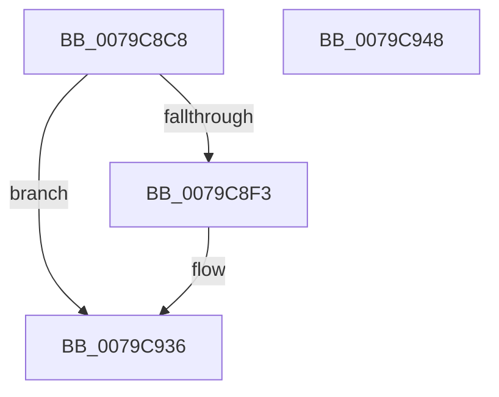

# BCryptImportKeyPair

- RVA: `0x0079C8C8`–`0x0079C949` (길이 `129` bytes)
- VA: `0x000000014079C8C8`
- 실행 섹션: `PAGE`
- PDB 이름 있음: `예`; PDB Function 태그: `아니요`
- unwind 정보 RVA: `0x00086C28`
- 디코드: `33`개 명령, `129/129` bytes 표시
- 미해석 바이트: `0` (있으면 어셈블리에 `.byte`로 보존)

> 이 문서는 커널 이미지의 기계어와 PDB 기호를 분석해 생성했습니다. 4번과 5번은 함수 원형과 자료형을 바이너리 사용 방식에서 추정한 C 해석이며 원본 소스 복구 결과는 아닙니다.

## 1. Dependencies

- 직접 호출 지점: **3**; 고유 호출 대상: **3**
- 직접 호출자로 확인된 함수: **1**
- RIP 상대 이미지 참조: **2**

### Outgoing calls
- `0x0079C8E9` → [ExGetExtensionTable](../../text/42/ExGetExtensionTable_function_00428814.md) (function, `0x00428814`)
- `0x0079C923` → [guard_dispatch_icall](../../text/6B/guard_dispatch_icall_function_006BAAD0.md) (function, `0x006BAAD0`)
- `0x0079C931` → [ExReleaseExtensionTable](../../text/45/ExReleaseExtensionTable_function_00456DC0.md) (function, `0x00456DC0`)

### Direct callers
- [SecureDump_EncryptSymmetricKeyWithPublicKey](../../text/5A/SecureDump_EncryptSymmetricKeyWithPublicKey_function_005A27A4.md) at `0x005A28CA`

### Static image references
- `0x0079C8DD` → RVA `0x00F04E30` (`.data`; read)
- `0x0079C8FA` → RVA `0x006CA910` (` ?? ::FNODOBFM::`string'`; read)

## 2. Other-region calls and transfers

- 다른 실행 섹션으로 향하는 call: **3**
  - `0x0079C8E9` → [ExGetExtensionTable](../../text/42/ExGetExtensionTable_function_00428814.md) (`PAGE` → `.text`)
  - `0x0079C923` → [guard_dispatch_icall](../../text/6B/guard_dispatch_icall_function_006BAAD0.md) (`PAGE` → `.text`)
  - `0x0079C931` → [ExReleaseExtensionTable](../../text/45/ExReleaseExtensionTable_function_00456DC0.md) (`PAGE` → `.text`)
- 별도 외부 분기/꼬리 이동을 확인하지 못했습니다.

## 3. Assembly (complete function range)

```asm
0079C8C8  48 89 5C 24 08                  mov qword ptr [rsp + 8], rbx
0079C8CD  48 89 74 24 10                  mov qword ptr [rsp + 0x10], rsi
0079C8D2  57                              push rdi
0079C8D3  48 83 EC 40                     sub rsp, 0x40
0079C8D7  48 8B F1                        mov rsi, rcx
0079C8DA  49 8B F9                        mov rdi, r9
0079C8DD  48 8B 0D 4C 85 76 00            mov rcx, qword ptr [rip + 0x76854c]
0079C8E4  BB 02 00 00 C0                  mov ebx, 0xc0000002
0079C8E9  E8 26 BF C8 FF                  call 0x140428814
0079C8EE  48 85 C0                        test rax, rax
0079C8F1  74 43                           je 0x14079c936
0079C8F3  4C 8B 90 C0 00 00 00            mov r10, qword ptr [rax + 0xc0]
0079C8FA  4C 8D 05 0F E0 F2 FF            lea r8, [rip - 0xd1ff1]
0079C901  8B 44 24 78                     mov eax, dword ptr [rsp + 0x78]
0079C905  4C 8B CF                        mov r9, rdi
0079C908  83 64 24 30 00                  and dword ptr [rsp + 0x30], 0
0079C90D  33 D2                           xor edx, edx
0079C90F  89 44 24 28                     mov dword ptr [rsp + 0x28], eax
0079C913  48 8B CE                        mov rcx, rsi
0079C916  48 8B 44 24 70                  mov rax, qword ptr [rsp + 0x70]
0079C91B  48 89 44 24 20                  mov qword ptr [rsp + 0x20], rax
0079C920  49 8B C2                        mov rax, r10
0079C923  E8 A8 E1 F1 FF                  call 0x1406baad0
0079C928  48 8B 0D 01 85 76 00            mov rcx, qword ptr [rip + 0x768501]
0079C92F  8B D8                           mov ebx, eax
0079C931  E8 8A A4 CB FF                  call 0x140456dc0
0079C936  48 8B 74 24 58                  mov rsi, qword ptr [rsp + 0x58]
0079C93B  8B C3                           mov eax, ebx
0079C93D  48 8B 5C 24 50                  mov rbx, qword ptr [rsp + 0x50]
0079C942  48 83 C4 40                     add rsp, 0x40
0079C946  5F                              pop rdi
0079C947  C3                              ret
0079C948  CC                              int3
```

## 4. C-style interpretation (structured pseudocode)

```c
__int64 __fastcall BCryptImportKeyPair(__int64 a1, int a2, __int64 a3, __int64 a4, __int64 a5, unsigned int a6)
{
    __int64 result;
    __int64 v_r10;
    __int64 v_rbx;
    __int64 v_rsp;
    unsigned int v_stack_m18;
    unsigned int v_stack_m20;
    unsigned __int64 v_stack_m28;
    unsigned __int64 v_stack_p10;
    unsigned __int64 v_stack_p8;

    v_stack_p8 = v_rbx;
    v_stack_p10 = v_rsi;
    v_rsp = (v_rsp) - (64);
    result = ExGetExtensionTable(*(unsigned __int64 *)(v_rip + 7767372), a2, a3, a4);
    v_rbx = (unsigned int)(0xC0000002ULL);
    if (result != 0) {
        v_r10 = *(unsigned __int64 *)(result + 192);
        a3 = v_rip - 860145;
        result = a6;
        a4 = a4;
        a2 = 0;
        v_stack_m20 = (unsigned int)(result);
        a1 = a1;
        result = a5;
        v_stack_m28 = result;
        result = v_r10;
        result = guard_dispatch_icall(a1, a2, a3, a4);
        a1 = *(unsigned __int64 *)(v_rip + 7767297);
        v_rbx = (unsigned int)(result);
        result = ExReleaseExtensionTable(a1, a2, a3, a4);
    }
    v_rsp = (v_rsp) + (64);
    return (unsigned int)((unsigned int)(v_rbx));
}
```

## 5. (Beta) C Style

```c
int64_t BCryptImportKeyPair(int64_t Arg1, int32_t Arg2, int64_t Arg3, int64_t Arg4, int64_t Arg5, uint32_t Arg6)
{
    int64_t result;
    int64_t local_r10;
    int64_t local_rbx;
    int64_t local_rsp;
    uint32_t v_stack_m18;
    uint32_t v_stack_m20;
    uint64_t v_stack_m28;
    uint64_t v_stack_p10;
    uint64_t v_stack_p8;

    v_stack_p8 = local_rbx;
    v_stack_p10 = local_rsi;
    local_rsp = (local_rsp) - (64);
    result = ExGetExtensionTable(*(uint64_t *)(v_rip + 0x76854C), Arg2, Arg3, Arg4);
    local_rbx = (uint32_t)(0xC0000002ULL);
    if (result != 0) {
        local_r10 = *(uint64_t *)(result + 0xC0);
        Arg3 = v_rip - 860145;
        result = Arg6;
        Arg4 = Arg4;
        Arg2 = 0;
        v_stack_m20 = (uint32_t)(result);
        Arg1 = Arg1;
        result = Arg5;
        v_stack_m28 = result;
        result = local_r10;
        result = guard_dispatch_icall(Arg1, Arg2, Arg3, Arg4);
        Arg1 = *(uint64_t *)(v_rip + 0x768501);
        local_rbx = (uint32_t)(result);
        result = ExReleaseExtensionTable(Arg1, Arg2, Arg3, Arg4);
    }
    local_rsp = (local_rsp) + (64);
    return (uint32_t)((uint32_t)(local_rbx));
}
```

## 6. Execution-region graph

[열기: 2D/3D 그래프와 함수 탐색 컨트롤 패널](../../../control-panel.html?section=page&rva=0x0079C8C8&view=graph)

- 2D 그래프는 위에서 아래로 흐르고, 3D 그래프는 빈 공간을 드래그해 회전합니다. Shift+드래그는 이동, 휠은 확대·축소, 함수 노드 선택은 대상 보고서 이동입니다.

### Static fallback


