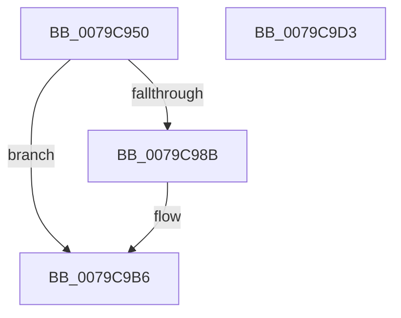

# BCryptSetProperty

- RVA: `0x0079C950`–`0x0079C9D4` (길이 `132` bytes)
- VA: `0x000000014079C950`
- 실행 섹션: `PAGE`
- PDB 이름 있음: `예`; PDB Function 태그: `아니요`
- unwind 정보 RVA: `0x0005D7BC`
- 디코드: `35`개 명령, `132/132` bytes 표시
- 미해석 바이트: `0` (있으면 어셈블리에 `.byte`로 보존)

> 이 문서는 커널 이미지의 기계어와 PDB 기호를 분석해 생성했습니다. 4번과 5번은 함수 원형과 자료형을 바이너리 사용 방식에서 추정한 C 해석이며 원본 소스 복구 결과는 아닙니다.

## 1. Dependencies

- 직접 호출 지점: **3**; 고유 호출 대상: **3**
- 직접 호출자로 확인된 함수: **2**
- RIP 상대 이미지 참조: **1**

### Outgoing calls
- `0x0079C981` → [ExGetExtensionTable](../../text/42/ExGetExtensionTable_function_00428814.md) (function, `0x00428814`)
- `0x0079C9A3` → [guard_dispatch_icall](../../text/6B/guard_dispatch_icall_function_006BAAD0.md) (function, `0x006BAAD0`)
- `0x0079C9B1` → [ExReleaseExtensionTable](../../text/45/ExReleaseExtensionTable_function_00456DC0.md) (function, `0x00456DC0`)

### Direct callers
- [SecureDump_SymmetricEncryptionSetup](../../text/5A/SecureDump_SymmetricEncryptionSetup_function_005A3774.md) at `0x005A3889`
- [SmCrEncStart](../7A/SmCrEncStart_function_007AA208.md) at `0x007AA365`

### Static image references
- `0x0079C96F` → RVA `0x00F04E30` (`.data`; read)

## 2. Other-region calls and transfers

- 다른 실행 섹션으로 향하는 call: **3**
  - `0x0079C981` → [ExGetExtensionTable](../../text/42/ExGetExtensionTable_function_00428814.md) (`PAGE` → `.text`)
  - `0x0079C9A3` → [guard_dispatch_icall](../../text/6B/guard_dispatch_icall_function_006BAAD0.md) (`PAGE` → `.text`)
  - `0x0079C9B1` → [ExReleaseExtensionTable](../../text/45/ExReleaseExtensionTable_function_00456DC0.md) (`PAGE` → `.text`)
- 별도 외부 분기/꼬리 이동을 확인하지 못했습니다.

## 3. Assembly (complete function range)

```asm
0079C950  48 8B C4                        mov rax, rsp
0079C953  48 89 58 08                     mov qword ptr [rax + 8], rbx
0079C957  48 89 68 10                     mov qword ptr [rax + 0x10], rbp
0079C95B  48 89 70 18                     mov qword ptr [rax + 0x18], rsi
0079C95F  48 89 78 20                     mov qword ptr [rax + 0x20], rdi
0079C963  41 56                           push r14
0079C965  48 83 EC 30                     sub rsp, 0x30
0079C969  4C 8B F1                        mov r14, rcx
0079C96C  41 8B F9                        mov edi, r9d
0079C96F  48 8B 0D BA 84 76 00            mov rcx, qword ptr [rip + 0x7684ba]
0079C976  49 8B F0                        mov rsi, r8
0079C979  48 8B EA                        mov rbp, rdx
0079C97C  BB 02 00 00 C0                  mov ebx, 0xc0000002
0079C981  E8 8E BE C8 FF                  call 0x140428814
0079C986  48 85 C0                        test rax, rax
0079C989  74 2B                           je 0x14079c9b6
0079C98B  48 8B 80 E8 00 00 00            mov rax, qword ptr [rax + 0xe8]
0079C992  44 8B CF                        mov r9d, edi
0079C995  83 64 24 20 00                  and dword ptr [rsp + 0x20], 0
0079C99A  4C 8B C6                        mov r8, rsi
0079C99D  48 8B D5                        mov rdx, rbp
0079C9A0  49 8B CE                        mov rcx, r14
0079C9A3  E8 28 E1 F1 FF                  call 0x1406baad0
0079C9A8  48 8B 0D 81 84 76 00            mov rcx, qword ptr [rip + 0x768481]
0079C9AF  8B D8                           mov ebx, eax
0079C9B1  E8 0A A4 CB FF                  call 0x140456dc0
0079C9B6  48 8B 6C 24 48                  mov rbp, qword ptr [rsp + 0x48]
0079C9BB  8B C3                           mov eax, ebx
0079C9BD  48 8B 5C 24 40                  mov rbx, qword ptr [rsp + 0x40]
0079C9C2  48 8B 74 24 50                  mov rsi, qword ptr [rsp + 0x50]
0079C9C7  48 8B 7C 24 58                  mov rdi, qword ptr [rsp + 0x58]
0079C9CC  48 83 C4 30                     add rsp, 0x30
0079C9D0  41 5E                           pop r14
0079C9D2  C3                              ret
0079C9D3  CC                              int3
```

## 4. C-style interpretation (structured pseudocode)

```c
__int64 __fastcall BCryptSetProperty(__int64 a1, __int64 a2, __int64 a3, int a4)
{
    __int64 result;
    __int64 v_rbx;
    __int64 v_rsp;
    unsigned int v_stack_m18;
    unsigned __int64 v_stack_p10;
    unsigned __int64 v_stack_p18;
    unsigned __int64 v_stack_p20;
    unsigned __int64 v_stack_p8;

    *(unsigned __int64 *)(v_rsp + 8) = v_rbx;
    *(unsigned __int64 *)(v_rsp + 16) = v_rbp;
    *(unsigned __int64 *)(v_rsp + 24) = v_rsi;
    *(unsigned __int64 *)(v_rsp + 32) = v_rdi;
    v_rsp = (v_rsp) - (48);
    result = ExGetExtensionTable(*(unsigned __int64 *)(v_rip + 7767226), a2, a3, a4);
    v_rbx = (unsigned int)(0xC0000002ULL);
    if (result != 0) {
        result = *(unsigned __int64 *)(result + 232);
        a4 = (unsigned int)((unsigned int)(a4));
        a3 = a3;
        a2 = a2;
        a1 = a1;
        result = guard_dispatch_icall(a1, a2, a3, a4);
        a1 = *(unsigned __int64 *)(v_rip + 7767169);
        v_rbx = (unsigned int)(result);
        result = ExReleaseExtensionTable(a1, a2, a3, a4);
    }
    v_rsp = (v_rsp) + (48);
    return (unsigned int)((unsigned int)(v_rbx));
}
```

## 5. (Beta) C Style

```c
int64_t BCryptSetProperty(int64_t Arg1, int64_t Arg2, int64_t Arg3, int32_t Arg4)
{
    int64_t result;
    int64_t local_rbx;
    int64_t local_rsp;
    uint32_t v_stack_m18;
    uint64_t v_stack_p10;
    uint64_t v_stack_p18;
    uint64_t v_stack_p20;
    uint64_t v_stack_p8;

    *(uint64_t *)(local_rsp + 0x8) = local_rbx;
    *(uint64_t *)(local_rsp + 0x10) = local_rbp;
    *(uint64_t *)(local_rsp + 0x18) = local_rsi;
    *(uint64_t *)(local_rsp + 0x20) = local_rdi;
    local_rsp = (local_rsp) - (48);
    result = ExGetExtensionTable(*(uint64_t *)(v_rip + 0x7684BA), Arg2, Arg3, Arg4);
    local_rbx = (uint32_t)(0xC0000002ULL);
    if (result != 0) {
        result = *(uint64_t *)(result + 0xE8);
        Arg4 = (uint32_t)((uint32_t)(Arg4));
        Arg3 = Arg3;
        Arg2 = Arg2;
        Arg1 = Arg1;
        result = guard_dispatch_icall(Arg1, Arg2, Arg3, Arg4);
        Arg1 = *(uint64_t *)(v_rip + 0x768481);
        local_rbx = (uint32_t)(result);
        result = ExReleaseExtensionTable(Arg1, Arg2, Arg3, Arg4);
    }
    local_rsp = (local_rsp) + (48);
    return (uint32_t)((uint32_t)(local_rbx));
}
```

## 6. Execution-region graph

[열기: 2D/3D 그래프와 함수 탐색 컨트롤 패널](../../../control-panel.html?section=page&rva=0x0079C950&view=graph)

- 2D 그래프는 위에서 아래로 흐르고, 3D 그래프는 빈 공간을 드래그해 회전합니다. Shift+드래그는 이동, 휠은 확대·축소, 함수 노드 선택은 대상 보고서 이동입니다.

### Static fallback


