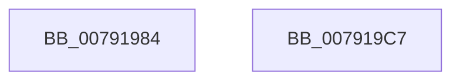

# LdrpOpenKey

- RVA: `0x00791984`–`0x007919C8` (길이 `68` bytes)
- VA: `0x0000000140791984`
- 실행 섹션: `PAGE`
- PDB 이름 있음: `예`; PDB Function 태그: `아니요`
- unwind 정보 RVA: `0x0005CC98`
- 디코드: `17`개 명령, `68/68` bytes 표시
- 미해석 바이트: `0` (있으면 어셈블리에 `.byte`로 보존)

> 이 문서는 커널 이미지의 기계어와 PDB 기호를 분석해 생성했습니다. 4번과 5번은 함수 원형과 자료형을 바이너리 사용 방식에서 추정한 C 해석이며 원본 소스 복구 결과는 아닙니다.

## 1. Dependencies

- 직접 호출 지점: **1**; 고유 호출 대상: **1**
- 직접 호출자로 확인된 함수: **4**
- RIP 상대 이미지 참조: **0**

### Outgoing calls
- `0x007919BD` → [ZwOpenKey](../../text/6A/ZwOpenKey_function_006AD310.md) (function, `0x006AD310`)

### Direct callers
- [RtlpMuiRegLoadInstalledFromKey](../../text/6A/RtlpMuiRegLoadInstalledFromKey_function_006A9450.md) at `0x006A94C0`
- [RtlpMuiRegLoadInstalledFromKey](../../text/6A/RtlpMuiRegLoadInstalledFromKey_function_006A9450.md) at `0x006A9540`
- [RtlpRemovePendingDeleteLanguages](../../text/6A/RtlpRemovePendingDeleteLanguages_function_006A9684.md) at `0x006A9702`
- [RtlpLoadInstallLanguageFallback](../83/RtlpLoadInstallLanguageFallback_function_0083D278.md) at `0x0083D31B`
- [RtlpLoadLanguageConfigList](../83/RtlpLoadLanguageConfigList_function_0083D450.md) at `0x0083D4B6`
- [RtlpLoadLanguageConfigList](../83/RtlpLoadLanguageConfigList_function_0083D450.md) at `0x0083D500`

### Static image references
- 디코드된 RIP-relative 메모리 참조가 없습니다.

## 2. Other-region calls and transfers

- 다른 실행 섹션으로 향하는 call: **1**
  - `0x007919BD` → [ZwOpenKey](../../text/6A/ZwOpenKey_function_006AD310.md) (`PAGE` → `.text`)
- 별도 외부 분기/꼬리 이동을 확인하지 못했습니다.

## 3. Assembly (complete function range)

```asm
00791984  4C 8B DC                        mov r11, rsp
00791987  48 83 EC 58                     sub rsp, 0x58
0079198B  49 89 53 D0                     mov qword ptr [r11 - 0x30], rdx
0079198F  4D 8D 43 C8                     lea r8, [r11 - 0x38]
00791993  49 89 4B D8                     mov qword ptr [r11 - 0x28], rcx
00791997  33 C0                           xor eax, eax
00791999  0F 57 C0                        xorps xmm0, xmm0
0079199C  49 C7 43 C8 30 00 00 00         mov qword ptr [r11 - 0x38], 0x30
007919A4  49 C7 43 E0 40 02 00 00         mov qword ptr [r11 - 0x20], 0x240
007919AC  BA 19 00 02 00                  mov edx, 0x20019
007919B1  49 8B C9                        mov rcx, r9
007919B4  49 89 01                        mov qword ptr [r9], rax
007919B7  F3 0F 7F 44 24 40               movdqu xmmword ptr [rsp + 0x40], xmm0
007919BD  E8 4E B9 F1 FF                  call 0x1406ad310
007919C2  48 83 C4 58                     add rsp, 0x58
007919C6  C3                              ret
007919C7  CC                              int3
```

## 4. C-style interpretation (structured pseudocode)

```c
__int64 __fastcall LdrpOpenKey(__int64 a1, __int64 a2, __int64 a3, __int64 a4)
{
    __int64 result;
    __int64 v_rsp;
    unsigned __int64 v_stack_m18;

    v_rsp = (v_rsp) - (88);
    *(unsigned __int64 *)(v_rsp - 48) = a2;
    *(unsigned __int64 *)(v_rsp - 40) = a1;
    result = 0;
    *(unsigned __int64 *)(v_rsp - 56) = 48;
    *(unsigned __int64 *)(v_rsp - 32) = 576;
    *(unsigned __int64 *)(a4) = 0;
    v_stack_m18 = v_xmm0;
    result = ZwOpenKey(a4, (unsigned int)(0x20019ULL), v_rsp - 56, a4);
    v_rsp = (v_rsp) + (88);
    return result;
}
```

## 5. (Beta) C Style

```c
int64_t LdrpOpenKey(int64_t Arg1, int64_t Arg2, int64_t Arg3, void *Arg4)
{
    uint8_t *arg4 = (uint8_t *)Arg4;

    int64_t result;
    int64_t local_rsp;
    uint64_t v_stack_m18;

    local_rsp = (local_rsp) - (88);
    *(uint64_t *)(local_rsp - 0x30) = Arg2;
    *(uint64_t *)(local_rsp - 0x28) = Arg1;
    result = 0;
    *(uint64_t *)(local_rsp - 0x38) = 48;
    *(uint64_t *)(local_rsp - 0x20) = 576;
    *(uint64_t *)(arg4) = 0;
    v_stack_m18 = v_xmm0;
    result = ZwOpenKey(Arg4, (uint32_t)(0x20019ULL), local_rsp - 56, Arg4);
    local_rsp = (local_rsp) + (88);
    return result;
}
```

### 관측된 메모리 오프셋

구조체 형식이 확인되지 않은 접근은 인자 기준의 오프셋으로만 기록했습니다.

| 기준 인자 | 오프셋 표현 | 폭 (bit) | 접근 |
|---|---:|---:|---|
| `Arg4` | `+ 0x0` | `64` | `W` |

## 6. Execution-region graph

[열기: 2D/3D 그래프와 함수 탐색 컨트롤 패널](../../../control-panel.html?section=page&rva=0x00791984&view=graph)

- 2D 그래프는 위에서 아래로 흐르고, 3D 그래프는 빈 공간을 드래그해 회전합니다. Shift+드래그는 이동, 휠은 확대·축소, 함수 노드 선택은 대상 보고서 이동입니다.

### Static fallback


