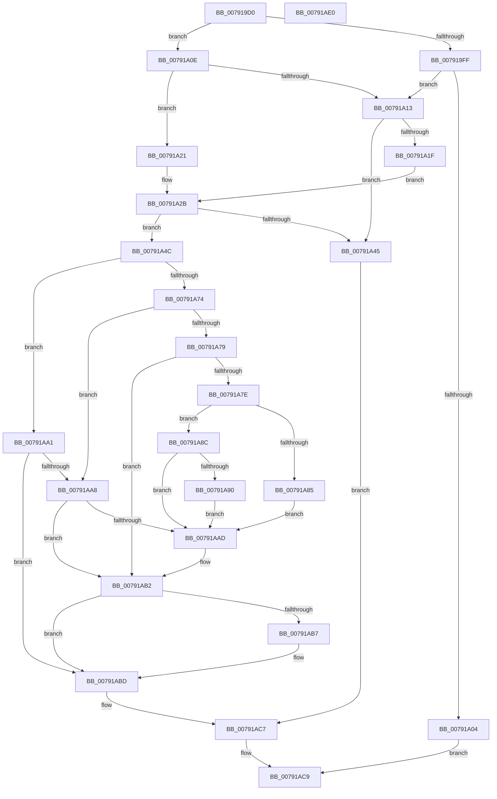

# LdrpQueryValueKey

- RVA: `0x007919D0`–`0x00791AE1` (길이 `273` bytes)
- VA: `0x00000001407919D0`
- 실행 섹션: `PAGE`
- PDB 이름 있음: `예`; PDB Function 태그: `아니요`
- unwind 정보 RVA: `0x000733F8`
- 디코드: `88`개 명령, `273/273` bytes 표시
- 미해석 바이트: `0` (있으면 어셈블리에 `.byte`로 보존)

> 이 문서는 커널 이미지의 기계어와 PDB 기호를 분석해 생성했습니다. 4번과 5번은 함수 원형과 자료형을 바이너리 사용 방식에서 추정한 C 해석이며 원본 소스 복구 결과는 아닙니다.

## 1. Dependencies

- 직접 호출 지점: **4**; 고유 호출 대상: **4**
- 직접 호출자로 확인된 함수: **6**
- RIP 상대 이미지 참조: **0**

### Outgoing calls
- `0x00791A38` → [ExAllocatePool2](../../poolcode/B8/ExAllocatePool2_function_00B820F0.md) (function, `0x00B820F0`)
- `0x00791A69` → [ZwQueryValueKey](../../text/6A/ZwQueryValueKey_function_006AD3B0.md) (function, `0x006AD3B0`)
- `0x00791A9A` → [memcpy](../../text/6C/memcpy_function_006C6840.md) (function, `0x006C6840`)
- `0x00791AC2` → [ExFreePoolWithTag](../../poolcode/B8/ExFreePoolWithTag_function_00B82870.md) (function, `0x00B82870`)

### Direct callers
- [RtlpMuiRegAddAlternateCodePage](../../text/6A/RtlpMuiRegAddAlternateCodePage_function_006A8EE4.md) at `0x006A8F41`
- [RtlpMuiRegAddAlternateCodePage](../../text/6A/RtlpMuiRegAddAlternateCodePage_function_006A8EE4.md) at `0x006A8FB1`
- [RtlpMuiRegLoadInstalledFromKey](../../text/6A/RtlpMuiRegLoadInstalledFromKey_function_006A9450.md) at `0x006A9584`
- [RtlpLoadInstallLanguageFallback](../83/RtlpLoadInstallLanguageFallback_function_0083D278.md) at `0x0083D355`
- [RtlpLoadPolicyLanguageSpec](../83/RtlpLoadPolicyLanguageSpec_function_0083D594.md) at `0x0083D61C`
- [RtlpLoadPolicyLanguageSpec](../83/RtlpLoadPolicyLanguageSpec_function_0083D594.md) at `0x0083D672`
- [RtlpMuiRegInitLIPLanguage](../83/RtlpMuiRegInitLIPLanguage_function_0083F8D8.md) at `0x0083F991`
- [RtlpMuiRegInitLIPLanguage](../83/RtlpMuiRegInitLIPLanguage_function_0083F8D8.md) at `0x0083F9C9`
- [RtlpMuiRegPopulateBaseLanguages](../83/RtlpMuiRegPopulateBaseLanguages_function_0083FC4C.md) at `0x0083FE78`

### Static image references
- 디코드된 RIP-relative 메모리 참조가 없습니다.

## 2. Other-region calls and transfers

- 다른 실행 섹션으로 향하는 call: **4**
  - `0x00791A38` → [ExAllocatePool2](../../poolcode/B8/ExAllocatePool2_function_00B820F0.md) (`PAGE` → `POOLCODE`)
  - `0x00791A69` → [ZwQueryValueKey](../../text/6A/ZwQueryValueKey_function_006AD3B0.md) (`PAGE` → `.text`)
  - `0x00791A9A` → [memcpy](../../text/6C/memcpy_function_006C6840.md) (`PAGE` → `.text`)
  - `0x00791AC2` → [ExFreePoolWithTag](../../poolcode/B8/ExFreePoolWithTag_function_00B82870.md) (`PAGE` → `POOLCODE`)
- 별도 외부 분기/꼬리 이동을 확인하지 못했습니다.

## 3. Assembly (complete function range)

```asm
007919D0  48 89 5C 24 08                  mov qword ptr [rsp + 8], rbx
007919D5  48 89 6C 24 10                  mov qword ptr [rsp + 0x10], rbp
007919DA  56                              push rsi
007919DB  57                              push rdi
007919DC  41 54                           push r12
007919DE  41 56                           push r14
007919E0  41 57                           push r15
007919E2  48 83 EC 30                     sub rsp, 0x30
007919E6  48 8B 9C 24 80 00 00 00         mov rbx, qword ptr [rsp + 0x80]
007919EE  4D 8B F1                        mov r14, r9
007919F1  4D 8B F8                        mov r15, r8
007919F4  48 8B FA                        mov rdi, rdx
007919F7  4C 8B E1                        mov r12, rcx
007919FA  4D 85 C9                        test r9, r9
007919FD  74 0F                           je 0x140791a0e
007919FF  48 85 DB                        test rbx, rbx
00791A02  75 0F                           jne 0x140791a13
00791A04  B8 0D 00 00 C0                  mov eax, 0xc000000d
00791A09  E9 BB 00 00 00                  jmp 0x140791ac9
00791A0E  48 85 DB                        test rbx, rbx
00791A11  74 0E                           je 0x140791a21
00791A13  8B 2B                           mov ebp, dword ptr [rbx]
00791A15  83 64 24 78 00                  and dword ptr [rsp + 0x78], 0
00791A1A  83 C5 0C                        add ebp, 0xc
00791A1D  74 26                           je 0x140791a45
00791A1F  EB 0A                           jmp 0x140791a2b
00791A21  83 64 24 78 00                  and dword ptr [rsp + 0x78], 0
00791A26  BD 0C 00 00 00                  mov ebp, 0xc
00791A2B  8B D5                           mov edx, ebp
00791A2D  B9 00 01 00 00                  mov ecx, 0x100
00791A32  41 B8 6D 6C 74 72               mov r8d, 0x72746c6d
00791A38  E8 B3 06 3F 00                  call 0x140b820f0
00791A3D  48 8B F0                        mov rsi, rax
00791A40  48 85 C0                        test rax, rax
00791A43  75 07                           jne 0x140791a4c
00791A45  BF 9A 00 00 C0                  mov edi, 0xc000009a
00791A4A  EB 7B                           jmp 0x140791ac7
00791A4C  48 8D 44 24 78                  lea rax, [rsp + 0x78]
00791A51  4C 8B CE                        mov r9, rsi
00791A54  48 89 44 24 28                  mov qword ptr [rsp + 0x28], rax
00791A59  41 B8 02 00 00 00               mov r8d, 2
00791A5F  48 8B D7                        mov rdx, rdi
00791A62  89 6C 24 20                     mov dword ptr [rsp + 0x20], ebp
00791A66  49 8B CC                        mov rcx, r12
00791A69  E8 42 B9 F1 FF                  call 0x1406ad3b0
00791A6E  8B F8                           mov edi, eax
00791A70  85 C0                           test eax, eax
00791A72  78 2D                           js 0x140791aa1
00791A74  4D 85 F6                        test r14, r14
00791A77  74 2F                           je 0x140791aa8
00791A79  48 85 DB                        test rbx, rbx
00791A7C  74 34                           je 0x140791ab2
00791A7E  8B 46 08                        mov eax, dword ptr [rsi + 8]
00791A81  3B 03                           cmp eax, dword ptr [rbx]
00791A83  76 07                           jbe 0x140791a8c
00791A85  BF 05 00 00 80                  mov edi, 0x80000005
00791A8A  EB 21                           jmp 0x140791aad
00791A8C  3B C5                           cmp eax, ebp
00791A8E  77 1D                           ja 0x140791aad
00791A90  4C 8B C0                        mov r8, rax
00791A93  48 8D 56 0C                     lea rdx, [rsi + 0xc]
00791A97  49 8B CE                        mov rcx, r14
00791A9A  E8 A1 4D F3 FF                  call 0x1406c6840
00791A9F  EB 0C                           jmp 0x140791aad
00791AA1  3D 05 00 00 80                  cmp eax, 0x80000005
00791AA6  75 15                           jne 0x140791abd
00791AA8  48 85 DB                        test rbx, rbx
00791AAB  74 05                           je 0x140791ab2
00791AAD  8B 46 08                        mov eax, dword ptr [rsi + 8]
00791AB0  89 03                           mov dword ptr [rbx], eax
00791AB2  4D 85 FF                        test r15, r15
00791AB5  74 06                           je 0x140791abd
00791AB7  8B 46 04                        mov eax, dword ptr [rsi + 4]
00791ABA  41 89 07                        mov dword ptr [r15], eax
00791ABD  33 D2                           xor edx, edx
00791ABF  48 8B CE                        mov rcx, rsi
00791AC2  E8 A9 0D 3F 00                  call 0x140b82870
00791AC7  8B C7                           mov eax, edi
00791AC9  48 8B 5C 24 60                  mov rbx, qword ptr [rsp + 0x60]
00791ACE  48 8B 6C 24 68                  mov rbp, qword ptr [rsp + 0x68]
00791AD3  48 83 C4 30                     add rsp, 0x30
00791AD7  41 5F                           pop r15
00791AD9  41 5E                           pop r14
00791ADB  41 5C                           pop r12
00791ADD  5F                              pop rdi
00791ADE  5E                              pop rsi
00791ADF  C3                              ret
00791AE0  CC                              int3
```

## 4. C-style interpretation (structured pseudocode)

```c
__int64 __fastcall LdrpQueryValueKey(__int64 a1, __int64 a2, __int64 a3, __int64 a4, __int64 a5)
{
    __int64 result;
    __int64 v_rbp;
    __int64 v_rsp;
    unsigned __int64 v_stack_m30;
    unsigned int v_stack_m38;
    unsigned __int64 v_stack_p10;
    unsigned int v_stack_p20;
    unsigned __int64 v_stack_p8;

    v_stack_p8 = v_rbx;
    v_stack_p10 = v_rbp;
    v_rsp = (v_rsp) - (48);
    if (a4 == 0) goto loc_00791A0E;
    if (a5 != 0) goto loc_00791A13;
    goto loc_00791AC9;
loc_00791A0E:
    if (a5 == 0) goto loc_00791A21;
loc_00791A13:
    v_rbp = (unsigned int)(((unsigned int)(*(unsigned int *)(a5))) + (12));
    if (condition_is_equal) goto loc_00791A45;
    goto loc_00791A2B;
loc_00791A21:
loc_00791A2B:
    result = ExAllocatePool2(256, 12, (unsigned int)(0x72746C6DULL), a4);
    if (result != 0) goto loc_00791A4C;
loc_00791A45:
    goto loc_00791AC7;
loc_00791A4C:
    v_stack_m30 = v_stack_p20;
    v_stack_m38 = 12;
    result = ZwQueryValueKey(a1, (unsigned int)(0xC000009AULL), 2, result);
    if (sign_flag) goto loc_00791AA1;
    if (a4 == 0) goto loc_00791AA8;
    if (a5 == 0) goto loc_00791AB2;
    if (((unsigned int)((unsigned int)(*(unsigned int *)(result + 8)))) <= (*(unsigned int *)(a5))) goto loc_00791A8C;
    goto loc_00791AAD;
loc_00791A8C:
    if (((unsigned int)((unsigned int)(*(unsigned int *)(result + 8)))) > 12) goto loc_00791AAD;
    result = memcpy(a4, result + 12, (unsigned int)(*(unsigned int *)(result + 8)), result);
    goto loc_00791AAD;
loc_00791AA1:
    if (((unsigned int)(result)) != 0x80000005ULL) goto loc_00791ABD;
loc_00791AA8:
    if (a5 != 0) {
        result = *(unsigned int *)(result + 8);
        *(unsigned int *)(a5) = (unsigned int)(result);
    }
    if (a3 != 0) {
        result = *(unsigned int *)(result + 4);
        *(unsigned int *)(a3) = (unsigned int)(result);
    }
    a2 = 0;
    result = ExFreePoolWithTag(result, a2, (unsigned int)(*(unsigned int *)(result + 8)), result);
loc_00791AC7:
loc_00791AC9:
    v_rsp = (v_rsp) + (48);
    return (unsigned int)((unsigned int)((unsigned int)(0x80000005ULL)));
}
```

## 5. (Beta) C Style

```c
int64_t LdrpQueryValueKey(int64_t Arg1, int64_t Arg2, int64_t Arg3, int64_t Arg4, int64_t Arg5)
{
    int64_t result;
    int64_t local_rbp;
    int64_t local_rsp;
    uint64_t v_stack_m30;
    uint32_t v_stack_m38;
    uint64_t v_stack_p10;
    uint32_t v_stack_p20;
    uint64_t v_stack_p8;

    v_stack_p8 = local_rbx;
    v_stack_p10 = local_rbp;
    local_rsp = (local_rsp) - (48);
    if (Arg4 == 0) goto loc_00791A0E;
    if (Arg5 != 0) goto loc_00791A13;
    goto loc_00791AC9;
loc_00791A0E:
    if (Arg5 == 0) goto loc_00791A21;
loc_00791A13:
    local_rbp = (uint32_t)(((uint32_t)(*(uint32_t *)(Arg5))) + (12));
    if (condition_is_equal) goto loc_00791A45;
    goto loc_00791A2B;
loc_00791A21:
loc_00791A2B:
    result = ExAllocatePool2(256, 12, (uint32_t)(0x72746C6DULL), Arg4);
    if (result != 0) goto loc_00791A4C;
loc_00791A45:
    goto loc_00791AC7;
loc_00791A4C:
    v_stack_m30 = v_stack_p20;
    v_stack_m38 = 12;
    result = ZwQueryValueKey(Arg1, (uint32_t)(0xC000009AULL), 2, result);
    if (sign_flag) goto loc_00791AA1;
    if (Arg4 == 0) goto loc_00791AA8;
    if (Arg5 == 0) goto loc_00791AB2;
    if (((uint32_t)((uint32_t)(*(uint32_t *)(result + 0x8)))) <= (*(uint32_t *)(Arg5))) goto loc_00791A8C;
    goto loc_00791AAD;
loc_00791A8C:
    if (((uint32_t)((uint32_t)(*(uint32_t *)(result + 0x8)))) > 12) goto loc_00791AAD;
    result = memcpy(Arg4, result + 12, (uint32_t)(*(uint32_t *)(result + 0x8)), result);
    goto loc_00791AAD;
loc_00791AA1:
    if (((uint32_t)(result)) != 0x80000005ULL) goto loc_00791ABD;
loc_00791AA8:
    if (Arg5 != 0) {
        result = *(uint32_t *)(result + 0x8);
        *(uint32_t *)(Arg5) = (uint32_t)(result);
    }
    if (Arg3 != 0) {
        result = *(uint32_t *)(result + 0x4);
        *(uint32_t *)(Arg3) = (uint32_t)(result);
    }
    Arg2 = 0;
    result = ExFreePoolWithTag(result, Arg2, (uint32_t)(*(uint32_t *)(result + 0x8)), result);
loc_00791AC7:
loc_00791AC9:
    local_rsp = (local_rsp) + (48);
    return (uint32_t)((uint32_t)((uint32_t)(0x80000005ULL)));
}
```

## 6. Execution-region graph

[열기: 2D/3D 그래프와 함수 탐색 컨트롤 패널](../../../control-panel.html?section=page&rva=0x007919D0&view=graph)

- 2D 그래프는 위에서 아래로 흐르고, 3D 그래프는 빈 공간을 드래그해 회전합니다. Shift+드래그는 이동, 휠은 확대·축소, 함수 노드 선택은 대상 보고서 이동입니다.

### Static fallback


