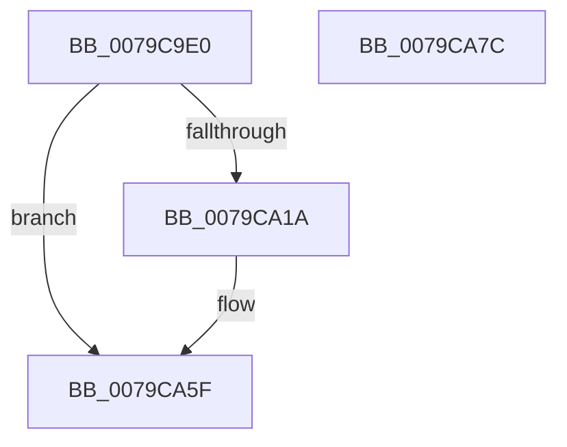

# LsaCallAuthenticationPackage

- RVA: `0x0079C9E0`–`0x0079CA7D` (길이 `157` bytes)
- VA: `0x000000014079C9E0`
- 실행 섹션: `PAGE`
- PDB 이름 있음: `예`; PDB Function 태그: `아니요`
- unwind 정보 RVA: `0x00060130`
- 디코드: `41`개 명령, `157/157` bytes 표시
- 미해석 바이트: `0` (있으면 어셈블리에 `.byte`로 보존)

> 이 문서는 커널 이미지의 기계어와 PDB 기호를 분석해 생성했습니다. 4번과 5번은 함수 원형과 자료형을 바이너리 사용 방식에서 추정한 C 해석이며 원본 소스 복구 결과는 아닙니다.

## 1. Dependencies

- 직접 호출 지점: **3**; 고유 호출 대상: **3**
- 직접 호출자로 확인된 함수: **0**
- RIP 상대 이미지 참조: **1**

### Outgoing calls
- `0x0079CA10` → [ExGetExtensionTable](../../text/42/ExGetExtensionTable_function_00428814.md) (function, `0x00428814`)
- `0x0079CA4C` → [guard_dispatch_icall](../../text/6B/guard_dispatch_icall_function_006BAAD0.md) (function, `0x006BAAD0`)
- `0x0079CA5A` → [ExReleaseExtensionTable](../../text/45/ExReleaseExtensionTable_function_00456DC0.md) (function, `0x00456DC0`)

### Direct callers
- 이 함수 시작 RVA로 연결되는 직접 call은 확인되지 않았습니다. 간접 호출은 완전히 역산할 수 없습니다.

### Static image references
- `0x0079C9FF` → RVA `0x00F04E28` (`.data`; read)

## 2. Other-region calls and transfers

- 다른 실행 섹션으로 향하는 call: **3**
  - `0x0079CA10` → [ExGetExtensionTable](../../text/42/ExGetExtensionTable_function_00428814.md) (`PAGE` → `.text`)
  - `0x0079CA4C` → [guard_dispatch_icall](../../text/6B/guard_dispatch_icall_function_006BAAD0.md) (`PAGE` → `.text`)
  - `0x0079CA5A` → [ExReleaseExtensionTable](../../text/45/ExReleaseExtensionTable_function_00456DC0.md) (`PAGE` → `.text`)
- 별도 외부 분기/꼬리 이동을 확인하지 못했습니다.

## 3. Assembly (complete function range)

```asm
0079C9E0  48 8B C4                        mov rax, rsp
0079C9E3  48 89 58 08                     mov qword ptr [rax + 8], rbx
0079C9E7  48 89 68 10                     mov qword ptr [rax + 0x10], rbp
0079C9EB  48 89 70 18                     mov qword ptr [rax + 0x18], rsi
0079C9EF  48 89 78 20                     mov qword ptr [rax + 0x20], rdi
0079C9F3  41 56                           push r14
0079C9F5  48 83 EC 40                     sub rsp, 0x40
0079C9F9  4C 8B F1                        mov r14, rcx
0079C9FC  41 8B F9                        mov edi, r9d
0079C9FF  48 8B 0D 22 84 76 00            mov rcx, qword ptr [rip + 0x768422]
0079CA06  49 8B F0                        mov rsi, r8
0079CA09  8B EA                           mov ebp, edx
0079CA0B  BB 02 00 00 C0                  mov ebx, 0xc0000002
0079CA10  E8 FF BD C8 FF                  call 0x140428814
0079CA15  48 85 C0                        test rax, rax
0079CA18  74 45                           je 0x14079ca5f
0079CA1A  4C 8B 10                        mov r10, qword ptr [rax]
0079CA1D  44 8B CF                        mov r9d, edi
0079CA20  48 8B 84 24 80 00 00 00         mov rax, qword ptr [rsp + 0x80]
0079CA28  4C 8B C6                        mov r8, rsi
0079CA2B  48 89 44 24 30                  mov qword ptr [rsp + 0x30], rax
0079CA30  8B D5                           mov edx, ebp
0079CA32  48 8B 44 24 78                  mov rax, qword ptr [rsp + 0x78]
0079CA37  49 8B CE                        mov rcx, r14
0079CA3A  48 89 44 24 28                  mov qword ptr [rsp + 0x28], rax
0079CA3F  48 8B 44 24 70                  mov rax, qword ptr [rsp + 0x70]
0079CA44  48 89 44 24 20                  mov qword ptr [rsp + 0x20], rax
0079CA49  49 8B C2                        mov rax, r10
0079CA4C  E8 7F E0 F1 FF                  call 0x1406baad0
0079CA51  48 8B 0D D0 83 76 00            mov rcx, qword ptr [rip + 0x7683d0]
0079CA58  8B D8                           mov ebx, eax
0079CA5A  E8 61 A3 CB FF                  call 0x140456dc0
0079CA5F  48 8B 6C 24 58                  mov rbp, qword ptr [rsp + 0x58]
0079CA64  8B C3                           mov eax, ebx
0079CA66  48 8B 5C 24 50                  mov rbx, qword ptr [rsp + 0x50]
0079CA6B  48 8B 74 24 60                  mov rsi, qword ptr [rsp + 0x60]
0079CA70  48 8B 7C 24 68                  mov rdi, qword ptr [rsp + 0x68]
0079CA75  48 83 C4 40                     add rsp, 0x40
0079CA79  41 5E                           pop r14
0079CA7B  C3                              ret
0079CA7C  CC                              int3
```

## 4. C-style interpretation (structured pseudocode)

```c
__int64 __fastcall LsaCallAuthenticationPackage(__int64 a1, int a2, __int64 a3, int a4, __int64 a5, __int64 a6, __int64 a7)
{
    __int64 result;
    __int64 v_r10;
    __int64 v_rbx;
    __int64 v_rsp;
    unsigned __int64 v_stack_m18;
    unsigned __int64 v_stack_m20;
    unsigned __int64 v_stack_m28;
    unsigned __int64 v_stack_p10;
    unsigned __int64 v_stack_p18;
    unsigned __int64 v_stack_p20;
    unsigned __int64 v_stack_p8;

    *(unsigned __int64 *)(v_rsp + 8) = v_rbx;
    *(unsigned __int64 *)(v_rsp + 16) = v_rbp;
    *(unsigned __int64 *)(v_rsp + 24) = v_rsi;
    *(unsigned __int64 *)(v_rsp + 32) = v_rdi;
    v_rsp = (v_rsp) - (64);
    result = ExGetExtensionTable(*(unsigned __int64 *)(v_rip + 7767074), a2, a3, a4);
    v_rbx = (unsigned int)(0xC0000002ULL);
    if (result != 0) {
        v_r10 = *(unsigned __int64 *)(result);
        a4 = (unsigned int)((unsigned int)(a4));
        result = a7;
        a3 = a3;
        v_stack_m18 = result;
        a2 = (unsigned int)((unsigned int)(a2));
        result = a6;
        a1 = a1;
        v_stack_m20 = result;
        result = a5;
        v_stack_m28 = result;
        result = v_r10;
        result = guard_dispatch_icall(a1, a2, a3, a4);
        a1 = *(unsigned __int64 *)(v_rip + 7766992);
        v_rbx = (unsigned int)(result);
        result = ExReleaseExtensionTable(a1, a2, a3, a4);
    }
    v_rsp = (v_rsp) + (64);
    return (unsigned int)((unsigned int)(v_rbx));
}
```

## 5. (Beta) C Style

```c
int64_t LsaCallAuthenticationPackage(int64_t Arg1, int32_t Arg2, int64_t Arg3, int32_t Arg4, int64_t Arg5, int64_t Arg6, int64_t Arg7)
{
    int64_t result;
    int64_t local_r10;
    int64_t local_rbx;
    int64_t local_rsp;
    uint64_t v_stack_m18;
    uint64_t v_stack_m20;
    uint64_t v_stack_m28;
    uint64_t v_stack_p10;
    uint64_t v_stack_p18;
    uint64_t v_stack_p20;
    uint64_t v_stack_p8;

    *(uint64_t *)(local_rsp + 0x8) = local_rbx;
    *(uint64_t *)(local_rsp + 0x10) = local_rbp;
    *(uint64_t *)(local_rsp + 0x18) = local_rsi;
    *(uint64_t *)(local_rsp + 0x20) = local_rdi;
    local_rsp = (local_rsp) - (64);
    result = ExGetExtensionTable(*(uint64_t *)(v_rip + 0x768422), Arg2, Arg3, Arg4);
    local_rbx = (uint32_t)(0xC0000002ULL);
    if (result != 0) {
        local_r10 = *(uint64_t *)(result);
        Arg4 = (uint32_t)((uint32_t)(Arg4));
        result = Arg7;
        Arg3 = Arg3;
        v_stack_m18 = result;
        Arg2 = (uint32_t)((uint32_t)(Arg2));
        result = Arg6;
        Arg1 = Arg1;
        v_stack_m20 = result;
        result = Arg5;
        v_stack_m28 = result;
        result = local_r10;
        result = guard_dispatch_icall(Arg1, Arg2, Arg3, Arg4);
        Arg1 = *(uint64_t *)(v_rip + 0x7683D0);
        local_rbx = (uint32_t)(result);
        result = ExReleaseExtensionTable(Arg1, Arg2, Arg3, Arg4);
    }
    local_rsp = (local_rsp) + (64);
    return (uint32_t)((uint32_t)(local_rbx));
}
```

## 6. Execution-region graph

[열기: 2D/3D 그래프와 함수 탐색 컨트롤 패널](../../../control-panel.html?section=page&rva=0x0079C9E0&view=graph)

- 2D 그래프는 위에서 아래로 흐르고, 3D 그래프는 빈 공간을 드래그해 회전합니다. Shift+드래그는 이동, 휠은 확대·축소, 함수 노드 선택은 대상 보고서 이동입니다.

### Static fallback


