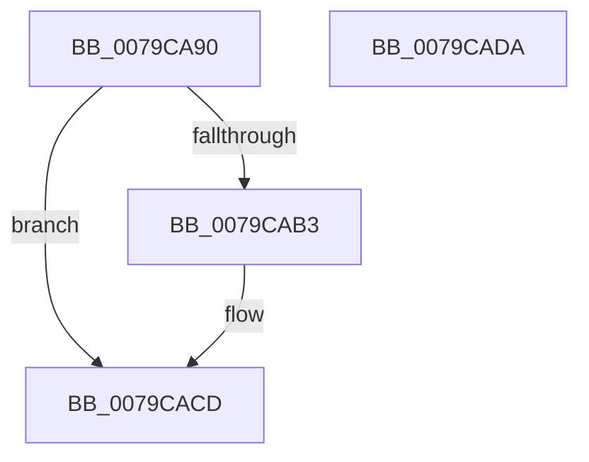

# LsaDeregisterLogonProcess

- RVA: `0x0079CA90`–`0x0079CADB` (길이 `75` bytes)
- VA: `0x000000014079CA90`
- 실행 섹션: `PAGE`
- PDB 이름 있음: `예`; PDB Function 태그: `아니요`
- unwind 정보 RVA: `0x0005CAAC`
- 디코드: `21`개 명령, `75/75` bytes 표시
- 미해석 바이트: `0` (있으면 어셈블리에 `.byte`로 보존)

> 이 문서는 커널 이미지의 기계어와 PDB 기호를 분석해 생성했습니다. 4번과 5번은 함수 원형과 자료형을 바이너리 사용 방식에서 추정한 C 해석이며 원본 소스 복구 결과는 아닙니다.

## 1. Dependencies

- 직접 호출 지점: **3**; 고유 호출 대상: **3**
- 직접 호출자로 확인된 함수: **0**
- RIP 상대 이미지 참조: **1**

### Outgoing calls
- `0x0079CAA9` → [ExGetExtensionTable](../../text/42/ExGetExtensionTable_function_00428814.md) (function, `0x00428814`)
- `0x0079CABA` → [guard_dispatch_icall](../../text/6B/guard_dispatch_icall_function_006BAAD0.md) (function, `0x006BAAD0`)
- `0x0079CAC8` → [ExReleaseExtensionTable](../../text/45/ExReleaseExtensionTable_function_00456DC0.md) (function, `0x00456DC0`)

### Direct callers
- 이 함수 시작 RVA로 연결되는 직접 call은 확인되지 않았습니다. 간접 호출은 완전히 역산할 수 없습니다.

### Static image references
- `0x0079CAA2` → RVA `0x00F04E28` (`.data`; read)

## 2. Other-region calls and transfers

- 다른 실행 섹션으로 향하는 call: **3**
  - `0x0079CAA9` → [ExGetExtensionTable](../../text/42/ExGetExtensionTable_function_00428814.md) (`PAGE` → `.text`)
  - `0x0079CABA` → [guard_dispatch_icall](../../text/6B/guard_dispatch_icall_function_006BAAD0.md) (`PAGE` → `.text`)
  - `0x0079CAC8` → [ExReleaseExtensionTable](../../text/45/ExReleaseExtensionTable_function_00456DC0.md) (`PAGE` → `.text`)
- 별도 외부 분기/꼬리 이동을 확인하지 못했습니다.

## 3. Assembly (complete function range)

```asm
0079CA90  48 89 5C 24 08                  mov qword ptr [rsp + 8], rbx
0079CA95  57                              push rdi
0079CA96  48 83 EC 20                     sub rsp, 0x20
0079CA9A  48 8B F9                        mov rdi, rcx
0079CA9D  BB 02 00 00 C0                  mov ebx, 0xc0000002
0079CAA2  48 8B 0D 7F 83 76 00            mov rcx, qword ptr [rip + 0x76837f]
0079CAA9  E8 66 BD C8 FF                  call 0x140428814
0079CAAE  48 85 C0                        test rax, rax
0079CAB1  74 1A                           je 0x14079cacd
0079CAB3  48 8B 40 08                     mov rax, qword ptr [rax + 8]
0079CAB7  48 8B CF                        mov rcx, rdi
0079CABA  E8 11 E0 F1 FF                  call 0x1406baad0
0079CABF  48 8B 0D 62 83 76 00            mov rcx, qword ptr [rip + 0x768362]
0079CAC6  8B D8                           mov ebx, eax
0079CAC8  E8 F3 A2 CB FF                  call 0x140456dc0
0079CACD  8B C3                           mov eax, ebx
0079CACF  48 8B 5C 24 30                  mov rbx, qword ptr [rsp + 0x30]
0079CAD4  48 83 C4 20                     add rsp, 0x20
0079CAD8  5F                              pop rdi
0079CAD9  C3                              ret
0079CADA  CC                              int3
```

## 4. C-style interpretation (structured pseudocode)

```c
__int64 __fastcall LsaDeregisterLogonProcess(__int64 a1)
{
    __int64 result;
    __int64 v_rbx;
    __int64 v_rsp;
    unsigned __int64 v_stack_p8;

    v_stack_p8 = v_rbx;
    v_rsp = (v_rsp) - (32);
    result = ExGetExtensionTable(*(unsigned __int64 *)(v_rip + 7766911), a2, a3, a4);
    v_rbx = (unsigned int)(0xC0000002ULL);
    if (result != 0) {
        result = *(unsigned __int64 *)(result + 8);
        a1 = a1;
        result = guard_dispatch_icall(a1, a2, a3, a4);
        a1 = *(unsigned __int64 *)(v_rip + 7766882);
        v_rbx = (unsigned int)(result);
        result = ExReleaseExtensionTable(a1, a2, a3, a4);
    }
    v_rsp = (v_rsp) + (32);
    return (unsigned int)((unsigned int)(v_rbx));
}
```

## 5. (Beta) C Style

```c
int64_t LsaDeregisterLogonProcess(int64_t Arg1)
{
    int64_t result;
    int64_t local_rbx;
    int64_t local_rsp;
    uint64_t v_stack_p8;

    v_stack_p8 = local_rbx;
    local_rsp = (local_rsp) - (32);
    result = ExGetExtensionTable(*(uint64_t *)(v_rip + 0x76837F), a2, a3, a4);
    local_rbx = (uint32_t)(0xC0000002ULL);
    if (result != 0) {
        result = *(uint64_t *)(result + 0x8);
        Arg1 = Arg1;
        result = guard_dispatch_icall(Arg1, a2, a3, a4);
        Arg1 = *(uint64_t *)(v_rip + 0x768362);
        local_rbx = (uint32_t)(result);
        result = ExReleaseExtensionTable(Arg1, a2, a3, a4);
    }
    local_rsp = (local_rsp) + (32);
    return (uint32_t)((uint32_t)(local_rbx));
}
```

## 6. Execution-region graph

[열기: 2D/3D 그래프와 함수 탐색 컨트롤 패널](../../../control-panel.html?section=page&rva=0x0079CA90&view=graph)

- 2D 그래프는 위에서 아래로 흐르고, 3D 그래프는 빈 공간을 드래그해 회전합니다. Shift+드래그는 이동, 휠은 확대·축소, 함수 노드 선택은 대상 보고서 이동입니다.

### Static fallback


