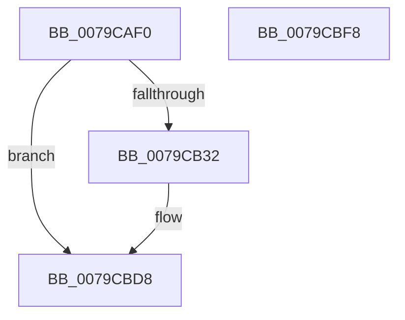

# LsaLogonUser

- RVA: `0x0079CAF0`–`0x0079CBF9` (길이 `265` bytes)
- VA: `0x000000014079CAF0`
- 실행 섹션: `PAGE`
- PDB 이름 있음: `예`; PDB Function 태그: `아니요`
- unwind 정보 RVA: `0x00068E0C`
- 디코드: `56`개 명령, `265/265` bytes 표시
- 미해석 바이트: `0` (있으면 어셈블리에 `.byte`로 보존)

> 이 문서는 커널 이미지의 기계어와 PDB 기호를 분석해 생성했습니다. 4번과 5번은 함수 원형과 자료형을 바이너리 사용 방식에서 추정한 C 해석이며 원본 소스 복구 결과는 아닙니다.

## 1. Dependencies

- 직접 호출 지점: **3**; 고유 호출 대상: **3**
- 직접 호출자로 확인된 함수: **0**
- RIP 상대 이미지 참조: **1**

### Outgoing calls
- `0x0079CB24` → [ExGetExtensionTable](../../text/42/ExGetExtensionTable_function_00428814.md) (function, `0x00428814`)
- `0x0079CBC5` → [guard_dispatch_icall](../../text/6B/guard_dispatch_icall_function_006BAAD0.md) (function, `0x006BAAD0`)
- `0x0079CBD3` → [ExReleaseExtensionTable](../../text/45/ExReleaseExtensionTable_function_00456DC0.md) (function, `0x00456DC0`)

### Direct callers
- 이 함수 시작 RVA로 연결되는 직접 call은 확인되지 않았습니다. 간접 호출은 완전히 역산할 수 없습니다.

### Static image references
- `0x0079CB12` → RVA `0x00F04E28` (`.data`; read)

## 2. Other-region calls and transfers

- 다른 실행 섹션으로 향하는 call: **3**
  - `0x0079CB24` → [ExGetExtensionTable](../../text/42/ExGetExtensionTable_function_00428814.md) (`PAGE` → `.text`)
  - `0x0079CBC5` → [guard_dispatch_icall](../../text/6B/guard_dispatch_icall_function_006BAAD0.md) (`PAGE` → `.text`)
  - `0x0079CBD3` → [ExReleaseExtensionTable](../../text/45/ExReleaseExtensionTable_function_00456DC0.md) (`PAGE` → `.text`)
- 별도 외부 분기/꼬리 이동을 확인하지 못했습니다.

## 3. Assembly (complete function range)

```asm
0079CAF0  48 8B C4                        mov rax, rsp
0079CAF3  48 89 58 08                     mov qword ptr [rax + 8], rbx
0079CAF7  48 89 68 10                     mov qword ptr [rax + 0x10], rbp
0079CAFB  48 89 70 18                     mov qword ptr [rax + 0x18], rsi
0079CAFF  48 89 78 20                     mov qword ptr [rax + 0x20], rdi
0079CB03  41 56                           push r14
0079CB05  48 81 EC 80 00 00 00            sub rsp, 0x80
0079CB0C  4C 8B F1                        mov r14, rcx
0079CB0F  41 8B F9                        mov edi, r9d
0079CB12  48 8B 0D 0F 83 76 00            mov rcx, qword ptr [rip + 0x76830f]
0079CB19  41 8B F0                        mov esi, r8d
0079CB1C  48 8B EA                        mov rbp, rdx
0079CB1F  BB 02 00 00 C0                  mov ebx, 0xc0000002
0079CB24  E8 EB BC C8 FF                  call 0x140428814
0079CB29  48 85 C0                        test rax, rax
0079CB2C  0F 84 A6 00 00 00               je 0x14079cbd8
0079CB32  4C 8B 50 18                     mov r10, qword ptr [rax + 0x18]
0079CB36  44 8B CF                        mov r9d, edi
0079CB39  48 8B 84 24 F8 00 00 00         mov rax, qword ptr [rsp + 0xf8]
0079CB41  44 8B C6                        mov r8d, esi
0079CB44  48 89 44 24 68                  mov qword ptr [rsp + 0x68], rax
0079CB49  48 8B D5                        mov rdx, rbp
0079CB4C  48 8B 84 24 F0 00 00 00         mov rax, qword ptr [rsp + 0xf0]
0079CB54  49 8B CE                        mov rcx, r14
0079CB57  48 89 44 24 60                  mov qword ptr [rsp + 0x60], rax
0079CB5C  48 8B 84 24 E8 00 00 00         mov rax, qword ptr [rsp + 0xe8]
0079CB64  48 89 44 24 58                  mov qword ptr [rsp + 0x58], rax
0079CB69  48 8B 84 24 E0 00 00 00         mov rax, qword ptr [rsp + 0xe0]
0079CB71  48 89 44 24 50                  mov qword ptr [rsp + 0x50], rax
0079CB76  48 8B 84 24 D8 00 00 00         mov rax, qword ptr [rsp + 0xd8]
0079CB7E  48 89 44 24 48                  mov qword ptr [rsp + 0x48], rax
0079CB83  48 8B 84 24 D0 00 00 00         mov rax, qword ptr [rsp + 0xd0]
0079CB8B  48 89 44 24 40                  mov qword ptr [rsp + 0x40], rax
0079CB90  48 8B 84 24 C8 00 00 00         mov rax, qword ptr [rsp + 0xc8]
0079CB98  48 89 44 24 38                  mov qword ptr [rsp + 0x38], rax
0079CB9D  48 8B 84 24 C0 00 00 00         mov rax, qword ptr [rsp + 0xc0]
0079CBA5  48 89 44 24 30                  mov qword ptr [rsp + 0x30], rax
0079CBAA  8B 84 24 B8 00 00 00            mov eax, dword ptr [rsp + 0xb8]
0079CBB1  89 44 24 28                     mov dword ptr [rsp + 0x28], eax
0079CBB5  48 8B 84 24 B0 00 00 00         mov rax, qword ptr [rsp + 0xb0]
0079CBBD  48 89 44 24 20                  mov qword ptr [rsp + 0x20], rax
0079CBC2  49 8B C2                        mov rax, r10
0079CBC5  E8 06 DF F1 FF                  call 0x1406baad0
0079CBCA  48 8B 0D 57 82 76 00            mov rcx, qword ptr [rip + 0x768257]
0079CBD1  8B D8                           mov ebx, eax
0079CBD3  E8 E8 A1 CB FF                  call 0x140456dc0
0079CBD8  4C 8D 9C 24 80 00 00 00         lea r11, [rsp + 0x80]
0079CBE0  8B C3                           mov eax, ebx
0079CBE2  49 8B 5B 10                     mov rbx, qword ptr [r11 + 0x10]
0079CBE6  49 8B 6B 18                     mov rbp, qword ptr [r11 + 0x18]
0079CBEA  49 8B 73 20                     mov rsi, qword ptr [r11 + 0x20]
0079CBEE  49 8B 7B 28                     mov rdi, qword ptr [r11 + 0x28]
0079CBF2  49 8B E3                        mov rsp, r11
0079CBF5  41 5E                           pop r14
0079CBF7  C3                              ret
0079CBF8  CC                              int3
```

## 4. C-style interpretation (structured pseudocode)

```c
__int64 __fastcall LsaLogonUser(__int64 a1, __int64 a2, int a3, int a4, __int64 a5, unsigned int a6, __int64 a7, __int64 a8, __int64 a9, __int64 a10, __int64 a11, __int64 a12, __int64 a13, __int64 a14)
{
    __int64 result;
    __int64 v_r10;
    __int64 v_rbx;
    __int64 v_rsp;
    unsigned __int64 v_stack_m20;
    unsigned __int64 v_stack_m28;
    unsigned __int64 v_stack_m30;
    unsigned __int64 v_stack_m38;
    unsigned __int64 v_stack_m40;
    unsigned __int64 v_stack_m48;
    unsigned __int64 v_stack_m50;
    unsigned __int64 v_stack_m58;
    unsigned int v_stack_m60;
    unsigned __int64 v_stack_m68;
    unsigned __int64 v_stack_m8;

    *(unsigned __int64 *)(v_rsp + 8) = v_rbx;
    *(unsigned __int64 *)(v_rsp + 16) = v_rbp;
    *(unsigned __int64 *)(v_rsp + 24) = v_rsi;
    *(unsigned __int64 *)(v_rsp + 32) = v_rdi;
    v_rsp = (v_rsp) - (128);
    result = ExGetExtensionTable(*(unsigned __int64 *)(v_rip + 7766799), a2, a3, a4);
    v_rbx = (unsigned int)(0xC0000002ULL);
    if (result != 0) {
        v_r10 = *(unsigned __int64 *)(result + 24);
        a4 = (unsigned int)((unsigned int)(a4));
        result = a14;
        a3 = (unsigned int)((unsigned int)(a3));
        v_stack_m20 = result;
        a2 = a2;
        result = a13;
        a1 = a1;
        v_stack_m28 = result;
        result = a12;
        v_stack_m30 = result;
        result = a11;
        v_stack_m38 = result;
        result = a10;
        v_stack_m40 = result;
        result = a9;
        v_stack_m48 = result;
        result = a8;
        v_stack_m50 = result;
        result = a7;
        v_stack_m58 = result;
        result = a6;
        v_stack_m60 = (unsigned int)(result);
        result = a5;
        v_stack_m68 = result;
        result = v_r10;
        result = guard_dispatch_icall(a1, a2, a3, a4);
        a1 = *(unsigned __int64 *)(v_rip + 7766615);
        v_rbx = (unsigned int)(result);
        result = ExReleaseExtensionTable(a1, a2, a3, a4);
    }
    return (unsigned int)((unsigned int)(v_rbx));
}
```

## 5. (Beta) C Style

```c
int64_t LsaLogonUser(int64_t Arg1, int64_t Arg2, int32_t Arg3, int32_t Arg4, int64_t Arg5, uint32_t Arg6, int64_t Arg7, int64_t Arg8, int64_t Arg9, int64_t Arg10, int64_t Arg11, int64_t Arg12, int64_t Arg13, int64_t Arg14)
{
    int64_t result;
    int64_t local_r10;
    int64_t local_rbx;
    int64_t local_rsp;
    uint64_t v_stack_m20;
    uint64_t v_stack_m28;
    uint64_t v_stack_m30;
    uint64_t v_stack_m38;
    uint64_t v_stack_m40;
    uint64_t v_stack_m48;
    uint64_t v_stack_m50;
    uint64_t v_stack_m58;
    uint32_t v_stack_m60;
    uint64_t v_stack_m68;
    uint64_t v_stack_m8;

    *(uint64_t *)(local_rsp + 0x8) = local_rbx;
    *(uint64_t *)(local_rsp + 0x10) = local_rbp;
    *(uint64_t *)(local_rsp + 0x18) = local_rsi;
    *(uint64_t *)(local_rsp + 0x20) = local_rdi;
    local_rsp = (local_rsp) - (128);
    result = ExGetExtensionTable(*(uint64_t *)(v_rip + 0x76830F), Arg2, Arg3, Arg4);
    local_rbx = (uint32_t)(0xC0000002ULL);
    if (result != 0) {
        local_r10 = *(uint64_t *)(result + 0x18);
        Arg4 = (uint32_t)((uint32_t)(Arg4));
        result = Arg14;
        Arg3 = (uint32_t)((uint32_t)(Arg3));
        v_stack_m20 = result;
        Arg2 = Arg2;
        result = Arg13;
        Arg1 = Arg1;
        v_stack_m28 = result;
        result = Arg12;
        v_stack_m30 = result;
        result = Arg11;
        v_stack_m38 = result;
        result = Arg10;
        v_stack_m40 = result;
        result = Arg9;
        v_stack_m48 = result;
        result = Arg8;
        v_stack_m50 = result;
        result = Arg7;
        v_stack_m58 = result;
        result = Arg6;
        v_stack_m60 = (uint32_t)(result);
        result = Arg5;
        v_stack_m68 = result;
        result = local_r10;
        result = guard_dispatch_icall(Arg1, Arg2, Arg3, Arg4);
        Arg1 = *(uint64_t *)(v_rip + 0x768257);
        local_rbx = (uint32_t)(result);
        result = ExReleaseExtensionTable(Arg1, Arg2, Arg3, Arg4);
    }
    return (uint32_t)((uint32_t)(local_rbx));
}
```

## 6. Execution-region graph

[열기: 2D/3D 그래프와 함수 탐색 컨트롤 패널](../../../control-panel.html?section=page&rva=0x0079CAF0&view=graph)

- 2D 그래프는 위에서 아래로 흐르고, 3D 그래프는 빈 공간을 드래그해 회전합니다. Shift+드래그는 이동, 휠은 확대·축소, 함수 노드 선택은 대상 보고서 이동입니다.

### Static fallback


