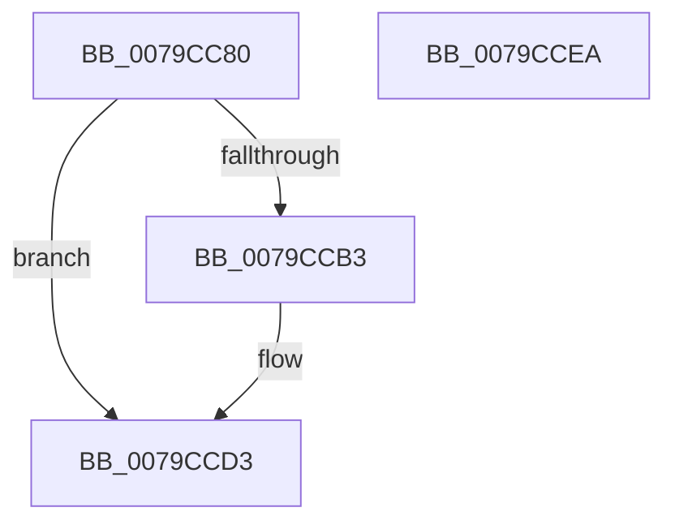

# LsaRegisterLogonProcess

- RVA: `0x0079CC80`–`0x0079CCEB` (길이 `107` bytes)
- VA: `0x000000014079CC80`
- 실행 섹션: `PAGE`
- PDB 이름 있음: `예`; PDB Function 태그: `아니요`
- unwind 정보 RVA: `0x0005C954`
- 디코드: `29`개 명령, `107/107` bytes 표시
- 미해석 바이트: `0` (있으면 어셈블리에 `.byte`로 보존)

> 이 문서는 커널 이미지의 기계어와 PDB 기호를 분석해 생성했습니다. 4번과 5번은 함수 원형과 자료형을 바이너리 사용 방식에서 추정한 C 해석이며 원본 소스 복구 결과는 아닙니다.

## 1. Dependencies

- 직접 호출 지점: **3**; 고유 호출 대상: **3**
- 직접 호출자로 확인된 함수: **0**
- RIP 상대 이미지 참조: **1**

### Outgoing calls
- `0x0079CCA9` → [ExGetExtensionTable](../../text/42/ExGetExtensionTable_function_00428814.md) (function, `0x00428814`)
- `0x0079CCC0` → [guard_dispatch_icall](../../text/6B/guard_dispatch_icall_function_006BAAD0.md) (function, `0x006BAAD0`)
- `0x0079CCCE` → [ExReleaseExtensionTable](../../text/45/ExReleaseExtensionTable_function_00456DC0.md) (function, `0x00456DC0`)

### Direct callers
- 이 함수 시작 RVA로 연결되는 직접 call은 확인되지 않았습니다. 간접 호출은 완전히 역산할 수 없습니다.

### Static image references
- `0x0079CC9A` → RVA `0x00F04E28` (`.data`; read)

## 2. Other-region calls and transfers

- 다른 실행 섹션으로 향하는 call: **3**
  - `0x0079CCA9` → [ExGetExtensionTable](../../text/42/ExGetExtensionTable_function_00428814.md) (`PAGE` → `.text`)
  - `0x0079CCC0` → [guard_dispatch_icall](../../text/6B/guard_dispatch_icall_function_006BAAD0.md) (`PAGE` → `.text`)
  - `0x0079CCCE` → [ExReleaseExtensionTable](../../text/45/ExReleaseExtensionTable_function_00456DC0.md) (`PAGE` → `.text`)
- 별도 외부 분기/꼬리 이동을 확인하지 못했습니다.

## 3. Assembly (complete function range)

```asm
0079CC80  48 89 5C 24 08                  mov qword ptr [rsp + 8], rbx
0079CC85  48 89 6C 24 10                  mov qword ptr [rsp + 0x10], rbp
0079CC8A  48 89 74 24 18                  mov qword ptr [rsp + 0x18], rsi
0079CC8F  57                              push rdi
0079CC90  48 83 EC 20                     sub rsp, 0x20
0079CC94  48 8B E9                        mov rbp, rcx
0079CC97  49 8B F8                        mov rdi, r8
0079CC9A  48 8B 0D 87 81 76 00            mov rcx, qword ptr [rip + 0x768187]
0079CCA1  48 8B F2                        mov rsi, rdx
0079CCA4  BB 02 00 00 C0                  mov ebx, 0xc0000002
0079CCA9  E8 66 BB C8 FF                  call 0x140428814
0079CCAE  48 85 C0                        test rax, rax
0079CCB1  74 20                           je 0x14079ccd3
0079CCB3  48 8B 40 28                     mov rax, qword ptr [rax + 0x28]
0079CCB7  4C 8B C7                        mov r8, rdi
0079CCBA  48 8B D6                        mov rdx, rsi
0079CCBD  48 8B CD                        mov rcx, rbp
0079CCC0  E8 0B DE F1 FF                  call 0x1406baad0
0079CCC5  48 8B 0D 5C 81 76 00            mov rcx, qword ptr [rip + 0x76815c]
0079CCCC  8B D8                           mov ebx, eax
0079CCCE  E8 ED A0 CB FF                  call 0x140456dc0
0079CCD3  48 8B 6C 24 38                  mov rbp, qword ptr [rsp + 0x38]
0079CCD8  8B C3                           mov eax, ebx
0079CCDA  48 8B 5C 24 30                  mov rbx, qword ptr [rsp + 0x30]
0079CCDF  48 8B 74 24 40                  mov rsi, qword ptr [rsp + 0x40]
0079CCE4  48 83 C4 20                     add rsp, 0x20
0079CCE8  5F                              pop rdi
0079CCE9  C3                              ret
0079CCEA  CC                              int3
```

## 4. C-style interpretation (structured pseudocode)

```c
__int64 __fastcall LsaRegisterLogonProcess(__int64 a1, __int64 a2, __int64 a3)
{
    __int64 result;
    __int64 v_rbx;
    __int64 v_rsp;
    unsigned __int64 v_stack_p10;
    unsigned __int64 v_stack_p18;
    unsigned __int64 v_stack_p8;

    v_stack_p8 = v_rbx;
    v_stack_p10 = v_rbp;
    v_stack_p18 = v_rsi;
    v_rsp = (v_rsp) - (32);
    result = ExGetExtensionTable(*(unsigned __int64 *)(v_rip + 7766407), a2, a3, a4);
    v_rbx = (unsigned int)(0xC0000002ULL);
    if (result != 0) {
        result = *(unsigned __int64 *)(result + 40);
        a3 = a3;
        a2 = a2;
        a1 = a1;
        result = guard_dispatch_icall(a1, a2, a3, a4);
        a1 = *(unsigned __int64 *)(v_rip + 7766364);
        v_rbx = (unsigned int)(result);
        result = ExReleaseExtensionTable(a1, a2, a3, a4);
    }
    v_rsp = (v_rsp) + (32);
    return (unsigned int)((unsigned int)(v_rbx));
}
```

## 5. (Beta) C Style

```c
int64_t LsaRegisterLogonProcess(int64_t Arg1, int64_t Arg2, int64_t Arg3)
{
    int64_t result;
    int64_t local_rbx;
    int64_t local_rsp;
    uint64_t v_stack_p10;
    uint64_t v_stack_p18;
    uint64_t v_stack_p8;

    v_stack_p8 = local_rbx;
    v_stack_p10 = local_rbp;
    v_stack_p18 = local_rsi;
    local_rsp = (local_rsp) - (32);
    result = ExGetExtensionTable(*(uint64_t *)(v_rip + 0x768187), Arg2, Arg3, a4);
    local_rbx = (uint32_t)(0xC0000002ULL);
    if (result != 0) {
        result = *(uint64_t *)(result + 0x28);
        Arg3 = Arg3;
        Arg2 = Arg2;
        Arg1 = Arg1;
        result = guard_dispatch_icall(Arg1, Arg2, Arg3, a4);
        Arg1 = *(uint64_t *)(v_rip + 0x76815C);
        local_rbx = (uint32_t)(result);
        result = ExReleaseExtensionTable(Arg1, Arg2, Arg3, a4);
    }
    local_rsp = (local_rsp) + (32);
    return (uint32_t)((uint32_t)(local_rbx));
}
```

## 6. Execution-region graph

[열기: 2D/3D 그래프와 함수 탐색 컨트롤 패널](../../../control-panel.html?section=page&rva=0x0079CC80&view=graph)

- 2D 그래프는 위에서 아래로 흐르고, 3D 그래프는 빈 공간을 드래그해 회전합니다. Shift+드래그는 이동, 휠은 확대·축소, 함수 노드 선택은 대상 보고서 이동입니다.

### Static fallback


