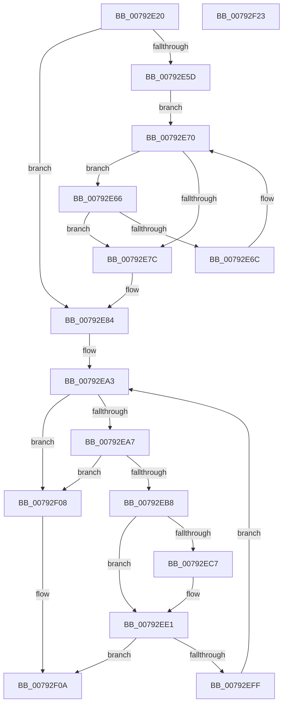

# Normalization__AppendDecomposedChar

- RVA: `0x00792E20`–`0x00792F24` (길이 `260` bytes)
- VA: `0x0000000140792E20`
- 실행 섹션: `PAGE`
- PDB 이름 있음: `예`; PDB Function 태그: `아니요`
- unwind 정보 RVA: `0x00060300`
- 디코드: `79`개 명령, `260/260` bytes 표시
- 미해석 바이트: `0` (있으면 어셈블리에 `.byte`로 보존)

> 이 문서는 커널 이미지의 기계어와 PDB 기호를 분석해 생성했습니다. 4번과 5번은 함수 원형과 자료형을 바이너리 사용 방식에서 추정한 C 해석이며 원본 소스 복구 결과는 아닙니다.

## 1. Dependencies

- 직접 호출 지점: **1**; 고유 호출 대상: **1**
- 직접 호출자로 확인된 함수: **1**
- RIP 상대 이미지 참조: **0**

### Outgoing calls
- `0x00792EF6` → [Normalization__NormalizeCharacter](Normalization__NormalizeCharacter_function_00793D34.md) (function, `0x00793D34`)

### Direct callers
- [Normalization__NormalizeCharacter](Normalization__NormalizeCharacter_function_00793D34.md) at `0x00794544`

### Static image references
- 디코드된 RIP-relative 메모리 참조가 없습니다.

## 2. Other-region calls and transfers

- 다른 실행 섹션으로 향하는 call: **0**
- 별도 외부 분기/꼬리 이동을 확인하지 못했습니다.

## 3. Assembly (complete function range)

```asm
00792E20  48 89 5C 24 08                  mov qword ptr [rsp + 8], rbx
00792E25  48 89 6C 24 10                  mov qword ptr [rsp + 0x10], rbp
00792E2A  48 89 74 24 18                  mov qword ptr [rsp + 0x18], rsi
00792E2F  57                              push rdi
00792E30  41 56                           push r14
00792E32  41 57                           push r15
00792E34  48 83 EC 20                     sub rsp, 0x20
00792E38  8B C2                           mov eax, edx
00792E3A  44 8B D2                        mov r10d, edx
00792E3D  99                              cdq
00792E3E  49 8B E8                        mov rbp, r8
00792E41  F7 79 38                        idiv dword ptr [rcx + 0x38]
00792E44  48 8B 41 40                     mov rax, qword ptr [rcx + 0x40]
00792E48  48 8B F1                        mov rsi, rcx
00792E4B  4C 63 CA                        movsxd r9, edx
00792E4E  42 0F B7 1C 48                  movzx ebx, word ptr [rax + r9*2]
00792E53  B8 00 E0 00 00                  mov eax, 0xe000
00792E58  66 85 D8                        test ax, bx
00792E5B  75 27                           jne 0x140792e84
00792E5D  48 8B 51 48                     mov rdx, qword ptr [rcx + 0x48]
00792E61  66 03 DB                        add bx, bx
00792E64  EB 0A                           jmp 0x140792e70
00792E66  66 41 3B CA                     cmp cx, r10w
00792E6A  74 10                           je 0x140792e7c
00792E6C  66 83 C3 02                     add bx, 2
00792E70  0F B7 C3                        movzx eax, bx
00792E73  0F B7 0C 42                     movzx ecx, word ptr [rdx + rax*2]
00792E77  66 85 C9                        test cx, cx
00792E7A  75 EA                           jne 0x140792e66
00792E7C  0F B7 C3                        movzx eax, bx
00792E7F  0F B7 5C 42 02                  movzx ebx, word ptr [rdx + rax*2 + 2]
00792E84  0F B7 FB                        movzx edi, bx
00792E87  B8 64 00 00 00                  mov eax, 0x64
00792E8C  C1 EF 0D                        shr edi, 0xd
00792E8F  41 BF 01 00 00 00               mov r15d, 1
00792E95  83 FF 07                        cmp edi, 7
00792E98  0F 44 F8                        cmove edi, eax
00792E9B  B8 FF 1F 00 00                  mov eax, 0x1fff
00792EA0  66 23 D8                        and bx, ax
00792EA3  85 FF                           test edi, edi
00792EA5  7E 61                           jle 0x140792f08
00792EA7  4C 8B 46 50                     mov r8, qword ptr [rsi + 0x50]
00792EAB  0F B7 C3                        movzx eax, bx
00792EAE  41 0F B7 0C 40                  movzx ecx, word ptr [r8 + rax*2]
00792EB3  66 85 C9                        test cx, cx
00792EB6  74 50                           je 0x140792f08
00792EB8  8D 81 00 28 FF FF               lea eax, [rcx - 0xd800]
00792EBE  8B D1                           mov edx, ecx
00792EC0  3D FF 07 00 00                  cmp eax, 0x7ff
00792EC5  77 1A                           ja 0x140792ee1
00792EC7  66 41 03 DF                     add bx, r15w
00792ECB  41 2B FF                        sub edi, r15d
00792ECE  0F B7 C3                        movzx eax, bx
00792ED1  41 0F B7 14 40                  movzx edx, word ptr [r8 + rax*2]
00792ED6  8D 81 09 28 FF FF               lea eax, [rcx - 0xd7f7]
00792EDC  C1 E0 0A                        shl eax, 0xa
00792EDF  03 D0                           add edx, eax
00792EE1  48 8B 46 20                     mov rax, qword ptr [rsi + 0x20]
00792EE5  4C 8B CD                        mov r9, rbp
00792EE8  4C 63 C2                        movsxd r8, edx
00792EEB  48 8B CE                        mov rcx, rsi
00792EEE  49 C1 F8 07                     sar r8, 7
00792EF2  45 8A 04 00                     mov r8b, byte ptr [r8 + rax]
00792EF6  E8 39 0E 00 00                  call 0x140793d34
00792EFB  85 C0                           test eax, eax
00792EFD  75 0B                           jne 0x140792f0a
00792EFF  41 2B FF                        sub edi, r15d
00792F02  66 41 03 DF                     add bx, r15w
00792F06  EB 9B                           jmp 0x140792ea3
00792F08  33 C0                           xor eax, eax
00792F0A  48 8B 5C 24 40                  mov rbx, qword ptr [rsp + 0x40]
00792F0F  48 8B 6C 24 48                  mov rbp, qword ptr [rsp + 0x48]
00792F14  48 8B 74 24 50                  mov rsi, qword ptr [rsp + 0x50]
00792F19  48 83 C4 20                     add rsp, 0x20
00792F1D  41 5F                           pop r15
00792F1F  41 5E                           pop r14
00792F21  5F                              pop rdi
00792F22  C3                              ret
00792F23  CC                              int3
```

## 4. C-style interpretation (structured pseudocode)

```c
__int64 __fastcall Normalization__AppendDecomposedChar(__int64 a1, int a2, __int64 a3)
{
    __int64 result;
    __int64 v_rbx;
    __int64 v_rdi;
    __int64 v_rsp;
    unsigned __int64 v_stack_p10;
    unsigned __int64 v_stack_p18;
    unsigned __int64 v_stack_p8;

    v_stack_p8 = v_rbx;
    v_stack_p10 = v_rbp;
    v_stack_p18 = v_rsi;
    v_rsp = (v_rsp) - (32);
    if ((((unsigned __int16)((unsigned int)(0xE000ULL))) & ((unsigned __int16)(*(unsigned __int16 *)(*(unsigned __int64 *)(a1 + 64) + (int)(a2) * 2)))) != 0) goto loc_00792E84;
    v_rbx = (unsigned __int16)((*(unsigned __int16 *)(*(unsigned __int64 *)(a1 + 64) + (int)(a2) * 2)) + ((unsigned __int16)(*(unsigned __int16 *)(*(unsigned __int64 *)(a1 + 64) + (int)(a2) * 2))));
    goto loc_00792E70;
loc_00792E66:
    if (((unsigned __int16)(a1)) == ((unsigned __int16)((unsigned int)(a2)))) goto loc_00792E7C;
    v_rbx = (unsigned __int16)((v_rbx) + (2));
loc_00792E70:
    if ((unsigned __int16)(*(unsigned __int16 *)(*(unsigned __int64 *)(a1 + 72) + (unsigned __int16)(v_rbx) * 2)) != 0) goto loc_00792E66;
loc_00792E7C:
loc_00792E84:
    v_rdi = (unsigned int)(((unsigned __int16)(*(unsigned __int16 *)(*(unsigned __int64 *)(a1 + 72) + (unsigned __int16)(v_rbx) * 2 + 2))) >> (13));
    if (((unsigned int)(v_rdi)) == 7) { v_rdi = 100; }
    v_rbx = (unsigned __int16)((*(unsigned __int16 *)(*(unsigned __int64 *)(a1 + 72) + (unsigned __int16)(v_rbx) * 2 + 2)) & ((unsigned __int16)((unsigned int)(0x1FFFULL))));
loc_00792EA3:
    if (condition_is_less_or_equal) goto loc_00792F08;
    if ((unsigned __int16)(*(unsigned __int16 *)(*(unsigned __int64 *)(a1 + 80) + (unsigned __int16)(v_rbx) * 2)) == 0) goto loc_00792F08;
    result = *(unsigned __int16 *)(*(unsigned __int64 *)(a1 + 80) + (unsigned __int16)(v_rbx) * 2) - 55296;
    if (((unsigned int)(*(unsigned __int16 *)(*(unsigned __int64 *)(a1 + 80) + (unsigned __int16)(v_rbx) * 2) - 55296)) <= 0x7FFULL) {
        v_rbx = (unsigned __int16)((v_rbx) + (1));
        v_rdi = (unsigned int)((v_rdi) - (1));
        result = (unsigned __int16)(v_rbx);
        a2 = *(unsigned __int16 *)(*(unsigned __int64 *)(a1 + 80) + result * 2);
        result = *(unsigned __int16 *)(*(unsigned __int64 *)(a1 + 80) + (unsigned __int16)(v_rbx) * 2) - 55287;
        result = (unsigned int)((result) << (10));
        a2 = (unsigned int)((a2) + ((unsigned int)(result)));
    }
    a3 = ((int)(a2)) >> (7);
    result = Normalization__NormalizeCharacter(a1, a2, *(unsigned __int8 *)(a3 + *(unsigned __int64 *)(a1 + 32) * 1), a3);
    if ((unsigned int)(result) != 0) goto loc_00792F0A;
    v_rdi = (unsigned int)((v_rdi) - (1));
    v_rbx = (unsigned __int16)((v_rbx) + (1));
    goto loc_00792EA3;
loc_00792F08:
    result = 0;
loc_00792F0A:
    v_rsp = (v_rsp) + (32);
    return result;
}
```

## 5. (Beta) C Style

```c
int64_t Normalization__AppendDecomposedChar(void *Arg1, int32_t Arg2, int64_t Arg3)
{
    uint8_t *arg1 = (uint8_t *)Arg1;

    int64_t result;
    int64_t local_rbx;
    int64_t local_rdi;
    int64_t local_rsp;
    uint64_t v_stack_p10;
    uint64_t v_stack_p18;
    uint64_t v_stack_p8;

    v_stack_p8 = local_rbx;
    v_stack_p10 = local_rbp;
    v_stack_p18 = local_rsi;
    local_rsp = (local_rsp) - (32);
    if ((((uint16_t)((uint32_t)(0xE000ULL))) & ((uint16_t)(*(uint16_t *)(*(uint64_t *)(arg1 + 0x40) + (int32_t)(Arg2) * 2)))) != 0) goto loc_00792E84;
    local_rbx = (uint16_t)((*(uint16_t *)(*(uint64_t *)(arg1 + 0x40) + (int32_t)(Arg2) * 2)) + ((uint16_t)(*(uint16_t *)(*(uint64_t *)(arg1 + 0x40) + (int32_t)(Arg2) * 2))));
    goto loc_00792E70;
loc_00792E66:
    if (((uint16_t)(Arg1)) == ((uint16_t)((uint32_t)(Arg2)))) goto loc_00792E7C;
    local_rbx = (uint16_t)((local_rbx) + (2));
loc_00792E70:
    if ((uint16_t)(*(uint16_t *)(*(uint64_t *)(arg1 + 0x48) + (uint16_t)(local_rbx) * 2)) != 0) goto loc_00792E66;
loc_00792E7C:
loc_00792E84:
    local_rdi = (uint32_t)(((uint16_t)(*(uint16_t *)(*(uint64_t *)(arg1 + 0x48) + (uint16_t)(local_rbx) * 2 + 0x2))) >> (13));
    if (((uint32_t)(local_rdi)) == 7) { local_rdi = 100; }
    local_rbx = (uint16_t)((*(uint16_t *)(*(uint64_t *)(arg1 + 0x48) + (uint16_t)(local_rbx) * 2 + 0x2)) & ((uint16_t)((uint32_t)(0x1FFFULL))));
loc_00792EA3:
    if (condition_is_less_or_equal) goto loc_00792F08;
    if ((uint16_t)(*(uint16_t *)(*(uint64_t *)(arg1 + 0x50) + (uint16_t)(local_rbx) * 2)) == 0) goto loc_00792F08;
    result = *(uint16_t *)(*(uint64_t *)(arg1 + 0x50) + (uint16_t)(local_rbx) * 2) - 55296;
    if (((uint32_t)(*(uint16_t *)(*(uint64_t *)(arg1 + 0x50) + (uint16_t)(local_rbx) * 2) - 55296)) <= 0x7FFULL) {
        local_rbx = (uint16_t)((local_rbx) + (1));
        local_rdi = (uint32_t)((local_rdi) - (1));
        result = (uint16_t)(local_rbx);
        Arg2 = *(uint16_t *)(*(uint64_t *)(arg1 + 0x50) + result * 2);
        result = *(uint16_t *)(*(uint64_t *)(arg1 + 0x50) + (uint16_t)(local_rbx) * 2) - 55287;
        result = (uint32_t)((result) << (10));
        Arg2 = (uint32_t)((Arg2) + ((uint32_t)(result)));
    }
    Arg3 = ((int32_t)(Arg2)) >> (7);
    result = Normalization__NormalizeCharacter(Arg1, Arg2, *(uint8_t *)(Arg3 + *(uint64_t *)(arg1 + 0x20) * 1), Arg3);
    if ((uint32_t)(result) != 0) goto loc_00792F0A;
    local_rdi = (uint32_t)((local_rdi) - (1));
    local_rbx = (uint16_t)((local_rbx) + (1));
    goto loc_00792EA3;
loc_00792F08:
    result = 0;
loc_00792F0A:
    local_rsp = (local_rsp) + (32);
    return result;
}
```

### 관측된 메모리 오프셋

구조체 형식이 확인되지 않은 접근은 인자 기준의 오프셋으로만 기록했습니다.

| 기준 인자 | 오프셋 표현 | 폭 (bit) | 접근 |
|---|---:|---:|---|
| `Arg1` | `+ 0x20` | `64` | `R` |
| `Arg1` | `+ 0x38` | `32` | `R` |
| `Arg1` | `+ 0x40` | `64` | `R` |
| `Arg1` | `+ 0x48` | `64` | `R` |
| `Arg1` | `+ 0x50` | `64` | `R` |

## 6. Execution-region graph

[열기: 2D/3D 그래프와 함수 탐색 컨트롤 패널](../../../control-panel.html?section=page&rva=0x00792E20&view=graph)

- 2D 그래프는 위에서 아래로 흐르고, 3D 그래프는 빈 공간을 드래그해 회전합니다. Shift+드래그는 이동, 휠은 확대·축소, 함수 노드 선택은 대상 보고서 이동입니다.

### Static fallback


