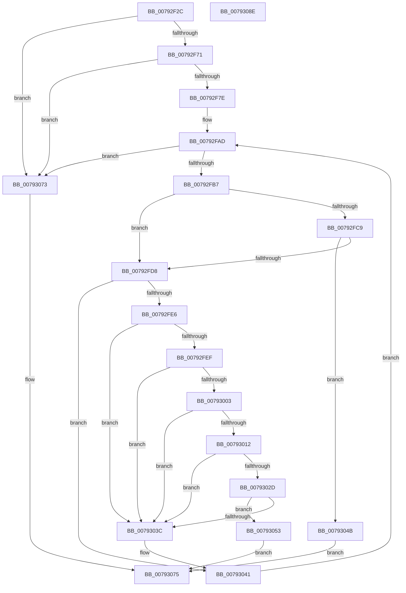

# Normalization__CanCombinableCharactersCombine

- RVA: `0x00792F2C`–`0x0079308F` (길이 `355` bytes)
- VA: `0x0000000140792F2C`
- 실행 섹션: `PAGE`
- PDB 이름 있음: `예`; PDB Function 태그: `아니요`
- unwind 정보 RVA: `0x000BE9E8`
- 디코드: `93`개 명령, `355/355` bytes 표시
- 미해석 바이트: `0` (있으면 어셈블리에 `.byte`로 보존)

> 이 문서는 커널 이미지의 기계어와 PDB 기호를 분석해 생성했습니다. 4번과 5번은 함수 원형과 자료형을 바이너리 사용 방식에서 추정한 C 해석이며 원본 소스 복구 결과는 아닙니다.

## 1. Dependencies

- 직접 호출 지점: **0**; 고유 호출 대상: **0**
- 직접 호출자로 확인된 함수: **6**
- RIP 상대 이미지 참조: **0**

### Outgoing calls
- 직접 디코드된 call 명령이 없습니다.

### Direct callers
- [NormBuffer__LastStartBasePair](../../text/5E/NormBuffer__LastStartBasePair_function_005EDB20.md) at `0x005EDB53`
- [NormBuffer__RecheckStartCombinations](../../text/5E/NormBuffer__RecheckStartCombinations_function_005EDB70.md) at `0x005EDBEF`
- [Normalization__CanCombineWithStartBase](Normalization__CanCombineWithStartBase_function_00793098.md) at `0x007930C8`
- [Normalization__CanCombineWithStartFirstPair](Normalization__CanCombineWithStartFirstPair_function_007930E4.md) at `0x00793134`
- [Normalization__CanCombineWithStartFirstPair](Normalization__CanCombineWithStartFirstPair_function_007930E4.md) at `0x00793146`
- [Normalization__IsNormalized](Normalization__IsNormalized_function_007934D0.md) at `0x00793795`
- [Normalization__IsNormalized](Normalization__IsNormalized_function_007934D0.md) at `0x00793840`
- [Normalization__IsNormalized](Normalization__IsNormalized_function_007934D0.md) at `0x007938DE`
- [Normalization__IsNormalized](Normalization__IsNormalized_function_007934D0.md) at `0x00793931`
- [Normalization__NormalizeCharacter](Normalization__NormalizeCharacter_function_00793D34.md) at `0x00793EA3`
- [Normalization__NormalizeCharacter](Normalization__NormalizeCharacter_function_00793D34.md) at `0x007941E1`
- [Normalization__NormalizeCharacter](Normalization__NormalizeCharacter_function_00793D34.md) at `0x0079428A`
- [Normalization__NormalizeCharacter](Normalization__NormalizeCharacter_function_00793D34.md) at `0x007942AC`
- [Normalization__NormalizeCharacter](Normalization__NormalizeCharacter_function_00793D34.md) at `0x007942C7`
- [Normalization__NormalizeCharacter](Normalization__NormalizeCharacter_function_00793D34.md) at `0x00794396`
- [Normalization__NormalizeCharacter](Normalization__NormalizeCharacter_function_00793D34.md) at `0x007943F0`
- [Normalization__NormalizeCharacter](Normalization__NormalizeCharacter_function_00793D34.md) at `0x00794464`

### Static image references
- 디코드된 RIP-relative 메모리 참조가 없습니다.

## 2. Other-region calls and transfers

- 다른 실행 섹션으로 향하는 call: **0**
- 별도 외부 분기/꼬리 이동을 확인하지 못했습니다.

## 3. Assembly (complete function range)

```asm
00792F2C  48 8B C4                        mov rax, rsp
00792F2F  48 89 58 08                     mov qword ptr [rax + 8], rbx
00792F33  48 89 68 10                     mov qword ptr [rax + 0x10], rbp
00792F37  48 89 70 18                     mov qword ptr [rax + 0x18], rsi
00792F3B  48 89 78 20                     mov qword ptr [rax + 0x20], rdi
00792F3F  41 56                           push r14
00792F41  41 57                           push r15
00792F43  B8 00 00 1F 00                  mov eax, 0x1f0000
00792F48  41 B9 00 00 00 00               mov r9d, 0
00792F4E  85 D0                           test eax, edx
00792F50  45 8B D8                        mov r11d, r8d
00792F53  44 8B D2                        mov r10d, edx
00792F56  48 8B D9                        mov rbx, rcx
00792F59  41 0F 94 C1                     sete r9b
00792F5D  44 85 C0                        test eax, r8d
00792F60  B8 00 00 00 00                  mov eax, 0
00792F65  0F 94 C0                        sete al
00792F68  44 3B C8                        cmp r9d, eax
00792F6B  0F 85 02 01 00 00               jne 0x140793073
00792F71  44 8B 41 58                     mov r8d, dword ptr [rcx + 0x58]
00792F75  45 85 C0                        test r8d, r8d
00792F78  0F 84 F5 00 00 00               je 0x140793073
00792F7E  48 8B 49 60                     mov rcx, qword ptr [rcx + 0x60]
00792F82  BD 00 24 00 00                  mov ebp, 0x2400
00792F87  41 69 C3 FD 30 00 00            imul eax, r11d, 0x30fd
00792F8E  41 BE 00 28 00 00               mov r14d, 0x2800
00792F94  41 BF 00 04 00 00               mov r15d, 0x400
00792F9A  03 C2                           add eax, edx
00792F9C  99                              cdq
00792F9D  41 F7 F8                        idiv r8d
00792FA0  0F B7 C2                        movzx eax, dx
00792FA3  44 0F B7 04 41                  movzx r8d, word ptr [rcx + rax*2]
00792FA8  0F B7 74 41 02                  movzx esi, word ptr [rcx + rax*2 + 2]
00792FAD  66 44 3B C6                     cmp r8w, si
00792FB1  0F 83 BC 00 00 00               jae 0x140793073
00792FB7  4C 8B 4B 68                     mov r9, qword ptr [rbx + 0x68]
00792FBB  41 0F B7 D0                     movzx edx, r8w
00792FBF  41 0F B7 3C 51                  movzx edi, word ptr [r9 + rdx*2]
00792FC4  44 3B D7                        cmp r10d, edi
00792FC7  75 0F                           jne 0x140792fd8
00792FC9  41 0F B7 C0                     movzx eax, r8w
00792FCD  41 0F B7 4C 41 02               movzx ecx, word ptr [r9 + rax*2 + 2]
00792FD3  44 3B D9                        cmp r11d, ecx
00792FD6  74 73                           je 0x14079304b
00792FD8  41 8D 04 3E                     lea eax, [r14 + rdi]
00792FDC  B9 FF 07 00 00                  mov ecx, 0x7ff
00792FE1  66 3B C1                        cmp ax, cx
00792FE4  77 5B                           ja 0x140793041
00792FE6  41 81 FA FF FF 00 00            cmp r10d, 0xffff
00792FED  7E 4D                           jle 0x14079303c
00792FEF  41 8D 82 00 00 FF FF            lea eax, [r10 - 0x10000]
00792FF6  99                              cdq
00792FF7  41 F7 FF                        idiv r15d
00792FFA  66 41 2B C6                     sub ax, r14w
00792FFE  66 3B F8                        cmp di, ax
00793001  75 39                           jne 0x14079303c
00793003  41 0F B7 C0                     movzx eax, r8w
00793007  66 2B D5                        sub dx, bp
0079300A  66 41 39 54 41 02               cmp word ptr [r9 + rax*2 + 2], dx
00793010  75 2A                           jne 0x14079303c
00793012  41 8D 83 00 00 FF FF            lea eax, [r11 - 0x10000]
00793019  41 0F B7 C8                     movzx ecx, r8w
0079301D  99                              cdq
0079301E  41 F7 FF                        idiv r15d
00793021  66 41 2B C6                     sub ax, r14w
00793025  66 41 39 44 49 04               cmp word ptr [r9 + rcx*2 + 4], ax
0079302B  75 0F                           jne 0x14079303c
0079302D  41 0F B7 C0                     movzx eax, r8w
00793031  66 2B D5                        sub dx, bp
00793034  66 41 39 54 41 06               cmp word ptr [r9 + rax*2 + 6], dx
0079303A  74 17                           je 0x140793053
0079303C  66 41 83 C0 03                  add r8w, 3
00793041  66 41 83 C0 03                  add r8w, 3
00793046  E9 62 FF FF FF                  jmp 0x140792fad
0079304B  41 0F B7 44 51 04               movzx eax, word ptr [r9 + rdx*2 + 4]
00793051  EB 22                           jmp 0x140793075
00793053  41 0F B7 C0                     movzx eax, r8w
00793057  41 0F B7 C8                     movzx ecx, r8w
0079305B  41 0F B7 44 41 08               movzx eax, word ptr [r9 + rax*2 + 8]
00793061  41 0F B7 54 49 0A               movzx edx, word ptr [r9 + rcx*2 + 0xa]
00793067  2D F7 D7 00 00                  sub eax, 0xd7f7
0079306C  C1 E0 0A                        shl eax, 0xa
0079306F  03 C2                           add eax, edx
00793071  EB 02                           jmp 0x140793075
00793073  33 C0                           xor eax, eax
00793075  48 8B 5C 24 18                  mov rbx, qword ptr [rsp + 0x18]
0079307A  48 8B 6C 24 20                  mov rbp, qword ptr [rsp + 0x20]
0079307F  48 8B 74 24 28                  mov rsi, qword ptr [rsp + 0x28]
00793084  48 8B 7C 24 30                  mov rdi, qword ptr [rsp + 0x30]
00793089  41 5F                           pop r15
0079308B  41 5E                           pop r14
0079308D  C3                              ret
0079308E  CC                              int3
```

## 4. C-style interpretation (structured pseudocode)

```c
__int64 __fastcall Normalization__CanCombinableCharactersCombine(__int64 a1, int a2, int a3)
{
    __int64 result;
    unsigned __int64 v_stack_p10;
    unsigned __int64 v_stack_p18;
    unsigned __int64 v_stack_p20;
    unsigned __int64 v_stack_p8;

    *(unsigned __int64 *)(v_rsp + 8) = v_rbx;
    *(unsigned __int64 *)(v_rsp + 16) = v_rbp;
    *(unsigned __int64 *)(v_rsp + 24) = v_rsi;
    *(unsigned __int64 *)(v_rsp + 32) = v_rdi;
    a4 = ((((unsigned int)((unsigned int)(0x1F0000ULL))) & (a2)) == 0) ? 1 : 0;
    result = ((((unsigned int)((unsigned int)(0x1F0000ULL))) & (a3)) == 0) ? 1 : 0;
    if (((unsigned int)(a4)) != ((unsigned int)(result))) goto loc_00793073;
    if ((unsigned int)((unsigned int)(*(unsigned int *)(a1 + 88))) == 0) goto loc_00793073;
    result = (unsigned int)((result) * ((unsigned int)((unsigned int)(a3))));
    result = (unsigned int)((result) + (a2));
loc_00792FAD:
    if (((unsigned __int16)(*(unsigned __int16 *)(*(unsigned __int64 *)(a1 + 96) + (unsigned __int16)(a2) * 2))) >= ((unsigned __int16)(*(unsigned __int16 *)(*(unsigned __int64 *)(a1 + 96) + (unsigned __int16)(a2) * 2 + 2)))) goto loc_00793073;
    if (((unsigned int)((unsigned int)(a2))) != ((unsigned int)(*(unsigned __int16 *)(*(unsigned __int64 *)(a1 + 104) + (unsigned __int16)(*(unsigned __int16 *)(*(unsigned __int64 *)(a1 + 96) + (unsigned __int16)(a2) * 2)) * 2)))) goto loc_00792FD8;
    if (((unsigned int)((unsigned int)(a3))) == ((unsigned int)(*(unsigned __int16 *)(*(unsigned __int64 *)(a1 + 104) + (unsigned __int16)(*(unsigned __int16 *)(*(unsigned __int64 *)(a1 + 96) + (unsigned __int16)(a2) * 2)) * 2 + 2)))) goto loc_0079304B;
loc_00792FD8:
    if (((unsigned __int16)((unsigned int)(0x2800ULL) + *(unsigned __int16 *)(*(unsigned __int64 *)(a1 + 104) + (unsigned __int16)(*(unsigned __int16 *)(*(unsigned __int64 *)(a1 + 96) + (unsigned __int16)(a2) * 2)) * 2) * 1)) > ((unsigned __int16)((unsigned int)(0x7FFULL)))) goto loc_00793041;
    if (((unsigned int)((unsigned int)(a2))) <= 0xFFFFULL) goto loc_0079303C;
    result = (unsigned __int16)(((unsigned int)(a2) - 65536) - ((unsigned __int16)((unsigned int)(0x2800ULL))));
    if (((unsigned __int16)(*(unsigned __int16 *)(*(unsigned __int64 *)(a1 + 104) + (unsigned __int16)(*(unsigned __int16 *)(*(unsigned __int64 *)(a1 + 96) + (unsigned __int16)(a2) * 2)) * 2))) != ((unsigned __int16)(result))) goto loc_0079303C;
    a2 = (unsigned __int16)(((unsigned __int16)(*(unsigned __int16 *)(*(unsigned __int64 *)(a1 + 96) + (unsigned __int16)(a2) * 2))) - ((unsigned __int16)((unsigned int)(0x2400ULL))));
    if ((*(unsigned __int16 *)(*(unsigned __int64 *)(a1 + 104) + (unsigned __int16)(*(unsigned __int16 *)(*(unsigned __int64 *)(a1 + 96) + (unsigned __int16)(a2) * 2)) * 2 + 2)) != ((unsigned __int16)(a2))) goto loc_0079303C;
    result = (unsigned __int16)(((unsigned int)(a3) - 65536) - ((unsigned __int16)((unsigned int)(0x2800ULL))));
    if ((*(unsigned __int16 *)(*(unsigned __int64 *)(a1 + 104) + (unsigned __int16)(*(unsigned __int16 *)(*(unsigned __int64 *)(a1 + 96) + (unsigned __int16)(a2) * 2)) * 2 + 4)) != ((unsigned __int16)(result))) goto loc_0079303C;
    a2 = (unsigned __int16)((a2) - ((unsigned __int16)((unsigned int)(0x2400ULL))));
    if ((*(unsigned __int16 *)(*(unsigned __int64 *)(a1 + 104) + (unsigned __int16)(*(unsigned __int16 *)(*(unsigned __int64 *)(a1 + 96) + (unsigned __int16)(a2) * 2)) * 2 + 6)) == ((unsigned __int16)(a2))) goto loc_00793053;
loc_0079303C:
    a3 = (unsigned __int16)((*(unsigned __int16 *)(*(unsigned __int64 *)(a1 + 96) + (unsigned __int16)(a2) * 2)) + (3));
loc_00793041:
    a3 = (unsigned __int16)((a3) + (3));
    goto loc_00792FAD;
loc_0079304B:
    goto loc_00793075;
loc_00793053:
    result = (unsigned int)((*(unsigned __int16 *)(*(unsigned __int64 *)(a1 + 104) + (unsigned __int16)(a3) * 2 + 8)) - (0xD7F7ULL));
    result = (unsigned int)((result) << (10));
    result = (unsigned int)((result) + ((unsigned int)(*(unsigned __int16 *)(*(unsigned __int64 *)(a1 + 104) + (unsigned __int16)(a3) * 2 + 10))));
    goto loc_00793075;
loc_00793073:
    result = 0;
loc_00793075:
    return result;
}
```

## 5. (Beta) C Style

```c
int64_t Normalization__CanCombinableCharactersCombine(void *Arg1, int32_t Arg2, int32_t Arg3)
{
    uint8_t *arg1 = (uint8_t *)Arg1;

    int64_t result;
    uint64_t v_stack_p10;
    uint64_t v_stack_p18;
    uint64_t v_stack_p20;
    uint64_t v_stack_p8;

    *(uint64_t *)(local_rsp + 0x8) = local_rbx;
    *(uint64_t *)(local_rsp + 0x10) = local_rbp;
    *(uint64_t *)(local_rsp + 0x18) = local_rsi;
    *(uint64_t *)(local_rsp + 0x20) = local_rdi;
    a4 = ((((uint32_t)((uint32_t)(0x1F0000ULL))) & (Arg2)) == 0) ? 1 : 0;
    result = ((((uint32_t)((uint32_t)(0x1F0000ULL))) & (Arg3)) == 0) ? 1 : 0;
    if (((uint32_t)(a4)) != ((uint32_t)(result))) goto loc_00793073;
    if ((uint32_t)((uint32_t)(*(uint32_t *)(arg1 + 0x58))) == 0) goto loc_00793073;
    result = (uint32_t)((result) * ((uint32_t)((uint32_t)(Arg3))));
    result = (uint32_t)((result) + (Arg2));
loc_00792FAD:
    if (((uint16_t)(*(uint16_t *)(*(uint64_t *)(arg1 + 0x60) + (uint16_t)(Arg2) * 2))) >= ((uint16_t)(*(uint16_t *)(*(uint64_t *)(arg1 + 0x60) + (uint16_t)(Arg2) * 2 + 0x2)))) goto loc_00793073;
    if (((uint32_t)((uint32_t)(Arg2))) != ((uint32_t)(*(uint16_t *)(*(uint64_t *)(arg1 + 0x68) + (uint16_t)(*(uint16_t *)(*(uint64_t *)(arg1 + 0x60) + (uint16_t)(Arg2) * 2)) * 2)))) goto loc_00792FD8;
    if (((uint32_t)((uint32_t)(Arg3))) == ((uint32_t)(*(uint16_t *)(*(uint64_t *)(arg1 + 0x68) + (uint16_t)(*(uint16_t *)(*(uint64_t *)(arg1 + 0x60) + (uint16_t)(Arg2) * 2)) * 2 + 0x2)))) goto loc_0079304B;
loc_00792FD8:
    if (((uint16_t)((uint32_t)(0x2800ULL) + *(uint16_t *)(*(uint64_t *)(arg1 + 0x68) + (uint16_t)(*(uint16_t *)(*(uint64_t *)(arg1 + 0x60) + (uint16_t)(Arg2) * 2)) * 2) * 1)) > ((uint16_t)((uint32_t)(0x7FFULL)))) goto loc_00793041;
    if (((uint32_t)((uint32_t)(Arg2))) <= 0xFFFFULL) goto loc_0079303C;
    result = (uint16_t)(((uint32_t)(Arg2) - 65536) - ((uint16_t)((uint32_t)(0x2800ULL))));
    if (((uint16_t)(*(uint16_t *)(*(uint64_t *)(arg1 + 0x68) + (uint16_t)(*(uint16_t *)(*(uint64_t *)(arg1 + 0x60) + (uint16_t)(Arg2) * 2)) * 2))) != ((uint16_t)(result))) goto loc_0079303C;
    Arg2 = (uint16_t)(((uint16_t)(*(uint16_t *)(*(uint64_t *)(arg1 + 0x60) + (uint16_t)(Arg2) * 2))) - ((uint16_t)((uint32_t)(0x2400ULL))));
    if ((*(uint16_t *)(*(uint64_t *)(arg1 + 0x68) + (uint16_t)(*(uint16_t *)(*(uint64_t *)(arg1 + 0x60) + (uint16_t)(Arg2) * 2)) * 2 + 0x2)) != ((uint16_t)(Arg2))) goto loc_0079303C;
    result = (uint16_t)(((uint32_t)(Arg3) - 65536) - ((uint16_t)((uint32_t)(0x2800ULL))));
    if ((*(uint16_t *)(*(uint64_t *)(arg1 + 0x68) + (uint16_t)(*(uint16_t *)(*(uint64_t *)(arg1 + 0x60) + (uint16_t)(Arg2) * 2)) * 2 + 0x4)) != ((uint16_t)(result))) goto loc_0079303C;
    Arg2 = (uint16_t)((Arg2) - ((uint16_t)((uint32_t)(0x2400ULL))));
    if ((*(uint16_t *)(*(uint64_t *)(arg1 + 0x68) + (uint16_t)(*(uint16_t *)(*(uint64_t *)(arg1 + 0x60) + (uint16_t)(Arg2) * 2)) * 2 + 0x6)) == ((uint16_t)(Arg2))) goto loc_00793053;
loc_0079303C:
    Arg3 = (uint16_t)((*(uint16_t *)(*(uint64_t *)(arg1 + 0x60) + (uint16_t)(Arg2) * 2)) + (3));
loc_00793041:
    Arg3 = (uint16_t)((Arg3) + (3));
    goto loc_00792FAD;
loc_0079304B:
    goto loc_00793075;
loc_00793053:
    result = (uint32_t)((*(uint16_t *)(*(uint64_t *)(arg1 + 0x68) + (uint16_t)(Arg3) * 2 + 0x8)) - (0xD7F7ULL));
    result = (uint32_t)((result) << (10));
    result = (uint32_t)((result) + ((uint32_t)(*(uint16_t *)(*(uint64_t *)(arg1 + 0x68) + (uint16_t)(Arg3) * 2 + 0xA))));
    goto loc_00793075;
loc_00793073:
    result = 0;
loc_00793075:
    return result;
}
```

### 관측된 메모리 오프셋

구조체 형식이 확인되지 않은 접근은 인자 기준의 오프셋으로만 기록했습니다.

| 기준 인자 | 오프셋 표현 | 폭 (bit) | 접근 |
|---|---:|---:|---|
| `Arg1` | `+ 0x58` | `32` | `R` |
| `Arg1` | `+ 0x60` | `64` | `R` |
| `Arg1` | `+ 0x68` | `64` | `R` |

## 6. Execution-region graph

[열기: 2D/3D 그래프와 함수 탐색 컨트롤 패널](../../../control-panel.html?section=page&rva=0x00792F2C&view=graph)

- 2D 그래프는 위에서 아래로 흐르고, 3D 그래프는 빈 공간을 드래그해 회전합니다. Shift+드래그는 이동, 휠은 확대·축소, 함수 노드 선택은 대상 보고서 이동입니다.

### Static fallback


