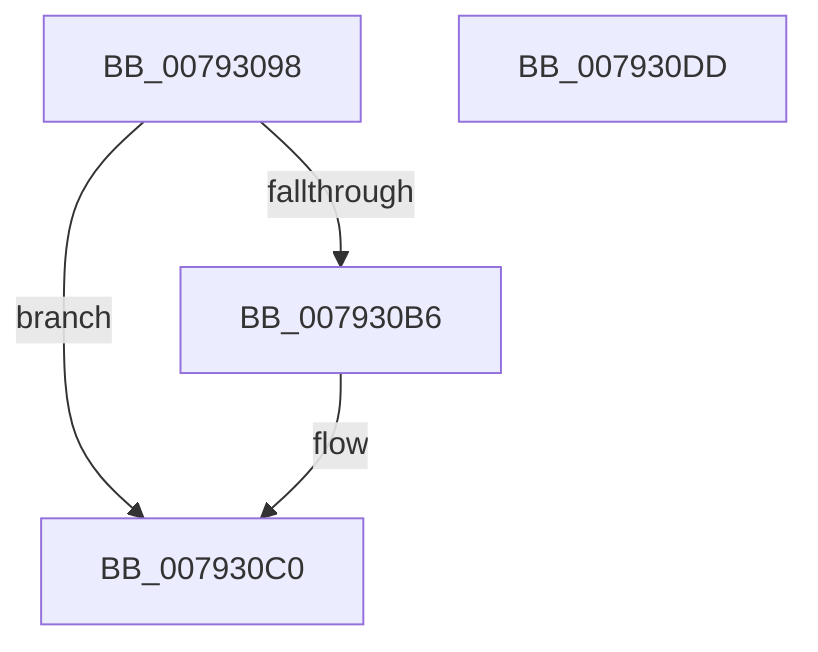

# Normalization__CanCombineWithStartBase

- RVA: `0x00793098`–`0x007930DE` (길이 `70` bytes)
- VA: `0x0000000140793098`
- 실행 섹션: `PAGE`
- PDB 이름 있음: `예`; PDB Function 태그: `아니요`
- unwind 정보 RVA: `0x00060BC4`
- 디코드: `23`개 명령, `70/70` bytes 표시
- 미해석 바이트: `0` (있으면 어셈블리에 `.byte`로 보존)

> 이 문서는 커널 이미지의 기계어와 PDB 기호를 분석해 생성했습니다. 4번과 5번은 함수 원형과 자료형을 바이너리 사용 방식에서 추정한 C 해석이며 원본 소스 복구 결과는 아닙니다.

## 1. Dependencies

- 직접 호출 지점: **2**; 고유 호출 대상: **2**
- 직접 호출자로 확인된 함수: **1**
- RIP 상대 이미지 참조: **0**

### Outgoing calls
- `0x007930B9` → [Normalization__GetFirstDecomposedCharPlane0](Normalization__GetFirstDecomposedCharPlane0_function_007931B0.md) (function, `0x007931B0`)
- `0x007930C8` → [Normalization__CanCombinableCharactersCombine](Normalization__CanCombinableCharactersCombine_function_00792F2C.md) (function, `0x00792F2C`)

### Direct callers
- [Normalization__IsNormalized](Normalization__IsNormalized_function_007934D0.md) at `0x00793817`
- [Normalization__IsNormalized](Normalization__IsNormalized_function_007934D0.md) at `0x00793899`

### Static image references
- 디코드된 RIP-relative 메모리 참조가 없습니다.

## 2. Other-region calls and transfers

- 다른 실행 섹션으로 향하는 call: **0**
- 별도 외부 분기/꼬리 이동을 확인하지 못했습니다.

## 3. Assembly (complete function range)

```asm
00793098  48 89 5C 24 08                  mov qword ptr [rsp + 8], rbx
0079309D  48 89 74 24 10                  mov qword ptr [rsp + 0x10], rsi
007930A2  57                              push rdi
007930A3  48 83 EC 20                     sub rsp, 0x20
007930A7  8B 02                           mov eax, dword ptr [rdx]
007930A9  41 8B F1                        mov esi, r9d
007930AC  48 8B FA                        mov rdi, rdx
007930AF  48 8B D9                        mov rbx, rcx
007930B2  85 C0                           test eax, eax
007930B4  75 0A                           jne 0x1407930c0
007930B6  41 8B D0                        mov edx, r8d
007930B9  E8 F2 00 00 00                  call 0x1407931b0
007930BE  89 07                           mov dword ptr [rdi], eax
007930C0  44 8B C6                        mov r8d, esi
007930C3  8B D0                           mov edx, eax
007930C5  48 8B CB                        mov rcx, rbx
007930C8  E8 5F FE FF FF                  call 0x140792f2c
007930CD  48 8B 5C 24 30                  mov rbx, qword ptr [rsp + 0x30]
007930D2  48 8B 74 24 38                  mov rsi, qword ptr [rsp + 0x38]
007930D7  48 83 C4 20                     add rsp, 0x20
007930DB  5F                              pop rdi
007930DC  C3                              ret
007930DD  CC                              int3
```

## 4. C-style interpretation (structured pseudocode)

```c
__int64 __fastcall Normalization__CanCombineWithStartBase(__int64 a1, __int64 a2, int a3, int a4)
{
    __int64 result;
    __int64 v_rsp;
    unsigned __int64 v_stack_p10;
    unsigned __int64 v_stack_p8;

    v_stack_p8 = v_rbx;
    v_stack_p10 = v_rsi;
    v_rsp = (v_rsp) - (32);
    result = (unsigned int)(*(unsigned int *)(a2));
    if ((unsigned int)((unsigned int)(*(unsigned int *)(a2))) == 0) {
        a2 = a3;
        result = Normalization__GetFirstDecomposedCharPlane0(a1, a2, a3, a4);
        *(unsigned int *)(a2) = (unsigned int)(result);
    }
    result = Normalization__CanCombinableCharactersCombine(a1, (unsigned int)((unsigned int)(result)), (unsigned int)((unsigned int)((unsigned int)(a4))), a4);
    v_rsp = (v_rsp) + (32);
    return result;
}
```

## 5. (Beta) C Style

```c
int64_t Normalization__CanCombineWithStartBase(int64_t Arg1, void *Arg2, int32_t Arg3, int32_t Arg4)
{
    uint8_t *arg2 = (uint8_t *)Arg2;

    int64_t result;
    int64_t local_rsp;
    uint64_t v_stack_p10;
    uint64_t v_stack_p8;

    v_stack_p8 = local_rbx;
    v_stack_p10 = local_rsi;
    local_rsp = (local_rsp) - (32);
    result = (uint32_t)(*(uint32_t *)(arg2));
    if ((uint32_t)((uint32_t)(*(uint32_t *)(arg2))) == 0) {
        Arg2 = Arg3;
        result = Normalization__GetFirstDecomposedCharPlane0(Arg1, Arg2, Arg3, Arg4);
        *(uint32_t *)(arg2) = (uint32_t)(result);
    }
    result = Normalization__CanCombinableCharactersCombine(Arg1, (uint32_t)((uint32_t)(result)), (uint32_t)((uint32_t)((uint32_t)(Arg4))), Arg4);
    local_rsp = (local_rsp) + (32);
    return result;
}
```

### 관측된 메모리 오프셋

구조체 형식이 확인되지 않은 접근은 인자 기준의 오프셋으로만 기록했습니다.

| 기준 인자 | 오프셋 표현 | 폭 (bit) | 접근 |
|---|---:|---:|---|
| `Arg2` | `+ 0x0` | `32` | `R` |
| `Arg2` | `+ 0x0` | `32` | `W` |

## 6. Execution-region graph

[열기: 2D/3D 그래프와 함수 탐색 컨트롤 패널](../../../control-panel.html?section=page&rva=0x00793098&view=graph)

- 2D 그래프는 위에서 아래로 흐르고, 3D 그래프는 빈 공간을 드래그해 회전합니다. Shift+드래그는 이동, 휠은 확대·축소, 함수 노드 선택은 대상 보고서 이동입니다.

### Static fallback


