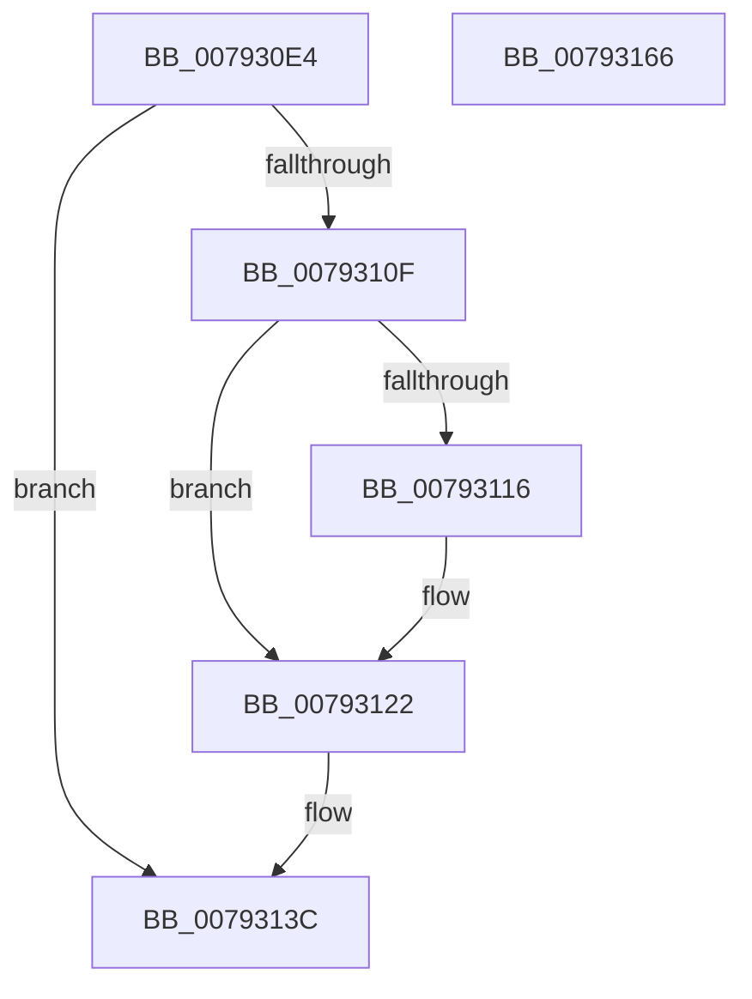

# Normalization__CanCombineWithStartFirstPair

- RVA: `0x007930E4`–`0x00793167` (길이 `131` bytes)
- VA: `0x00000001407930E4`
- 실행 섹션: `PAGE`
- PDB 이름 있음: `예`; PDB Function 태그: `아니요`
- unwind 정보 RVA: `0x0005E6B4`
- 디코드: `41`개 명령, `131/131` bytes 표시
- 미해석 바이트: `0` (있으면 어셈블리에 `.byte`로 보존)

> 이 문서는 커널 이미지의 기계어와 PDB 기호를 분석해 생성했습니다. 4번과 5번은 함수 원형과 자료형을 바이너리 사용 방식에서 추정한 C 해석이며 원본 소스 복구 결과는 아닙니다.

## 1. Dependencies

- 직접 호출 지점: **4**; 고유 호출 대상: **3**
- 직접 호출자로 확인된 함수: **1**
- RIP 상대 이미지 참조: **0**

### Outgoing calls
- `0x00793119` → [Normalization__GetFirstDecomposedCharPlane0](Normalization__GetFirstDecomposedCharPlane0_function_007931B0.md) (function, `0x007931B0`)
- `0x00793127` → [Normalization__GetSecondDecomposedCharPlane0](Normalization__GetSecondDecomposedCharPlane0_function_007933C0.md) (function, `0x007933C0`)
- `0x00793134` → [Normalization__CanCombinableCharactersCombine](Normalization__CanCombinableCharactersCombine_function_00792F2C.md) (function, `0x00792F2C`)
- `0x00793146` → [Normalization__CanCombinableCharactersCombine](Normalization__CanCombinableCharactersCombine_function_00792F2C.md) (function, `0x00792F2C`)

### Direct callers
- [Normalization__IsNormalized](Normalization__IsNormalized_function_007934D0.md) at `0x007937E0`
- [Normalization__IsNormalized](Normalization__IsNormalized_function_007934D0.md) at `0x00793879`

### Static image references
- 디코드된 RIP-relative 메모리 참조가 없습니다.

## 2. Other-region calls and transfers

- 다른 실행 섹션으로 향하는 call: **0**
- 별도 외부 분기/꼬리 이동을 확인하지 못했습니다.

## 3. Assembly (complete function range)

```asm
007930E4  48 8B C4                        mov rax, rsp
007930E7  48 89 58 08                     mov qword ptr [rax + 8], rbx
007930EB  48 89 68 10                     mov qword ptr [rax + 0x10], rbp
007930EF  48 89 70 18                     mov qword ptr [rax + 0x18], rsi
007930F3  48 89 78 20                     mov qword ptr [rax + 0x20], rdi
007930F7  41 56                           push r14
007930F9  48 83 EC 20                     sub rsp, 0x20
007930FD  8B 02                           mov eax, dword ptr [rdx]
007930FF  41 8B E9                        mov ebp, r9d
00793102  49 8B F0                        mov rsi, r8
00793105  4C 8B F2                        mov r14, rdx
00793108  48 8B F9                        mov rdi, rcx
0079310B  85 C0                           test eax, eax
0079310D  75 2D                           jne 0x14079313c
0079310F  41 8B 18                        mov ebx, dword ptr [r8]
00793112  85 DB                           test ebx, ebx
00793114  75 0C                           jne 0x140793122
00793116  41 8B D1                        mov edx, r9d
00793119  E8 92 00 00 00                  call 0x1407931b0
0079311E  8B D8                           mov ebx, eax
00793120  89 06                           mov dword ptr [rsi], eax
00793122  8B D5                           mov edx, ebp
00793124  48 8B CF                        mov rcx, rdi
00793127  E8 94 02 00 00                  call 0x1407933c0
0079312C  44 8B C0                        mov r8d, eax
0079312F  8B D3                           mov edx, ebx
00793131  48 8B CF                        mov rcx, rdi
00793134  E8 F3 FD FF FF                  call 0x140792f2c
00793139  41 89 06                        mov dword ptr [r14], eax
0079313C  44 8B 44 24 50                  mov r8d, dword ptr [rsp + 0x50]
00793141  8B D0                           mov edx, eax
00793143  48 8B CF                        mov rcx, rdi
00793146  E8 E1 FD FF FF                  call 0x140792f2c
0079314B  48 8B 5C 24 30                  mov rbx, qword ptr [rsp + 0x30]
00793150  48 8B 6C 24 38                  mov rbp, qword ptr [rsp + 0x38]
00793155  48 8B 74 24 40                  mov rsi, qword ptr [rsp + 0x40]
0079315A  48 8B 7C 24 48                  mov rdi, qword ptr [rsp + 0x48]
0079315F  48 83 C4 20                     add rsp, 0x20
00793163  41 5E                           pop r14
00793165  C3                              ret
00793166  CC                              int3
```

## 4. C-style interpretation (structured pseudocode)

```c
__int64 __fastcall Normalization__CanCombineWithStartFirstPair(__int64 a1, __int64 a2, __int64 a3, int a4, unsigned int a5)
{
    __int64 result;
    __int64 v_rbx;
    __int64 v_rsp;
    unsigned __int64 v_stack_p10;
    unsigned __int64 v_stack_p18;
    unsigned __int64 v_stack_p20;
    unsigned __int64 v_stack_p8;

    *(unsigned __int64 *)(v_rsp + 8) = v_rbx;
    *(unsigned __int64 *)(v_rsp + 16) = v_rbp;
    *(unsigned __int64 *)(v_rsp + 24) = v_rsi;
    *(unsigned __int64 *)(v_rsp + 32) = v_rdi;
    v_rsp = (v_rsp) - (32);
    if ((unsigned int)((unsigned int)(*(unsigned int *)(a2))) != 0) goto loc_0079313C;
    result = (unsigned int)(*(unsigned int *)(a2));
    v_rbx = (unsigned int)(*(unsigned int *)(a3));
    if ((unsigned int)((unsigned int)(*(unsigned int *)(a3))) == 0) {
        a2 = a4;
        result = Normalization__GetFirstDecomposedCharPlane0(a1, a2, a3, a4);
        v_rbx = (unsigned int)(result);
        *(unsigned int *)(a3) = (unsigned int)(result);
    }
    result = Normalization__GetSecondDecomposedCharPlane0(a1, (unsigned int)((unsigned int)((unsigned int)(a4))), a3, a4);
    result = Normalization__CanCombinableCharactersCombine(a1, (unsigned int)((unsigned int)(v_rbx)), (unsigned int)((unsigned int)(result)), a4);
    *(unsigned int *)(a2) = (unsigned int)(result);
loc_0079313C:
    result = Normalization__CanCombinableCharactersCombine(a1, (unsigned int)((unsigned int)(result)), (unsigned int)(a5), a4);
    v_rsp = (v_rsp) + (32);
    return result;
}
```

## 5. (Beta) C Style

```c
int64_t Normalization__CanCombineWithStartFirstPair(int64_t Arg1, void *Arg2, void *Arg3, int32_t Arg4, uint32_t Arg5)
{
    uint8_t *arg2 = (uint8_t *)Arg2;
    uint8_t *arg3 = (uint8_t *)Arg3;

    int64_t result;
    int64_t local_rbx;
    int64_t local_rsp;
    uint64_t v_stack_p10;
    uint64_t v_stack_p18;
    uint64_t v_stack_p20;
    uint64_t v_stack_p8;

    *(uint64_t *)(local_rsp + 0x8) = local_rbx;
    *(uint64_t *)(local_rsp + 0x10) = local_rbp;
    *(uint64_t *)(local_rsp + 0x18) = local_rsi;
    *(uint64_t *)(local_rsp + 0x20) = local_rdi;
    local_rsp = (local_rsp) - (32);
    if ((uint32_t)((uint32_t)(*(uint32_t *)(arg2))) != 0) goto loc_0079313C;
    result = (uint32_t)(*(uint32_t *)(arg2));
    local_rbx = (uint32_t)(*(uint32_t *)(arg3));
    if ((uint32_t)((uint32_t)(*(uint32_t *)(arg3))) == 0) {
        Arg2 = Arg4;
        result = Normalization__GetFirstDecomposedCharPlane0(Arg1, Arg2, Arg3, Arg4);
        local_rbx = (uint32_t)(result);
        *(uint32_t *)(arg3) = (uint32_t)(result);
    }
    result = Normalization__GetSecondDecomposedCharPlane0(Arg1, (uint32_t)((uint32_t)((uint32_t)(Arg4))), Arg3, Arg4);
    result = Normalization__CanCombinableCharactersCombine(Arg1, (uint32_t)((uint32_t)(local_rbx)), (uint32_t)((uint32_t)(result)), Arg4);
    *(uint32_t *)(arg2) = (uint32_t)(result);
loc_0079313C:
    result = Normalization__CanCombinableCharactersCombine(Arg1, (uint32_t)((uint32_t)(result)), (uint32_t)(Arg5), Arg4);
    local_rsp = (local_rsp) + (32);
    return result;
}
```

### 관측된 메모리 오프셋

구조체 형식이 확인되지 않은 접근은 인자 기준의 오프셋으로만 기록했습니다.

| 기준 인자 | 오프셋 표현 | 폭 (bit) | 접근 |
|---|---:|---:|---|
| `Arg2` | `+ 0x0` | `32` | `R` |
| `Arg2` | `+ 0x0` | `32` | `W` |
| `Arg3` | `+ 0x0` | `32` | `R` |
| `Arg3` | `+ 0x0` | `32` | `W` |

## 6. Execution-region graph

[열기: 2D/3D 그래프와 함수 탐색 컨트롤 패널](../../../control-panel.html?section=page&rva=0x007930E4&view=graph)

- 2D 그래프는 위에서 아래로 흐르고, 3D 그래프는 빈 공간을 드래그해 회전합니다. Shift+드래그는 이동, 휠은 확대·축소, 함수 노드 선택은 대상 보고서 이동입니다.

### Static fallback


