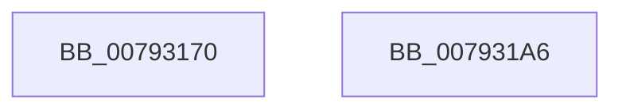

# Normalization__GetCharacterInfo

- RVA: `0x00793170`–`0x007931A7` (길이 `55` bytes)
- VA: `0x0000000140793170`
- 실행 섹션: `PAGE`
- PDB 이름 있음: `예`; PDB Function 태그: `아니요`
- unwind 정보 RVA: `0x000DB714`
- 디코드: `18`개 명령, `55/55` bytes 표시
- 미해석 바이트: `0` (있으면 어셈블리에 `.byte`로 보존)

> 이 문서는 커널 이미지의 기계어와 PDB 기호를 분석해 생성했습니다. 4번과 5번은 함수 원형과 자료형을 바이너리 사용 방식에서 추정한 C 해석이며 원본 소스 복구 결과는 아닙니다.

## 1. Dependencies

- 직접 호출 지점: **0**; 고유 호출 대상: **0**
- 직접 호출자로 확인된 함수: **2**
- RIP 상대 이미지 참조: **0**

### Outgoing calls
- 직접 디코드된 call 명령이 없습니다.

### Direct callers
- [NormBuffer__AppendAndSortDecomposed](../../text/5E/NormBuffer__AppendAndSortDecomposed_function_005ED7FC.md) at `0x005ED821`
- [NormBuffer__RecheckStartCombinations](../../text/5E/NormBuffer__RecheckStartCombinations_function_005EDB70.md) at `0x005EDBCD`
- [NormBuffer__RecheckStartCombinations](../../text/5E/NormBuffer__RecheckStartCombinations_function_005EDB70.md) at `0x005EDC0C`

### Static image references
- 디코드된 RIP-relative 메모리 참조가 없습니다.

## 2. Other-region calls and transfers

- 다른 실행 섹션으로 향하는 call: **0**
- 별도 외부 분기/꼬리 이동을 확인하지 못했습니다.

## 3. Assembly (complete function range)

```asm
00793170  48 8B 41 20                     mov rax, qword ptr [rcx + 0x20]
00793174  4C 8B D9                        mov r11, rcx
00793177  4C 63 D2                        movsxd r10, edx
0079317A  49 8B D2                        mov rdx, r10
0079317D  41 83 E2 7F                     and r10d, 0x7f
00793181  48 C1 FA 07                     sar rdx, 7
00793185  0F B6 0C 02                     movzx ecx, byte ptr [rdx + rax]
00793189  49 8B 43 28                     mov rax, qword ptr [r11 + 0x28]
0079318D  48 C1 E1 07                     shl rcx, 7
00793191  49 03 CA                        add rcx, r10
00793194  8A 4C 01 80                     mov cl, byte ptr [rcx + rax - 0x80]
00793198  8A C1                           mov al, cl
0079319A  80 E1 3F                        and cl, 0x3f
0079319D  24 C0                           and al, 0xc0
0079319F  41 88 08                        mov byte ptr [r8], cl
007931A2  41 88 01                        mov byte ptr [r9], al
007931A5  C3                              ret
007931A6  CC                              int3
```

## 4. C-style interpretation (structured pseudocode)

```c
__int64 __fastcall Normalization__GetCharacterInfo(__int64 a1, int a2, __int64 a3, __int64 a4)
{
    __int64 result;
    __int64 v_r10;

    v_r10 = (unsigned int)(((int)(a2)) & (127));
    a2 = ((int)(a2)) >> (7);
    a1 = (*(unsigned __int8 *)(a2 + *(unsigned __int64 *)(a1 + 32) * 1)) << (7);
    a1 = (a1) + (v_r10);
    a1 = (unsigned __int8)((*(unsigned __int8 *)(a1 + *(unsigned __int64 *)(a1 + 40) * 1 - 128)) & (63));
    result = (unsigned __int8)(((unsigned __int8)(*(unsigned __int8 *)(a1 + *(unsigned __int64 *)(a1 + 40) * 1 - 128))) & (192));
    *(unsigned __int8 *)(a3) = (unsigned __int8)(a1);
    *(unsigned __int8 *)(a4) = (unsigned __int8)(result);
    return result;
}
```

## 5. (Beta) C Style

```c
int64_t Normalization__GetCharacterInfo(void *Arg1, int32_t Arg2, void *Arg3, void *Arg4)
{
    uint8_t *arg1 = (uint8_t *)Arg1;
    uint8_t *arg3 = (uint8_t *)Arg3;
    uint8_t *arg4 = (uint8_t *)Arg4;

    int64_t result;
    int64_t local_r10;

    local_r10 = (uint32_t)(((int32_t)(Arg2)) & (127));
    Arg2 = ((int32_t)(Arg2)) >> (7);
    Arg1 = (*(uint8_t *)(Arg2 + *(uint64_t *)(arg1 + 0x20) * 1)) << (7);
    Arg1 = (Arg1) + (local_r10);
    Arg1 = (uint8_t)((*(uint8_t *)(arg1 + *(uint64_t *)(arg1 + 0x28) * 1 - 0x80)) & (63));
    result = (uint8_t)(((uint8_t)(*(uint8_t *)(arg1 + *(uint64_t *)(arg1 + 0x28) * 1 - 0x80))) & (192));
    *(uint8_t *)(arg3) = (uint8_t)(Arg1);
    *(uint8_t *)(arg4) = (uint8_t)(result);
    return result;
}
```

### 관측된 메모리 오프셋

구조체 형식이 확인되지 않은 접근은 인자 기준의 오프셋으로만 기록했습니다.

| 기준 인자 | 오프셋 표현 | 폭 (bit) | 접근 |
|---|---:|---:|---|
| `Arg1` | `+ 0x20` | `64` | `R` |
| `Arg1` | `+ 0x28` | `64` | `R` |
| `Arg3` | `+ 0x0` | `8` | `W` |
| `Arg4` | `+ 0x0` | `8` | `W` |

## 6. Execution-region graph

[열기: 2D/3D 그래프와 함수 탐색 컨트롤 패널](../../../control-panel.html?section=page&rva=0x00793170&view=graph)

- 2D 그래프는 위에서 아래로 흐르고, 3D 그래프는 빈 공간을 드래그해 회전합니다. Shift+드래그는 이동, 휠은 확대·축소, 함수 노드 선택은 대상 보고서 이동입니다.

### Static fallback


