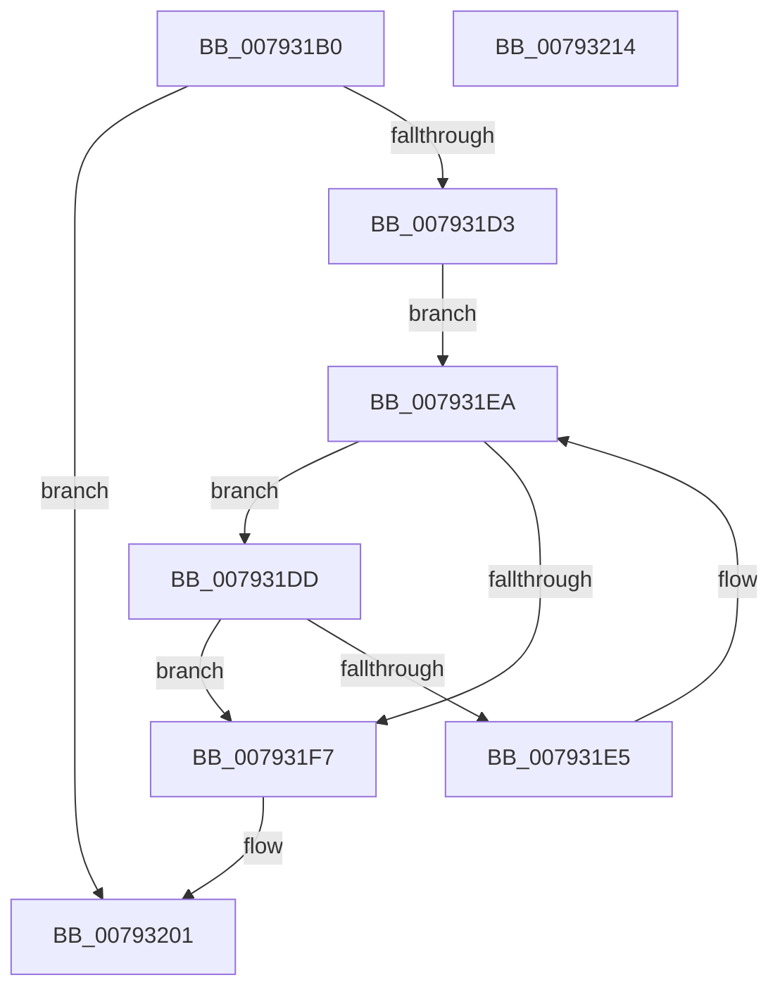

# Normalization__GetFirstDecomposedCharPlane0

- RVA: `0x007931B0`–`0x00793215` (길이 `101` bytes)
- VA: `0x00000001407931B0`
- 실행 섹션: `PAGE`
- PDB 이름 있음: `예`; PDB Function 태그: `아니요`
- unwind 정보 RVA: `0x000DB714`
- 디코드: `30`개 명령, `101/101` bytes 표시
- 미해석 바이트: `0` (있으면 어셈블리에 `.byte`로 보존)

> 이 문서는 커널 이미지의 기계어와 PDB 기호를 분석해 생성했습니다. 4번과 5번은 함수 원형과 자료형을 바이너리 사용 방식에서 추정한 C 해석이며 원본 소스 복구 결과는 아닙니다.

## 1. Dependencies

- 직접 호출 지점: **0**; 고유 호출 대상: **0**
- 직접 호출자로 확인된 함수: **3**
- RIP 상대 이미지 참조: **0**

### Outgoing calls
- 직접 디코드된 call 명령이 없습니다.

### Direct callers
- [NormBuffer__LastStartBase](../../text/5E/NormBuffer__LastStartBase_function_005EDAF4.md) at `0x005EDB0B`
- [Normalization__CanCombineWithStartBase](Normalization__CanCombineWithStartBase_function_00793098.md) at `0x007930B9`
- [Normalization__CanCombineWithStartFirstPair](Normalization__CanCombineWithStartFirstPair_function_007930E4.md) at `0x00793119`

### Static image references
- 디코드된 RIP-relative 메모리 참조가 없습니다.

## 2. Other-region calls and transfers

- 다른 실행 섹션으로 향하는 call: **0**
- 별도 외부 분기/꼬리 이동을 확인하지 못했습니다.

## 3. Assembly (complete function range)

```asm
007931B0  8B C2                           mov eax, edx
007931B2  44 8B DA                        mov r11d, edx
007931B5  99                              cdq
007931B6  4C 8B D1                        mov r10, rcx
007931B9  F7 79 38                        idiv dword ptr [rcx + 0x38]
007931BC  48 8B 41 40                     mov rax, qword ptr [rcx + 0x40]
007931C0  4C 63 C2                        movsxd r8, edx
007931C3  46 0F B7 0C 40                  movzx r9d, word ptr [rax + r8*2]
007931C8  B8 00 E0 00 00                  mov eax, 0xe000
007931CD  66 44 85 C8                     test ax, r9w
007931D1  75 2E                           jne 0x140793201
007931D3  48 8B 51 48                     mov rdx, qword ptr [rcx + 0x48]
007931D7  66 45 03 C9                     add r9w, r9w
007931DB  EB 0D                           jmp 0x1407931ea
007931DD  0F B7 C1                        movzx eax, cx
007931E0  41 3B C3                        cmp eax, r11d
007931E3  74 12                           je 0x1407931f7
007931E5  66 41 83 C1 02                  add r9w, 2
007931EA  41 0F B7 C1                     movzx eax, r9w
007931EE  0F B7 0C 42                     movzx ecx, word ptr [rdx + rax*2]
007931F2  66 85 C9                        test cx, cx
007931F5  75 E6                           jne 0x1407931dd
007931F7  41 0F B7 C1                     movzx eax, r9w
007931FB  44 0F B7 4C 42 02               movzx r9d, word ptr [rdx + rax*2 + 2]
00793201  49 8B 42 50                     mov rax, qword ptr [r10 + 0x50]
00793205  41 0F B7 C9                     movzx ecx, r9w
00793209  81 E1 FF 1F 00 00               and ecx, 0x1fff
0079320F  0F B7 04 48                     movzx eax, word ptr [rax + rcx*2]
00793213  C3                              ret
00793214  CC                              int3
```

## 4. C-style interpretation (structured pseudocode)

```c
__int64 __fastcall Normalization__GetFirstDecomposedCharPlane0(__int64 a1, int a2)
{
    if ((((unsigned __int16)((unsigned int)(0xE000ULL))) & ((unsigned __int16)(*(unsigned __int16 *)(*(unsigned __int64 *)(a1 + 64) + (int)(a2) * 2)))) != 0) goto loc_00793201;
    a4 = (unsigned __int16)((*(unsigned __int16 *)(*(unsigned __int64 *)(a1 + 64) + (int)(a2) * 2)) + ((unsigned __int16)(*(unsigned __int16 *)(*(unsigned __int64 *)(a1 + 64) + (int)(a2) * 2))));
    goto loc_007931EA;
loc_007931DD:
    if (((unsigned int)((unsigned __int16)(a1))) == ((unsigned int)((unsigned int)(a2)))) goto loc_007931F7;
    a4 = (unsigned __int16)((a4) + (2));
loc_007931EA:
    if ((unsigned __int16)(*(unsigned __int16 *)(*(unsigned __int64 *)(a1 + 72) + (unsigned __int16)(a4) * 2)) != 0) goto loc_007931DD;
loc_007931F7:
loc_00793201:
    a1 = (unsigned int)(((unsigned __int16)(*(unsigned __int16 *)(*(unsigned __int64 *)(a1 + 72) + (unsigned __int16)(a4) * 2 + 2))) & (0x1FFFULL));
    return *(unsigned __int16 *)(*(unsigned __int64 *)(a1 + 80) + a1 * 2);
}
```

## 5. (Beta) C Style

```c
int64_t Normalization__GetFirstDecomposedCharPlane0(void *Arg1, int32_t Arg2)
{
    uint8_t *arg1 = (uint8_t *)Arg1;

    if ((((uint16_t)((uint32_t)(0xE000ULL))) & ((uint16_t)(*(uint16_t *)(*(uint64_t *)(arg1 + 0x40) + (int32_t)(Arg2) * 2)))) != 0) goto loc_00793201;
    a4 = (uint16_t)((*(uint16_t *)(*(uint64_t *)(arg1 + 0x40) + (int32_t)(Arg2) * 2)) + ((uint16_t)(*(uint16_t *)(*(uint64_t *)(arg1 + 0x40) + (int32_t)(Arg2) * 2))));
    goto loc_007931EA;
loc_007931DD:
    if (((uint32_t)((uint16_t)(Arg1))) == ((uint32_t)((uint32_t)(Arg2)))) goto loc_007931F7;
    a4 = (uint16_t)((a4) + (2));
loc_007931EA:
    if ((uint16_t)(*(uint16_t *)(*(uint64_t *)(arg1 + 0x48) + (uint16_t)(a4) * 2)) != 0) goto loc_007931DD;
loc_007931F7:
loc_00793201:
    Arg1 = (uint32_t)(((uint16_t)(*(uint16_t *)(*(uint64_t *)(arg1 + 0x48) + (uint16_t)(a4) * 2 + 0x2))) & (0x1FFFULL));
    return *(uint16_t *)(*(uint64_t *)(arg1 + 0x50) + arg1 * 2);
}
```

### 관측된 메모리 오프셋

구조체 형식이 확인되지 않은 접근은 인자 기준의 오프셋으로만 기록했습니다.

| 기준 인자 | 오프셋 표현 | 폭 (bit) | 접근 |
|---|---:|---:|---|
| `Arg1` | `+ 0x38` | `32` | `R` |
| `Arg1` | `+ 0x40` | `64` | `R` |
| `Arg1` | `+ 0x48` | `64` | `R` |
| `Arg1` | `+ 0x50` | `64` | `R` |

## 6. Execution-region graph

[열기: 2D/3D 그래프와 함수 탐색 컨트롤 패널](../../../control-panel.html?section=page&rva=0x007931B0&view=graph)

- 2D 그래프는 위에서 아래로 흐르고, 3D 그래프는 빈 공간을 드래그해 회전합니다. Shift+드래그는 이동, 휠은 확대·축소, 함수 노드 선택은 대상 보고서 이동입니다.

### Static fallback


