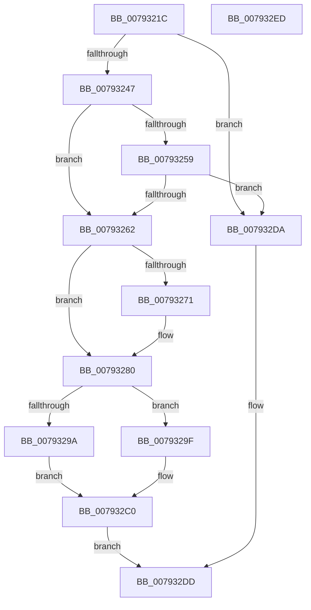

# Normalization__GetLastChar

- RVA: `0x0079321C`–`0x007932EE` (길이 `210` bytes)
- VA: `0x000000014079321C`
- 실행 섹션: `PAGE`
- PDB 이름 있음: `예`; PDB Function 태그: `아니요`
- unwind 정보 RVA: `0x00069588`
- 디코드: `60`개 명령, `210/210` bytes 표시
- 미해석 바이트: `0` (있으면 어셈블리에 `.byte`로 보존)

> 이 문서는 커널 이미지의 기계어와 PDB 기호를 분석해 생성했습니다. 4번과 5번은 함수 원형과 자료형을 바이너리 사용 방식에서 추정한 C 해석이며 원본 소스 복구 결과는 아닙니다.

## 1. Dependencies

- 직접 호출 지점: **0**; 고유 호출 대상: **0**
- 직접 호출자로 확인된 함수: **1**
- RIP 상대 이미지 참조: **0**

### Outgoing calls
- 직접 디코드된 call 명령이 없습니다.

### Direct callers
- [Normalization__IsNormalized](Normalization__IsNormalized_function_007934D0.md) at `0x00793720`
- [Normalization__IsNormalized](Normalization__IsNormalized_function_007934D0.md) at `0x00793919`

### Static image references
- 디코드된 RIP-relative 메모리 참조가 없습니다.

## 2. Other-region calls and transfers

- 다른 실행 섹션으로 향하는 call: **0**
- 별도 외부 분기/꼬리 이동을 확인하지 못했습니다.

## 3. Assembly (complete function range)

```asm
0079321C  48 89 5C 24 08                  mov qword ptr [rsp + 8], rbx
00793221  48 89 74 24 10                  mov qword ptr [rsp + 0x10], rsi
00793226  48 89 7C 24 18                  mov qword ptr [rsp + 0x18], rdi
0079322B  4D 8B 10                        mov r10, qword ptr [r8]
0079322E  48 83 EA 02                     sub rdx, 2
00793232  45 8B 19                        mov r11d, dword ptr [r9]
00793235  49 8B D9                        mov rbx, r9
00793238  49 8B F8                        mov rdi, r8
0079323B  48 8B F1                        mov rsi, rcx
0079323E  4C 3B D2                        cmp r10, rdx
00793241  0F 84 93 00 00 00               je 0x1407932da
00793247  B8 00 28 00 00                  mov eax, 0x2800
0079324C  B9 FF 07 00 00                  mov ecx, 0x7ff
00793251  66 03 02                        add ax, word ptr [rdx]
00793254  66 3B C1                        cmp ax, cx
00793257  77 09                           ja 0x140793262
00793259  48 83 EA 02                     sub rdx, 2
0079325D  4C 3B D2                        cmp r10, rdx
00793260  74 78                           je 0x1407932da
00793262  44 0F B7 02                     movzx r8d, word ptr [rdx]
00793266  41 8D 80 00 28 FF FF            lea eax, [r8 - 0xd800]
0079326D  3B C1                           cmp eax, ecx
0079326F  77 0F                           ja 0x140793280
00793271  0F B7 42 FE                     movzx eax, word ptr [rdx - 2]
00793275  2D F7 D7 00 00                  sub eax, 0xd7f7
0079327A  C1 E0 0A                        shl eax, 0xa
0079327D  44 03 C0                        add r8d, eax
00793280  48 8B 46 20                     mov rax, qword ptr [rsi + 0x20]
00793284  4D 63 C8                        movsxd r9, r8d
00793287  49 8B C9                        mov rcx, r9
0079328A  48 C1 F9 07                     sar rcx, 7
0079328E  44 0F B6 14 01                  movzx r10d, byte ptr [rcx + rax]
00793293  32 C9                           xor cl, cl
00793295  45 84 D2                        test r10b, r10b
00793298  75 05                           jne 0x14079329f
0079329A  44 8A C9                        mov r9b, cl
0079329D  EB 21                           jmp 0x1407932c0
0079329F  48 8B 46 28                     mov rax, qword ptr [rsi + 0x28]
007932A3  41 83 E1 7F                     and r9d, 0x7f
007932A7  49 8B CA                        mov rcx, r10
007932AA  48 C1 E1 07                     shl rcx, 7
007932AE  49 03 C9                        add rcx, r9
007932B1  44 8A 4C 01 80                  mov r9b, byte ptr [rcx + rax - 0x80]
007932B6  41 8A C9                        mov cl, r9b
007932B9  80 E1 3F                        and cl, 0x3f
007932BC  41 80 E1 C0                     and r9b, 0xc0
007932C0  48 8B 44 24 30                  mov rax, qword ptr [rsp + 0x30]
007932C5  44 88 08                        mov byte ptr [rax], r9b
007932C8  48 8B 44 24 28                  mov rax, qword ptr [rsp + 0x28]
007932CD  88 08                           mov byte ptr [rax], cl
007932CF  41 8B C0                        mov eax, r8d
007932D2  48 89 17                        mov qword ptr [rdi], rdx
007932D5  44 89 03                        mov dword ptr [rbx], r8d
007932D8  EB 03                           jmp 0x1407932dd
007932DA  41 8B C3                        mov eax, r11d
007932DD  48 8B 5C 24 08                  mov rbx, qword ptr [rsp + 8]
007932E2  48 8B 74 24 10                  mov rsi, qword ptr [rsp + 0x10]
007932E7  48 8B 7C 24 18                  mov rdi, qword ptr [rsp + 0x18]
007932EC  C3                              ret
007932ED  CC                              int3
```

## 4. C-style interpretation (structured pseudocode)

```c
__int64 __fastcall Normalization__GetLastChar(__int64 a1, __int64 a2, __int64 a3, __int64 a4, __int64 a5, __int64 a6)
{
    __int64 result;
    unsigned __int64 v_stack_p10;
    unsigned __int64 v_stack_p18;
    unsigned __int64 v_stack_p8;

    v_stack_p8 = v_rbx;
    v_stack_p10 = v_rsi;
    v_stack_p18 = v_rdi;
    a2 = (a2) - (2);
    if ((*(unsigned __int64 *)(a3)) == a2) goto loc_007932DA;
    result = (unsigned __int16)(((unsigned int)(0x2800ULL)) + (*(unsigned __int16 *)(a2)));
    if (((unsigned __int16)(result)) > ((unsigned __int16)((unsigned int)(0x7FFULL)))) goto loc_00793262;
    a2 = (a2) - (2);
    if ((*(unsigned __int64 *)(a3)) == a2) goto loc_007932DA;
loc_00793262:
    result = *(unsigned __int16 *)(a2) - 55296;
    if (((unsigned int)(*(unsigned __int16 *)(a2) - 55296)) <= ((unsigned int)((unsigned int)(0x7FFULL)))) {
        result = *(unsigned __int16 *)(a2 - 2);
        result = (unsigned int)((result) - (0xD7F7ULL));
        result = (unsigned int)((result) << (10));
        a3 = (unsigned int)((*(unsigned __int16 *)(a2)) + ((unsigned int)(result)));
    }
    a1 = ((int)((unsigned int)(a3))) >> (7);
    a1 = 0;
    if ((unsigned __int8)(*(unsigned __int8 *)(a1 + *(unsigned __int64 *)(a1 + 32) * 1)) != 0) goto loc_0079329F;
    goto loc_007932C0;
loc_0079329F:
    a4 = (unsigned int)((0) & (127));
    a1 = (*(unsigned __int8 *)(a1 + *(unsigned __int64 *)(a1 + 32) * 1)) << (7);
    a1 = (a1) + (a4);
    a1 = (unsigned __int8)(((unsigned __int8)(*(unsigned __int8 *)(a1 + *(unsigned __int64 *)(a1 + 40) * 1 - 128))) & (63));
    a4 = (unsigned __int8)((*(unsigned __int8 *)(a1 + *(unsigned __int64 *)(a1 + 40) * 1 - 128)) & (192));
loc_007932C0:
    *(unsigned __int8 *)(a6) = (unsigned __int8)(a4);
    *(unsigned __int8 *)(a5) = (unsigned __int8)(a1);
    *(unsigned __int64 *)(a3) = a2;
    *(unsigned int *)(a4) = (unsigned int)(a3);
    goto loc_007932DD;
loc_007932DA:
loc_007932DD:
    return (unsigned int)((unsigned int)((unsigned int)(*(unsigned int *)(a4))));
}
```

## 5. (Beta) C Style

```c
int64_t Normalization__GetLastChar(void *Arg1, void *Arg2, void *Arg3, void *Arg4, void *Arg5, void *Arg6)
{
    uint8_t *arg1 = (uint8_t *)Arg1;
    uint8_t *arg2 = (uint8_t *)Arg2;
    uint8_t *arg3 = (uint8_t *)Arg3;
    uint8_t *arg4 = (uint8_t *)Arg4;
    uint8_t *arg5 = (uint8_t *)Arg5;
    uint8_t *arg6 = (uint8_t *)Arg6;

    int64_t result;
    uint64_t v_stack_p10;
    uint64_t v_stack_p18;
    uint64_t v_stack_p8;

    v_stack_p8 = local_rbx;
    v_stack_p10 = local_rsi;
    v_stack_p18 = local_rdi;
    Arg2 = (Arg2) - (2);
    if ((*(uint64_t *)(arg3)) == Arg2) goto loc_007932DA;
    result = (uint16_t)(((uint32_t)(0x2800ULL)) + (*(uint16_t *)(arg2)));
    if (((uint16_t)(result)) > ((uint16_t)((uint32_t)(0x7FFULL)))) goto loc_00793262;
    Arg2 = (Arg2) - (2);
    if ((*(uint64_t *)(arg3)) == Arg2) goto loc_007932DA;
loc_00793262:
    result = *(uint16_t *)(arg2) - 55296;
    if (((uint32_t)(*(uint16_t *)(arg2) - 55296)) <= ((uint32_t)((uint32_t)(0x7FFULL)))) {
        result = *(uint16_t *)(arg2 - 0x2);
        result = (uint32_t)((result) - (0xD7F7ULL));
        result = (uint32_t)((result) << (10));
        Arg3 = (uint32_t)((*(uint16_t *)(arg2)) + ((uint32_t)(result)));
    }
    Arg1 = ((int32_t)((uint32_t)(Arg3))) >> (7);
    Arg1 = 0;
    if ((uint8_t)(*(uint8_t *)(arg1 + *(uint64_t *)(arg1 + 0x20) * 1)) != 0) goto loc_0079329F;
    goto loc_007932C0;
loc_0079329F:
    Arg4 = (uint32_t)((0) & (127));
    Arg1 = (*(uint8_t *)(arg1 + *(uint64_t *)(arg1 + 0x20) * 1)) << (7);
    Arg1 = (Arg1) + (Arg4);
    Arg1 = (uint8_t)(((uint8_t)(*(uint8_t *)(arg1 + *(uint64_t *)(arg1 + 0x28) * 1 - 0x80))) & (63));
    Arg4 = (uint8_t)((*(uint8_t *)(arg1 + *(uint64_t *)(arg1 + 0x28) * 1 - 0x80)) & (192));
loc_007932C0:
    *(uint8_t *)(arg6) = (uint8_t)(Arg4);
    *(uint8_t *)(arg5) = (uint8_t)(Arg1);
    *(void **)(arg3) = Arg2;
    *(uint32_t *)(arg4) = (uint32_t)(Arg3);
    goto loc_007932DD;
loc_007932DA:
loc_007932DD:
    return (uint32_t)((uint32_t)((uint32_t)(*(uint32_t *)(arg4))));
}
```

### 관측된 메모리 오프셋

구조체 형식이 확인되지 않은 접근은 인자 기준의 오프셋으로만 기록했습니다.

| 기준 인자 | 오프셋 표현 | 폭 (bit) | 접근 |
|---|---:|---:|---|
| `Arg1` | `+ 0x20` | `64` | `R` |
| `Arg1` | `+ 0x28` | `64` | `R` |
| `Arg2` | `- 0x2` | `16` | `R` |
| `Arg2` | `+ 0x0` | `16` | `R` |
| `Arg3` | `+ 0x0` | `64` | `R` |
| `Arg3` | `+ 0x0` | `64` | `W` |
| `Arg4` | `+ 0x0` | `32` | `R` |
| `Arg4` | `+ 0x0` | `32` | `W` |
| `Arg5` | `+ 0x0` | `8` | `W` |
| `Arg6` | `+ 0x0` | `8` | `W` |

## 6. Execution-region graph

[열기: 2D/3D 그래프와 함수 탐색 컨트롤 패널](../../../control-panel.html?section=page&rva=0x0079321C&view=graph)

- 2D 그래프는 위에서 아래로 흐르고, 3D 그래프는 빈 공간을 드래그해 회전합니다. Shift+드래그는 이동, 휠은 확대·축소, 함수 노드 선택은 대상 보고서 이동입니다.

### Static fallback


