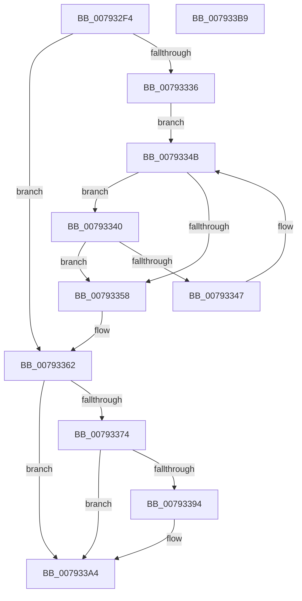

# Normalization__GetSecondAndThirdDecomposedCharPlane0

- RVA: `0x007932F4`–`0x007933BA` (길이 `198` bytes)
- VA: `0x00000001407932F4`
- 실행 섹션: `PAGE`
- PDB 이름 있음: `예`; PDB Function 태그: `아니요`
- unwind 정보 RVA: `0x000A5A38`
- 디코드: `58`개 명령, `198/198` bytes 표시
- 미해석 바이트: `0` (있으면 어셈블리에 `.byte`로 보존)

> 이 문서는 커널 이미지의 기계어와 PDB 기호를 분석해 생성했습니다. 4번과 5번은 함수 원형과 자료형을 바이너리 사용 방식에서 추정한 C 해석이며 원본 소스 복구 결과는 아닙니다.

## 1. Dependencies

- 직접 호출 지점: **0**; 고유 호출 대상: **0**
- 직접 호출자로 확인된 함수: **1**
- RIP 상대 이미지 참조: **0**

### Outgoing calls
- 직접 디코드된 call 명령이 없습니다.

### Direct callers
- [NormBuffer__ReplaceLastStartBase](../../text/5E/NormBuffer__ReplaceLastStartBase_function_005EDCBC.md) at `0x005EDCFF`

### Static image references
- 디코드된 RIP-relative 메모리 참조가 없습니다.

## 2. Other-region calls and transfers

- 다른 실행 섹션으로 향하는 call: **0**
- 별도 외부 분기/꼬리 이동을 확인하지 못했습니다.

## 3. Assembly (complete function range)

```asm
007932F4  48 8B C4                        mov rax, rsp
007932F7  48 89 58 08                     mov qword ptr [rax + 8], rbx
007932FB  48 89 68 10                     mov qword ptr [rax + 0x10], rbp
007932FF  48 89 70 18                     mov qword ptr [rax + 0x18], rsi
00793303  48 89 78 20                     mov qword ptr [rax + 0x20], rdi
00793307  8B C2                           mov eax, edx
00793309  8B DA                           mov ebx, edx
0079330B  99                              cdq
0079330C  33 F6                           xor esi, esi
0079330E  F7 79 38                        idiv dword ptr [rcx + 0x38]
00793311  48 8B 41 40                     mov rax, qword ptr [rcx + 0x40]
00793315  49 8B F8                        mov rdi, r8
00793318  4C 63 D2                        movsxd r10, edx
0079331B  8D 6E 02                        lea ebp, [rsi + 2]
0079331E  4C 8B C1                        mov r8, rcx
00793321  41 89 31                        mov dword ptr [r9], esi
00793324  89 37                           mov dword ptr [rdi], esi
00793326  46 0F B7 1C 50                  movzx r11d, word ptr [rax + r10*2]
0079332B  B8 00 E0 00 00                  mov eax, 0xe000
00793330  66 44 85 D8                     test ax, r11w
00793334  75 2C                           jne 0x140793362
00793336  48 8B 51 48                     mov rdx, qword ptr [rcx + 0x48]
0079333A  66 45 03 DB                     add r11w, r11w
0079333E  EB 0B                           jmp 0x14079334b
00793340  0F B7 C1                        movzx eax, cx
00793343  3B C3                           cmp eax, ebx
00793345  74 11                           je 0x140793358
00793347  66 44 03 DD                     add r11w, bp
0079334B  41 0F B7 C3                     movzx eax, r11w
0079334F  0F B7 0C 42                     movzx ecx, word ptr [rdx + rax*2]
00793353  66 85 C9                        test cx, cx
00793356  75 E8                           jne 0x140793340
00793358  41 0F B7 C3                     movzx eax, r11w
0079335C  44 0F B7 5C 42 02               movzx r11d, word ptr [rdx + rax*2 + 2]
00793362  41 0F B7 D3                     movzx edx, r11w
00793366  41 BA 01 00 00 00               mov r10d, 1
0079336C  C1 EA 0D                        shr edx, 0xd
0079336F  41 3B D2                        cmp edx, r10d
00793372  76 30                           jbe 0x1407933a4
00793374  4D 8B 40 50                     mov r8, qword ptr [r8 + 0x50]
00793378  B8 FF 1F 00 00                  mov eax, 0x1fff
0079337D  66 44 23 D8                     and r11w, ax
00793381  66 45 03 DA                     add r11w, r10w
00793385  41 0F B7 C3                     movzx eax, r11w
00793389  41 0F B7 0C 40                  movzx ecx, word ptr [r8 + rax*2]
0079338E  89 0F                           mov dword ptr [rdi], ecx
00793390  3B D5                           cmp edx, ebp
00793392  74 10                           je 0x1407933a4
00793394  66 45 03 DA                     add r11w, r10w
00793398  41 0F B7 C3                     movzx eax, r11w
0079339C  41 0F B7 0C 40                  movzx ecx, word ptr [r8 + rax*2]
007933A1  41 89 09                        mov dword ptr [r9], ecx
007933A4  48 8B 5C 24 08                  mov rbx, qword ptr [rsp + 8]
007933A9  48 8B 6C 24 10                  mov rbp, qword ptr [rsp + 0x10]
007933AE  48 8B 74 24 18                  mov rsi, qword ptr [rsp + 0x18]
007933B3  48 8B 7C 24 20                  mov rdi, qword ptr [rsp + 0x20]
007933B8  C3                              ret
007933B9  CC                              int3
```

## 4. C-style interpretation (structured pseudocode)

```c
__int64 __fastcall Normalization__GetSecondAndThirdDecomposedCharPlane0(__int64 a1, int a2, __int64 a3, __int64 a4)
{
    __int64 result;
    __int64 v_r11;
    __int64 v_rsi;
    unsigned __int64 v_stack_p10;
    unsigned __int64 v_stack_p18;
    unsigned __int64 v_stack_p20;
    unsigned __int64 v_stack_p8;

    *(unsigned __int64 *)(v_rsp + 8) = v_rbx;
    *(unsigned __int64 *)(v_rsp + 16) = v_rbp;
    *(unsigned __int64 *)(v_rsp + 24) = v_rsi;
    *(unsigned __int64 *)(v_rsp + 32) = v_rdi;
    v_rsi = 0;
    *(unsigned int *)(a4) = 0;
    *(unsigned int *)(a3) = 0;
    if ((((unsigned __int16)((unsigned int)(0xE000ULL))) & ((unsigned __int16)(*(unsigned __int16 *)(*(unsigned __int64 *)(a1 + 64) + (int)(a2) * 2)))) != 0) goto loc_00793362;
    v_r11 = (unsigned __int16)((*(unsigned __int16 *)(*(unsigned __int64 *)(a1 + 64) + (int)(a2) * 2)) + ((unsigned __int16)(*(unsigned __int16 *)(*(unsigned __int64 *)(a1 + 64) + (int)(a2) * 2))));
    goto loc_0079334B;
loc_00793340:
    if (((unsigned int)((unsigned __int16)(a1))) == ((unsigned int)((unsigned int)(a2)))) goto loc_00793358;
    v_r11 = (unsigned __int16)((v_r11) + ((unsigned __int16)(v_rsi + 2)));
loc_0079334B:
    if ((unsigned __int16)(*(unsigned __int16 *)(*(unsigned __int64 *)(a1 + 72) + (unsigned __int16)(v_r11) * 2)) != 0) goto loc_00793340;
loc_00793358:
loc_00793362:
    a2 = (unsigned int)(((unsigned __int16)(*(unsigned __int16 *)(*(unsigned __int64 *)(a1 + 72) + (unsigned __int16)(v_r11) * 2 + 2))) >> (13));
    if (a2 <= 1) goto loc_007933A4;
    v_r11 = (unsigned __int16)((*(unsigned __int16 *)(*(unsigned __int64 *)(a1 + 72) + (unsigned __int16)(v_r11) * 2 + 2)) & ((unsigned __int16)((unsigned int)(0x1FFFULL))));
    v_r11 = (unsigned __int16)((v_r11) + (1));
    *(unsigned int *)(a3) = (unsigned int)(*(unsigned __int16 *)(*(unsigned __int64 *)(a1 + 80) + (unsigned __int16)(v_r11) * 2));
    result = (unsigned __int16)(v_r11);
    if (a2 != ((unsigned int)(v_rsi + 2))) {
        v_r11 = (unsigned __int16)((v_r11) + (1));
        result = (unsigned __int16)(v_r11);
        a1 = *(unsigned __int16 *)(*(unsigned __int64 *)(a1 + 80) + result * 2);
        *(unsigned int *)(a4) = (unsigned int)(a1);
    }
    return result;
}
```

## 5. (Beta) C Style

```c
int64_t Normalization__GetSecondAndThirdDecomposedCharPlane0(void *Arg1, int32_t Arg2, void *Arg3, void *Arg4)
{
    uint8_t *arg1 = (uint8_t *)Arg1;
    uint8_t *arg3 = (uint8_t *)Arg3;
    uint8_t *arg4 = (uint8_t *)Arg4;

    int64_t result;
    int64_t local_r11;
    int64_t local_rsi;
    uint64_t v_stack_p10;
    uint64_t v_stack_p18;
    uint64_t v_stack_p20;
    uint64_t v_stack_p8;

    *(uint64_t *)(local_rsp + 0x8) = local_rbx;
    *(uint64_t *)(local_rsp + 0x10) = local_rbp;
    *(uint64_t *)(local_rsp + 0x18) = local_rsi;
    *(uint64_t *)(local_rsp + 0x20) = local_rdi;
    local_rsi = 0;
    *(uint32_t *)(arg4) = 0;
    *(uint32_t *)(arg3) = 0;
    if ((((uint16_t)((uint32_t)(0xE000ULL))) & ((uint16_t)(*(uint16_t *)(*(uint64_t *)(arg1 + 0x40) + (int32_t)(Arg2) * 2)))) != 0) goto loc_00793362;
    local_r11 = (uint16_t)((*(uint16_t *)(*(uint64_t *)(arg1 + 0x40) + (int32_t)(Arg2) * 2)) + ((uint16_t)(*(uint16_t *)(*(uint64_t *)(arg1 + 0x40) + (int32_t)(Arg2) * 2))));
    goto loc_0079334B;
loc_00793340:
    if (((uint32_t)((uint16_t)(Arg1))) == ((uint32_t)((uint32_t)(Arg2)))) goto loc_00793358;
    local_r11 = (uint16_t)((local_r11) + ((uint16_t)(local_rsi + 2)));
loc_0079334B:
    if ((uint16_t)(*(uint16_t *)(*(uint64_t *)(arg1 + 0x48) + (uint16_t)(local_r11) * 2)) != 0) goto loc_00793340;
loc_00793358:
loc_00793362:
    Arg2 = (uint32_t)(((uint16_t)(*(uint16_t *)(*(uint64_t *)(arg1 + 0x48) + (uint16_t)(local_r11) * 2 + 0x2))) >> (13));
    if (Arg2 <= 1) goto loc_007933A4;
    local_r11 = (uint16_t)((*(uint16_t *)(*(uint64_t *)(arg1 + 0x48) + (uint16_t)(local_r11) * 2 + 0x2)) & ((uint16_t)((uint32_t)(0x1FFFULL))));
    local_r11 = (uint16_t)((local_r11) + (1));
    *(uint32_t *)(arg3) = (uint32_t)(*(uint16_t *)(*(uint64_t *)(arg1 + 0x50) + (uint16_t)(local_r11) * 2));
    result = (uint16_t)(local_r11);
    if (Arg2 != ((uint32_t)(local_rsi + 2))) {
        local_r11 = (uint16_t)((local_r11) + (1));
        result = (uint16_t)(local_r11);
        Arg1 = *(uint16_t *)(*(uint64_t *)(arg1 + 0x50) + result * 2);
        *(uint32_t *)(arg4) = (uint32_t)(Arg1);
    }
    return result;
}
```

### 관측된 메모리 오프셋

구조체 형식이 확인되지 않은 접근은 인자 기준의 오프셋으로만 기록했습니다.

| 기준 인자 | 오프셋 표현 | 폭 (bit) | 접근 |
|---|---:|---:|---|
| `Arg1` | `+ 0x38` | `32` | `R` |
| `Arg1` | `+ 0x40` | `64` | `R` |
| `Arg1` | `+ 0x48` | `64` | `R` |
| `Arg1` | `+ 0x50` | `64` | `R` |
| `Arg3` | `+ 0x0` | `32` | `W` |
| `Arg4` | `+ 0x0` | `32` | `W` |

## 6. Execution-region graph

[열기: 2D/3D 그래프와 함수 탐색 컨트롤 패널](../../../control-panel.html?section=page&rva=0x007932F4&view=graph)

- 2D 그래프는 위에서 아래로 흐르고, 3D 그래프는 빈 공간을 드래그해 회전합니다. Shift+드래그는 이동, 휠은 확대·축소, 함수 노드 선택은 대상 보고서 이동입니다.

### Static fallback


