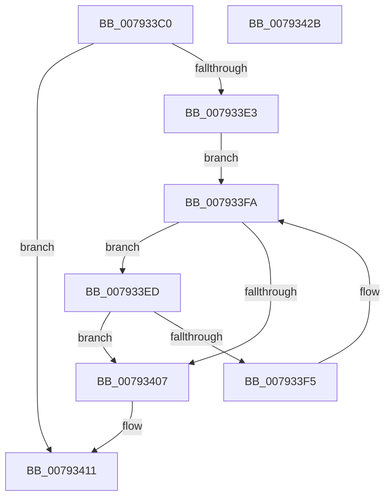

# Normalization__GetSecondDecomposedCharPlane0

- RVA: `0x007933C0`–`0x0079342C` (길이 `108` bytes)
- VA: `0x00000001407933C0`
- 실행 섹션: `PAGE`
- PDB 이름 있음: `예`; PDB Function 태그: `아니요`
- unwind 정보 RVA: `0x000DB714`
- 디코드: `32`개 명령, `108/108` bytes 표시
- 미해석 바이트: `0` (있으면 어셈블리에 `.byte`로 보존)

> 이 문서는 커널 이미지의 기계어와 PDB 기호를 분석해 생성했습니다. 4번과 5번은 함수 원형과 자료형을 바이너리 사용 방식에서 추정한 C 해석이며 원본 소스 복구 결과는 아닙니다.

## 1. Dependencies

- 직접 호출 지점: **0**; 고유 호출 대상: **0**
- 직접 호출자로 확인된 함수: **2**
- RIP 상대 이미지 참조: **0**

### Outgoing calls
- 직접 디코드된 call 명령이 없습니다.

### Direct callers
- [NormBuffer__LastStartBasePair](../../text/5E/NormBuffer__LastStartBasePair_function_005EDB20.md) at `0x005EDB3B`
- [Normalization__CanCombineWithStartFirstPair](Normalization__CanCombineWithStartFirstPair_function_007930E4.md) at `0x00793127`

### Static image references
- 디코드된 RIP-relative 메모리 참조가 없습니다.

## 2. Other-region calls and transfers

- 다른 실행 섹션으로 향하는 call: **0**
- 별도 외부 분기/꼬리 이동을 확인하지 못했습니다.

## 3. Assembly (complete function range)

```asm
007933C0  8B C2                           mov eax, edx
007933C2  44 8B DA                        mov r11d, edx
007933C5  99                              cdq
007933C6  4C 8B D1                        mov r10, rcx
007933C9  F7 79 38                        idiv dword ptr [rcx + 0x38]
007933CC  48 8B 41 40                     mov rax, qword ptr [rcx + 0x40]
007933D0  4C 63 C2                        movsxd r8, edx
007933D3  46 0F B7 0C 40                  movzx r9d, word ptr [rax + r8*2]
007933D8  B8 00 E0 00 00                  mov eax, 0xe000
007933DD  66 44 85 C8                     test ax, r9w
007933E1  75 2E                           jne 0x140793411
007933E3  48 8B 51 48                     mov rdx, qword ptr [rcx + 0x48]
007933E7  66 45 03 C9                     add r9w, r9w
007933EB  EB 0D                           jmp 0x1407933fa
007933ED  0F B7 C1                        movzx eax, cx
007933F0  41 3B C3                        cmp eax, r11d
007933F3  74 12                           je 0x140793407
007933F5  66 41 83 C1 02                  add r9w, 2
007933FA  41 0F B7 C1                     movzx eax, r9w
007933FE  0F B7 0C 42                     movzx ecx, word ptr [rdx + rax*2]
00793402  66 85 C9                        test cx, cx
00793405  75 E6                           jne 0x1407933ed
00793407  41 0F B7 C1                     movzx eax, r9w
0079340B  44 0F B7 4C 42 02               movzx r9d, word ptr [rdx + rax*2 + 2]
00793411  B8 FF 1F 00 00                  mov eax, 0x1fff
00793416  66 44 23 C8                     and r9w, ax
0079341A  49 8B 42 50                     mov rax, qword ptr [r10 + 0x50]
0079341E  66 41 FF C1                     inc r9w
00793422  41 0F B7 C9                     movzx ecx, r9w
00793426  0F B7 04 48                     movzx eax, word ptr [rax + rcx*2]
0079342A  C3                              ret
0079342B  CC                              int3
```

## 4. C-style interpretation (structured pseudocode)

```c
__int64 __fastcall Normalization__GetSecondDecomposedCharPlane0(__int64 a1, int a2)
{
    if ((((unsigned __int16)((unsigned int)(0xE000ULL))) & ((unsigned __int16)(*(unsigned __int16 *)(*(unsigned __int64 *)(a1 + 64) + (int)(a2) * 2)))) != 0) goto loc_00793411;
    a4 = (unsigned __int16)((*(unsigned __int16 *)(*(unsigned __int64 *)(a1 + 64) + (int)(a2) * 2)) + ((unsigned __int16)(*(unsigned __int16 *)(*(unsigned __int64 *)(a1 + 64) + (int)(a2) * 2))));
    goto loc_007933FA;
loc_007933ED:
    if (((unsigned int)((unsigned __int16)(a1))) == ((unsigned int)((unsigned int)(a2)))) goto loc_00793407;
    a4 = (unsigned __int16)((a4) + (2));
loc_007933FA:
    if ((unsigned __int16)(*(unsigned __int16 *)(*(unsigned __int64 *)(a1 + 72) + (unsigned __int16)(a4) * 2)) != 0) goto loc_007933ED;
loc_00793407:
loc_00793411:
    a4 = (unsigned __int16)((*(unsigned __int16 *)(*(unsigned __int64 *)(a1 + 72) + (unsigned __int16)(a4) * 2 + 2)) & ((unsigned __int16)((unsigned int)(0x1FFFULL))));
    a4 = (unsigned __int16)((a4) + 1);
    return *(unsigned __int16 *)(*(unsigned __int64 *)(a1 + 80) + (unsigned __int16)(a4) * 2);
}
```

## 5. (Beta) C Style

```c
int64_t Normalization__GetSecondDecomposedCharPlane0(void *Arg1, int32_t Arg2)
{
    uint8_t *arg1 = (uint8_t *)Arg1;

    if ((((uint16_t)((uint32_t)(0xE000ULL))) & ((uint16_t)(*(uint16_t *)(*(uint64_t *)(arg1 + 0x40) + (int32_t)(Arg2) * 2)))) != 0) goto loc_00793411;
    a4 = (uint16_t)((*(uint16_t *)(*(uint64_t *)(arg1 + 0x40) + (int32_t)(Arg2) * 2)) + ((uint16_t)(*(uint16_t *)(*(uint64_t *)(arg1 + 0x40) + (int32_t)(Arg2) * 2))));
    goto loc_007933FA;
loc_007933ED:
    if (((uint32_t)((uint16_t)(Arg1))) == ((uint32_t)((uint32_t)(Arg2)))) goto loc_00793407;
    a4 = (uint16_t)((a4) + (2));
loc_007933FA:
    if ((uint16_t)(*(uint16_t *)(*(uint64_t *)(arg1 + 0x48) + (uint16_t)(a4) * 2)) != 0) goto loc_007933ED;
loc_00793407:
loc_00793411:
    a4 = (uint16_t)((*(uint16_t *)(*(uint64_t *)(arg1 + 0x48) + (uint16_t)(a4) * 2 + 0x2)) & ((uint16_t)((uint32_t)(0x1FFFULL))));
    a4 = (uint16_t)((a4) + 1);
    return *(uint16_t *)(*(uint64_t *)(arg1 + 0x50) + (uint16_t)(a4) * 2);
}
```

### 관측된 메모리 오프셋

구조체 형식이 확인되지 않은 접근은 인자 기준의 오프셋으로만 기록했습니다.

| 기준 인자 | 오프셋 표현 | 폭 (bit) | 접근 |
|---|---:|---:|---|
| `Arg1` | `+ 0x38` | `32` | `R` |
| `Arg1` | `+ 0x40` | `64` | `R` |
| `Arg1` | `+ 0x48` | `64` | `R` |
| `Arg1` | `+ 0x50` | `64` | `R` |

## 6. Execution-region graph

[열기: 2D/3D 그래프와 함수 탐색 컨트롤 패널](../../../control-panel.html?section=page&rva=0x007933C0&view=graph)

- 2D 그래프는 위에서 아래로 흐르고, 3D 그래프는 빈 공간을 드래그해 회전합니다. Shift+드래그는 이동, 휠은 확대·축소, 함수 노드 선택은 대상 보고서 이동입니다.

### Static fallback


