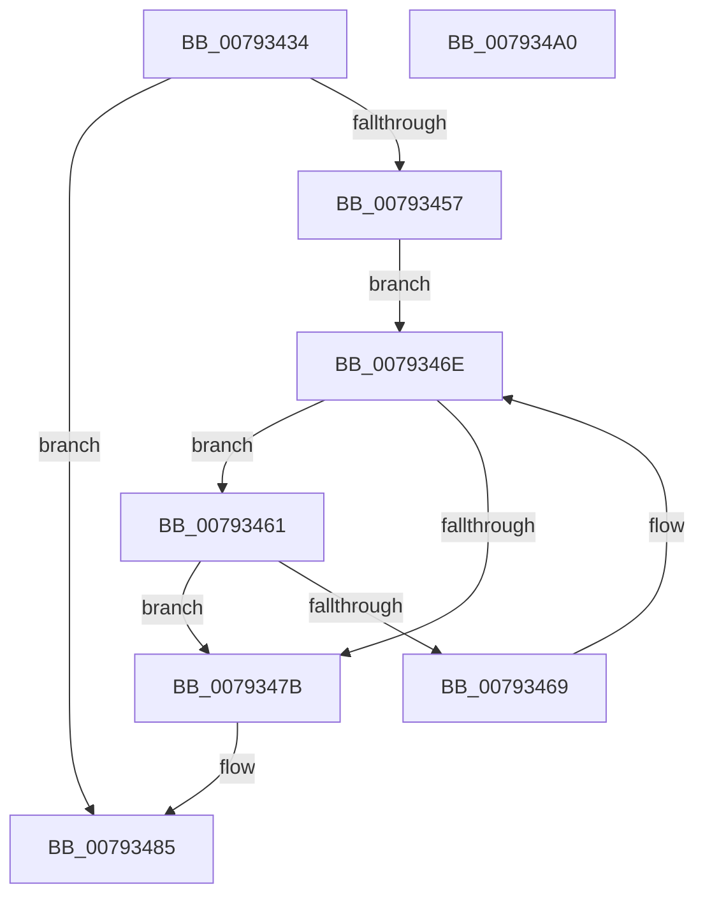

# Normalization__GetThirdAndLastDecomposedCharPlane0

- RVA: `0x00793434`–`0x007934A1` (길이 `109` bytes)
- VA: `0x0000000140793434`
- 실행 섹션: `PAGE`
- PDB 이름 있음: `예`; PDB Function 태그: `아니요`
- unwind 정보 RVA: `0x000DB714`
- 디코드: `32`개 명령, `109/109` bytes 표시
- 미해석 바이트: `0` (있으면 어셈블리에 `.byte`로 보존)

> 이 문서는 커널 이미지의 기계어와 PDB 기호를 분석해 생성했습니다. 4번과 5번은 함수 원형과 자료형을 바이너리 사용 방식에서 추정한 C 해석이며 원본 소스 복구 결과는 아닙니다.

## 1. Dependencies

- 직접 호출 지점: **0**; 고유 호출 대상: **0**
- 직접 호출자로 확인된 함수: **1**
- RIP 상대 이미지 참조: **0**

### Outgoing calls
- 직접 디코드된 call 명령이 없습니다.

### Direct callers
- [NormBuffer__ReplaceLastStartBasePair](../../text/5E/NormBuffer__ReplaceLastStartBasePair_function_005EDD3C.md) at `0x005EDD62`

### Static image references
- 디코드된 RIP-relative 메모리 참조가 없습니다.

## 2. Other-region calls and transfers

- 다른 실행 섹션으로 향하는 call: **0**
- 별도 외부 분기/꼬리 이동을 확인하지 못했습니다.

## 3. Assembly (complete function range)

```asm
00793434  8B C2                           mov eax, edx
00793436  44 8B DA                        mov r11d, edx
00793439  99                              cdq
0079343A  4C 8B D1                        mov r10, rcx
0079343D  F7 79 38                        idiv dword ptr [rcx + 0x38]
00793440  48 8B 41 40                     mov rax, qword ptr [rcx + 0x40]
00793444  4C 63 C2                        movsxd r8, edx
00793447  46 0F B7 0C 40                  movzx r9d, word ptr [rax + r8*2]
0079344C  B8 00 E0 00 00                  mov eax, 0xe000
00793451  66 44 85 C8                     test ax, r9w
00793455  75 2E                           jne 0x140793485
00793457  48 8B 51 48                     mov rdx, qword ptr [rcx + 0x48]
0079345B  66 45 03 C9                     add r9w, r9w
0079345F  EB 0D                           jmp 0x14079346e
00793461  0F B7 C1                        movzx eax, cx
00793464  41 3B C3                        cmp eax, r11d
00793467  74 12                           je 0x14079347b
00793469  66 41 83 C1 02                  add r9w, 2
0079346E  41 0F B7 C1                     movzx eax, r9w
00793472  0F B7 0C 42                     movzx ecx, word ptr [rdx + rax*2]
00793476  66 85 C9                        test cx, cx
00793479  75 E6                           jne 0x140793461
0079347B  41 0F B7 C1                     movzx eax, r9w
0079347F  44 0F B7 4C 42 02               movzx r9d, word ptr [rdx + rax*2 + 2]
00793485  B8 FF 1F 00 00                  mov eax, 0x1fff
0079348A  66 44 23 C8                     and r9w, ax
0079348E  49 8B 42 50                     mov rax, qword ptr [r10 + 0x50]
00793492  66 41 83 C1 02                  add r9w, 2
00793497  41 0F B7 C9                     movzx ecx, r9w
0079349B  0F B7 04 48                     movzx eax, word ptr [rax + rcx*2]
0079349F  C3                              ret
007934A0  CC                              int3
```

## 4. C-style interpretation (structured pseudocode)

```c
__int64 __fastcall Normalization__GetThirdAndLastDecomposedCharPlane0(__int64 a1, int a2)
{
    if ((((unsigned __int16)((unsigned int)(0xE000ULL))) & ((unsigned __int16)(*(unsigned __int16 *)(*(unsigned __int64 *)(a1 + 64) + (int)(a2) * 2)))) != 0) goto loc_00793485;
    a4 = (unsigned __int16)((*(unsigned __int16 *)(*(unsigned __int64 *)(a1 + 64) + (int)(a2) * 2)) + ((unsigned __int16)(*(unsigned __int16 *)(*(unsigned __int64 *)(a1 + 64) + (int)(a2) * 2))));
    goto loc_0079346E;
loc_00793461:
    if (((unsigned int)((unsigned __int16)(a1))) == ((unsigned int)((unsigned int)(a2)))) goto loc_0079347B;
    a4 = (unsigned __int16)((a4) + (2));
loc_0079346E:
    if ((unsigned __int16)(*(unsigned __int16 *)(*(unsigned __int64 *)(a1 + 72) + (unsigned __int16)(a4) * 2)) != 0) goto loc_00793461;
loc_0079347B:
loc_00793485:
    a4 = (unsigned __int16)((*(unsigned __int16 *)(*(unsigned __int64 *)(a1 + 72) + (unsigned __int16)(a4) * 2 + 2)) & ((unsigned __int16)((unsigned int)(0x1FFFULL))));
    a4 = (unsigned __int16)((a4) + (2));
    return *(unsigned __int16 *)(*(unsigned __int64 *)(a1 + 80) + (unsigned __int16)(a4) * 2);
}
```

## 5. (Beta) C Style

```c
int64_t Normalization__GetThirdAndLastDecomposedCharPlane0(void *Arg1, int32_t Arg2)
{
    uint8_t *arg1 = (uint8_t *)Arg1;

    if ((((uint16_t)((uint32_t)(0xE000ULL))) & ((uint16_t)(*(uint16_t *)(*(uint64_t *)(arg1 + 0x40) + (int32_t)(Arg2) * 2)))) != 0) goto loc_00793485;
    a4 = (uint16_t)((*(uint16_t *)(*(uint64_t *)(arg1 + 0x40) + (int32_t)(Arg2) * 2)) + ((uint16_t)(*(uint16_t *)(*(uint64_t *)(arg1 + 0x40) + (int32_t)(Arg2) * 2))));
    goto loc_0079346E;
loc_00793461:
    if (((uint32_t)((uint16_t)(Arg1))) == ((uint32_t)((uint32_t)(Arg2)))) goto loc_0079347B;
    a4 = (uint16_t)((a4) + (2));
loc_0079346E:
    if ((uint16_t)(*(uint16_t *)(*(uint64_t *)(arg1 + 0x48) + (uint16_t)(a4) * 2)) != 0) goto loc_00793461;
loc_0079347B:
loc_00793485:
    a4 = (uint16_t)((*(uint16_t *)(*(uint64_t *)(arg1 + 0x48) + (uint16_t)(a4) * 2 + 0x2)) & ((uint16_t)((uint32_t)(0x1FFFULL))));
    a4 = (uint16_t)((a4) + (2));
    return *(uint16_t *)(*(uint64_t *)(arg1 + 0x50) + (uint16_t)(a4) * 2);
}
```

### 관측된 메모리 오프셋

구조체 형식이 확인되지 않은 접근은 인자 기준의 오프셋으로만 기록했습니다.

| 기준 인자 | 오프셋 표현 | 폭 (bit) | 접근 |
|---|---:|---:|---|
| `Arg1` | `+ 0x38` | `32` | `R` |
| `Arg1` | `+ 0x40` | `64` | `R` |
| `Arg1` | `+ 0x48` | `64` | `R` |
| `Arg1` | `+ 0x50` | `64` | `R` |

## 6. Execution-region graph

[열기: 2D/3D 그래프와 함수 탐색 컨트롤 패널](../../../control-panel.html?section=page&rva=0x00793434&view=graph)

- 2D 그래프는 위에서 아래로 흐르고, 3D 그래프는 빈 공간을 드래그해 회전합니다. Shift+드래그는 이동, 휠은 확대·축소, 함수 노드 선택은 대상 보고서 이동입니다.

### Static fallback


