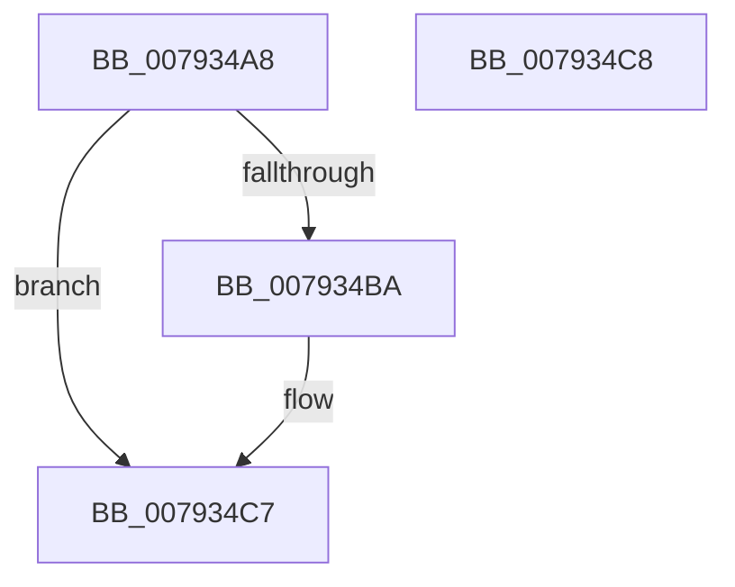

# Normalization__GuessCharCountBySize

- RVA: `0x007934A8`–`0x007934C9` (길이 `33` bytes)
- VA: `0x00000001407934A8`
- 실행 섹션: `PAGE`
- PDB 이름 있음: `예`; PDB Function 태그: `아니요`
- unwind 정보 RVA: `0x000DB714`
- 디코드: `12`개 명령, `33/33` bytes 표시
- 미해석 바이트: `0` (있으면 어셈블리에 `.byte`로 보존)

> 이 문서는 커널 이미지의 기계어와 PDB 기호를 분석해 생성했습니다. 4번과 5번은 함수 원형과 자료형을 바이너리 사용 방식에서 추정한 C 해석이며 원본 소스 복구 결과는 아닙니다.

## 1. Dependencies

- 직접 호출 지점: **0**; 고유 호출 대상: **0**
- 직접 호출자로 확인된 함수: **2**
- RIP 상대 이미지 참조: **0**

### Outgoing calls
- 직접 디코드된 call 명령이 없습니다.

### Direct callers
- [Normalization__Normalize](Normalization__Normalize_function_00793B70.md) at `0x00793CD6`
- [RtlpNormalizeStringWorker](RtlpNormalizeStringWorker_function_007946C4.md) at `0x00794740`

### Static image references
- 디코드된 RIP-relative 메모리 참조가 없습니다.

## 2. Other-region calls and transfers

- 다른 실행 섹션으로 향하는 call: **0**
- 별도 외부 분기/꼬리 이동을 확인하지 못했습니다.

## 3. Assembly (complete function range)

```asm
007934A8  8B C2                           mov eax, edx
007934AA  41 B8 40 00 00 00               mov r8d, 0x40
007934B0  C1 F8 03                        sar eax, 3
007934B3  03 C2                           add eax, edx
007934B5  41 3B C0                        cmp eax, r8d
007934B8  7D 0D                           jge 0x1407934c7
007934BA  8B C2                           mov eax, edx
007934BC  0F AF 41 18                     imul eax, dword ptr [rcx + 0x18]
007934C0  41 3B C0                        cmp eax, r8d
007934C3  41 0F 4F C0                     cmovg eax, r8d
007934C7  C3                              ret
007934C8  CC                              int3
```

## 4. C-style interpretation (structured pseudocode)

```c
__int64 __fastcall Normalization__GuessCharCountBySize(__int64 a1, int a2)
{
    __int64 result;

    result = (unsigned int)(((unsigned int)(a2)) >> (3));
    result = (unsigned int)((result) + (a2));
    if (((unsigned int)(result)) < 64) {
        result = a2;
        result = (unsigned int)((result) * (*(unsigned int *)(a1 + 24)));
        if (((unsigned int)(result)) > 64) { result = 64; }
    }
    return result;
}
```

## 5. (Beta) C Style

```c
int64_t Normalization__GuessCharCountBySize(void *Arg1, int32_t Arg2)
{
    uint8_t *arg1 = (uint8_t *)Arg1;

    int64_t result;

    result = (uint32_t)(((uint32_t)(Arg2)) >> (3));
    result = (uint32_t)((result) + (Arg2));
    if (((uint32_t)(result)) < 64) {
        result = Arg2;
        result = (uint32_t)((result) * (*(uint32_t *)(arg1 + 0x18)));
        if (((uint32_t)(result)) > 64) { result = 64; }
    }
    return result;
}
```

### 관측된 메모리 오프셋

구조체 형식이 확인되지 않은 접근은 인자 기준의 오프셋으로만 기록했습니다.

| 기준 인자 | 오프셋 표현 | 폭 (bit) | 접근 |
|---|---:|---:|---|
| `Arg1` | `+ 0x18` | `32` | `R` |

## 6. Execution-region graph

[열기: 2D/3D 그래프와 함수 탐색 컨트롤 패널](../../../control-panel.html?section=page&rva=0x007934A8&view=graph)

- 2D 그래프는 위에서 아래로 흐르고, 3D 그래프는 빈 공간을 드래그해 회전합니다. Shift+드래그는 이동, 휠은 확대·축소, 함수 노드 선택은 대상 보고서 이동입니다.

### Static fallback


