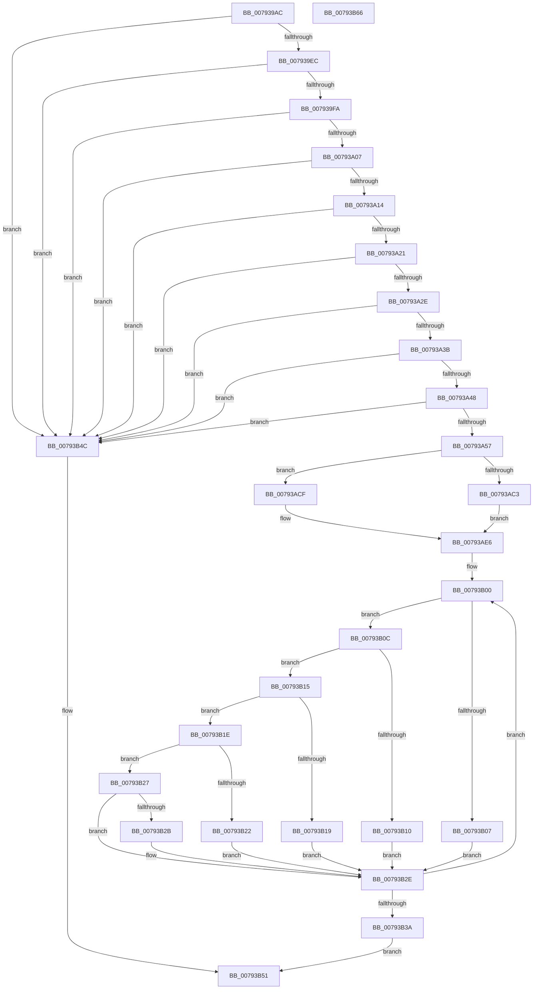

# Normalization__LoadTables

- RVA: `0x007939AC`–`0x00793B67` (길이 `443` bytes)
- VA: `0x00000001407939AC`
- 실행 섹션: `PAGE`
- PDB 이름 있음: `예`; PDB Function 태그: `아니요`
- unwind 정보 RVA: `0x0005C954`
- 디코드: `128`개 명령, `443/443` bytes 표시
- 미해석 바이트: `0` (있으면 어셈블리에 `.byte`로 보존)

> 이 문서는 커널 이미지의 기계어와 PDB 기호를 분석해 생성했습니다. 4번과 5번은 함수 원형과 자료형을 바이너리 사용 방식에서 추정한 C 해석이며 원본 소스 복구 결과는 아닙니다.

## 1. Dependencies

- 직접 호출 지점: **1**; 고유 호출 대상: **1**
- 직접 호출자로 확인된 함수: **1**
- RIP 상대 이미지 참조: **0**

### Outgoing calls
- `0x007939D4` → [memset](../../text/6C/memset_function_006C6C40.md) (function, `0x006C6C40`)

### Direct callers
- [RtlpGetNormalization](RtlpGetNormalization_function_0079AB58.md) at `0x0079AC12`

### Static image references
- 디코드된 RIP-relative 메모리 참조가 없습니다.

## 2. Other-region calls and transfers

- 다른 실행 섹션으로 향하는 call: **1**
  - `0x007939D4` → [memset](../../text/6C/memset_function_006C6C40.md) (`PAGE` → `.text`)
- 별도 외부 분기/꼬리 이동을 확인하지 못했습니다.

## 3. Assembly (complete function range)

```asm
007939AC  48 89 5C 24 08                  mov qword ptr [rsp + 8], rbx
007939B1  48 89 6C 24 10                  mov qword ptr [rsp + 0x10], rbp
007939B6  48 89 74 24 18                  mov qword ptr [rsp + 0x18], rsi
007939BB  57                              push rdi
007939BC  48 83 EC 20                     sub rsp, 0x20
007939C0  48 8B FA                        mov rdi, rdx
007939C3  49 8B E8                        mov rbp, r8
007939C6  33 D2                           xor edx, edx
007939C8  8B F1                           mov esi, ecx
007939CA  49 8B C9                        mov rcx, r9
007939CD  49 8B D9                        mov rbx, r9
007939D0  44 8D 42 78                     lea r8d, [rdx + 0x78]
007939D4  E8 67 32 F3 FF                  call 0x1406c6c40
007939D9  0F B7 47 34                     movzx eax, word ptr [rdi + 0x34]
007939DD  48 8B D5                        mov rdx, rbp
007939E0  48 D1 EA                        shr rdx, 1
007939E3  48 3B D0                        cmp rdx, rax
007939E6  0F 82 60 01 00 00               jb 0x140793b4c
007939EC  44 0F B7 47 36                  movzx r8d, word ptr [rdi + 0x36]
007939F1  49 3B D0                        cmp rdx, r8
007939F4  0F 82 52 01 00 00               jb 0x140793b4c
007939FA  0F B7 4F 38                     movzx ecx, word ptr [rdi + 0x38]
007939FE  48 3B D1                        cmp rdx, rcx
00793A01  0F 82 45 01 00 00               jb 0x140793b4c
00793A07  0F B7 47 3A                     movzx eax, word ptr [rdi + 0x3a]
00793A0B  48 3B D0                        cmp rdx, rax
00793A0E  0F 82 38 01 00 00               jb 0x140793b4c
00793A14  0F B7 47 3C                     movzx eax, word ptr [rdi + 0x3c]
00793A18  48 3B D0                        cmp rdx, rax
00793A1B  0F 82 2B 01 00 00               jb 0x140793b4c
00793A21  0F B7 47 3E                     movzx eax, word ptr [rdi + 0x3e]
00793A25  48 3B D0                        cmp rdx, rax
00793A28  0F 82 1E 01 00 00               jb 0x140793b4c
00793A2E  0F B7 47 40                     movzx eax, word ptr [rdi + 0x40]
00793A32  48 3B D0                        cmp rdx, rax
00793A35  0F 82 11 01 00 00               jb 0x140793b4c
00793A3B  0F B7 47 42                     movzx eax, word ptr [rdi + 0x42]
00793A3F  48 3B D0                        cmp rdx, rax
00793A42  0F 82 04 01 00 00               jb 0x140793b4c
00793A48  41 2B C8                        sub ecx, r8d
00793A4B  81 F9 00 11 00 00               cmp ecx, 0x1100
00793A51  0F 85 F5 00 00 00               jne 0x140793b4c
00793A57  48 89 7B 08                     mov qword ptr [rbx + 8], rdi
00793A5B  33 D2                           xor edx, edx
00793A5D  48 89 6B 10                     mov qword ptr [rbx + 0x10], rbp
00793A61  0F B7 47 28                     movzx eax, word ptr [rdi + 0x28]
00793A65  89 03                           mov dword ptr [rbx], eax
00793A67  0F B7 47 2A                     movzx eax, word ptr [rdi + 0x2a]
00793A6B  89 43 18                        mov dword ptr [rbx + 0x18], eax
00793A6E  0F B7 47 2C                     movzx eax, word ptr [rdi + 0x2c]
00793A72  89 43 1C                        mov dword ptr [rbx + 0x1c], eax
00793A75  0F B7 47 36                     movzx eax, word ptr [rdi + 0x36]
00793A79  48 8D 0C 47                     lea rcx, [rdi + rax*2]
00793A7D  48 89 4B 20                     mov qword ptr [rbx + 0x20], rcx
00793A81  0F B7 47 38                     movzx eax, word ptr [rdi + 0x38]
00793A85  48 8D 0C 47                     lea rcx, [rdi + rax*2]
00793A89  48 89 4B 28                     mov qword ptr [rbx + 0x28], rcx
00793A8D  0F B7 47 2E                     movzx eax, word ptr [rdi + 0x2e]
00793A91  89 43 38                        mov dword ptr [rbx + 0x38], eax
00793A94  0F B7 47 3A                     movzx eax, word ptr [rdi + 0x3a]
00793A98  48 8D 0C 47                     lea rcx, [rdi + rax*2]
00793A9C  48 89 4B 40                     mov qword ptr [rbx + 0x40], rcx
00793AA0  0F B7 47 3C                     movzx eax, word ptr [rdi + 0x3c]
00793AA4  48 8D 0C 47                     lea rcx, [rdi + rax*2]
00793AA8  48 89 4B 48                     mov qword ptr [rbx + 0x48], rcx
00793AAC  0F B7 47 3E                     movzx eax, word ptr [rdi + 0x3e]
00793AB0  48 8D 0C 47                     lea rcx, [rdi + rax*2]
00793AB4  48 89 4B 50                     mov qword ptr [rbx + 0x50], rcx
00793AB8  0F B7 47 30                     movzx eax, word ptr [rdi + 0x30]
00793ABC  89 43 58                        mov dword ptr [rbx + 0x58], eax
00793ABF  85 C0                           test eax, eax
00793AC1  75 0C                           jne 0x140793acf
00793AC3  C6 43 70 01                     mov byte ptr [rbx + 0x70], 1
00793AC7  8B C2                           mov eax, edx
00793AC9  48 89 53 60                     mov qword ptr [rbx + 0x60], rdx
00793ACD  EB 17                           jmp 0x140793ae6
00793ACF  88 53 70                        mov byte ptr [rbx + 0x70], dl
00793AD2  0F B7 47 40                     movzx eax, word ptr [rdi + 0x40]
00793AD6  48 8D 0C 47                     lea rcx, [rdi + rax*2]
00793ADA  48 89 4B 60                     mov qword ptr [rbx + 0x60], rcx
00793ADE  0F B7 47 42                     movzx eax, word ptr [rdi + 0x42]
00793AE2  48 8D 04 47                     lea rax, [rdi + rax*2]
00793AE6  48 89 43 68                     mov qword ptr [rbx + 0x68], rax
00793AEA  0F B7 47 34                     movzx eax, word ptr [rdi + 0x34]
00793AEE  83 4B 72 FF                     or dword ptr [rbx + 0x72], 0xffffffff
00793AF2  C6 43 76 FF                     mov byte ptr [rbx + 0x76], 0xff
00793AF6  48 8D 0C 47                     lea rcx, [rdi + rax*2]
00793AFA  48 89 4B 30                     mov qword ptr [rbx + 0x30], rcx
00793AFE  8A 01                           mov al, byte ptr [rcx]
00793B00  44 8A C0                        mov r8b, al
00793B03  3C D8                           cmp al, 0xd8
00793B05  75 05                           jne 0x140793b0c
00793B07  88 53 72                        mov byte ptr [rbx + 0x72], dl
00793B0A  EB 22                           jmp 0x140793b2e
00793B0C  3C DC                           cmp al, 0xdc
00793B0E  75 05                           jne 0x140793b15
00793B10  88 53 73                        mov byte ptr [rbx + 0x73], dl
00793B13  EB 19                           jmp 0x140793b2e
00793B15  3C DD                           cmp al, 0xdd
00793B17  75 05                           jne 0x140793b1e
00793B19  88 53 74                        mov byte ptr [rbx + 0x74], dl
00793B1C  EB 10                           jmp 0x140793b2e
00793B1E  3C E6                           cmp al, 0xe6
00793B20  75 05                           jne 0x140793b27
00793B22  88 53 75                        mov byte ptr [rbx + 0x75], dl
00793B25  EB 07                           jmp 0x140793b2e
00793B27  3C E7                           cmp al, 0xe7
00793B29  75 03                           jne 0x140793b2e
00793B2B  88 53 76                        mov byte ptr [rbx + 0x76], dl
00793B2E  48 FF C1                        inc rcx
00793B31  FE C2                           inc dl
00793B33  8A 01                           mov al, byte ptr [rcx]
00793B35  41 3A C0                        cmp al, r8b
00793B38  73 C6                           jae 0x140793b00
00793B3A  C1 EE 08                        shr esi, 8
00793B3D  40 F6 D6                        not sil
00793B40  40 80 E6 01                     and sil, 1
00793B44  40 88 73 71                     mov byte ptr [rbx + 0x71], sil
00793B48  33 C0                           xor eax, eax
00793B4A  EB 05                           jmp 0x140793b51
00793B4C  B8 98 00 00 C0                  mov eax, 0xc0000098
00793B51  48 8B 5C 24 30                  mov rbx, qword ptr [rsp + 0x30]
00793B56  48 8B 6C 24 38                  mov rbp, qword ptr [rsp + 0x38]
00793B5B  48 8B 74 24 40                  mov rsi, qword ptr [rsp + 0x40]
00793B60  48 83 C4 20                     add rsp, 0x20
00793B64  5F                              pop rdi
00793B65  C3                              ret
00793B66  CC                              int3
```

## 4. C-style interpretation (structured pseudocode)

```c
__int64 __fastcall Normalization__LoadTables(int a1, __int64 a2, __int64 a3, __int64 a4)
{
    __int64 result;
    __int64 v_rsi;
    __int64 v_rsp;
    unsigned __int64 v_stack_p10;
    unsigned __int64 v_stack_p18;
    unsigned __int64 v_stack_p8;

    v_stack_p8 = v_rbx;
    v_stack_p10 = v_rbp;
    v_stack_p18 = v_rsi;
    v_rsp = (v_rsp) - (32);
    a2 = 0;
    result = memset(a4, a2, a2 + 120, a4);
    a2 = (a3) >> (1);
    if (a2 < (*(unsigned __int16 *)(a2 + 52))) goto loc_00793B4C;
    if (a2 < (*(unsigned __int16 *)(a2 + 54))) goto loc_00793B4C;
    if (a2 < (*(unsigned __int16 *)(a2 + 56))) goto loc_00793B4C;
    if (a2 < (*(unsigned __int16 *)(a2 + 58))) goto loc_00793B4C;
    if (a2 < (*(unsigned __int16 *)(a2 + 60))) goto loc_00793B4C;
    if (a2 < (*(unsigned __int16 *)(a2 + 62))) goto loc_00793B4C;
    if (a2 < (*(unsigned __int16 *)(a2 + 64))) goto loc_00793B4C;
    if (a2 < (*(unsigned __int16 *)(a2 + 66))) goto loc_00793B4C;
    a1 = (unsigned int)((*(unsigned __int16 *)(a2 + 56)) - ((unsigned int)(*(unsigned __int16 *)(a2 + 54))));
    if (a1 != 0x1100ULL) goto loc_00793B4C;
    *(unsigned __int64 *)(a4 + 8) = a2;
    a2 = 0;
    *(unsigned __int64 *)(a4 + 16) = a3;
    *(unsigned int *)(a4) = (unsigned int)(*(unsigned __int16 *)(a2 + 40));
    *(unsigned int *)(a4 + 24) = (unsigned int)(*(unsigned __int16 *)(a2 + 42));
    *(unsigned int *)(a4 + 28) = (unsigned int)(*(unsigned __int16 *)(a2 + 44));
    *(unsigned __int64 *)(a4 + 32) = a2 + *(unsigned __int16 *)(a2 + 54) * 2;
    *(unsigned __int64 *)(a4 + 40) = a2 + *(unsigned __int16 *)(a2 + 56) * 2;
    *(unsigned int *)(a4 + 56) = (unsigned int)(*(unsigned __int16 *)(a2 + 46));
    *(unsigned __int64 *)(a4 + 64) = a2 + *(unsigned __int16 *)(a2 + 58) * 2;
    *(unsigned __int64 *)(a4 + 72) = a2 + *(unsigned __int16 *)(a2 + 60) * 2;
    *(unsigned __int64 *)(a4 + 80) = a2 + *(unsigned __int16 *)(a2 + 62) * 2;
    *(unsigned int *)(a4 + 88) = (unsigned int)(*(unsigned __int16 *)(a2 + 48));
    if ((unsigned int)(*(unsigned __int16 *)(a2 + 48)) != 0) goto loc_00793ACF;
    *(unsigned __int8 *)(a4 + 112) = 1;
    *(unsigned __int64 *)(a4 + 96) = 0;
    goto loc_00793AE6;
loc_00793ACF:
    *(unsigned __int8 *)(a4 + 112) = 0;
    *(unsigned __int64 *)(a4 + 96) = a2 + *(unsigned __int16 *)(a2 + 64) * 2;
loc_00793AE6:
    *(unsigned __int64 *)(a4 + 104) = a2 + *(unsigned __int16 *)(a2 + 66) * 2;
    *(unsigned __int8 *)(a4 + 118) = 255;
    *(unsigned __int64 *)(a4 + 48) = a2 + *(unsigned __int16 *)(a2 + 52) * 2;
loc_00793B00:
    if (((unsigned __int8)(*(unsigned __int8 *)(a2 + *(unsigned __int16 *)(a2 + 52) * 2))) != 216) goto loc_00793B0C;
    *(unsigned __int8 *)(a4 + 114) = 0;
    goto loc_00793B2E;
loc_00793B0C:
    if (((unsigned __int8)(*(unsigned __int8 *)(a2 + *(unsigned __int16 *)(a2 + 52) * 2))) != 220) goto loc_00793B15;
    *(unsigned __int8 *)(a4 + 115) = 0;
    goto loc_00793B2E;
loc_00793B15:
    if (((unsigned __int8)(*(unsigned __int8 *)(a2 + *(unsigned __int16 *)(a2 + 52) * 2))) != 221) goto loc_00793B1E;
    *(unsigned __int8 *)(a4 + 116) = 0;
    goto loc_00793B2E;
loc_00793B1E:
    if (((unsigned __int8)(*(unsigned __int8 *)(a2 + *(unsigned __int16 *)(a2 + 52) * 2))) != 230) goto loc_00793B27;
    *(unsigned __int8 *)(a4 + 117) = 0;
    goto loc_00793B2E;
loc_00793B27:
    if (((unsigned __int8)(*(unsigned __int8 *)(a2 + *(unsigned __int16 *)(a2 + 52) * 2))) == 231) {
        *(unsigned __int8 *)(a4 + 118) = 0;
    }
    a1 = (a2 + *(unsigned __int16 *)(a2 + 52) * 2) + 1;
    a2 = (unsigned __int8)((a2) + 1);
    if (((unsigned __int8)(*(unsigned __int8 *)(a1))) >= ((unsigned __int8)((unsigned __int8)(*(unsigned __int8 *)(a2 + *(unsigned __int16 *)(a2 + 52) * 2))))) goto loc_00793B00;
    v_rsi = (unsigned int)(((unsigned int)(a1)) >> (8));
    v_rsi = (unsigned __int8)(~(v_rsi));
    v_rsi = (unsigned __int8)((v_rsi) & (1));
    *(unsigned __int8 *)(a4 + 113) = (unsigned __int8)(v_rsi);
    result = 0;
    goto loc_00793B51;
loc_00793B4C:
loc_00793B51:
    v_rsp = (v_rsp) + (32);
    return (unsigned int)(0xC0000098ULL);
}
```

## 5. (Beta) C Style

```c
int64_t Normalization__LoadTables(int32_t Arg1, void *Arg2, int64_t Arg3, void *Arg4)
{
    uint8_t *arg2 = (uint8_t *)Arg2;
    uint8_t *arg4 = (uint8_t *)Arg4;

    int64_t result;
    int64_t local_rsi;
    int64_t local_rsp;
    uint64_t v_stack_p10;
    uint64_t v_stack_p18;
    uint64_t v_stack_p8;

    v_stack_p8 = local_rbx;
    v_stack_p10 = local_rbp;
    v_stack_p18 = local_rsi;
    local_rsp = (local_rsp) - (32);
    Arg2 = 0;
    result = memset(Arg4, Arg2, Arg2 + 120, Arg4);
    Arg2 = (Arg3) >> (1);
    if (Arg2 < (*(uint16_t *)(arg2 + 0x34))) goto loc_00793B4C;
    if (Arg2 < (*(uint16_t *)(arg2 + 0x36))) goto loc_00793B4C;
    if (Arg2 < (*(uint16_t *)(arg2 + 0x38))) goto loc_00793B4C;
    if (Arg2 < (*(uint16_t *)(arg2 + 0x3A))) goto loc_00793B4C;
    if (Arg2 < (*(uint16_t *)(arg2 + 0x3C))) goto loc_00793B4C;
    if (Arg2 < (*(uint16_t *)(arg2 + 0x3E))) goto loc_00793B4C;
    if (Arg2 < (*(uint16_t *)(arg2 + 0x40))) goto loc_00793B4C;
    if (Arg2 < (*(uint16_t *)(arg2 + 0x42))) goto loc_00793B4C;
    Arg1 = (uint32_t)((*(uint16_t *)(arg2 + 0x38)) - ((uint32_t)(*(uint16_t *)(arg2 + 0x36))));
    if (Arg1 != 0x1100ULL) goto loc_00793B4C;
    *(void **)(arg4 + 0x8) = Arg2;
    Arg2 = 0;
    *(uint64_t *)(arg4 + 0x10) = Arg3;
    *(uint32_t *)(arg4) = (uint32_t)(*(uint16_t *)(arg2 + 0x28));
    *(uint32_t *)(arg4 + 0x18) = (uint32_t)(*(uint16_t *)(arg2 + 0x2A));
    *(uint32_t *)(arg4 + 0x1C) = (uint32_t)(*(uint16_t *)(arg2 + 0x2C));
    *(void **)(arg4 + 0x20) = Arg2 + *(uint16_t *)(arg2 + 0x36) * 2;
    *(void **)(arg4 + 0x28) = Arg2 + *(uint16_t *)(arg2 + 0x38) * 2;
    *(uint32_t *)(arg4 + 0x38) = (uint32_t)(*(uint16_t *)(arg2 + 0x2E));
    *(void **)(arg4 + 0x40) = Arg2 + *(uint16_t *)(arg2 + 0x3A) * 2;
    *(void **)(arg4 + 0x48) = Arg2 + *(uint16_t *)(arg2 + 0x3C) * 2;
    *(void **)(arg4 + 0x50) = Arg2 + *(uint16_t *)(arg2 + 0x3E) * 2;
    *(uint32_t *)(arg4 + 0x58) = (uint32_t)(*(uint16_t *)(arg2 + 0x30));
    if ((uint32_t)(*(uint16_t *)(arg2 + 0x30)) != 0) goto loc_00793ACF;
    *(uint8_t *)(arg4 + 0x70) = 1;
    *(uint64_t *)(arg4 + 0x60) = 0;
    goto loc_00793AE6;
loc_00793ACF:
    *(uint8_t *)(arg4 + 0x70) = 0;
    *(void **)(arg4 + 0x60) = Arg2 + *(uint16_t *)(arg2 + 0x40) * 2;
loc_00793AE6:
    *(void **)(arg4 + 0x68) = Arg2 + *(uint16_t *)(arg2 + 0x42) * 2;
    *(uint8_t *)(arg4 + 0x76) = 255;
    *(void **)(arg4 + 0x30) = Arg2 + *(uint16_t *)(arg2 + 0x34) * 2;
loc_00793B00:
    if (((uint8_t)(*(uint8_t *)(arg2 + *(uint16_t *)(arg2 + 0x34) * 2))) != 216) goto loc_00793B0C;
    *(uint8_t *)(arg4 + 0x72) = 0;
    goto loc_00793B2E;
loc_00793B0C:
    if (((uint8_t)(*(uint8_t *)(arg2 + *(uint16_t *)(arg2 + 0x34) * 2))) != 220) goto loc_00793B15;
    *(uint8_t *)(arg4 + 0x73) = 0;
    goto loc_00793B2E;
loc_00793B15:
    if (((uint8_t)(*(uint8_t *)(arg2 + *(uint16_t *)(arg2 + 0x34) * 2))) != 221) goto loc_00793B1E;
    *(uint8_t *)(arg4 + 0x74) = 0;
    goto loc_00793B2E;
loc_00793B1E:
    if (((uint8_t)(*(uint8_t *)(arg2 + *(uint16_t *)(arg2 + 0x34) * 2))) != 230) goto loc_00793B27;
    *(uint8_t *)(arg4 + 0x75) = 0;
    goto loc_00793B2E;
loc_00793B27:
    if (((uint8_t)(*(uint8_t *)(arg2 + *(uint16_t *)(arg2 + 0x34) * 2))) == 231) {
        *(uint8_t *)(arg4 + 0x76) = 0;
    }
    Arg1 = (Arg2 + *(uint16_t *)(arg2 + 0x34) * 2) + 1;
    Arg2 = (uint8_t)((Arg2) + 1);
    if (((uint8_t)(*(uint8_t *)(Arg1))) >= ((uint8_t)((uint8_t)(*(uint8_t *)(arg2 + *(uint16_t *)(arg2 + 0x34) * 2))))) goto loc_00793B00;
    local_rsi = (uint32_t)(((uint32_t)(Arg1)) >> (8));
    local_rsi = (uint8_t)(~(local_rsi));
    local_rsi = (uint8_t)((local_rsi) & (1));
    *(uint8_t *)(arg4 + 0x71) = (uint8_t)(local_rsi);
    result = 0;
    goto loc_00793B51;
loc_00793B4C:
loc_00793B51:
    local_rsp = (local_rsp) + (32);
    return (uint32_t)(0xC0000098ULL);
}
```

### 관측된 메모리 오프셋

구조체 형식이 확인되지 않은 접근은 인자 기준의 오프셋으로만 기록했습니다.

| 기준 인자 | 오프셋 표현 | 폭 (bit) | 접근 |
|---|---:|---:|---|
| `Arg2` | `+ 0x0` | `8` | `R` |
| `Arg2` | `+ 0x0 + rax*2` | `64` | `R` |
| `Arg2` | `+ 0x28` | `16` | `R` |
| `Arg2` | `+ 0x2A` | `16` | `R` |
| `Arg2` | `+ 0x2C` | `16` | `R` |
| `Arg2` | `+ 0x2E` | `16` | `R` |
| `Arg2` | `+ 0x30` | `16` | `R` |
| `Arg2` | `+ 0x34` | `16` | `R` |
| `Arg2` | `+ 0x36` | `16` | `R` |
| `Arg2` | `+ 0x38` | `16` | `R` |
| `Arg2` | `+ 0x3A` | `16` | `R` |
| `Arg2` | `+ 0x3C` | `16` | `R` |
| `Arg2` | `+ 0x3E` | `16` | `R` |
| `Arg2` | `+ 0x40` | `16` | `R` |
| `Arg2` | `+ 0x42` | `16` | `R` |
| `Arg4` | `+ 0x0` | `32` | `W` |
| `Arg4` | `+ 0x8` | `64` | `W` |
| `Arg4` | `+ 0x10` | `64` | `W` |
| `Arg4` | `+ 0x18` | `32` | `W` |
| `Arg4` | `+ 0x1C` | `32` | `W` |
| `Arg4` | `+ 0x20` | `64` | `W` |
| `Arg4` | `+ 0x28` | `64` | `W` |
| `Arg4` | `+ 0x30` | `64` | `W` |
| `Arg4` | `+ 0x38` | `32` | `W` |
| `Arg4` | `+ 0x40` | `64` | `W` |
| `Arg4` | `+ 0x48` | `64` | `W` |
| `Arg4` | `+ 0x50` | `64` | `W` |
| `Arg4` | `+ 0x58` | `32` | `W` |
| `Arg4` | `+ 0x60` | `64` | `W` |
| `Arg4` | `+ 0x68` | `64` | `W` |
| `Arg4` | `+ 0x70` | `8` | `W` |
| `Arg4` | `+ 0x71` | `8` | `W` |

추가 오프셋 6개는 표에서 생략했습니다.

## 6. Execution-region graph

[열기: 2D/3D 그래프와 함수 탐색 컨트롤 패널](../../../control-panel.html?section=page&rva=0x007939AC&view=graph)

- 2D 그래프는 위에서 아래로 흐르고, 3D 그래프는 빈 공간을 드래그해 회전합니다. Shift+드래그는 이동, 휠은 확대·축소, 함수 노드 선택은 대상 보고서 이동입니다.

### Static fallback


