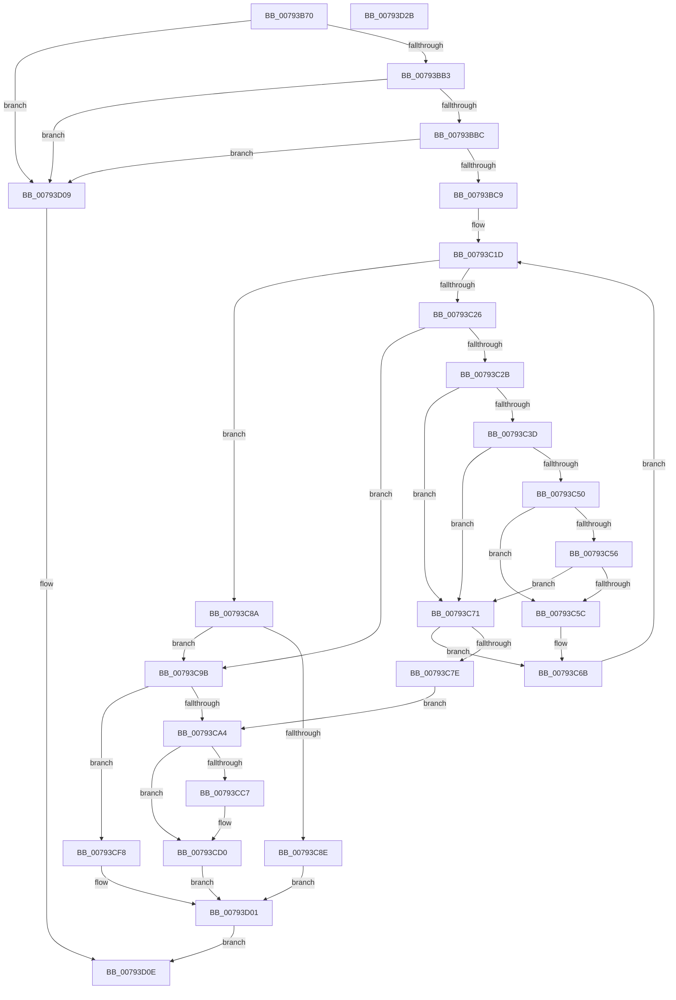

# Normalization__Normalize

- RVA: `0x00793B70`–`0x00793D2C` (길이 `444` bytes)
- VA: `0x0000000140793B70`
- 실행 섹션: `PAGE`
- PDB 이름 있음: `예`; PDB Function 태그: `아니요`
- unwind 정보 RVA: `0x000BDB98`
- 디코드: `132`개 명령, `444/444` bytes 표시
- 미해석 바이트: `0` (있으면 어셈블리에 `.byte`로 보존)

> 이 문서는 커널 이미지의 기계어와 PDB 기호를 분석해 생성했습니다. 4번과 5번은 함수 원형과 자료형을 바이너리 사용 방식에서 추정한 C 해석이며 원본 소스 복구 결과는 아닙니다.

## 1. Dependencies

- 직접 호출 지점: **4**; 고유 호출 대상: **4**
- 직접 호출자로 확인된 함수: **1**
- RIP 상대 이미지 참조: **0**

### Outgoing calls
- `0x00793BA5` → [memset](../../text/6C/memset_function_006C6C40.md) (function, `0x006C6C40`)
- `0x00793C63` → [Normalization__NormalizeCharacter](Normalization__NormalizeCharacter_function_00793D34.md) (function, `0x00793D34`)
- `0x00793C75` → [NormBuffer__Append](../../text/5E/NormBuffer__Append_function_005ED798.md) (function, `0x005ED798`)
- `0x00793CD6` → [Normalization__GuessCharCountBySize](Normalization__GuessCharCountBySize_function_007934A8.md) (function, `0x007934A8`)

### Direct callers
- [RtlpNormalizeStringWorker](RtlpNormalizeStringWorker_function_007946C4.md) at `0x00794729`

### Static image references
- 디코드된 RIP-relative 메모리 참조가 없습니다.

## 2. Other-region calls and transfers

- 다른 실행 섹션으로 향하는 call: **2**
  - `0x00793BA5` → [memset](../../text/6C/memset_function_006C6C40.md) (`PAGE` → `.text`)
  - `0x00793C75` → [NormBuffer__Append](../../text/5E/NormBuffer__Append_function_005ED798.md) (`PAGE` → `.text`)
- 별도 외부 분기/꼬리 이동을 확인하지 못했습니다.

## 3. Assembly (complete function range)

```asm
00793B70  48 8B C4                        mov rax, rsp
00793B73  48 89 58 08                     mov qword ptr [rax + 8], rbx
00793B77  48 89 70 10                     mov qword ptr [rax + 0x10], rsi
00793B7B  48 89 78 18                     mov qword ptr [rax + 0x18], rdi
00793B7F  55                              push rbp
00793B80  41 56                           push r14
00793B82  41 57                           push r15
00793B84  48 8D 68 B1                     lea rbp, [rax - 0x4f]
00793B88  48 81 EC A0 00 00 00            sub rsp, 0xa0
00793B8F  48 8B DA                        mov rbx, rdx
00793B92  4D 63 F8                        movsxd r15, r8d
00793B95  33 D2                           xor edx, edx
00793B97  48 8B F9                        mov rdi, rcx
00793B9A  48 8D 4D B7                     lea rcx, [rbp - 0x49]
00793B9E  49 8B F1                        mov rsi, r9
00793BA1  44 8D 42 78                     lea r8d, [rdx + 0x78]
00793BA5  E8 96 30 F3 FF                  call 0x1406c6c40
00793BAA  48 85 DB                        test rbx, rbx
00793BAD  0F 84 56 01 00 00               je 0x140793d09
00793BB3  48 85 F6                        test rsi, rsi
00793BB6  0F 84 4D 01 00 00               je 0x140793d09
00793BBC  4C 8B 75 7F                     mov r14, qword ptr [rbp + 0x7f]
00793BC0  4D 85 F6                        test r14, r14
00793BC3  0F 84 40 01 00 00               je 0x140793d09
00793BC9  48 63 45 77                     movsxd rax, dword ptr [rbp + 0x77]
00793BCD  4A 8D 0C 7B                     lea rcx, [rbx + r15*2]
00793BD1  83 65 EF 00                     and dword ptr [rbp - 0x11], 0
00793BD5  66 83 65 FF 00                  and word ptr [rbp - 1], 0
00793BDA  83 65 0F 00                     and dword ptr [rbp + 0xf], 0
00793BDE  66 83 65 13 00                  and word ptr [rbp + 0x13], 0
00793BE3  41 83 26 00                     and dword ptr [r14], 0
00793BE7  48 89 4D BF                     mov qword ptr [rbp - 0x41], rcx
00793BEB  45 33 DB                        xor r11d, r11d
00793BEE  48 8D 0C 46                     lea rcx, [rsi + rax*2]
00793BF2  89 45 E7                        mov dword ptr [rbp - 0x19], eax
00793BF5  48 8D 46 FE                     lea rax, [rsi - 2]
00793BF9  48 89 5D B7                     mov qword ptr [rbp - 0x49], rbx
00793BFD  48 89 45 F7                     mov qword ptr [rbp - 9], rax
00793C01  44 89 7D EB                     mov dword ptr [rbp - 0x15], r15d
00793C05  48 89 75 CF                     mov qword ptr [rbp - 0x31], rsi
00793C09  48 89 4D D7                     mov qword ptr [rbp - 0x29], rcx
00793C0D  48 89 75 DF                     mov qword ptr [rbp - 0x21], rsi
00793C11  48 89 5D C7                     mov qword ptr [rbp - 0x39], rbx
00793C15  48 89 75 07                     mov qword ptr [rbp + 7], rsi
00793C19  48 89 7D 27                     mov qword ptr [rbp + 0x27], rdi
00793C1D  41 8B C3                        mov eax, r11d
00793C20  48 3B 5D BF                     cmp rbx, qword ptr [rbp - 0x41]
00793C24  74 64                           je 0x140793c8a
00793C26  45 85 DB                        test r11d, r11d
00793C29  75 70                           jne 0x140793c9b
00793C2B  0F B7 03                        movzx eax, word ptr [rbx]
00793C2E  48 83 C3 02                     add rbx, 2
00793C32  8B D0                           mov edx, eax
00793C34  48 89 5D C7                     mov qword ptr [rbp - 0x39], rbx
00793C38  3B 47 1C                        cmp eax, dword ptr [rdi + 0x1c]
00793C3B  7C 34                           jl 0x140793c71
00793C3D  8B C8                           mov ecx, eax
00793C3F  48 8B 47 20                     mov rax, qword ptr [rdi + 0x20]
00793C43  48 C1 E9 07                     shr rcx, 7
00793C47  44 8A 04 01                     mov r8b, byte ptr [rcx + rax]
00793C4B  45 84 C0                        test r8b, r8b
00793C4E  74 21                           je 0x140793c71
00793C50  41 80 F8 FB                     cmp r8b, 0xfb
00793C54  75 06                           jne 0x140793c5c
00793C56  44 38 5F 71                     cmp byte ptr [rdi + 0x71], r11b
00793C5A  75 15                           jne 0x140793c71
00793C5C  4C 8D 4D B7                     lea r9, [rbp - 0x49]
00793C60  48 8B CF                        mov rcx, rdi
00793C63  E8 CC 00 00 00                  call 0x140793d34
00793C68  44 8B D8                        mov r11d, eax
00793C6B  48 8B 5D C7                     mov rbx, qword ptr [rbp - 0x39]
00793C6F  EB AC                           jmp 0x140793c1d
00793C71  48 8D 4D B7                     lea rcx, [rbp - 0x49]
00793C75  E8 1E 9B E5 FF                  call 0x1405ed798
00793C7A  84 C0                           test al, al
00793C7C  75 ED                           jne 0x140793c6b
00793C7E  48 8B 5D C7                     mov rbx, qword ptr [rbp - 0x39]
00793C82  41 BB 23 00 00 C0               mov r11d, 0xc0000023
00793C88  EB 1A                           jmp 0x140793ca4
00793C8A  85 C0                           test eax, eax
00793C8C  75 0D                           jne 0x140793c9b
00793C8E  48 8B 5D DF                     mov rbx, qword ptr [rbp - 0x21]
00793C92  48 2B 5D CF                     sub rbx, qword ptr [rbp - 0x31]
00793C96  48 D1 FB                        sar rbx, 1
00793C99  EB 66                           jmp 0x140793d01
00793C9B  41 81 FB 23 00 00 C0            cmp r11d, 0xc0000023
00793CA2  75 54                           jne 0x140793cf8
00793CA4  4C 8B 55 BF                     mov r10, qword ptr [rbp - 0x41]
00793CA8  4C 8B 4D DF                     mov r9, qword ptr [rbp - 0x21]
00793CAC  4C 2B D3                        sub r10, rbx
00793CAF  4C 2B 4D CF                     sub r9, qword ptr [rbp - 0x31]
00793CB3  48 2B 5D B7                     sub rbx, qword ptr [rbp - 0x49]
00793CB7  49 D1 FA                        sar r10, 1
00793CBA  41 FF C2                        inc r10d
00793CBD  49 D1 F9                        sar r9, 1
00793CC0  48 D1 FB                        sar rbx, 1
00793CC3  85 DB                           test ebx, ebx
00793CC5  75 09                           jne 0x140793cd0
00793CC7  44 03 4F 18                     add r9d, dword ptr [rdi + 0x18]
00793CCB  BB 01 00 00 00                  mov ebx, 1
00793CD0  41 8B D2                        mov edx, r10d
00793CD3  48 8B CF                        mov rcx, rdi
00793CD6  E8 CD F7 FF FF                  call 0x1407934a8
00793CDB  8B C8                           mov ecx, eax
00793CDD  41 8B C1                        mov eax, r9d
00793CE0  41 0F AF C2                     imul eax, r10d
00793CE4  99                              cdq
00793CE5  F7 FB                           idiv ebx
00793CE7  3B C1                           cmp eax, ecx
00793CE9  0F 4E C1                        cmovle eax, ecx
00793CEC  8B D8                           mov ebx, eax
00793CEE  C1 FB 03                        sar ebx, 3
00793CF1  03 D8                           add ebx, eax
00793CF3  41 03 D9                        add ebx, r9d
00793CF6  EB 09                           jmp 0x140793d01
00793CF8  48 2B 5D B7                     sub rbx, qword ptr [rbp - 0x49]
00793CFC  48 D1 FB                        sar rbx, 1
00793CFF  FF CB                           dec ebx
00793D01  41 89 1E                        mov dword ptr [r14], ebx
00793D04  41 8B C3                        mov eax, r11d
00793D07  EB 05                           jmp 0x140793d0e
00793D09  B8 0D 00 00 C0                  mov eax, 0xc000000d
00793D0E  4C 8D 9C 24 A0 00 00 00         lea r11, [rsp + 0xa0]
00793D16  49 8B 5B 20                     mov rbx, qword ptr [r11 + 0x20]
00793D1A  49 8B 73 28                     mov rsi, qword ptr [r11 + 0x28]
00793D1E  49 8B 7B 30                     mov rdi, qword ptr [r11 + 0x30]
00793D22  49 8B E3                        mov rsp, r11
00793D25  41 5F                           pop r15
00793D27  41 5E                           pop r14
00793D29  5D                              pop rbp
00793D2A  C3                              ret
00793D2B  CC                              int3
```

## 4. C-style interpretation (structured pseudocode)

```c
__int64 __fastcall Normalization__Normalize(__int64 a1, __int64 a2, int a3, __int64 a4)
{
    __int64 result;
    __int64 v_r10;
    __int64 v_r11;
    __int64 v_rbx;
    __int64 v_rsp;
    unsigned __int64 v_stack_m18;

    *(unsigned __int64 *)(v_rsp + 8) = v_rbx;
    *(unsigned __int64 *)(v_rsp + 16) = v_rsi;
    *(unsigned __int64 *)(v_rsp + 24) = v_rdi;
    v_rsp = (v_rsp) - (160);
    a2 = 0;
    result = memset(v_rsp - 79 - 73, a2, a2 + 120, a4);
    if (0 == 0) goto loc_00793D09;
    if (a4 == 0) goto loc_00793D09;
    if (*(unsigned __int64 *)(v_rsp - 79 + 127) == 0) goto loc_00793D09;
    *(unsigned __int64 *)(v_rsp - 79 - 65) = a2 + (int)(a3) * 2;
    v_r11 = 0;
    *(unsigned int *)(v_rsp - 79 - 25) = (unsigned int)((int)(*(unsigned int *)(v_rsp - 79 + 119)));
    *(unsigned __int64 *)(v_rsp - 79 - 73) = 0;
    *(unsigned __int64 *)(v_rsp - 79 - 9) = a4 - 2;
    *(unsigned int *)(v_rsp - 79 - 21) = (unsigned int)((int)(a3));
    *(unsigned __int64 *)(v_rsp - 79 - 49) = a4;
    *(unsigned __int64 *)(v_rsp - 79 - 41) = a4 + (int)(*(unsigned int *)(v_rsp - 79 + 119)) * 2;
    *(unsigned __int64 *)(v_rsp - 79 - 33) = a4;
    *(unsigned __int64 *)(v_rsp - 79 - 57) = 0;
    *(unsigned __int64 *)(v_rsp - 79 + 7) = a4;
    *(unsigned __int64 *)(v_rsp - 79 + 39) = a1;
loc_00793C1D:
    if (0 == (*(unsigned __int64 *)(v_rsp - 79 - 65))) goto loc_00793C8A;
    if (0 != 0) goto loc_00793C9B;
    v_rbx = (a2) + (2);
    *(unsigned __int64 *)(v_rsp - 79 - 57) = v_rbx;
    if (((unsigned int)(*(unsigned __int16 *)(a2))) < (*(unsigned int *)(a1 + 28))) goto loc_00793C71;
    a1 = ((unsigned int)((unsigned int)(*(unsigned __int16 *)(a2)))) >> (7);
    if ((unsigned __int8)(*(unsigned __int8 *)(a1 + *(unsigned __int64 *)(a1 + 32) * 1)) == 0) goto loc_00793C71;
    if (((unsigned __int8)(*(unsigned __int8 *)(a1 + *(unsigned __int64 *)(a1 + 32) * 1))) != 251) goto loc_00793C5C;
    if ((*(unsigned __int8 *)(a1 + 113)) != 0) goto loc_00793C71;
loc_00793C5C:
    result = Normalization__NormalizeCharacter(a1, (unsigned int)((unsigned int)(*(unsigned __int16 *)(a2))), *(unsigned __int8 *)(a1 + *(unsigned __int64 *)(a1 + 32) * 1), v_rsp - 79 - 73);
loc_00793C6B:
    goto loc_00793C1D;
loc_00793C71:
    result = NormBuffer__Append(v_rsp - 79 - 73, (unsigned int)((unsigned int)(*(unsigned __int16 *)(a2))), *(unsigned __int8 *)(a1 + *(unsigned __int64 *)(a1 + 32) * 1), v_rsp - 79 - 73);
    if ((unsigned __int8)(result) != 0) goto loc_00793C6B;
    goto loc_00793CA4;
loc_00793C8A:
    if ((unsigned int)(result) != 0) goto loc_00793C9B;
    v_rbx = (*(unsigned __int64 *)(v_rsp - 79 - 33)) - (*(unsigned __int64 *)(v_rsp - 79 - 49));
    v_rbx = (v_rbx) >> (1);
    goto loc_00793D01;
loc_00793C9B:
    if (((unsigned int)((unsigned int)(0xC0000023ULL))) != 0xC0000023ULL) goto loc_00793CF8;
loc_00793CA4:
    v_r10 = (*(unsigned __int64 *)(v_rsp - 79 - 65)) - (v_rbx);
    a4 = (*(unsigned __int64 *)(v_rsp - 79 - 33)) - (*(unsigned __int64 *)(v_rsp - 79 - 49));
    v_rbx = (v_rbx) - (*(unsigned __int64 *)(v_rsp - 79 - 73));
    v_r10 = (v_r10) >> (1);
    v_r10 = (unsigned int)((v_r10) + 1);
    a4 = (a4) >> (1);
    v_rbx = (v_rbx) >> (1);
    if ((unsigned int)(v_rbx) == 0) {
        a4 = (unsigned int)((a4) + (*(unsigned int *)(a1 + 24)));
        v_rbx = 1;
    }
    result = Normalization__GuessCharCountBySize(a1, (unsigned int)((unsigned int)(v_r10)), *(unsigned __int8 *)(a1 + *(unsigned __int64 *)(a1 + 32) * 1), a4);
    result = (unsigned int)(((unsigned int)((unsigned int)(a4))) * ((unsigned int)(v_r10)));
    if (((unsigned int)(result)) <= ((unsigned int)((unsigned int)((unsigned int)(result))))) { result = (unsigned int)((unsigned int)((unsigned int)(result))); }
    v_rbx = (unsigned int)(((unsigned int)((unsigned int)(result))) >> (3));
    v_rbx = (unsigned int)((v_rbx) + ((unsigned int)(result)));
    v_rbx = (unsigned int)((v_rbx) + ((unsigned int)(a4)));
    goto loc_00793D01;
loc_00793CF8:
    v_rbx = (v_rbx) - (*(unsigned __int64 *)(v_rsp - 79 - 73));
    v_rbx = (v_rbx) >> (1);
    v_rbx = (unsigned int)((v_rbx) - 1);
loc_00793D01:
    *(unsigned int *)(*(unsigned __int64 *)(v_rsp - 79 + 127)) = (unsigned int)(v_rbx);
    goto loc_00793D0E;
loc_00793D09:
loc_00793D0E:
    return (unsigned int)(0xC000000DULL);
}
```

## 5. (Beta) C Style

```c
int64_t Normalization__Normalize(void *Arg1, int64_t Arg2, int32_t Arg3, int64_t Arg4)
{
    uint8_t *arg1 = (uint8_t *)Arg1;

    int64_t result;
    int64_t local_r10;
    int64_t local_r11;
    int64_t local_rbx;
    int64_t local_rsp;
    uint64_t v_stack_m18;

    *(uint64_t *)(local_rsp + 0x8) = local_rbx;
    *(uint64_t *)(local_rsp + 0x10) = local_rsi;
    *(uint64_t *)(local_rsp + 0x18) = local_rdi;
    local_rsp = (local_rsp) - (160);
    Arg2 = 0;
    result = memset(local_rsp - 79 - 73, Arg2, Arg2 + 120, Arg4);
    if (0 == 0) goto loc_00793D09;
    if (Arg4 == 0) goto loc_00793D09;
    if (*(uint64_t *)(local_rsp - 0x4F + 0x7F) == 0) goto loc_00793D09;
    *(uint64_t *)(local_rsp - 0x4F - 0x41) = Arg2 + (int32_t)(Arg3) * 2;
    local_r11 = 0;
    *(uint32_t *)(local_rsp - 0x4F - 0x19) = (uint32_t)((int32_t)(*(uint32_t *)(local_rsp - 0x4F + 0x77)));
    *(uint64_t *)(local_rsp - 0x4F - 0x49) = 0;
    *(uint64_t *)(local_rsp - 0x4F - 0x9) = Arg4 - 2;
    *(uint32_t *)(local_rsp - 0x4F - 0x15) = (uint32_t)((int32_t)(Arg3));
    *(uint64_t *)(local_rsp - 0x4F - 0x31) = Arg4;
    *(uint64_t *)(local_rsp - 0x4F - 0x29) = Arg4 + (int32_t)(*(uint32_t *)(local_rsp - 0x4F + 0x77)) * 2;
    *(uint64_t *)(local_rsp - 0x4F - 0x21) = Arg4;
    *(uint64_t *)(local_rsp - 0x4F - 0x39) = 0;
    *(uint64_t *)(local_rsp - 0x4F + 0x7) = Arg4;
    *(void **)(local_rsp - 0x4F + 0x27) = Arg1;
loc_00793C1D:
    if (0 == (*(uint64_t *)(local_rsp - 0x4F - 0x41))) goto loc_00793C8A;
    if (0 != 0) goto loc_00793C9B;
    local_rbx = (Arg2) + (2);
    *(uint64_t *)(local_rsp - 0x4F - 0x39) = local_rbx;
    if (((uint32_t)(*(uint16_t *)(Arg2))) < (*(uint32_t *)(arg1 + 0x1C))) goto loc_00793C71;
    Arg1 = ((uint32_t)((uint32_t)(*(uint16_t *)(Arg2)))) >> (7);
    if ((uint8_t)(*(uint8_t *)(arg1 + *(uint64_t *)(arg1 + 0x20) * 1)) == 0) goto loc_00793C71;
    if (((uint8_t)(*(uint8_t *)(arg1 + *(uint64_t *)(arg1 + 0x20) * 1))) != 251) goto loc_00793C5C;
    if ((*(uint8_t *)(arg1 + 0x71)) != 0) goto loc_00793C71;
loc_00793C5C:
    result = Normalization__NormalizeCharacter(Arg1, (uint32_t)((uint32_t)(*(uint16_t *)(Arg2))), *(uint8_t *)(arg1 + *(uint64_t *)(arg1 + 0x20) * 1), local_rsp - 79 - 73);
loc_00793C6B:
    goto loc_00793C1D;
loc_00793C71:
    result = NormBuffer__Append(local_rsp - 79 - 73, (uint32_t)((uint32_t)(*(uint16_t *)(Arg2))), *(uint8_t *)(arg1 + *(uint64_t *)(arg1 + 0x20) * 1), local_rsp - 79 - 73);
    if ((uint8_t)(result) != 0) goto loc_00793C6B;
    goto loc_00793CA4;
loc_00793C8A:
    if ((uint32_t)(result) != 0) goto loc_00793C9B;
    local_rbx = (*(uint64_t *)(local_rsp - 0x4F - 0x21)) - (*(uint64_t *)(local_rsp - 0x4F - 0x31));
    local_rbx = (local_rbx) >> (1);
    goto loc_00793D01;
loc_00793C9B:
    if (((uint32_t)((uint32_t)(0xC0000023ULL))) != 0xC0000023ULL) goto loc_00793CF8;
loc_00793CA4:
    local_r10 = (*(uint64_t *)(local_rsp - 0x4F - 0x41)) - (local_rbx);
    Arg4 = (*(uint64_t *)(local_rsp - 0x4F - 0x21)) - (*(uint64_t *)(local_rsp - 0x4F - 0x31));
    local_rbx = (local_rbx) - (*(uint64_t *)(local_rsp - 0x4F - 0x49));
    local_r10 = (local_r10) >> (1);
    local_r10 = (uint32_t)((local_r10) + 1);
    Arg4 = (Arg4) >> (1);
    local_rbx = (local_rbx) >> (1);
    if ((uint32_t)(local_rbx) == 0) {
        Arg4 = (uint32_t)((Arg4) + (*(uint32_t *)(arg1 + 0x18)));
        local_rbx = 1;
    }
    result = Normalization__GuessCharCountBySize(Arg1, (uint32_t)((uint32_t)(local_r10)), *(uint8_t *)(arg1 + *(uint64_t *)(arg1 + 0x20) * 1), Arg4);
    result = (uint32_t)(((uint32_t)((uint32_t)(Arg4))) * ((uint32_t)(local_r10)));
    if (((uint32_t)(result)) <= ((uint32_t)((uint32_t)((uint32_t)(result))))) { result = (uint32_t)((uint32_t)((uint32_t)(result))); }
    local_rbx = (uint32_t)(((uint32_t)((uint32_t)(result))) >> (3));
    local_rbx = (uint32_t)((local_rbx) + ((uint32_t)(result)));
    local_rbx = (uint32_t)((local_rbx) + ((uint32_t)(Arg4)));
    goto loc_00793D01;
loc_00793CF8:
    local_rbx = (local_rbx) - (*(uint64_t *)(local_rsp - 0x4F - 0x49));
    local_rbx = (local_rbx) >> (1);
    local_rbx = (uint32_t)((local_rbx) - 1);
loc_00793D01:
    *(uint32_t *)(*(uint64_t *)(local_rsp - 0x4F + 0x7F)) = (uint32_t)(local_rbx);
    goto loc_00793D0E;
loc_00793D09:
loc_00793D0E:
    return (uint32_t)(0xC000000DULL);
}
```

### 관측된 메모리 오프셋

구조체 형식이 확인되지 않은 접근은 인자 기준의 오프셋으로만 기록했습니다.

| 기준 인자 | 오프셋 표현 | 폭 (bit) | 접근 |
|---|---:|---:|---|
| `Arg1` | `+ 0x18` | `32` | `R` |
| `Arg1` | `+ 0x1C` | `32` | `R` |
| `Arg1` | `+ 0x20` | `64` | `R` |
| `Arg1` | `+ 0x71` | `8` | `R` |

## 6. Execution-region graph

[열기: 2D/3D 그래프와 함수 탐색 컨트롤 패널](../../../control-panel.html?section=page&rva=0x00793B70&view=graph)

- 2D 그래프는 위에서 아래로 흐르고, 3D 그래프는 빈 공간을 드래그해 회전합니다. Shift+드래그는 이동, 휠은 확대·축소, 함수 노드 선택은 대상 보고서 이동입니다.

### Static fallback


