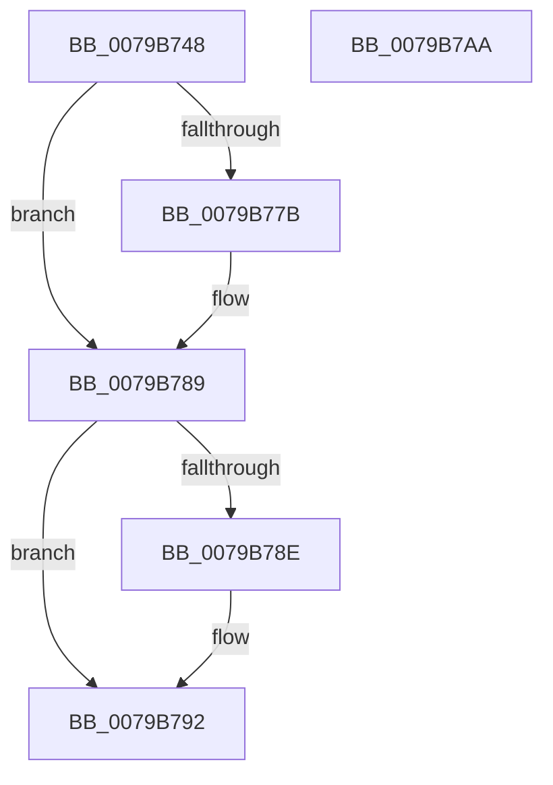

# PdcAcquireRwLockExclusive

- RVA: `0x0079B748`–`0x0079B7AB` (길이 `99` bytes)
- VA: `0x000000014079B748`
- 실행 섹션: `PAGE`
- PDB 이름 있음: `예`; PDB Function 태그: `아니요`
- unwind 정보 RVA: `0x0005CAAC`
- 디코드: `27`개 명령, `99/99` bytes 표시
- 미해석 바이트: `0` (있으면 어셈블리에 `.byte`로 보존)

> 이 문서는 커널 이미지의 기계어와 PDB 기호를 분석해 생성했습니다. 4번과 5번은 함수 원형과 자료형을 바이너리 사용 방식에서 추정한 C 해석이며 원본 소스 복구 결과는 아닙니다.

## 1. Dependencies

- 직접 호출 지점: **2**; 고유 호출 대상: **2**
- 직접 호출자로 확인된 함수: **1**
- RIP 상대 이미지 참조: **0**

### Outgoing calls
- `0x0079B76B` → [KeAbPreAcquire](../../text/21/KeAbPreAcquire_function_00210230.md) (function, `0x00210230`)
- `0x0079B784` → [ExfAcquirePushLockExclusiveEx](../../text/20/ExfAcquirePushLockExclusiveEx_function_0020FC90.md) (function, `0x0020FC90`)

### Direct callers
- [PdcTaskClientRequest](../AA/PdcTaskClientRequest_function_00AA37E4.md) at `0x00AA383C`

### Static image references
- 디코드된 RIP-relative 메모리 참조가 없습니다.

## 2. Other-region calls and transfers

- 다른 실행 섹션으로 향하는 call: **2**
  - `0x0079B76B` → [KeAbPreAcquire](../../text/21/KeAbPreAcquire_function_00210230.md) (`PAGE` → `.text`)
  - `0x0079B784` → [ExfAcquirePushLockExclusiveEx](../../text/20/ExfAcquirePushLockExclusiveEx_function_0020FC90.md) (`PAGE` → `.text`)
- 별도 외부 분기/꼬리 이동을 확인하지 못했습니다.

## 3. Assembly (complete function range)

```asm
0079B748  48 89 5C 24 08                  mov qword ptr [rsp + 8], rbx
0079B74D  57                              push rdi
0079B74E  48 83 EC 20                     sub rsp, 0x20
0079B752  65 48 8B 04 25 88 01 00 00      mov rax, qword ptr gs:[0x188]
0079B75B  45 33 C0                        xor r8d, r8d
0079B75E  33 D2                           xor edx, edx
0079B760  48 8B D9                        mov rbx, rcx
0079B763  66 FF 88 E4 01 00 00            dec word ptr [rax + 0x1e4]
0079B76A  90                              nop
0079B76B  E8 C0 4A A7 FF                  call 0x140210230
0079B770  F0 48 0F BA 2B 00               lock bts qword ptr [rbx], 0
0079B776  48 8B F8                        mov rdi, rax
0079B779  73 0E                           jae 0x14079b789
0079B77B  4C 8B C3                        mov r8, rbx
0079B77E  48 8B D0                        mov rdx, rax
0079B781  48 8B CB                        mov rcx, rbx
0079B784  E8 07 45 A7 FF                  call 0x14020fc90
0079B789  48 85 FF                        test rdi, rdi
0079B78C  74 04                           je 0x14079b792
0079B78E  C6 47 0A 01                     mov byte ptr [rdi + 0xa], 1
0079B792  65 48 8B 04 25 88 01 00 00      mov rax, qword ptr gs:[0x188]
0079B79B  48 89 43 08                     mov qword ptr [rbx + 8], rax
0079B79F  48 8B 5C 24 30                  mov rbx, qword ptr [rsp + 0x30]
0079B7A4  48 83 C4 20                     add rsp, 0x20
0079B7A8  5F                              pop rdi
0079B7A9  C3                              ret
0079B7AA  CC                              int3
```

## 4. C-style interpretation (structured pseudocode)

```c
__int64 __fastcall PdcAcquireRwLockExclusive(__int64 a1, int a2, int a3)
{
    __int64 result;
    __int64 v_rsp;
    unsigned __int64 v_stack_p8;

    v_stack_p8 = v_rbx;
    v_rsp = (v_rsp) - (32);
    a3 = 0;
    a2 = 0;
    result = KeAbPreAcquire(a1, a2, a3, a4);
    if (!(condition_is_above_or_equal)) {
        a3 = a1;
        a2 = result;
        a1 = a1;
        result = ExfAcquirePushLockExclusiveEx(a1, a2, a3, a4);
    }
    if (result != 0) {
        *(unsigned __int8 *)(result + 10) = 1;
    }
    *(unsigned __int64 *)(a1 + 8) = *(unsigned __int64 *)(gs_base + (0 + 392));
    v_rsp = (v_rsp) + (32);
    return *(unsigned __int64 *)(gs_base + (0 + 392));
}
```

## 5. (Beta) C Style

```c
int64_t PdcAcquireRwLockExclusive(void *Arg1, int32_t Arg2, int32_t Arg3)
{
    uint8_t *arg1 = (uint8_t *)Arg1;

    int64_t result;
    int64_t local_rsp;
    uint64_t v_stack_p8;

    v_stack_p8 = local_rbx;
    local_rsp = (local_rsp) - (32);
    Arg3 = 0;
    Arg2 = 0;
    result = KeAbPreAcquire(Arg1, Arg2, Arg3, a4);
    if (!(condition_is_above_or_equal)) {
        Arg3 = Arg1;
        Arg2 = result;
        Arg1 = Arg1;
        result = ExfAcquirePushLockExclusiveEx(Arg1, Arg2, Arg3, a4);
    }
    if (result != 0) {
        *(uint8_t *)(result + 0xA) = 1;
    }
    *(uint64_t *)(arg1 + 0x8) = *(uint64_t *)(gs_base + (0 + 0x188));
    local_rsp = (local_rsp) + (32);
    return *(uint64_t *)(gs_base + (0 + 0x188));
}
```

### 관측된 메모리 오프셋

구조체 형식이 확인되지 않은 접근은 인자 기준의 오프셋으로만 기록했습니다.

| 기준 인자 | 오프셋 표현 | 폭 (bit) | 접근 |
|---|---:|---:|---|
| `Arg1` | `+ 0x0` | `64` | `R/W` |
| `Arg1` | `+ 0x8` | `64` | `W` |

## 6. Execution-region graph

[열기: 2D/3D 그래프와 함수 탐색 컨트롤 패널](../../../control-panel.html?section=page&rva=0x0079B748&view=graph)

- 2D 그래프는 위에서 아래로 흐르고, 3D 그래프는 빈 공간을 드래그해 회전합니다. Shift+드래그는 이동, 휠은 확대·축소, 함수 노드 선택은 대상 보고서 이동입니다.

### Static fallback


