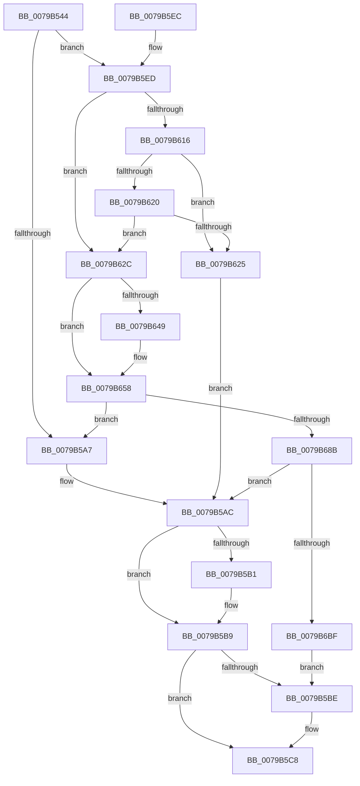

# PdcPortOpenCommon

- RVA: `0x0079B544`–`0x0079B6C9` (길이 `389` bytes)
- VA: `0x000000014079B544`
- 실행 섹션: `PAGE`
- PDB 이름 있음: `예`; PDB Function 태그: `아니요`
- unwind 정보 RVA: `0x000D06B0`
- 디코드: `103`개 명령, `389/389` bytes 표시
- 미해석 바이트: `0` (있으면 어셈블리에 `.byte`로 보존)

> 이 문서는 커널 이미지의 기계어와 PDB 기호를 분석해 생성했습니다. 4번과 5번은 함수 원형과 자료형을 바이너리 사용 방식에서 추정한 C 해석이며 원본 소스 복구 결과는 아닙니다.

## 1. Dependencies

- 직접 호출 지점: **7**; 고유 호출 대상: **6**
- 직접 호출자로 확인된 함수: **2**
- RIP 상대 이미지 참조: **0**

### Outgoing calls
- `0x0079B57B` → [memset](../../text/6C/memset_function_006C6C40.md) (function, `0x006C6C40`)
- `0x0079B59A` → [PdcAllocate](../A8/PdcAllocate_function_00A8F704.md) (function, `0x00A8F704`)
- `0x0079B5B4` → [PdcpPortReleaseResources](PdcpPortReleaseResources_function_0079B6D0.md) (function, `0x0079B6D0`)
- `0x0079B5C3` → [ExFreePoolWithTag](../../poolcode/B8/ExFreePoolWithTag_function_00B82870.md) (function, `0x00B82870`)
- `0x0079B653` → [RtlStringCchCopyW](../../text/26/RtlStringCchCopyW_function_0026E9A4.md) (function, `0x0026E9A4`)
- `0x0079B67A` → [PdcAllocate](../A8/PdcAllocate_function_00A8F704.md) (function, `0x00A8F704`)
- `0x0079B6B0` → [ZwPowerInformation](../../text/6A/ZwPowerInformation_function_006ADCB0.md) (function, `0x006ADCB0`)

### Direct callers
- [Pdcv2ActivationClientRegister](Pdcv2ActivationClientRegister_function_0079AF28.md) at `0x0079B075`
- [PdcTaskClientRegister](PdcTaskClientRegister_function_0079B49C.md) at `0x0079B510`

### Static image references
- 디코드된 RIP-relative 메모리 참조가 없습니다.

## 2. Other-region calls and transfers

- 다른 실행 섹션으로 향하는 call: **4**
  - `0x0079B57B` → [memset](../../text/6C/memset_function_006C6C40.md) (`PAGE` → `.text`)
  - `0x0079B5C3` → [ExFreePoolWithTag](../../poolcode/B8/ExFreePoolWithTag_function_00B82870.md) (`PAGE` → `POOLCODE`)
  - `0x0079B653` → [RtlStringCchCopyW](../../text/26/RtlStringCchCopyW_function_0026E9A4.md) (`PAGE` → `.text`)
  - `0x0079B6B0` → [ZwPowerInformation](../../text/6A/ZwPowerInformation_function_006ADCB0.md) (`PAGE` → `.text`)
- 별도 외부 분기/꼬리 이동을 확인하지 못했습니다.

## 3. Assembly (complete function range)

```asm
0079B544  48 8B C4                        mov rax, rsp
0079B547  48 89 58 08                     mov qword ptr [rax + 8], rbx
0079B54B  48 89 68 10                     mov qword ptr [rax + 0x10], rbp
0079B54F  48 89 70 18                     mov qword ptr [rax + 0x18], rsi
0079B553  48 89 78 20                     mov qword ptr [rax + 0x20], rdi
0079B557  41 54                           push r12
0079B559  41 56                           push r14
0079B55B  41 57                           push r15
0079B55D  48 81 EC 50 03 00 00            sub rsp, 0x350
0079B564  4D 8B E0                        mov r12, r8
0079B567  8B DA                           mov ebx, edx
0079B569  8B E9                           mov ebp, ecx
0079B56B  33 D2                           xor edx, edx
0079B56D  41 B8 20 03 00 00               mov r8d, 0x320
0079B573  48 8D 4C 24 30                  lea rcx, [rsp + 0x30]
0079B578  4D 8B F9                        mov r15, r9
0079B57B  E8 C0 B6 F2 FF                  call 0x1406c6c40
0079B580  4C 8B B4 24 B0 03 00 00         mov r14, qword ptr [rsp + 0x3b0]
0079B588  33 FF                           xor edi, edi
0079B58A  BA E8 06 00 00                  mov edx, 0x6e8
0079B58F  41 B8 50 64 63 50               mov r8d, 0x50636450
0079B595  B1 01                           mov cl, 1
0079B597  49 21 3E                        and qword ptr [r14], rdi
0079B59A  E8 65 41 2F 00                  call 0x140a8f704
0079B59F  48 8B F0                        mov rsi, rax
0079B5A2  48 85 C0                        test rax, rax
0079B5A5  75 46                           jne 0x14079b5ed
0079B5A7  BB 17 00 00 C0                  mov ebx, 0xc0000017
0079B5AC  48 85 F6                        test rsi, rsi
0079B5AF  74 08                           je 0x14079b5b9
0079B5B1  48 8B CE                        mov rcx, rsi
0079B5B4  E8 17 01 00 00                  call 0x14079b6d0
0079B5B9  48 85 FF                        test rdi, rdi
0079B5BC  74 0A                           je 0x14079b5c8
0079B5BE  33 D2                           xor edx, edx
0079B5C0  48 8B CF                        mov rcx, rdi
0079B5C3  E8 A8 72 3E 00                  call 0x140b82870
0079B5C8  4C 8D 9C 24 50 03 00 00         lea r11, [rsp + 0x350]
0079B5D0  8B C3                           mov eax, ebx
0079B5D2  49 8B 5B 20                     mov rbx, qword ptr [r11 + 0x20]
0079B5D6  49 8B 6B 28                     mov rbp, qword ptr [r11 + 0x28]
0079B5DA  49 8B 73 30                     mov rsi, qword ptr [r11 + 0x30]
0079B5DE  49 8B 7B 38                     mov rdi, qword ptr [r11 + 0x38]
0079B5E2  49 8B E3                        mov rsp, r11
0079B5E5  41 5F                           pop r15
0079B5E7  41 5E                           pop r14
0079B5E9  41 5C                           pop r12
0079B5EB  C3                              ret
0079B5EC  CC                              int3
0079B5ED  48 21 78 08                     and qword ptr [rax + 8], rdi
0079B5F1  41 BB 50 64 63 50               mov r11d, 0x50636450
0079B5F7  44 89 18                        mov dword ptr [rax], r11d
0079B5FA  4C 89 A0 D0 06 00 00            mov qword ptr [rax + 0x6d0], r12
0079B601  89 68 10                        mov dword ptr [rax + 0x10], ebp
0079B604  89 58 14                        mov dword ptr [rax + 0x14], ebx
0079B607  49 8B 07                        mov rax, qword ptr [r15]
0079B60A  48 89 86 D8 06 00 00            mov qword ptr [rsi + 0x6d8], rax
0079B611  48 85 C0                        test rax, rax
0079B614  75 16                           jne 0x14079b62c
0079B616  8D 43 FC                        lea eax, [rbx - 4]
0079B619  A9 FA FF FF FF                  test eax, 0xfffffffa
0079B61E  75 05                           jne 0x14079b625
0079B620  83 FB 09                        cmp ebx, 9
0079B623  75 07                           jne 0x14079b62c
0079B625  BB F1 00 00 C0                  mov ebx, 0xc00000f1
0079B62A  EB 80                           jmp 0x14079b5ac
0079B62C  4C 8B 84 24 A0 03 00 00         mov r8, qword ptr [rsp + 0x3a0]
0079B634  C7 44 24 5C 06 00 00 00         mov dword ptr [rsp + 0x5c], 6
0079B63C  89 6C 24 68                     mov dword ptr [rsp + 0x68], ebp
0079B640  89 5C 24 6C                     mov dword ptr [rsp + 0x6c], ebx
0079B644  4D 85 C0                        test r8, r8
0079B647  74 0F                           je 0x14079b658
0079B649  BA 40 00 00 00                  mov edx, 0x40
0079B64E  48 8D 4C 24 78                  lea rcx, [rsp + 0x78]
0079B653  E8 4C 33 AD FF                  call 0x14026e9a4
0079B658  21 7C 24 34                     and dword ptr [rsp + 0x34], edi
0079B65C  BB E0 00 00 00                  mov ebx, 0xe0
0079B661  48 21 7C 24 38                  and qword ptr [rsp + 0x38], rdi
0079B666  8B D3                           mov edx, ebx
0079B668  48 21 7C 24 40                  and qword ptr [rsp + 0x40], rdi
0079B66D  45 8B C3                        mov r8d, r11d
0079B670  B1 01                           mov cl, 1
0079B672  C7 44 24 30 F8 02 20 03         mov dword ptr [rsp + 0x30], 0x32002f8
0079B67A  E8 85 40 2F 00                  call 0x140a8f704
0079B67F  48 8B F8                        mov rdi, rax
0079B682  48 85 C0                        test rax, rax
0079B685  0F 84 1C FF FF FF               je 0x14079b5a7
0079B68B  83 64 24 20 00                  and dword ptr [rsp + 0x20], 0
0079B690  45 33 C9                        xor r9d, r9d
0079B693  C7 00 01 00 00 00               mov dword ptr [rax], 1
0079B699  44 8B C3                        mov r8d, ebx
0079B69C  48 8D 44 24 30                  lea rax, [rsp + 0x30]
0079B6A1  48 89 77 10                     mov qword ptr [rdi + 0x10], rsi
0079B6A5  48 8B D7                        mov rdx, rdi
0079B6A8  48 89 47 08                     mov qword ptr [rdi + 8], rax
0079B6AC  41 8D 49 43                     lea ecx, [r9 + 0x43]
0079B6B0  E8 FB 25 F1 FF                  call 0x1406adcb0
0079B6B5  8B D8                           mov ebx, eax
0079B6B7  85 C0                           test eax, eax
0079B6B9  0F 88 ED FE FF FF               js 0x14079b5ac
0079B6BF  49 89 36                        mov qword ptr [r14], rsi
0079B6C2  33 DB                           xor ebx, ebx
0079B6C4  E9 F5 FE FF FF                  jmp 0x14079b5be
```

## 4. C-style interpretation (structured pseudocode)

```c
__int64 __fastcall PdcPortOpenCommon(int a1, int a2, __int64 a3, __int64 a4, __int64 a5, __int64 a6, __int64 a7, __int64 a8, __int64 a9)
{
    __int64 result;
    __int64 v_rbx;
    __int64 v_rdi;
    __int64 v_rsp;
    unsigned __int64 v_stack_m18;
    unsigned __int64 v_stack_m2D8;
    unsigned int v_stack_m2E4;
    unsigned int v_stack_m2E8;
    unsigned int v_stack_m2F4;
    unsigned __int64 v_stack_m310;
    unsigned __int64 v_stack_m318;
    unsigned int v_stack_m31C;
    unsigned int v_stack_m320;
    unsigned int v_stack_m330;
    unsigned __int64 v_stack_m338;

    *(unsigned __int64 *)(v_rsp + 8) = v_rbx;
    *(unsigned __int64 *)(v_rsp + 16) = v_rbp;
    *(unsigned __int64 *)(v_rsp + 24) = v_rsi;
    *(unsigned __int64 *)(v_rsp + 32) = v_rdi;
    v_rsp = (v_rsp) - (848);
    a2 = 0;
    result = memset(v_stack_m338, a2, 800, a4);
    v_rdi = 0;
    result = PdcAllocate(1, (unsigned int)(0x6E8ULL), (unsigned int)(0x50636450ULL), a4);
    if (result != 0) goto loc_0079B5ED;
loc_0079B5A7:
loc_0079B5AC:
    if (result != 0) {
        a1 = result;
        result = PdcpPortReleaseResources(a1, (unsigned int)(0x6E8ULL), (unsigned int)(0x50636450ULL), a4);
    }
    if (0 != 0) {
        a2 = 0;
        a1 = 0;
        result = ExFreePoolWithTag(a1, a2, (unsigned int)(0x50636450ULL), a4);
    }
    return (unsigned int)((unsigned int)((unsigned int)(0xC0000017ULL)));
loc_0079B5ED:
    *(unsigned int *)((unsigned int)((unsigned int)((unsigned int)(0xC0000017ULL)))) = (unsigned int)((unsigned int)(0x50636450ULL));
    *(unsigned __int64 *)((unsigned int)((unsigned int)((unsigned int)(0xC0000017ULL))) + 1744) = a3;
    *(unsigned int *)((unsigned int)((unsigned int)((unsigned int)(0xC0000017ULL))) + 16) = (unsigned int)(*(unsigned __int64 *)(v_stack_m18 + 40));
    *(unsigned int *)((unsigned int)((unsigned int)((unsigned int)(0xC0000017ULL))) + 20) = (unsigned int)(*(unsigned __int64 *)(v_stack_m18 + 32));
    *(unsigned __int64 *)(*(unsigned __int64 *)(v_stack_m18 + 48) + 1752) = *(unsigned __int64 *)(a4);
    if (*(unsigned __int64 *)(a4) != 0) goto loc_0079B62C;
    if ((((unsigned int)(*(unsigned __int64 *)(v_stack_m18 + 32) - 4)) & (0xFFFFFFFAULL)) != 0) goto loc_0079B625;
    if (((unsigned int)(*(unsigned __int64 *)(v_stack_m18 + 32))) != 9) goto loc_0079B62C;
loc_0079B625:
    goto loc_0079B5AC;
loc_0079B62C:
    v_stack_m2F4 = 6;
    v_stack_m2E8 = (unsigned int)(*(unsigned __int64 *)(v_stack_m18 + 40));
    v_stack_m2E4 = (unsigned int)((unsigned int)(0xC00000F1ULL));
    result = *(unsigned __int64 *)(v_stack_m18 + 32) - 4;
    if (a7 != 0) {
        a2 = 64;
        a1 = v_stack_m2D8;
        result = RtlStringCchCopyW(a1, a2, a7, a4);
    }
    v_stack_m320 = 0x32002F8ULL;
    result = PdcAllocate(1, 224, (unsigned int)((unsigned int)((unsigned int)(0x50636450ULL))), a4);
    if (result == 0) goto loc_0079B5A7;
    a4 = 0;
    *(unsigned int *)(result) = 1;
    *(unsigned __int64 *)(result + 16) = *(unsigned __int64 *)(v_stack_m18 + 48);
    *(unsigned __int64 *)(result + 8) = v_stack_m320;
    result = ZwPowerInformation(a4 + 67, result, 224, a4);
    if (sign_flag) goto loc_0079B5AC;
    *(unsigned __int64 *)(a9) = *(unsigned __int64 *)(v_stack_m18 + 48);
    v_rbx = 0;
    goto loc_0079B5BE;
}
```

## 5. (Beta) C Style

```c
int64_t PdcPortOpenCommon(int32_t Arg1, void *Arg2, int64_t Arg3, void *Arg4, uint64_t Arg5, uint64_t Arg6, int64_t Arg7, uint64_t Arg8, void *Arg9)
{
    uint8_t *arg2 = (uint8_t *)Arg2;
    uint8_t *arg4 = (uint8_t *)Arg4;
    uint8_t *arg9 = (uint8_t *)Arg9;

    int64_t result;
    int64_t local_rbx;
    int64_t local_rdi;
    int64_t local_rsp;
    uint64_t v_stack_m18;
    uint64_t v_stack_m2D8;
    uint32_t v_stack_m2E4;
    uint32_t v_stack_m2E8;
    uint32_t v_stack_m2F4;
    uint64_t v_stack_m310;
    uint64_t v_stack_m318;
    uint32_t v_stack_m31C;
    uint32_t v_stack_m320;
    uint32_t v_stack_m330;
    uint64_t v_stack_m338;

    *(uint64_t *)(local_rsp + 0x8) = local_rbx;
    *(uint64_t *)(local_rsp + 0x10) = local_rbp;
    *(uint64_t *)(local_rsp + 0x18) = local_rsi;
    *(uint64_t *)(local_rsp + 0x20) = local_rdi;
    local_rsp = (local_rsp) - (848);
    Arg2 = 0;
    result = memset(v_stack_m338, Arg2, 800, Arg4);
    local_rdi = 0;
    result = PdcAllocate(1, (uint32_t)(0x6E8ULL), (uint32_t)(0x50636450ULL), Arg4);
    if (result != 0) goto loc_0079B5ED;
loc_0079B5A7:
loc_0079B5AC:
    if (result != 0) {
        Arg1 = result;
        result = PdcpPortReleaseResources(Arg1, (uint32_t)(0x6E8ULL), (uint32_t)(0x50636450ULL), Arg4);
    }
    if (0 != 0) {
        Arg2 = 0;
        Arg1 = 0;
        result = ExFreePoolWithTag(Arg1, Arg2, (uint32_t)(0x50636450ULL), Arg4);
    }
    return (uint32_t)((uint32_t)((uint32_t)(0xC0000017ULL)));
loc_0079B5ED:
    *(uint32_t *)((uint32_t)((uint32_t)((uint32_t)(0xC0000017ULL)))) = (uint32_t)((uint32_t)(0x50636450ULL));
    *(uint64_t *)((uint32_t)((uint32_t)((uint32_t)(0xC0000017ULL))) + 0x6D0) = Arg3;
    *(uint32_t *)((uint32_t)((uint32_t)((uint32_t)(0xC0000017ULL))) + 0x10) = (uint32_t)(*(uint64_t *)(v_stack_m18 + 0x28));
    *(uint32_t *)((uint32_t)((uint32_t)((uint32_t)(0xC0000017ULL))) + 0x14) = (uint32_t)(*(uint64_t *)(v_stack_m18 + 0x20));
    *(uint64_t *)(*(uint64_t *)(v_stack_m18 + 0x30) + 0x6D8) = *(uint64_t *)(arg4);
    if (*(uint64_t *)(arg4) != 0) goto loc_0079B62C;
    if ((((uint32_t)(*(uint64_t *)(v_stack_m18 + 0x20) - 4)) & (0xFFFFFFFAULL)) != 0) goto loc_0079B625;
    if (((uint32_t)(*(uint64_t *)(v_stack_m18 + 0x20))) != 9) goto loc_0079B62C;
loc_0079B625:
    goto loc_0079B5AC;
loc_0079B62C:
    v_stack_m2F4 = 6;
    v_stack_m2E8 = (uint32_t)(*(uint64_t *)(v_stack_m18 + 0x28));
    v_stack_m2E4 = (uint32_t)((uint32_t)(0xC00000F1ULL));
    result = *(uint64_t *)(v_stack_m18 + 0x20) - 4;
    if (Arg7 != 0) {
        Arg2 = 64;
        Arg1 = v_stack_m2D8;
        result = RtlStringCchCopyW(Arg1, Arg2, Arg7, Arg4);
    }
    v_stack_m320 = 0x32002F8ULL;
    result = PdcAllocate(1, 224, (uint32_t)((uint32_t)((uint32_t)(0x50636450ULL))), Arg4);
    if (result == 0) goto loc_0079B5A7;
    Arg4 = 0;
    *(uint32_t *)(result) = 1;
    *(uint64_t *)(result + 0x10) = *(uint64_t *)(v_stack_m18 + 0x30);
    *(uint64_t *)(result + 0x8) = v_stack_m320;
    result = ZwPowerInformation(Arg4 + 67, result, 224, Arg4);
    if (sign_flag) goto loc_0079B5AC;
    *(uint64_t *)(arg9) = *(uint64_t *)(v_stack_m18 + 0x30);
    local_rbx = 0;
    goto loc_0079B5BE;
}
```

### 관측된 메모리 오프셋

구조체 형식이 확인되지 않은 접근은 인자 기준의 오프셋으로만 기록했습니다.

| 기준 인자 | 오프셋 표현 | 폭 (bit) | 접근 |
|---|---:|---:|---|
| `Arg2` | `- 0x4` | `32` | `R` |
| `Arg4` | `+ 0x0` | `64` | `R` |
| `Arg9` | `+ 0x0` | `64` | `R/W` |
| `Arg9` | `+ 0x0` | `64` | `W` |

## 6. Execution-region graph

[열기: 2D/3D 그래프와 함수 탐색 컨트롤 패널](../../../control-panel.html?section=page&rva=0x0079B544&view=graph)

- 2D 그래프는 위에서 아래로 흐르고, 3D 그래프는 빈 공간을 드래그해 회전합니다. Shift+드래그는 이동, 휠은 확대·축소, 함수 노드 선택은 대상 보고서 이동입니다.

### Static fallback


