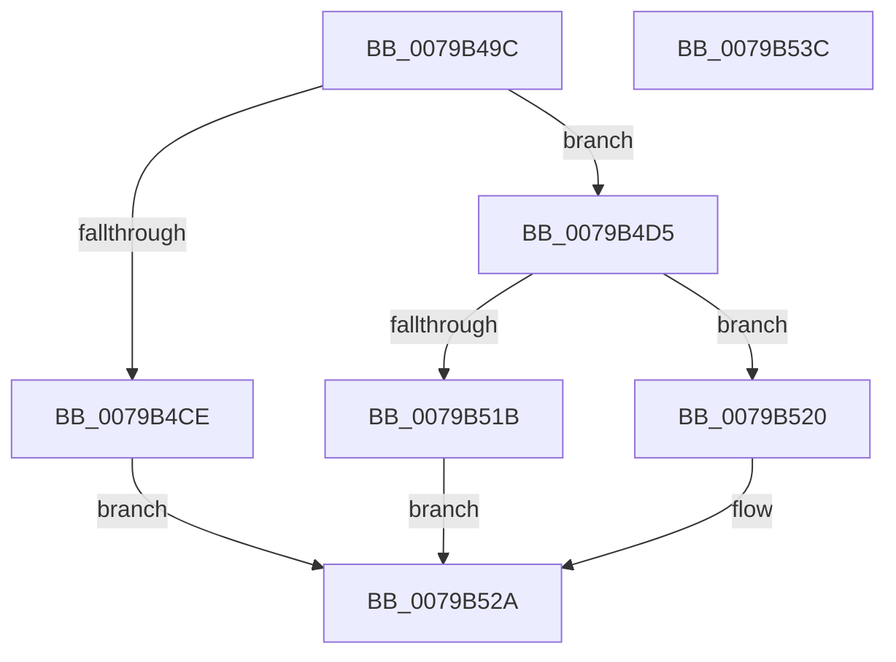

# PdcTaskClientRegister

- RVA: `0x0079B49C`–`0x0079B53D` (길이 `161` bytes)
- VA: `0x000000014079B49C`
- 실행 섹션: `PAGE`
- PDB 이름 있음: `예`; PDB Function 태그: `아니요`
- unwind 정보 RVA: `0x000D068C`
- 디코드: `46`개 명령, `161/161` bytes 표시
- 미해석 바이트: `0` (있으면 어셈블리에 `.byte`로 보존)

> 이 문서는 커널 이미지의 기계어와 PDB 기호를 분석해 생성했습니다. 4번과 5번은 함수 원형과 자료형을 바이너리 사용 방식에서 추정한 C 해석이며 원본 소스 복구 결과는 아닙니다.

## 1. Dependencies

- 직접 호출 지점: **4**; 고유 호출 대상: **4**
- 직접 호출자로 확인된 함수: **2**
- RIP 상대 이미지 참조: **0**

### Outgoing calls
- `0x0079B4C1` → [PdcAllocate](../A8/PdcAllocate_function_00A8F704.md) (function, `0x00A8F704`)
- `0x0079B4DE` → [memset](../../text/6C/memset_function_006C6C40.md) (function, `0x006C6C40`)
- `0x0079B510` → [PdcPortOpenCommon](PdcPortOpenCommon_function_0079B544.md) (function, `0x0079B544`)
- `0x0079B525` → [ExFreePoolWithTag](../../poolcode/B8/ExFreePoolWithTag_function_00B82870.md) (function, `0x00B82870`)

### Direct callers
- [PopUserShutdownScenarioInitialize](../../init/C3/PopUserShutdownScenarioInitialize_function_00C3F0D0.md) at `0x00C3F0E0`
- [PopDiagInitialize](../../init/C3/PopDiagInitialize_function_00C3F2C0.md) at `0x00C3F4A5`

### Static image references
- 디코드된 RIP-relative 메모리 참조가 없습니다.

## 2. Other-region calls and transfers

- 다른 실행 섹션으로 향하는 call: **2**
  - `0x0079B4DE` → [memset](../../text/6C/memset_function_006C6C40.md) (`PAGE` → `.text`)
  - `0x0079B525` → [ExFreePoolWithTag](../../poolcode/B8/ExFreePoolWithTag_function_00B82870.md) (`PAGE` → `POOLCODE`)
- 별도 외부 분기/꼬리 이동을 확인하지 못했습니다.

## 3. Assembly (complete function range)

```asm
0079B49C  48 89 5C 24 08                  mov qword ptr [rsp + 8], rbx
0079B4A1  48 89 74 24 18                  mov qword ptr [rsp + 0x18], rsi
0079B4A6  57                              push rdi
0079B4A7  48 83 EC 50                     sub rsp, 0x50
0079B4AB  48 83 22 00                     and qword ptr [rdx], 0
0079B4AF  48 8B F2                        mov rsi, rdx
0079B4B2  8B F9                           mov edi, ecx
0079B4B4  BA 40 00 00 00                  mov edx, 0x40
0079B4B9  B1 01                           mov cl, 1
0079B4BB  41 B8 50 64 63 63               mov r8d, 0x63636450
0079B4C1  E8 3E 42 2F 00                  call 0x140a8f704
0079B4C6  48 8B D8                        mov rbx, rax
0079B4C9  48 85 C0                        test rax, rax
0079B4CC  75 07                           jne 0x14079b4d5
0079B4CE  BF 17 00 00 C0                  mov edi, 0xc0000017
0079B4D3  EB 55                           jmp 0x14079b52a
0079B4D5  33 D2                           xor edx, edx
0079B4D7  48 8B CB                        mov rcx, rbx
0079B4DA  44 8D 42 40                     lea r8d, [rdx + 0x40]
0079B4DE  E8 5D B7 F2 FF                  call 0x1406c6c40
0079B4E3  48 83 64 24 68 00               and qword ptr [rsp + 0x68], 0
0079B4E9  48 8D 43 28                     lea rax, [rbx + 0x28]
0079B4ED  48 89 44 24 40                  mov qword ptr [rsp + 0x40], rax
0079B4F2  4C 8D 4C 24 68                  lea r9, [rsp + 0x68]
0079B4F7  48 83 64 24 30 00               and qword ptr [rsp + 0x30], 0
0079B4FD  4C 8B C3                        mov r8, rbx
0079B500  BA 04 00 00 00                  mov edx, 4
0079B505  C7 03 50 64 63 63               mov dword ptr [rbx], 0x63636450
0079B50B  8B CF                           mov ecx, edi
0079B50D  89 7B 20                        mov dword ptr [rbx + 0x20], edi
0079B510  E8 2F 00 00 00                  call 0x14079b544
0079B515  8B F8                           mov edi, eax
0079B517  85 C0                           test eax, eax
0079B519  75 05                           jne 0x14079b520
0079B51B  48 89 1E                        mov qword ptr [rsi], rbx
0079B51E  EB 0A                           jmp 0x14079b52a
0079B520  33 D2                           xor edx, edx
0079B522  48 8B CB                        mov rcx, rbx
0079B525  E8 46 73 3E 00                  call 0x140b82870
0079B52A  48 8B 5C 24 60                  mov rbx, qword ptr [rsp + 0x60]
0079B52F  8B C7                           mov eax, edi
0079B531  48 8B 74 24 70                  mov rsi, qword ptr [rsp + 0x70]
0079B536  48 83 C4 50                     add rsp, 0x50
0079B53A  5F                              pop rdi
0079B53B  C3                              ret
0079B53C  CC                              int3
```

## 4. C-style interpretation (structured pseudocode)

```c
__int64 __fastcall PdcTaskClientRegister(int a1, __int64 a2)
{
    __int64 result;
    __int64 v_rsp;
    unsigned __int64 v_stack_m18;
    unsigned __int64 v_stack_m28;
    unsigned __int64 v_stack_p10;
    unsigned __int64 v_stack_p18;
    unsigned __int64 v_stack_p8;

    v_stack_p8 = v_rbx;
    v_stack_p18 = v_rsi;
    v_rsp = (v_rsp) - (80);
    result = PdcAllocate(1, 64, (unsigned int)(0x63636450ULL), a4);
    if (result != 0) goto loc_0079B4D5;
    goto loc_0079B52A;
loc_0079B4D5:
    a2 = 0;
    result = memset(result, a2, a2 + 64, a4);
    v_stack_m18 = result + 40;
    *(unsigned int *)(result) = 0x63636450ULL;
    *(unsigned int *)(result + 32) = (unsigned int)((unsigned int)(0xC0000017ULL));
    result = PdcPortOpenCommon((unsigned int)((unsigned int)((unsigned int)(0xC0000017ULL))), 4, result, v_stack_p10);
    if ((unsigned int)(result) != 0) goto loc_0079B520;
    *(unsigned __int64 *)(a2) = result;
    goto loc_0079B52A;
loc_0079B520:
    a2 = 0;
    result = ExFreePoolWithTag(result, a2, result, v_stack_p10);
loc_0079B52A:
    v_rsp = (v_rsp) + (80);
    return (unsigned int)((unsigned int)((unsigned int)((unsigned int)(result))));
}
```

## 5. (Beta) C Style

```c
int64_t PdcTaskClientRegister(int32_t Arg1, void *Arg2)
{
    uint8_t *arg2 = (uint8_t *)Arg2;

    int64_t result;
    int64_t local_rsp;
    uint64_t v_stack_m18;
    uint64_t v_stack_m28;
    uint64_t v_stack_p10;
    uint64_t v_stack_p18;
    uint64_t v_stack_p8;

    v_stack_p8 = local_rbx;
    v_stack_p18 = local_rsi;
    local_rsp = (local_rsp) - (80);
    result = PdcAllocate(1, 64, (uint32_t)(0x63636450ULL), a4);
    if (result != 0) goto loc_0079B4D5;
    goto loc_0079B52A;
loc_0079B4D5:
    Arg2 = 0;
    result = memset(result, Arg2, Arg2 + 64, a4);
    v_stack_m18 = result + 40;
    *(uint32_t *)(result) = 0x63636450ULL;
    *(uint32_t *)(result + 0x20) = (uint32_t)((uint32_t)(0xC0000017ULL));
    result = PdcPortOpenCommon((uint32_t)((uint32_t)((uint32_t)(0xC0000017ULL))), 4, result, v_stack_p10);
    if ((uint32_t)(result) != 0) goto loc_0079B520;
    *(uint64_t *)(arg2) = result;
    goto loc_0079B52A;
loc_0079B520:
    Arg2 = 0;
    result = ExFreePoolWithTag(result, Arg2, result, v_stack_p10);
loc_0079B52A:
    local_rsp = (local_rsp) + (80);
    return (uint32_t)((uint32_t)((uint32_t)((uint32_t)(result))));
}
```

### 관측된 메모리 오프셋

구조체 형식이 확인되지 않은 접근은 인자 기준의 오프셋으로만 기록했습니다.

| 기준 인자 | 오프셋 표현 | 폭 (bit) | 접근 |
|---|---:|---:|---|
| `Arg2` | `+ 0x0` | `64` | `R/W` |
| `Arg2` | `+ 0x0` | `64` | `W` |

## 6. Execution-region graph

[열기: 2D/3D 그래프와 함수 탐색 컨트롤 패널](../../../control-panel.html?section=page&rva=0x0079B49C&view=graph)

- 2D 그래프는 위에서 아래로 흐르고, 3D 그래프는 빈 공간을 드래그해 회전합니다. Shift+드래그는 이동, 휠은 확대·축소, 함수 노드 선택은 대상 보고서 이동입니다.

### Static fallback


