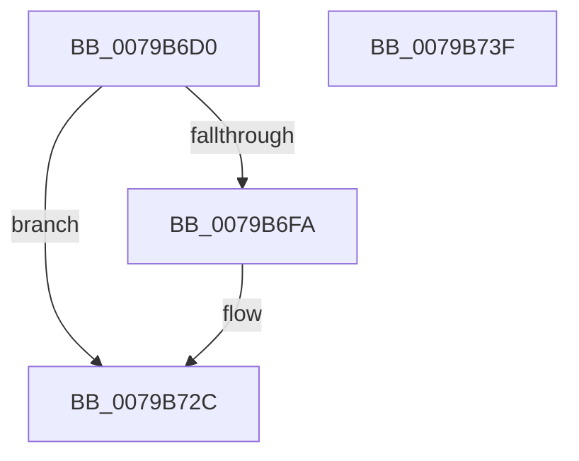

# PdcpPortReleaseResources

- RVA: `0x0079B6D0`–`0x0079B740` (길이 `112` bytes)
- VA: `0x000000014079B6D0`
- 실행 섹션: `PAGE`
- PDB 이름 있음: `예`; PDB Function 태그: `아니요`
- unwind 정보 RVA: `0x000D06A0`
- 디코드: `28`개 명령, `112/112` bytes 표시
- 미해석 바이트: `0` (있으면 어셈블리에 `.byte`로 보존)

> 이 문서는 커널 이미지의 기계어와 PDB 기호를 분석해 생성했습니다. 4번과 5번은 함수 원형과 자료형을 바이너리 사용 방식에서 추정한 C 해석이며 원본 소스 복구 결과는 아닙니다.

## 1. Dependencies

- 직접 호출 지점: **3**; 고유 호출 대상: **3**
- 직접 호출자로 확인된 함수: **1**
- RIP 상대 이미지 참조: **0**

### Outgoing calls
- `0x0079B6E9` → [memset](../../text/6C/memset_function_006C6C40.md) (function, `0x006C6C40`)
- `0x0079B727` → [guard_dispatch_icall](../../text/6B/guard_dispatch_icall_function_006BAAD0.md) (function, `0x006BAAD0`)
- `0x0079B731` → [ExFreePoolWithTag](../../poolcode/B8/ExFreePoolWithTag_function_00B82870.md) (function, `0x00B82870`)

### Direct callers
- [PdcPortOpenCommon](PdcPortOpenCommon_function_0079B544.md) at `0x0079B5B4`

### Static image references
- 디코드된 RIP-relative 메모리 참조가 없습니다.

## 2. Other-region calls and transfers

- 다른 실행 섹션으로 향하는 call: **3**
  - `0x0079B6E9` → [memset](../../text/6C/memset_function_006C6C40.md) (`PAGE` → `.text`)
  - `0x0079B727` → [guard_dispatch_icall](../../text/6B/guard_dispatch_icall_function_006BAAD0.md) (`PAGE` → `.text`)
  - `0x0079B731` → [ExFreePoolWithTag](../../poolcode/B8/ExFreePoolWithTag_function_00B82870.md) (`PAGE` → `POOLCODE`)
- 별도 외부 분기/꼬리 이동을 확인하지 못했습니다.

## 3. Assembly (complete function range)

```asm
0079B6D0  40 53                           push rbx
0079B6D2  48 81 EC 40 03 00 00            sub rsp, 0x340
0079B6D9  48 8B D9                        mov rbx, rcx
0079B6DC  33 D2                           xor edx, edx
0079B6DE  48 8D 4C 24 20                  lea rcx, [rsp + 0x20]
0079B6E3  41 B8 20 03 00 00               mov r8d, 0x320
0079B6E9  E8 52 B5 F2 FF                  call 0x1406c6c40
0079B6EE  48 8B 4B 18                     mov rcx, qword ptr [rbx + 0x18]
0079B6F2  83 23 00                        and dword ptr [rbx], 0
0079B6F5  48 85 C9                        test rcx, rcx
0079B6F8  74 32                           je 0x14079b72c
0079B6FA  8B 43 10                        mov eax, dword ptr [rbx + 0x10]
0079B6FD  48 8D 54 24 20                  lea rdx, [rsp + 0x20]
0079B702  89 44 24 58                     mov dword ptr [rsp + 0x58], eax
0079B706  41 B8 20 03 00 00               mov r8d, 0x320
0079B70C  8B 43 14                        mov eax, dword ptr [rbx + 0x14]
0079B70F  89 44 24 5C                     mov dword ptr [rsp + 0x5c], eax
0079B713  48 8B 43 20                     mov rax, qword ptr [rbx + 0x20]
0079B717  C7 44 24 48 01 00 00 00         mov dword ptr [rsp + 0x48], 1
0079B71F  C7 44 24 4C 06 00 00 00         mov dword ptr [rsp + 0x4c], 6
0079B727  E8 A4 F3 F1 FF                  call 0x1406baad0
0079B72C  33 D2                           xor edx, edx
0079B72E  48 8B CB                        mov rcx, rbx
0079B731  E8 3A 71 3E 00                  call 0x140b82870
0079B736  48 81 C4 40 03 00 00            add rsp, 0x340
0079B73D  5B                              pop rbx
0079B73E  C3                              ret
0079B73F  CC                              int3
```

## 4. C-style interpretation (structured pseudocode)

```c
__int64 __fastcall PdcpPortReleaseResources(__int64 a1, int a2)
{
    __int64 result;
    __int64 v_rsp;
    unsigned int v_stack_m2EC;
    unsigned int v_stack_m2F0;
    unsigned int v_stack_m2FC;
    unsigned int v_stack_m300;
    unsigned __int64 v_stack_m328;

    v_rsp = (v_rsp) - (832);
    a2 = 0;
    result = memset(v_stack_m328, a2, 800, a4);
    if (*(unsigned __int64 *)(a1 + 24) != 0) {
        result = *(unsigned int *)(a1 + 16);
        a2 = v_stack_m328;
        v_stack_m2F0 = (unsigned int)(result);
        a3 = 800;
        result = *(unsigned int *)(a1 + 20);
        v_stack_m2EC = (unsigned int)(result);
        result = *(unsigned __int64 *)(a1 + 32);
        v_stack_m300 = 1;
        v_stack_m2FC = 6;
        result = guard_dispatch_icall(*(unsigned __int64 *)(a1 + 24), a2, a3, a4);
    }
    a2 = 0;
    result = ExFreePoolWithTag(a1, a2, a3, a4);
    v_rsp = (v_rsp) + (832);
    return result;
}
```

## 5. (Beta) C Style

```c
int64_t PdcpPortReleaseResources(void *Arg1, int32_t Arg2)
{
    uint8_t *arg1 = (uint8_t *)Arg1;

    int64_t result;
    int64_t local_rsp;
    uint32_t v_stack_m2EC;
    uint32_t v_stack_m2F0;
    uint32_t v_stack_m2FC;
    uint32_t v_stack_m300;
    uint64_t v_stack_m328;

    local_rsp = (local_rsp) - (832);
    Arg2 = 0;
    result = memset(v_stack_m328, Arg2, 800, a4);
    if (*(uint64_t *)(arg1 + 0x18) != 0) {
        result = *(uint32_t *)(arg1 + 0x10);
        Arg2 = v_stack_m328;
        v_stack_m2F0 = (uint32_t)(result);
        a3 = 800;
        result = *(uint32_t *)(arg1 + 0x14);
        v_stack_m2EC = (uint32_t)(result);
        result = *(uint64_t *)(arg1 + 0x20);
        v_stack_m300 = 1;
        v_stack_m2FC = 6;
        result = guard_dispatch_icall(*(uint64_t *)(arg1 + 0x18), Arg2, a3, a4);
    }
    Arg2 = 0;
    result = ExFreePoolWithTag(Arg1, Arg2, a3, a4);
    local_rsp = (local_rsp) + (832);
    return result;
}
```

### 관측된 메모리 오프셋

구조체 형식이 확인되지 않은 접근은 인자 기준의 오프셋으로만 기록했습니다.

| 기준 인자 | 오프셋 표현 | 폭 (bit) | 접근 |
|---|---:|---:|---|
| `Arg1` | `+ 0x0` | `32` | `R/W` |
| `Arg1` | `+ 0x10` | `32` | `R` |
| `Arg1` | `+ 0x14` | `32` | `R` |
| `Arg1` | `+ 0x18` | `64` | `R` |
| `Arg1` | `+ 0x20` | `64` | `R` |

## 6. Execution-region graph

[열기: 2D/3D 그래프와 함수 탐색 컨트롤 패널](../../../control-panel.html?section=page&rva=0x0079B6D0&view=graph)

- 2D 그래프는 위에서 아래로 흐르고, 3D 그래프는 빈 공간을 드래그해 회전합니다. Shift+드래그는 이동, 휠은 확대·축소, 함수 노드 선택은 대상 보고서 이동입니다.

### Static fallback


