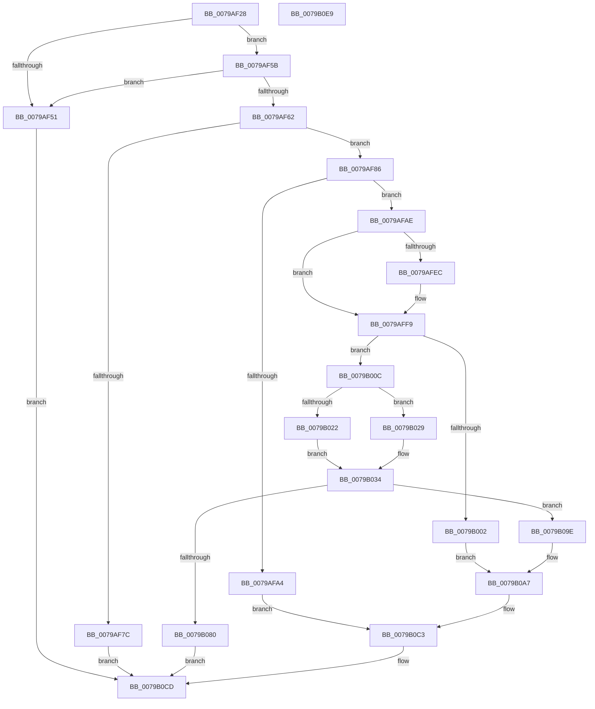

# Pdcv2ActivationClientRegister

- RVA: `0x0079AF28`–`0x0079B0EA` (길이 `450` bytes)
- VA: `0x000000014079AF28`
- 실행 섹션: `PAGE`
- PDB 이름 있음: `예`; PDB Function 태그: `아니요`
- unwind 정보 RVA: `0x000D0670`
- 디코드: `124`개 명령, `450/450` bytes 표시
- 미해석 바이트: `0` (있으면 어셈블리에 `.byte`로 보존)

> 이 문서는 커널 이미지의 기계어와 PDB 기호를 분석해 생성했습니다. 4번과 5번은 함수 원형과 자료형을 바이너리 사용 방식에서 추정한 C 해석이며 원본 소스 복구 결과는 아닙니다.

## 1. Dependencies

- 직접 호출 지점: **15**; 고유 호출 대상: **11**
- 직접 호출자로 확인된 함수: **3**
- RIP 상대 이미지 참조: **1**

### Outgoing calls
- `0x0079AF6F` → [PdcAllocate](../A8/PdcAllocate_function_00A8F704.md) (function, `0x00A8F704`)
- `0x0079AF97` → [PdcAllocate](../A8/PdcAllocate_function_00A8F704.md) (function, `0x00A8F704`)
- `0x0079AFC0` → [KeInitializeMutex](../../text/48/KeInitializeMutex_function_004830E0.md) (function, `0x004830E0`)
- `0x0079AFCD` → [PdcAcquireRwLockExclusive2](../A6/PdcAcquireRwLockExclusive2_function_00A65230.md) (function, `0x00A65230`)
- `0x0079AFDF` → [PdcAllocate](../A8/PdcAllocate_function_00A8F704.md) (function, `0x00A8F704`)
- `0x0079AFF4` → [KeInitializeEvent](../../text/40/KeInitializeEvent_function_0040DD10.md) (function, `0x0040DD10`)
- `0x0079B019` → [Feature_Servicing_PDCActivationsAVL__private_IsEnabledDeviceUsageNoInline](../../text/4F/Feature_Servicing_PDCActivationsAVL__private_IsEnabledDeviceUsageNoInline_function_004F4F6C.md) (function, `0x004F4F6C`)
- `0x0079B075` → [PdcPortOpenCommon](PdcPortOpenCommon_function_0079B544.md) (function, `0x0079B544`)
- `0x0079B083` → [PdcInitializeETW](../../text/60/PdcInitializeETW_function_00605D30.md) (function, `0x00605D30`)
- `0x0079B08D` → [Pdcv2EventWrite_ACTIVATION_CLIENT_REGISTER](../../text/60/Pdcv2EventWrite_ACTIVATION_CLIENT_REGISTER_function_00606018.md) (function, `0x00606018`)
- `0x0079B097` → [PdcReleaseRwLockExclusive2](../A7/PdcReleaseRwLockExclusive2_function_00A71898.md) (function, `0x00A71898`)
- `0x0079B0A2` → [PdcCloseEvent](../8D/PdcCloseEvent_function_008D2404.md) (function, `0x008D2404`)
- `0x0079B0B0` → [PdcReleaseRwLockExclusive2](../A7/PdcReleaseRwLockExclusive2_function_00A71898.md) (function, `0x00A71898`)
- `0x0079B0BA` → [ExFreePoolWithTag](../../poolcode/B8/ExFreePoolWithTag_function_00B82870.md) (function, `0x00B82870`)
- `0x0079B0C8` → [ExFreePoolWithTag](../../poolcode/B8/ExFreePoolWithTag_function_00B82870.md) (function, `0x00B82870`)

### Direct callers
- [PnpBootPhaseComplete](../72/PnpBootPhaseComplete_function_00723A44.md) at `0x00723AEA`
- [PopAdaptiveStandbyInitializeActivator](../76/PopAdaptiveStandbyInitializeActivator_function_0076E174.md) at `0x0076E238`
- [PopInitializeWin32kActivator](../../init/C3/PopInitializeWin32kActivator_function_00C3E7C4.md) at `0x00C3E81D`

### Static image references
- `0x0079B037` → RVA `0x0079B2C0` (`Pdcv2pActivationClientCallback`; read)

## 2. Other-region calls and transfers

- 다른 실행 섹션으로 향하는 call: **7**
  - `0x0079AFC0` → [KeInitializeMutex](../../text/48/KeInitializeMutex_function_004830E0.md) (`PAGE` → `.text`)
  - `0x0079AFF4` → [KeInitializeEvent](../../text/40/KeInitializeEvent_function_0040DD10.md) (`PAGE` → `.text`)
  - `0x0079B019` → [Feature_Servicing_PDCActivationsAVL__private_IsEnabledDeviceUsageNoInline](../../text/4F/Feature_Servicing_PDCActivationsAVL__private_IsEnabledDeviceUsageNoInline_function_004F4F6C.md) (`PAGE` → `.text`)
  - `0x0079B083` → [PdcInitializeETW](../../text/60/PdcInitializeETW_function_00605D30.md) (`PAGE` → `.text`)
  - `0x0079B08D` → [Pdcv2EventWrite_ACTIVATION_CLIENT_REGISTER](../../text/60/Pdcv2EventWrite_ACTIVATION_CLIENT_REGISTER_function_00606018.md) (`PAGE` → `.text`)
  - `0x0079B0BA` → [ExFreePoolWithTag](../../poolcode/B8/ExFreePoolWithTag_function_00B82870.md) (`PAGE` → `POOLCODE`)
  - `0x0079B0C8` → [ExFreePoolWithTag](../../poolcode/B8/ExFreePoolWithTag_function_00B82870.md) (`PAGE` → `POOLCODE`)
- 별도 외부 분기/꼬리 이동을 확인하지 못했습니다.

## 3. Assembly (complete function range)

```asm
0079AF28  48 89 5C 24 08                  mov qword ptr [rsp + 8], rbx
0079AF2D  48 89 6C 24 10                  mov qword ptr [rsp + 0x10], rbp
0079AF32  48 89 74 24 20                  mov qword ptr [rsp + 0x20], rsi
0079AF37  57                              push rdi
0079AF38  41 56                           push r14
0079AF3A  41 57                           push r15
0079AF3C  48 83 EC 50                     sub rsp, 0x50
0079AF40  49 83 20 00                     and qword ptr [r8], 0
0079AF44  4D 8B F0                        mov r14, r8
0079AF47  83 3A 01                        cmp dword ptr [rdx], 1
0079AF4A  48 8B DA                        mov rbx, rdx
0079AF4D  8B E9                           mov ebp, ecx
0079AF4F  74 0A                           je 0x14079af5b
0079AF51  BE F0 00 00 C0                  mov esi, 0xc00000f0
0079AF56  E9 72 01 00 00                  jmp 0x14079b0cd
0079AF5B  48 83 7A 08 00                  cmp qword ptr [rdx + 8], 0
0079AF60  74 EF                           je 0x14079af51
0079AF62  BA 20 01 00 00                  mov edx, 0x120
0079AF67  41 B8 50 44 41 32               mov r8d, 0x32414450
0079AF6D  B1 01                           mov cl, 1
0079AF6F  E8 90 47 2F 00                  call 0x140a8f704
0079AF74  48 8B F8                        mov rdi, rax
0079AF77  48 85 C0                        test rax, rax
0079AF7A  75 0A                           jne 0x14079af86
0079AF7C  BE 17 00 00 C0                  mov esi, 0xc0000017
0079AF81  E9 47 01 00 00                  jmp 0x14079b0cd
0079AF86  BA 38 00 00 00                  mov edx, 0x38
0079AF8B  4C 8D 78 08                     lea r15, [rax + 8]
0079AF8F  33 C9                           xor ecx, ecx
0079AF91  41 B8 50 64 63 4C               mov r8d, 0x4c636450
0079AF97  E8 68 47 2F 00                  call 0x140a8f704
0079AF9C  48 8B F0                        mov rsi, rax
0079AF9F  48 85 C0                        test rax, rax
0079AFA2  75 0A                           jne 0x14079afae
0079AFA4  BE 17 00 00 C0                  mov esi, 0xc0000017
0079AFA9  E9 15 01 00 00                  jmp 0x14079b0c3
0079AFAE  0F 57 C0                        xorps xmm0, xmm0
0079AFB1  33 C0                           xor eax, eax
0079AFB3  41 0F 11 07                     movups xmmword ptr [r15], xmm0
0079AFB7  33 D2                           xor edx, edx
0079AFB9  49 89 47 10                     mov qword ptr [r15 + 0x10], rax
0079AFBD  48 8B CE                        mov rcx, rsi
0079AFC0  E8 1B 81 CE FF                  call 0x1404830e0
0079AFC5  33 D2                           xor edx, edx
0079AFC7  49 89 37                        mov qword ptr [r15], rsi
0079AFCA  49 8B CF                        mov rcx, r15
0079AFCD  E8 5E A2 2C 00                  call 0x140a65230
0079AFD2  BA 18 00 00 00                  mov edx, 0x18
0079AFD7  33 C9                           xor ecx, ecx
0079AFD9  41 B8 50 64 63 45               mov r8d, 0x45636450
0079AFDF  E8 20 47 2F 00                  call 0x140a8f704
0079AFE4  48 8B F0                        mov rsi, rax
0079AFE7  48 85 C0                        test rax, rax
0079AFEA  74 0D                           je 0x14079aff9
0079AFEC  41 B0 01                        mov r8b, 1
0079AFEF  33 D2                           xor edx, edx
0079AFF1  48 8B C8                        mov rcx, rax
0079AFF4  E8 17 2D C7 FF                  call 0x14040dd10
0079AFF9  48 89 77 70                     mov qword ptr [rdi + 0x70], rsi
0079AFFD  48 85 F6                        test rsi, rsi
0079B000  75 0A                           jne 0x14079b00c
0079B002  BE 9A 00 00 C0                  mov esi, 0xc000009a
0079B007  E9 9B 00 00 00                  jmp 0x14079b0a7
0079B00C  C7 07 50 44 41 32               mov dword ptr [rdi], 0x32414450
0079B012  89 6F 20                        mov dword ptr [rdi + 0x20], ebp
0079B015  C6 47 48 01                     mov byte ptr [rdi + 0x48], 1
0079B019  E8 4E 9F D5 FF                  call 0x1404f4f6c
0079B01E  85 C0                           test eax, eax
0079B020  74 07                           je 0x14079b029
0079B022  48 83 67 60 00                  and qword ptr [rdi + 0x60], 0
0079B027  EB 0B                           jmp 0x14079b034
0079B029  48 8D 47 50                     lea rax, [rdi + 0x50]
0079B02D  48 89 40 08                     mov qword ptr [rax + 8], rax
0079B031  48 89 00                        mov qword ptr [rax], rax
0079B034  0F 10 03                        movups xmm0, xmmword ptr [rbx]
0079B037  48 8D 05 82 02 00 00            lea rax, [rip + 0x282]
0079B03E  4C 8B C7                        mov r8, rdi
0079B041  48 89 84 24 80 00 00 00         mov qword ptr [rsp + 0x80], rax
0079B049  4C 8D 8C 24 80 00 00 00         lea r9, [rsp + 0x80]
0079B051  0F 11 47 30                     movups xmmword ptr [rdi + 0x30], xmm0
0079B055  48 8D 47 28                     lea rax, [rdi + 0x28]
0079B059  BA 07 00 00 00                  mov edx, 7
0079B05E  F2 0F 10 4B 10                  movsd xmm1, qword ptr [rbx + 0x10]
0079B063  8B CD                           mov ecx, ebp
0079B065  48 89 44 24 40                  mov qword ptr [rsp + 0x40], rax
0079B06A  48 83 64 24 30 00               and qword ptr [rsp + 0x30], 0
0079B070  F2 0F 11 4F 40                  movsd qword ptr [rdi + 0x40], xmm1
0079B075  E8 CA 04 00 00                  call 0x14079b544
0079B07A  8B F0                           mov esi, eax
0079B07C  85 C0                           test eax, eax
0079B07E  75 1E                           jne 0x14079b09e
0079B080  49 89 3E                        mov qword ptr [r14], rdi
0079B083  E8 A8 AC E6 FF                  call 0x140605d30
0079B088  33 D2                           xor edx, edx
0079B08A  48 8B CF                        mov rcx, rdi
0079B08D  E8 86 AF E6 FF                  call 0x140606018
0079B092  33 D2                           xor edx, edx
0079B094  49 8B CF                        mov rcx, r15
0079B097  E8 FC 67 2D 00                  call 0x140a71898
0079B09C  EB 2F                           jmp 0x14079b0cd
0079B09E  48 8B 4F 70                     mov rcx, qword ptr [rdi + 0x70]
0079B0A2  E8 5D 73 13 00                  call 0x1408d2404
0079B0A7  48 8D 5F 08                     lea rbx, [rdi + 8]
0079B0AB  33 D2                           xor edx, edx
0079B0AD  48 8B CB                        mov rcx, rbx
0079B0B0  E8 E3 67 2D 00                  call 0x140a71898
0079B0B5  48 8B 0B                        mov rcx, qword ptr [rbx]
0079B0B8  33 D2                           xor edx, edx
0079B0BA  E8 B1 77 3E 00                  call 0x140b82870
0079B0BF  48 83 23 00                     and qword ptr [rbx], 0
0079B0C3  33 D2                           xor edx, edx
0079B0C5  48 8B CF                        mov rcx, rdi
0079B0C8  E8 A3 77 3E 00                  call 0x140b82870
0079B0CD  4C 8D 5C 24 50                  lea r11, [rsp + 0x50]
0079B0D2  8B C6                           mov eax, esi
0079B0D4  49 8B 5B 20                     mov rbx, qword ptr [r11 + 0x20]
0079B0D8  49 8B 6B 28                     mov rbp, qword ptr [r11 + 0x28]
0079B0DC  49 8B 73 38                     mov rsi, qword ptr [r11 + 0x38]
0079B0E0  49 8B E3                        mov rsp, r11
0079B0E3  41 5F                           pop r15
0079B0E5  41 5E                           pop r14
0079B0E7  5F                              pop rdi
0079B0E8  C3                              ret
0079B0E9  CC                              int3
```

## 4. C-style interpretation (structured pseudocode)

```c
__int64 __fastcall Pdcv2ActivationClientRegister(int a1, __int64 a2, __int64 a3)
{
    __int64 result;
    __int64 v_rsp;
    unsigned __int64 v_stack_m18;
    unsigned __int64 v_stack_m28;
    unsigned __int64 v_stack_m38;
    unsigned __int64 v_stack_p10;
    unsigned __int64 v_stack_p18;
    unsigned __int64 v_stack_p20;
    unsigned __int64 v_stack_p8;

    v_stack_p8 = v_rbx;
    v_stack_p10 = v_rbp;
    v_stack_p20 = v_rsi;
    v_rsp = (v_rsp) - (80);
    if ((*(unsigned int *)(a2)) == 1) goto loc_0079AF5B;
loc_0079AF51:
    goto loc_0079B0CD;
loc_0079AF5B:
    if ((*(unsigned __int64 *)(a2 + 8)) == 0) goto loc_0079AF51;
    result = PdcAllocate(1, 288, (unsigned int)(0x32414450ULL), a4);
    if (result != 0) goto loc_0079AF86;
    goto loc_0079B0CD;
loc_0079AF86:
    a1 = 0;
    result = PdcAllocate(a1, 56, (unsigned int)(0x4C636450ULL), a4);
    if (result != 0) goto loc_0079AFAE;
    goto loc_0079B0C3;
loc_0079AFAE:
    result = 0;
    *(unsigned __int64 *)(result + 8) = v_xmm0;
    a2 = 0;
    *(unsigned __int64 *)(result + 8 + 16) = 0;
    result = KeInitializeMutex((unsigned int)(0xC0000017ULL), a2, (unsigned int)(0x4C636450ULL), a4);
    a2 = 0;
    *(unsigned __int64 *)(result + 8) = (unsigned int)(0xC0000017ULL);
    result = PdcAcquireRwLockExclusive2(result + 8, a2, (unsigned int)(0x4C636450ULL), a4);
    a1 = 0;
    result = PdcAllocate(a1, 24, (unsigned int)(0x45636450ULL), a4);
    if (result != 0) {
        a3 = 1;
        a2 = 0;
        a1 = result;
        result = KeInitializeEvent(a1, a2, a3, a4);
    }
    *(unsigned __int64 *)(result + 112) = result;
    if (result != 0) goto loc_0079B00C;
    goto loc_0079B0A7;
loc_0079B00C:
    *(unsigned int *)(result) = 0x32414450ULL;
    *(unsigned int *)(result + 32) = (unsigned int)((unsigned int)(a1));
    *(unsigned __int8 *)(result + 72) = 1;
    result = Feature_Servicing_PDCActivationsAVL__private_IsEnabledDeviceUsageNoInline(a1, a2, a3, a4);
    if ((unsigned int)(result) == 0) goto loc_0079B029;
    goto loc_0079B034;
loc_0079B029:
    *(unsigned __int64 *)(result + 80 + 8) = result + 80;
    *(unsigned __int64 *)(result + 80) = result + 80;
loc_0079B034:
    v_stack_p18 = v_rip + 642;
    *(unsigned __int64 *)(result + 48) = v_xmm0;
    v_stack_m28 = result + 40;
    *(unsigned __int64 *)(result + 64) = v_xmm1;
    result = PdcPortOpenCommon((unsigned int)((unsigned int)((unsigned int)(a1))), 7, result, v_stack_p18);
    if ((unsigned int)(result) != 0) goto loc_0079B09E;
    *(unsigned __int64 *)(a3) = result;
    result = PdcInitializeETW((unsigned int)((unsigned int)((unsigned int)(a1))), 7, result, v_stack_p18);
    a2 = 0;
    result = Pdcv2EventWrite_ACTIVATION_CLIENT_REGISTER(result, a2, result, v_stack_p18);
    a2 = 0;
    result = PdcReleaseRwLockExclusive2(result + 8, a2, result, v_stack_p18);
    goto loc_0079B0CD;
loc_0079B09E:
    result = PdcCloseEvent(*(unsigned __int64 *)(result + 112), a2, result, v_stack_p18);
loc_0079B0A7:
    a2 = 0;
    result = PdcReleaseRwLockExclusive2(result + 8, a2, result, v_stack_p18);
    a2 = 0;
    result = ExFreePoolWithTag(*(unsigned __int64 *)(result + 8), a2, result, v_stack_p18);
loc_0079B0C3:
    a2 = 0;
    result = ExFreePoolWithTag(result, a2, result, v_stack_p18);
loc_0079B0CD:
    return (unsigned int)((unsigned int)((unsigned int)((unsigned int)(result))));
}
```

## 5. (Beta) C Style

```c
int64_t Pdcv2ActivationClientRegister(int32_t Arg1, void *Arg2, void *Arg3)
{
    uint8_t *arg2 = (uint8_t *)Arg2;
    uint8_t *arg3 = (uint8_t *)Arg3;

    int64_t result;
    int64_t local_rsp;
    uint64_t v_stack_m18;
    uint64_t v_stack_m28;
    uint64_t v_stack_m38;
    uint64_t v_stack_p10;
    uint64_t v_stack_p18;
    uint64_t v_stack_p20;
    uint64_t v_stack_p8;

    v_stack_p8 = local_rbx;
    v_stack_p10 = local_rbp;
    v_stack_p20 = local_rsi;
    local_rsp = (local_rsp) - (80);
    if ((*(uint32_t *)(arg2)) == 1) goto loc_0079AF5B;
loc_0079AF51:
    goto loc_0079B0CD;
loc_0079AF5B:
    if ((*(uint64_t *)(arg2 + 0x8)) == 0) goto loc_0079AF51;
    result = PdcAllocate(1, 288, (uint32_t)(0x32414450ULL), a4);
    if (result != 0) goto loc_0079AF86;
    goto loc_0079B0CD;
loc_0079AF86:
    Arg1 = 0;
    result = PdcAllocate(Arg1, 56, (uint32_t)(0x4C636450ULL), a4);
    if (result != 0) goto loc_0079AFAE;
    goto loc_0079B0C3;
loc_0079AFAE:
    result = 0;
    *(uint64_t *)(result + 0x8) = v_xmm0;
    Arg2 = 0;
    *(uint64_t *)(result + 0x8 + 0x10) = 0;
    result = KeInitializeMutex((uint32_t)(0xC0000017ULL), Arg2, (uint32_t)(0x4C636450ULL), a4);
    Arg2 = 0;
    *(uint64_t *)(result + 0x8) = (uint32_t)(0xC0000017ULL);
    result = PdcAcquireRwLockExclusive2(result + 8, Arg2, (uint32_t)(0x4C636450ULL), a4);
    Arg1 = 0;
    result = PdcAllocate(Arg1, 24, (uint32_t)(0x45636450ULL), a4);
    if (result != 0) {
        Arg3 = 1;
        Arg2 = 0;
        Arg1 = result;
        result = KeInitializeEvent(Arg1, Arg2, Arg3, a4);
    }
    *(uint64_t *)(result + 0x70) = result;
    if (result != 0) goto loc_0079B00C;
    goto loc_0079B0A7;
loc_0079B00C:
    *(uint32_t *)(result) = 0x32414450ULL;
    *(uint32_t *)(result + 0x20) = (uint32_t)((uint32_t)(Arg1));
    *(uint8_t *)(result + 0x48) = 1;
    result = Feature_Servicing_PDCActivationsAVL__private_IsEnabledDeviceUsageNoInline(Arg1, Arg2, Arg3, a4);
    if ((uint32_t)(result) == 0) goto loc_0079B029;
    goto loc_0079B034;
loc_0079B029:
    *(uint64_t *)(result + 0x50 + 0x8) = result + 80;
    *(uint64_t *)(result + 0x50) = result + 80;
loc_0079B034:
    v_stack_p18 = v_rip + 642;
    *(uint64_t *)(result + 0x30) = v_xmm0;
    v_stack_m28 = result + 40;
    *(uint64_t *)(result + 0x40) = v_xmm1;
    result = PdcPortOpenCommon((uint32_t)((uint32_t)((uint32_t)(Arg1))), 7, result, v_stack_p18);
    if ((uint32_t)(result) != 0) goto loc_0079B09E;
    *(uint64_t *)(arg3) = result;
    result = PdcInitializeETW((uint32_t)((uint32_t)((uint32_t)(Arg1))), 7, result, v_stack_p18);
    Arg2 = 0;
    result = Pdcv2EventWrite_ACTIVATION_CLIENT_REGISTER(result, Arg2, result, v_stack_p18);
    Arg2 = 0;
    result = PdcReleaseRwLockExclusive2(result + 8, Arg2, result, v_stack_p18);
    goto loc_0079B0CD;
loc_0079B09E:
    result = PdcCloseEvent(*(uint64_t *)(result + 0x70), Arg2, result, v_stack_p18);
loc_0079B0A7:
    Arg2 = 0;
    result = PdcReleaseRwLockExclusive2(result + 8, Arg2, result, v_stack_p18);
    Arg2 = 0;
    result = ExFreePoolWithTag(*(uint64_t *)(result + 0x8), Arg2, result, v_stack_p18);
loc_0079B0C3:
    Arg2 = 0;
    result = ExFreePoolWithTag(result, Arg2, result, v_stack_p18);
loc_0079B0CD:
    return (uint32_t)((uint32_t)((uint32_t)((uint32_t)(result))));
}
```

### 관측된 메모리 오프셋

구조체 형식이 확인되지 않은 접근은 인자 기준의 오프셋으로만 기록했습니다.

| 기준 인자 | 오프셋 표현 | 폭 (bit) | 접근 |
|---|---:|---:|---|
| `Arg2` | `+ 0x0` | `32` | `R` |
| `Arg2` | `+ 0x0` | `128` | `R` |
| `Arg2` | `+ 0x8` | `64` | `R` |
| `Arg2` | `+ 0x10` | `64` | `R` |
| `Arg3` | `+ 0x0` | `64` | `R/W` |
| `Arg3` | `+ 0x0` | `64` | `W` |

## 6. Execution-region graph

[열기: 2D/3D 그래프와 함수 탐색 컨트롤 패널](../../../control-panel.html?section=page&rva=0x0079AF28&view=graph)

- 2D 그래프는 위에서 아래로 흐르고, 3D 그래프는 빈 공간을 드래그해 회전합니다. Shift+드래그는 이동, 휠은 확대·축소, 함수 노드 선택은 대상 보고서 이동입니다.

### Static fallback


