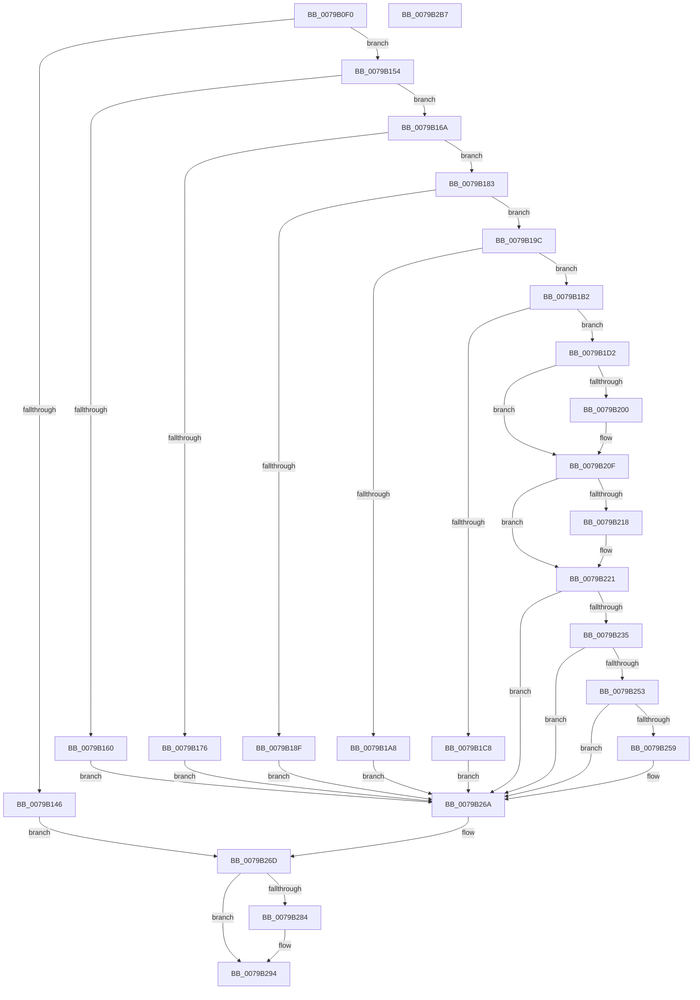

# Pdcv2ActivationClientRenewActivation

- RVA: `0x0079B0F0`–`0x0079B2B8` (길이 `456` bytes)
- VA: `0x000000014079B0F0`
- 실행 섹션: `PAGE`
- PDB 이름 있음: `예`; PDB Function 태그: `아니요`
- unwind 정보 RVA: `0x000D064C`
- 디코드: `118`개 명령, `456/456` bytes 표시
- 미해석 바이트: `0` (있으면 어셈블리에 `.byte`로 보존)

> 이 문서는 커널 이미지의 기계어와 PDB 기호를 분석해 생성했습니다. 4번과 5번은 함수 원형과 자료형을 바이너리 사용 방식에서 추정한 C 해석이며 원본 소스 복구 결과는 아닙니다.

## 1. Dependencies

- 직접 호출 지점: **9**; 고유 호출 대상: **8**
- 직접 호출자로 확인된 함수: **2**
- RIP 상대 이미지 참조: **0**

### Outgoing calls
- `0x0079B12C` → [memset](../../text/6C/memset_function_006C6C40.md) (function, `0x006C6C40`)
- `0x0079B19F` → [Pdcv2pValidateActivationParameters](../A7/Pdcv2pValidateActivationParameters_function_00A7FC90.md) (function, `0x00A7FC90`)
- `0x0079B1BD` → [PdcAcquireRwLockExclusive2](../A6/PdcAcquireRwLockExclusive2_function_00A65230.md) (function, `0x00A65230`)
- `0x0079B20A` → [RtlStringCchCopyW](../../text/26/RtlStringCchCopyW_function_0026E9A4.md) (function, `0x0026E9A4`)
- `0x0079B21C` → [PdcpResizeDiagnosticContext](../../text/60/PdcpResizeDiagnosticContext_function_0060588C.md) (function, `0x0060588C`)
- `0x0079B22A` → [PdcPortSendMessageSynchronously](../../text/49/PdcPortSendMessageSynchronously_function_0049A6B4.md) (function, `0x0049A6B4`)
- `0x0079B265` → [RtlStringCchCopyW](../../text/26/RtlStringCchCopyW_function_0026E9A4.md) (function, `0x0026E9A4`)
- `0x0079B276` → [Pdcv2EventWrite_ACTIVATION_CLIENT_RENEW_ACTIVATION](../../text/60/Pdcv2EventWrite_ACTIVATION_CLIENT_RENEW_ACTIVATION_function_00606074.md) (function, `0x00606074`)
- `0x0079B28F` → [PdcReleaseRwLockExclusive2](../A7/PdcReleaseRwLockExclusive2_function_00A71898.md) (function, `0x00A71898`)

### Direct callers
- [PopAdaptiveStandbyActivatorCallback](../../text/5D/PopAdaptiveStandbyActivatorCallback_function_005DC590.md) at `0x005DC6AB`
- [PopWin32kActivatorCallback](../75/PopWin32kActivatorCallback_function_00758520.md) at `0x0075858F`

### Static image references
- 디코드된 RIP-relative 메모리 참조가 없습니다.

## 2. Other-region calls and transfers

- 다른 실행 섹션으로 향하는 call: **6**
  - `0x0079B12C` → [memset](../../text/6C/memset_function_006C6C40.md) (`PAGE` → `.text`)
  - `0x0079B20A` → [RtlStringCchCopyW](../../text/26/RtlStringCchCopyW_function_0026E9A4.md) (`PAGE` → `.text`)
  - `0x0079B21C` → [PdcpResizeDiagnosticContext](../../text/60/PdcpResizeDiagnosticContext_function_0060588C.md) (`PAGE` → `.text`)
  - `0x0079B22A` → [PdcPortSendMessageSynchronously](../../text/49/PdcPortSendMessageSynchronously_function_0049A6B4.md) (`PAGE` → `.text`)
  - `0x0079B265` → [RtlStringCchCopyW](../../text/26/RtlStringCchCopyW_function_0026E9A4.md) (`PAGE` → `.text`)
  - `0x0079B276` → [Pdcv2EventWrite_ACTIVATION_CLIENT_RENEW_ACTIVATION](../../text/60/Pdcv2EventWrite_ACTIVATION_CLIENT_RENEW_ACTIVATION_function_00606074.md) (`PAGE` → `.text`)
- 별도 외부 분기/꼬리 이동을 확인하지 못했습니다.

## 3. Assembly (complete function range)

```asm
0079B0F0  48 8B C4                        mov rax, rsp
0079B0F3  48 89 58 08                     mov qword ptr [rax + 8], rbx
0079B0F7  48 89 70 10                     mov qword ptr [rax + 0x10], rsi
0079B0FB  48 89 78 20                     mov qword ptr [rax + 0x20], rdi
0079B0FF  55                              push rbp
0079B100  41 54                           push r12
0079B102  41 55                           push r13
0079B104  41 56                           push r14
0079B106  41 57                           push r15
0079B108  48 8D A8 98 FD FF FF            lea rbp, [rax - 0x268]
0079B10F  48 81 EC 40 03 00 00            sub rsp, 0x340
0079B116  4D 8B F8                        mov r15, r8
0079B119  4C 8B F2                        mov r14, rdx
0079B11C  48 8B F9                        mov rdi, rcx
0079B11F  33 D2                           xor edx, edx
0079B121  41 B8 20 03 00 00               mov r8d, 0x320
0079B127  48 8D 4C 24 20                  lea rcx, [rsp + 0x20]
0079B12C  E8 0F BB F2 FF                  call 0x1406c6c40
0079B131  45 33 ED                        xor r13d, r13d
0079B134  44 88 AD 80 02 00 00            mov byte ptr [rbp + 0x280], r13b
0079B13B  45 8B E5                        mov r12d, r13d
0079B13E  41 8B F5                        mov esi, r13d
0079B141  4D 85 FF                        test r15, r15
0079B144  75 0E                           jne 0x14079b154
0079B146  BB F1 00 00 C0                  mov ebx, 0xc00000f1
0079B14B  41 83 C8 FF                     or r8d, 0xffffffff
0079B14F  E9 19 01 00 00                  jmp 0x14079b26d
0079B154  41 C7 07 01 00 00 00            mov dword ptr [r15], 1
0079B15B  48 85 FF                        test rdi, rdi
0079B15E  75 0A                           jne 0x14079b16a
0079B160  BB EF 00 00 C0                  mov ebx, 0xc00000ef
0079B165  E9 00 01 00 00                  jmp 0x14079b26a
0079B16A  81 7F 18 50 44 43 41            cmp dword ptr [rdi + 0x18], 0x41434450
0079B171  4C 8B E7                        mov r12, rdi
0079B174  74 0D                           je 0x14079b183
0079B176  BB EF 00 00 C0                  mov ebx, 0xc00000ef
0079B17B  4D 8B E5                        mov r12, r13
0079B17E  E9 E7 00 00 00                  jmp 0x14079b26a
0079B183  48 8B 77 20                     mov rsi, qword ptr [rdi + 0x20]
0079B187  81 3E 50 44 41 32               cmp dword ptr [rsi], 0x32414450
0079B18D  74 0D                           je 0x14079b19c
0079B18F  BB EF 00 00 C0                  mov ebx, 0xc00000ef
0079B194  49 8B F5                        mov rsi, r13
0079B197  E9 CE 00 00 00                  jmp 0x14079b26a
0079B19C  49 8B CE                        mov rcx, r14
0079B19F  E8 EC 4A 2E 00                  call 0x140a7fc90
0079B1A4  84 C0                           test al, al
0079B1A6  75 0A                           jne 0x14079b1b2
0079B1A8  BB F0 00 00 C0                  mov ebx, 0xc00000f0
0079B1AD  E9 B8 00 00 00                  jmp 0x14079b26a
0079B1B2  48 8D 4E 08                     lea rcx, [rsi + 8]
0079B1B6  48 8D 95 80 02 00 00            lea rdx, [rbp + 0x280]
0079B1BD  E8 6E A0 2C 00                  call 0x140a65230
0079B1C2  4C 39 6E 28                     cmp qword ptr [rsi + 0x28], r13
0079B1C6  75 0A                           jne 0x14079b1d2
0079B1C8  BB 00 07 00 C0                  mov ebx, 0xc0000700
0079B1CD  E9 98 00 00 00                  jmp 0x14079b26a
0079B1D2  49 8B 46 08                     mov rax, qword ptr [r14 + 8]
0079B1D6  4D 8B 46 10                     mov r8, qword ptr [r14 + 0x10]
0079B1DA  48 89 44 24 60                  mov qword ptr [rsp + 0x60], rax
0079B1DF  48 8B 87 58 02 00 00            mov rax, qword ptr [rdi + 0x258]
0079B1E6  48 89 44 24 68                  mov qword ptr [rsp + 0x68], rax
0079B1EB  41 8B 46 04                     mov eax, dword ptr [r14 + 4]
0079B1EF  89 44 24 70                     mov dword ptr [rsp + 0x70], eax
0079B1F3  C7 44 24 48 0B 00 00 00         mov dword ptr [rsp + 0x48], 0xb
0079B1FB  4D 85 C0                        test r8, r8
0079B1FE  74 0F                           je 0x14079b20f
0079B200  BA 80 00 00 00                  mov edx, 0x80
0079B205  48 8D 4C 24 74                  lea rcx, [rsp + 0x74]
0079B20A  E8 95 37 AD FF                  call 0x14026e9a4
0079B20F  49 8B 4E 18                     mov rcx, qword ptr [r14 + 0x18]
0079B213  48 85 C9                        test rcx, rcx
0079B216  74 09                           je 0x14079b221
0079B218  48 8D 55 78                     lea rdx, [rbp + 0x78]
0079B21C  E8 6B A6 E6 FF                  call 0x14060588c
0079B221  48 8B 4E 28                     mov rcx, qword ptr [rsi + 0x28]
0079B225  48 8D 54 24 20                  lea rdx, [rsp + 0x20]
0079B22A  E8 85 F4 CF FF                  call 0x14049a6b4
0079B22F  8B D8                           mov ebx, eax
0079B231  85 C0                           test eax, eax
0079B233  78 35                           js 0x14079b26a
0079B235  8B 44 24 5C                     mov eax, dword ptr [rsp + 0x5c]
0079B239  FF 47 48                        inc dword ptr [rdi + 0x48]
0079B23C  4D 8B 46 10                     mov r8, qword ptr [r14 + 0x10]
0079B240  8B 5C 24 58                     mov ebx, dword ptr [rsp + 0x58]
0079B244  41 89 07                        mov dword ptr [r15], eax
0079B247  89 47 40                        mov dword ptr [rdi + 0x40], eax
0079B24A  44 88 6F 44                     mov byte ptr [rdi + 0x44], r13b
0079B24E  4D 85 C0                        test r8, r8
0079B251  74 17                           je 0x14079b26a
0079B253  66 45 39 28                     cmp word ptr [r8], r13w
0079B257  74 11                           je 0x14079b26a
0079B259  48 8D 8F 50 01 00 00            lea rcx, [rdi + 0x150]
0079B260  BA 80 00 00 00                  mov edx, 0x80
0079B265  E8 3A 37 AD FF                  call 0x14026e9a4
0079B26A  45 8B 07                        mov r8d, dword ptr [r15]
0079B26D  44 8B CB                        mov r9d, ebx
0079B270  48 8B D6                        mov rdx, rsi
0079B273  49 8B CC                        mov rcx, r12
0079B276  E8 F9 AD E6 FF                  call 0x140606074
0079B27B  44 38 AD 80 02 00 00            cmp byte ptr [rbp + 0x280], r13b
0079B282  74 10                           je 0x14079b294
0079B284  48 8D 4E 08                     lea rcx, [rsi + 8]
0079B288  48 8D 95 80 02 00 00            lea rdx, [rbp + 0x280]
0079B28F  E8 04 66 2D 00                  call 0x140a71898
0079B294  4C 8D 9C 24 40 03 00 00         lea r11, [rsp + 0x340]
0079B29C  8B C3                           mov eax, ebx
0079B29E  49 8B 5B 30                     mov rbx, qword ptr [r11 + 0x30]
0079B2A2  49 8B 73 38                     mov rsi, qword ptr [r11 + 0x38]
0079B2A6  49 8B 7B 48                     mov rdi, qword ptr [r11 + 0x48]
0079B2AA  49 8B E3                        mov rsp, r11
0079B2AD  41 5F                           pop r15
0079B2AF  41 5E                           pop r14
0079B2B1  41 5D                           pop r13
0079B2B3  41 5C                           pop r12
0079B2B5  5D                              pop rbp
0079B2B6  C3                              ret
0079B2B7  CC                              int3
```

## 4. C-style interpretation (structured pseudocode)

```c
__int64 __fastcall Pdcv2ActivationClientRenewActivation(__int64 a1, __int64 a2, __int64 a3)
{
    __int64 result;
    __int64 v_r13;
    __int64 v_rsp;
    unsigned __int64 v_stack_m28;
    unsigned __int64 v_stack_m2F4;
    unsigned int v_stack_m2F8;
    unsigned __int64 v_stack_m300;
    unsigned __int64 v_stack_m308;
    unsigned int v_stack_m30C;
    unsigned int v_stack_m310;
    unsigned int v_stack_m320;
    unsigned __int64 v_stack_m348;

    *(unsigned __int64 *)(v_rsp + 8) = v_rbx;
    *(unsigned __int64 *)(v_rsp + 16) = v_rsi;
    *(unsigned __int64 *)(v_rsp + 32) = v_rdi;
    v_rsp = (v_rsp) - (832);
    a2 = 0;
    result = memset(v_stack_m348, a2, 800, a4);
    v_r13 = 0;
    *(unsigned __int8 *)(v_rsp - 616 + 640) = 0;
    if (a3 != 0) goto loc_0079B154;
    a3 = (unsigned int)((800) | (0xFFFFFFFFULL));
    goto loc_0079B26D;
loc_0079B154:
    *(unsigned int *)(a3) = 1;
    if (a1 != 0) goto loc_0079B16A;
    goto loc_0079B26A;
loc_0079B16A:
    if ((*(unsigned int *)(a1 + 24)) == 0x41434450ULL) goto loc_0079B183;
    goto loc_0079B26A;
loc_0079B183:
    if ((*(unsigned int *)(*(unsigned __int64 *)(a1 + 32))) == 0x32414450ULL) goto loc_0079B19C;
    goto loc_0079B26A;
loc_0079B19C:
    result = Pdcv2pValidateActivationParameters(0, a2, a3, a4);
    if ((unsigned __int8)(result) != 0) goto loc_0079B1B2;
    goto loc_0079B26A;
loc_0079B1B2:
    result = PdcAcquireRwLockExclusive2(0 + 8, v_rsp - 616 + 640, a3, a4);
    if ((*(unsigned __int64 *)(0 + 40)) != 0) goto loc_0079B1D2;
    goto loc_0079B26A;
loc_0079B1D2:
    v_stack_m308 = *(unsigned __int64 *)(a2 + 8);
    v_stack_m300 = *(unsigned __int64 *)(a1 + 600);
    v_stack_m2F8 = (unsigned int)((unsigned int)(*(unsigned int *)(a2 + 4)));
    v_stack_m320 = 11;
    result = (unsigned int)(*(unsigned int *)(a2 + 4));
    if (*(unsigned __int64 *)(a2 + 16) != 0) {
        a2 = 128;
        a1 = v_stack_m2F4;
        result = RtlStringCchCopyW(a1, a2, *(unsigned __int64 *)(a2 + 16), a4);
    }
    if (*(unsigned __int64 *)(a2 + 24) != 0) {
        a2 = v_rsp - 616 + 120;
        result = PdcpResizeDiagnosticContext(*(unsigned __int64 *)(a2 + 24), a2, *(unsigned __int64 *)(a2 + 16), a4);
    }
    result = PdcPortSendMessageSynchronously(*(unsigned __int64 *)(0 + 40), v_stack_m348, *(unsigned __int64 *)(a2 + 16), a4);
    if (sign_flag) goto loc_0079B26A;
    *(unsigned int *)(a3) = (unsigned int)((unsigned int)(v_stack_m30C));
    *(unsigned int *)(a1 + 64) = (unsigned int)((unsigned int)(v_stack_m30C));
    *(unsigned __int8 *)(a1 + 68) = 0;
    if (*(unsigned __int64 *)(a2 + 16) == 0) goto loc_0079B26A;
    result = (unsigned int)(v_stack_m30C);
    if ((*(unsigned __int16 *)(*(unsigned __int64 *)(a2 + 16))) != 0) {
        a1 = a1 + 336;
        a2 = 128;
        result = RtlStringCchCopyW(a1, a2, *(unsigned __int64 *)(a2 + 16), a4);
    }
loc_0079B26D:
    result = Pdcv2EventWrite_ACTIVATION_CLIENT_RENEW_ACTIVATION(0, 0, (unsigned int)(*(unsigned int *)(a3)), (unsigned int)((unsigned int)((unsigned int)(v_stack_m310))));
    if ((*(unsigned __int8 *)(v_rsp - 616 + 640)) != 0) {
        a1 = 0 + 8;
        a2 = v_rsp - 616 + 640;
        result = PdcReleaseRwLockExclusive2(a1, a2, (unsigned int)(*(unsigned int *)(a3)), (unsigned int)((unsigned int)((unsigned int)(v_stack_m310))));
    }
    return (unsigned int)((unsigned int)((unsigned int)(v_stack_m310)));
}
```

## 5. (Beta) C Style

```c
int64_t Pdcv2ActivationClientRenewActivation(int64_t Arg1, void *Arg2, int64_t Arg3)
{
    uint8_t *arg2 = (uint8_t *)Arg2;

    int64_t result;
    int64_t local_r13;
    int64_t local_rsp;
    uint64_t v_stack_m28;
    uint64_t v_stack_m2F4;
    uint32_t v_stack_m2F8;
    uint64_t v_stack_m300;
    uint64_t v_stack_m308;
    uint32_t v_stack_m30C;
    uint32_t v_stack_m310;
    uint32_t v_stack_m320;
    uint64_t v_stack_m348;

    *(uint64_t *)(local_rsp + 0x8) = local_rbx;
    *(uint64_t *)(local_rsp + 0x10) = local_rsi;
    *(uint64_t *)(local_rsp + 0x20) = local_rdi;
    local_rsp = (local_rsp) - (832);
    Arg2 = 0;
    result = memset(v_stack_m348, Arg2, 800, a4);
    local_r13 = 0;
    *(uint8_t *)(local_rsp - 0x268 + 0x280) = 0;
    if (Arg3 != 0) goto loc_0079B154;
    Arg3 = (uint32_t)((800) | (0xFFFFFFFFULL));
    goto loc_0079B26D;
loc_0079B154:
    *(uint32_t *)(Arg3) = 1;
    if (Arg1 != 0) goto loc_0079B16A;
    goto loc_0079B26A;
loc_0079B16A:
    if ((*(uint32_t *)(Arg1 + 0x18)) == 0x41434450ULL) goto loc_0079B183;
    goto loc_0079B26A;
loc_0079B183:
    if ((*(uint32_t *)(*(uint64_t *)(Arg1 + 0x20))) == 0x32414450ULL) goto loc_0079B19C;
    goto loc_0079B26A;
loc_0079B19C:
    result = Pdcv2pValidateActivationParameters(0, Arg2, Arg3, a4);
    if ((uint8_t)(result) != 0) goto loc_0079B1B2;
    goto loc_0079B26A;
loc_0079B1B2:
    result = PdcAcquireRwLockExclusive2(0 + 8, local_rsp - 616 + 640, Arg3, a4);
    if ((*(uint64_t *)(0 + 0x28)) != 0) goto loc_0079B1D2;
    goto loc_0079B26A;
loc_0079B1D2:
    v_stack_m308 = *(uint64_t *)(arg2 + 0x8);
    v_stack_m300 = *(uint64_t *)(Arg1 + 0x258);
    v_stack_m2F8 = (uint32_t)((uint32_t)(*(uint32_t *)(arg2 + 0x4)));
    v_stack_m320 = 11;
    result = (uint32_t)(*(uint32_t *)(arg2 + 0x4));
    if (*(uint64_t *)(arg2 + 0x10) != 0) {
        Arg2 = 128;
        Arg1 = v_stack_m2F4;
        result = RtlStringCchCopyW(Arg1, Arg2, *(uint64_t *)(arg2 + 0x10), a4);
    }
    if (*(uint64_t *)(arg2 + 0x18) != 0) {
        Arg2 = local_rsp - 616 + 120;
        result = PdcpResizeDiagnosticContext(*(uint64_t *)(arg2 + 0x18), Arg2, *(uint64_t *)(arg2 + 0x10), a4);
    }
    result = PdcPortSendMessageSynchronously(*(uint64_t *)(0 + 0x28), v_stack_m348, *(uint64_t *)(arg2 + 0x10), a4);
    if (sign_flag) goto loc_0079B26A;
    *(uint32_t *)(Arg3) = (uint32_t)((uint32_t)(v_stack_m30C));
    *(uint32_t *)(Arg1 + 0x40) = (uint32_t)((uint32_t)(v_stack_m30C));
    *(uint8_t *)(Arg1 + 0x44) = 0;
    if (*(uint64_t *)(arg2 + 0x10) == 0) goto loc_0079B26A;
    result = (uint32_t)(v_stack_m30C);
    if ((*(uint16_t *)(*(uint64_t *)(arg2 + 0x10))) != 0) {
        Arg1 = Arg1 + 336;
        Arg2 = 128;
        result = RtlStringCchCopyW(Arg1, Arg2, *(uint64_t *)(arg2 + 0x10), a4);
    }
loc_0079B26D:
    result = Pdcv2EventWrite_ACTIVATION_CLIENT_RENEW_ACTIVATION(0, 0, (uint32_t)(*(uint32_t *)(Arg3)), (uint32_t)((uint32_t)((uint32_t)(v_stack_m310))));
    if ((*(uint8_t *)(local_rsp - 0x268 + 0x280)) != 0) {
        Arg1 = 0 + 8;
        Arg2 = local_rsp - 616 + 640;
        result = PdcReleaseRwLockExclusive2(Arg1, Arg2, (uint32_t)(*(uint32_t *)(Arg3)), (uint32_t)((uint32_t)((uint32_t)(v_stack_m310))));
    }
    return (uint32_t)((uint32_t)((uint32_t)(v_stack_m310)));
}
```

### 관측된 메모리 오프셋

구조체 형식이 확인되지 않은 접근은 인자 기준의 오프셋으로만 기록했습니다.

| 기준 인자 | 오프셋 표현 | 폭 (bit) | 접근 |
|---|---:|---:|---|
| `Arg2` | `+ 0x4` | `32` | `R` |
| `Arg2` | `+ 0x8` | `64` | `R` |
| `Arg2` | `+ 0x10` | `64` | `R` |
| `Arg2` | `+ 0x18` | `64` | `R` |

## 6. Execution-region graph

[열기: 2D/3D 그래프와 함수 탐색 컨트롤 패널](../../../control-panel.html?section=page&rva=0x0079B0F0&view=graph)

- 2D 그래프는 위에서 아래로 흐르고, 3D 그래프는 빈 공간을 드래그해 회전합니다. Shift+드래그는 이동, 휠은 확대·축소, 함수 노드 선택은 대상 보고서 이동입니다.

### Static fallback


