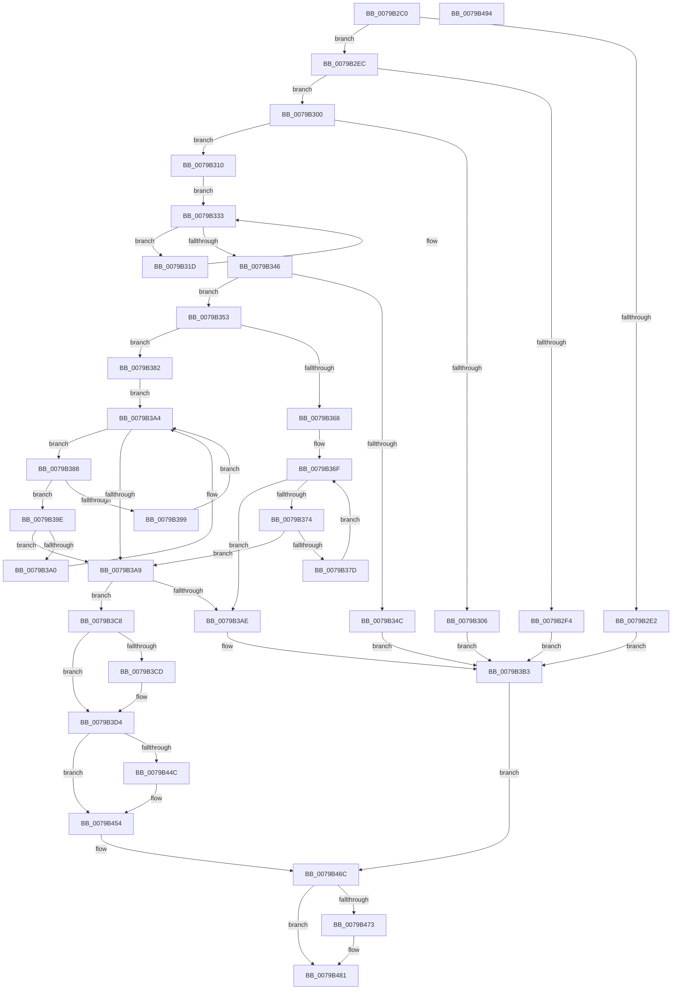

# Pdcv2pActivationClientCallback

- RVA: `0x0079B2C0`–`0x0079B495` (길이 `469` bytes)
- VA: `0x000000014079B2C0`
- 실행 섹션: `PAGE`
- PDB 이름 있음: `예`; PDB Function 태그: `아니요`
- unwind 정보 RVA: `0x00084CE8`
- 디코드: `132`개 명령, `469/469` bytes 표시
- 미해석 바이트: `0` (있으면 어셈블리에 `.byte`로 보존)

> 이 문서는 커널 이미지의 기계어와 PDB 기호를 분석해 생성했습니다. 4번과 5번은 함수 원형과 자료형을 바이너리 사용 방식에서 추정한 C 해석이며 원본 소스 복구 결과는 아닙니다.

## 1. Dependencies

- 직접 호출 지점: **14**; 고유 호출 대상: **10**
- 직접 호출자로 확인된 함수: **0**
- RIP 상대 이미지 참조: **0**

### Outgoing calls
- `0x0079B310` → [HalAdjustResourceList](../../text/48/HalAdjustResourceList_function_0048FDC0.md) (function, `0x0048FDC0`)
- `0x0079B325` → [PdcReleaseRwLockExclusive2](../A7/PdcReleaseRwLockExclusive2_function_00A71898.md) (function, `0x00A71898`)
- `0x0079B32E` → [PdcWaitForEvent](PdcWaitForEvent_function_0079B7B4.md) (function, `0x0079B7B4`)
- `0x0079B33B` → [PdcAcquireRwLockExclusive2](../A6/PdcAcquireRwLockExclusive2_function_00A65230.md) (function, `0x00A65230`)
- `0x0079B35F` → [Feature_Servicing_PDCActivationsAVL__private_IsEnabledDeviceUsageNoInline](../../text/4F/Feature_Servicing_PDCActivationsAVL__private_IsEnabledDeviceUsageNoInline_function_004F4F6C.md) (function, `0x004F4F6C`)
- `0x0079B390` → [PdcpActivationClientTableCompareRoutine](PdcpActivationClientTableCompareRoutine_function_0079AF04.md) (function, `0x0079AF04`)
- `0x0079B3BE` → [Pdcv2EventWrite_ACTIVATION_CLIENT_CALLBACK](../../text/60/Pdcv2EventWrite_ACTIVATION_CLIENT_CALLBACK_function_00605D7C.md) (function, `0x00605D7C`)
- `0x0079B3E0` → [Pdcv2EventWrite_ACTIVATION_CLIENT_CALLBACK](../../text/60/Pdcv2EventWrite_ACTIVATION_CLIENT_CALLBACK_function_00605D7C.md) (function, `0x00605D7C`)
- `0x0079B3FA` → [PdcResetEvent](../../text/60/PdcResetEvent_function_006058CC.md) (function, `0x006058CC`)
- `0x0079B41B` → [PdcReleaseRwLockExclusive2](../A7/PdcReleaseRwLockExclusive2_function_00A71898.md) (function, `0x00A71898`)
- `0x0079B431` → [guard_dispatch_icall](../../text/6B/guard_dispatch_icall_function_006BAAD0.md) (function, `0x006BAAD0`)
- `0x0079B43E` → [PdcAcquireRwLockExclusive2](../A6/PdcAcquireRwLockExclusive2_function_00A65230.md) (function, `0x00A65230`)
- `0x0079B467` → [KeSetEvent](../../text/33/KeSetEvent_function_0033F310.md) (function, `0x0033F310`)
- `0x0079B47C` → [PdcReleaseRwLockExclusive2](../A7/PdcReleaseRwLockExclusive2_function_00A71898.md) (function, `0x00A71898`)

### Direct callers
- 이 함수 시작 RVA로 연결되는 직접 call은 확인되지 않았습니다. 간접 호출은 완전히 역산할 수 없습니다.

### Static image references
- 디코드된 RIP-relative 메모리 참조가 없습니다.

## 2. Other-region calls and transfers

- 다른 실행 섹션으로 향하는 call: **7**
  - `0x0079B310` → [HalAdjustResourceList](../../text/48/HalAdjustResourceList_function_0048FDC0.md) (`PAGE` → `.text`)
  - `0x0079B35F` → [Feature_Servicing_PDCActivationsAVL__private_IsEnabledDeviceUsageNoInline](../../text/4F/Feature_Servicing_PDCActivationsAVL__private_IsEnabledDeviceUsageNoInline_function_004F4F6C.md) (`PAGE` → `.text`)
  - `0x0079B3BE` → [Pdcv2EventWrite_ACTIVATION_CLIENT_CALLBACK](../../text/60/Pdcv2EventWrite_ACTIVATION_CLIENT_CALLBACK_function_00605D7C.md) (`PAGE` → `.text`)
  - `0x0079B3E0` → [Pdcv2EventWrite_ACTIVATION_CLIENT_CALLBACK](../../text/60/Pdcv2EventWrite_ACTIVATION_CLIENT_CALLBACK_function_00605D7C.md) (`PAGE` → `.text`)
  - `0x0079B3FA` → [PdcResetEvent](../../text/60/PdcResetEvent_function_006058CC.md) (`PAGE` → `.text`)
  - `0x0079B431` → [guard_dispatch_icall](../../text/6B/guard_dispatch_icall_function_006BAAD0.md) (`PAGE` → `.text`)
  - `0x0079B467` → [KeSetEvent](../../text/33/KeSetEvent_function_0033F310.md) (`PAGE` → `.text`)
- 별도 외부 분기/꼬리 이동을 확인하지 못했습니다.

## 3. Assembly (complete function range)

```asm
0079B2C0  48 89 5C 24 10                  mov qword ptr [rsp + 0x10], rbx
0079B2C5  55                              push rbp
0079B2C6  56                              push rsi
0079B2C7  57                              push rdi
0079B2C8  41 56                           push r14
0079B2CA  41 57                           push r15
0079B2CC  48 83 EC 30                     sub rsp, 0x30
0079B2D0  33 ED                           xor ebp, ebp
0079B2D2  48 8B DA                        mov rbx, rdx
0079B2D5  40 88 6C 24 60                  mov byte ptr [rsp + 0x60], bpl
0079B2DA  48 8B F9                        mov rdi, rcx
0079B2DD  48 85 C9                        test rcx, rcx
0079B2E0  75 0A                           jne 0x14079b2ec
0079B2E2  BE EF 00 00 C0                  mov esi, 0xc00000ef
0079B2E7  E9 C7 00 00 00                  jmp 0x14079b3b3
0079B2EC  81 39 50 44 41 32               cmp dword ptr [rcx], 0x32414450
0079B2F2  74 0C                           je 0x14079b300
0079B2F4  BE EF 00 00 C0                  mov esi, 0xc00000ef
0079B2F9  33 FF                           xor edi, edi
0079B2FB  E9 B3 00 00 00                  jmp 0x14079b3b3
0079B300  83 7A 28 0C                     cmp dword ptr [rdx + 0x28], 0xc
0079B304  74 0A                           je 0x14079b310
0079B306  BE 02 07 00 C0                  mov esi, 0xc0000702
0079B30B  E9 A3 00 00 00                  jmp 0x14079b3b3
0079B310  E8 AB 4A CF FF                  call 0x14048fdc0
0079B315  8B F0                           mov esi, eax
0079B317  4C 8D 71 08                     lea r14, [rcx + 8]
0079B31B  EB 16                           jmp 0x14079b333
0079B31D  48 8D 54 24 60                  lea rdx, [rsp + 0x60]
0079B322  49 8B CE                        mov rcx, r14
0079B325  E8 6E 65 2D 00                  call 0x140a71898
0079B32A  48 8B 4F 70                     mov rcx, qword ptr [rdi + 0x70]
0079B32E  E8 81 04 00 00                  call 0x14079b7b4
0079B333  48 8D 54 24 60                  lea rdx, [rsp + 0x60]
0079B338  49 8B CE                        mov rcx, r14
0079B33B  E8 F0 9E 2C 00                  call 0x140a65230
0079B340  48 39 6F 68                     cmp qword ptr [rdi + 0x68], rbp
0079B344  75 D7                           jne 0x14079b31d
0079B346  48 39 6F 28                     cmp qword ptr [rdi + 0x28], rbp
0079B34A  75 07                           jne 0x14079b353
0079B34C  BE 00 07 00 C0                  mov esi, 0xc0000700
0079B351  EB 60                           jmp 0x14079b3b3
0079B353  4C 8B 7B 38                     mov r15, qword ptr [rbx + 0x38]
0079B357  8B 6B 40                        mov ebp, dword ptr [rbx + 0x40]
0079B35A  4C 89 7C 24 70                  mov qword ptr [rsp + 0x70], r15
0079B35F  E8 08 9C D5 FF                  call 0x1404f4f6c
0079B364  85 C0                           test eax, eax
0079B366  75 1A                           jne 0x14079b382
0079B368  48 8D 47 50                     lea rax, [rdi + 0x50]
0079B36C  48 8B 18                        mov rbx, qword ptr [rax]
0079B36F  48 3B D8                        cmp rbx, rax
0079B372  74 3A                           je 0x14079b3ae
0079B374  4C 39 BB 58 02 00 00            cmp qword ptr [rbx + 0x258], r15
0079B37B  74 2C                           je 0x14079b3a9
0079B37D  48 8B 1B                        mov rbx, qword ptr [rbx]
0079B380  EB ED                           jmp 0x14079b36f
0079B382  48 8B 5F 60                     mov rbx, qword ptr [rdi + 0x60]
0079B386  EB 1C                           jmp 0x14079b3a4
0079B388  48 8B D3                        mov rdx, rbx
0079B38B  48 8D 4C 24 70                  lea rcx, [rsp + 0x70]
0079B390  E8 6F FB FF FF                  call 0x14079af04
0079B395  85 C0                           test eax, eax
0079B397  79 05                           jns 0x14079b39e
0079B399  48 8B 1B                        mov rbx, qword ptr [rbx]
0079B39C  EB 06                           jmp 0x14079b3a4
0079B39E  7E 09                           jle 0x14079b3a9
0079B3A0  48 8B 5B 08                     mov rbx, qword ptr [rbx + 8]
0079B3A4  48 85 DB                        test rbx, rbx
0079B3A7  75 DF                           jne 0x14079b388
0079B3A9  48 85 DB                        test rbx, rbx
0079B3AC  75 1A                           jne 0x14079b3c8
0079B3AE  BE 89 01 00 C0                  mov esi, 0xc0000189
0079B3B3  44 8B CE                        mov r9d, esi
0079B3B6  44 8B C5                        mov r8d, ebp
0079B3B9  48 8B D7                        mov rdx, rdi
0079B3BC  33 C9                           xor ecx, ecx
0079B3BE  E8 B9 A9 E6 FF                  call 0x140605d7c
0079B3C3  E9 A4 00 00 00                  jmp 0x14079b46c
0079B3C8  83 FD 65                        cmp ebp, 0x65
0079B3CB  7C 07                           jl 0x14079b3d4
0079B3CD  FF 43 4C                        inc dword ptr [rbx + 0x4c]
0079B3D0  C6 43 44 01                     mov byte ptr [rbx + 0x44], 1
0079B3D4  44 8B CE                        mov r9d, esi
0079B3D7  44 8B C5                        mov r8d, ebp
0079B3DA  48 8B D7                        mov rdx, rdi
0079B3DD  48 8B CB                        mov rcx, rbx
0079B3E0  E8 97 A9 E6 FF                  call 0x140605d7c
0079B3E5  65 48 8B 04 25 88 01 00 00      mov rax, qword ptr gs:[0x188]
0079B3EE  48 8B 4F 70                     mov rcx, qword ptr [rdi + 0x70]
0079B3F2  48 89 47 68                     mov qword ptr [rdi + 0x68], rax
0079B3F6  48 89 5F 78                     mov qword ptr [rdi + 0x78], rbx
0079B3FA  E8 CD A4 E6 FF                  call 0x1406058cc
0079B3FF  65 48 8B 14 25 88 01 00 00      mov rdx, qword ptr gs:[0x188]
0079B408  49 8B CE                        mov rcx, r14
0079B40B  48 8B 47 28                     mov rax, qword ptr [rdi + 0x28]
0079B40F  48 89 90 E0 06 00 00            mov qword ptr [rax + 0x6e0], rdx
0079B416  48 8D 54 24 60                  lea rdx, [rsp + 0x60]
0079B41B  E8 78 64 2D 00                  call 0x140a71898
0079B420  48 8B 47 38                     mov rax, qword ptr [rdi + 0x38]
0079B424  8B D5                           mov edx, ebp
0079B426  4C 8B 4B 28                     mov r9, qword ptr [rbx + 0x28]
0079B42A  48 8B CB                        mov rcx, rbx
0079B42D  4C 8B 47 40                     mov r8, qword ptr [rdi + 0x40]
0079B431  E8 9A F6 F1 FF                  call 0x1406baad0
0079B436  48 8D 54 24 60                  lea rdx, [rsp + 0x60]
0079B43B  49 8B CE                        mov rcx, r14
0079B43E  E8 ED 9D 2C 00                  call 0x140a65230
0079B443  48 8B 47 28                     mov rax, qword ptr [rdi + 0x28]
0079B447  48 85 C0                        test rax, rax
0079B44A  74 08                           je 0x14079b454
0079B44C  48 83 A0 E0 06 00 00 00         and qword ptr [rax + 0x6e0], 0
0079B454  48 83 67 68 00                  and qword ptr [rdi + 0x68], 0
0079B459  45 33 C0                        xor r8d, r8d
0079B45C  48 83 67 78 00                  and qword ptr [rdi + 0x78], 0
0079B461  33 D2                           xor edx, edx
0079B463  48 8B 4F 70                     mov rcx, qword ptr [rdi + 0x70]
0079B467  E8 A4 3E BA FF                  call 0x14033f310
0079B46C  80 7C 24 60 00                  cmp byte ptr [rsp + 0x60], 0
0079B471  74 0E                           je 0x14079b481
0079B473  48 8D 4F 08                     lea rcx, [rdi + 8]
0079B477  48 8D 54 24 60                  lea rdx, [rsp + 0x60]
0079B47C  E8 17 64 2D 00                  call 0x140a71898
0079B481  48 8B 5C 24 68                  mov rbx, qword ptr [rsp + 0x68]
0079B486  8B C6                           mov eax, esi
0079B488  48 83 C4 30                     add rsp, 0x30
0079B48C  41 5F                           pop r15
0079B48E  41 5E                           pop r14
0079B490  5F                              pop rdi
0079B491  5E                              pop rsi
0079B492  5D                              pop rbp
0079B493  C3                              ret
0079B494  CC                              int3
```

## 4. C-style interpretation (structured pseudocode)

```c
__int64 __fastcall Pdcv2pActivationClientCallback(__int64 a1, __int64 a2)
{
    __int64 result;
    __int64 v_rbp;
    __int64 v_rdi;
    __int64 v_rsp;
    unsigned __int64 v_stack_p10;
    unsigned __int64 v_stack_p18;
    unsigned __int8 v_stack_p8;

    v_stack_p10 = v_rbx;
    v_rsp = (v_rsp) - (48);
    v_rbp = 0;
    v_stack_p8 = 0;
    if (a1 != 0) goto loc_0079B2EC;
    goto loc_0079B3B3;
loc_0079B2EC:
    if ((*(unsigned int *)(a1)) == 0x32414450ULL) goto loc_0079B300;
    v_rdi = 0;
    goto loc_0079B3B3;
loc_0079B300:
    if ((*(unsigned int *)(a2 + 40)) == 12) goto loc_0079B310;
    goto loc_0079B3B3;
loc_0079B310:
    result = HalAdjustResourceList(a1, a2, a3, a4);
    goto loc_0079B333;
loc_0079B31D:
    result = PdcReleaseRwLockExclusive2(a1 + 8, v_stack_p8, a3, a4);
    result = PdcWaitForEvent(*(unsigned __int64 *)(v_rdi + 112), v_stack_p8, a3, a4);
loc_0079B333:
    result = PdcAcquireRwLockExclusive2(a1 + 8, v_stack_p8, a3, a4);
    if ((*(unsigned __int64 *)(v_rdi + 104)) != 0) goto loc_0079B31D;
    if ((*(unsigned __int64 *)(v_rdi + 40)) != 0) goto loc_0079B353;
    goto loc_0079B3B3;
loc_0079B353:
    v_stack_p18 = *(unsigned __int64 *)(a2 + 56);
    result = Feature_Servicing_PDCActivationsAVL__private_IsEnabledDeviceUsageNoInline(a1 + 8, v_stack_p8, a3, a4);
    if ((unsigned int)(result) != 0) goto loc_0079B382;
loc_0079B36F:
    if ((*(unsigned __int64 *)(v_rdi + 80)) == (v_rdi + 80)) goto loc_0079B3AE;
    if ((*(unsigned __int64 *)(*(unsigned __int64 *)(v_rdi + 80) + 600)) == (*(unsigned __int64 *)(a2 + 56))) goto loc_0079B3A9;
    goto loc_0079B36F;
loc_0079B382:
    goto loc_0079B3A4;
loc_0079B388:
    result = PdcpActivationClientTableCompareRoutine(v_stack_p18, *(unsigned __int64 *)(v_rdi + 96), a3, a4);
    if (!sign_flag) goto loc_0079B39E;
    goto loc_0079B3A4;
loc_0079B39E:
    if (condition_is_less_or_equal) goto loc_0079B3A9;
loc_0079B3A4:
    if (*(unsigned __int64 *)(*(unsigned __int64 *)(*(unsigned __int64 *)(v_rdi + 96)) + 8) != 0) goto loc_0079B388;
loc_0079B3A9:
    if (*(unsigned __int64 *)(*(unsigned __int64 *)(*(unsigned __int64 *)(v_rdi + 96)) + 8) != 0) goto loc_0079B3C8;
loc_0079B3AE:
loc_0079B3B3:
    a1 = 0;
    result = Pdcv2EventWrite_ACTIVATION_CLIENT_CALLBACK(a1, 0, (unsigned int)((unsigned int)((unsigned int)(*(unsigned int *)(a2 + 64)))), (unsigned int)((unsigned int)((unsigned int)(0xC0000189ULL))));
    goto loc_0079B46C;
loc_0079B3C8:
    if (((unsigned int)((unsigned int)(*(unsigned int *)(a2 + 64)))) >= 101) {
        *(unsigned __int8 *)(*(unsigned __int64 *)(*(unsigned __int64 *)(*(unsigned __int64 *)(v_rdi + 96)) + 8) + 68) = 1;
    }
    result = Pdcv2EventWrite_ACTIVATION_CLIENT_CALLBACK(*(unsigned __int64 *)(*(unsigned __int64 *)(*(unsigned __int64 *)(v_rdi + 96)) + 8), 0, (unsigned int)((unsigned int)((unsigned int)(*(unsigned int *)(a2 + 64)))), (unsigned int)((unsigned int)((unsigned int)(0xC0000189ULL))));
    *(unsigned __int64 *)(v_rdi + 104) = *(unsigned __int64 *)(gs_base + (0 + 392));
    *(unsigned __int64 *)(v_rdi + 120) = *(unsigned __int64 *)(*(unsigned __int64 *)(*(unsigned __int64 *)(v_rdi + 96)) + 8);
    result = PdcResetEvent(*(unsigned __int64 *)(v_rdi + 112), 0, (unsigned int)((unsigned int)((unsigned int)(*(unsigned int *)(a2 + 64)))), (unsigned int)((unsigned int)((unsigned int)(0xC0000189ULL))));
    *(unsigned __int64 *)(*(unsigned __int64 *)(v_rdi + 40) + 1760) = *(unsigned __int64 *)(gs_base + (0 + 392));
    result = PdcReleaseRwLockExclusive2(a1 + 8, v_stack_p8, (unsigned int)((unsigned int)((unsigned int)(*(unsigned int *)(a2 + 64)))), (unsigned int)((unsigned int)((unsigned int)(0xC0000189ULL))));
    result = guard_dispatch_icall(*(unsigned __int64 *)(*(unsigned __int64 *)(*(unsigned __int64 *)(v_rdi + 96)) + 8), (unsigned int)((unsigned int)((unsigned int)(*(unsigned int *)(a2 + 64)))), *(unsigned __int64 *)(v_rdi + 64), *(unsigned __int64 *)(*(unsigned __int64 *)(*(unsigned __int64 *)(*(unsigned __int64 *)(v_rdi + 96)) + 8) + 40));
    result = PdcAcquireRwLockExclusive2(a1 + 8, v_stack_p8, *(unsigned __int64 *)(v_rdi + 64), *(unsigned __int64 *)(*(unsigned __int64 *)(*(unsigned __int64 *)(*(unsigned __int64 *)(v_rdi + 96)) + 8) + 40));
    if (*(unsigned __int64 *)(v_rdi + 40) != 0) {
    }
    a3 = 0;
    a2 = 0;
    result = KeSetEvent(*(unsigned __int64 *)(v_rdi + 112), a2, a3, *(unsigned __int64 *)(*(unsigned __int64 *)(*(unsigned __int64 *)(*(unsigned __int64 *)(v_rdi + 96)) + 8) + 40));
loc_0079B46C:
    if (v_stack_p8 != 0) {
        a1 = v_rdi + 8;
        a2 = v_stack_p8;
        result = PdcReleaseRwLockExclusive2(a1, a2, a3, *(unsigned __int64 *)(*(unsigned __int64 *)(*(unsigned __int64 *)(*(unsigned __int64 *)(v_rdi + 96)) + 8) + 40));
    }
    v_rsp = (v_rsp) + (48);
    return (unsigned int)((unsigned int)((unsigned int)(0xC0000189ULL)));
}
```

## 5. (Beta) C Style

```c
int64_t Pdcv2pActivationClientCallback(void *Arg1, void *Arg2)
{
    uint8_t *arg1 = (uint8_t *)Arg1;
    uint8_t *arg2 = (uint8_t *)Arg2;

    int64_t result;
    int64_t local_rbp;
    int64_t local_rdi;
    int64_t local_rsp;
    uint64_t v_stack_p10;
    uint64_t v_stack_p18;
    uint8_t v_stack_p8;

    v_stack_p10 = local_rbx;
    local_rsp = (local_rsp) - (48);
    local_rbp = 0;
    v_stack_p8 = 0;
    if (Arg1 != NULL) goto loc_0079B2EC;
    goto loc_0079B3B3;
loc_0079B2EC:
    if ((*(uint32_t *)(arg1)) == 0x32414450ULL) goto loc_0079B300;
    local_rdi = 0;
    goto loc_0079B3B3;
loc_0079B300:
    if ((*(uint32_t *)(arg2 + 0x28)) == 12) goto loc_0079B310;
    goto loc_0079B3B3;
loc_0079B310:
    result = HalAdjustResourceList(Arg1, Arg2, a3, a4);
    goto loc_0079B333;
loc_0079B31D:
    result = PdcReleaseRwLockExclusive2(Arg1 + 8, v_stack_p8, a3, a4);
    result = PdcWaitForEvent(*(uint64_t *)(local_rdi + 0x70), v_stack_p8, a3, a4);
loc_0079B333:
    result = PdcAcquireRwLockExclusive2(Arg1 + 8, v_stack_p8, a3, a4);
    if ((*(uint64_t *)(local_rdi + 0x68)) != 0) goto loc_0079B31D;
    if ((*(uint64_t *)(local_rdi + 0x28)) != 0) goto loc_0079B353;
    goto loc_0079B3B3;
loc_0079B353:
    v_stack_p18 = *(uint64_t *)(arg2 + 0x38);
    result = Feature_Servicing_PDCActivationsAVL__private_IsEnabledDeviceUsageNoInline(Arg1 + 8, v_stack_p8, a3, a4);
    if ((uint32_t)(result) != 0) goto loc_0079B382;
loc_0079B36F:
    if ((*(uint64_t *)(local_rdi + 0x50)) == (local_rdi + 80)) goto loc_0079B3AE;
    if ((*(uint64_t *)(*(uint64_t *)(local_rdi + 0x50) + 0x258)) == (*(uint64_t *)(arg2 + 0x38))) goto loc_0079B3A9;
    goto loc_0079B36F;
loc_0079B382:
    goto loc_0079B3A4;
loc_0079B388:
    result = PdcpActivationClientTableCompareRoutine(v_stack_p18, *(uint64_t *)(local_rdi + 0x60), a3, a4);
    if (!sign_flag) goto loc_0079B39E;
    goto loc_0079B3A4;
loc_0079B39E:
    if (condition_is_less_or_equal) goto loc_0079B3A9;
loc_0079B3A4:
    if (*(uint64_t *)(*(uint64_t *)(*(uint64_t *)(local_rdi + 0x60)) + 0x8) != 0) goto loc_0079B388;
loc_0079B3A9:
    if (*(uint64_t *)(*(uint64_t *)(*(uint64_t *)(local_rdi + 0x60)) + 0x8) != 0) goto loc_0079B3C8;
loc_0079B3AE:
loc_0079B3B3:
    Arg1 = 0;
    result = Pdcv2EventWrite_ACTIVATION_CLIENT_CALLBACK(Arg1, 0, (uint32_t)((uint32_t)((uint32_t)(*(uint32_t *)(arg2 + 0x40)))), (uint32_t)((uint32_t)((uint32_t)(0xC0000189ULL))));
    goto loc_0079B46C;
loc_0079B3C8:
    if (((uint32_t)((uint32_t)(*(uint32_t *)(arg2 + 0x40)))) >= 101) {
        *(uint8_t *)(*(uint64_t *)(*(uint64_t *)(*(uint64_t *)(local_rdi + 0x60)) + 0x8) + 0x44) = 1;
    }
    result = Pdcv2EventWrite_ACTIVATION_CLIENT_CALLBACK(*(uint64_t *)(*(uint64_t *)(*(uint64_t *)(local_rdi + 0x60)) + 0x8), 0, (uint32_t)((uint32_t)((uint32_t)(*(uint32_t *)(arg2 + 0x40)))), (uint32_t)((uint32_t)((uint32_t)(0xC0000189ULL))));
    *(uint64_t *)(local_rdi + 0x68) = *(uint64_t *)(gs_base + (0 + 0x188));
    *(uint64_t *)(local_rdi + 0x78) = *(uint64_t *)(*(uint64_t *)(*(uint64_t *)(local_rdi + 0x60)) + 0x8);
    result = PdcResetEvent(*(uint64_t *)(local_rdi + 0x70), 0, (uint32_t)((uint32_t)((uint32_t)(*(uint32_t *)(arg2 + 0x40)))), (uint32_t)((uint32_t)((uint32_t)(0xC0000189ULL))));
    *(uint64_t *)(*(uint64_t *)(local_rdi + 0x28) + 0x6E0) = *(uint64_t *)(gs_base + (0 + 0x188));
    result = PdcReleaseRwLockExclusive2(Arg1 + 8, v_stack_p8, (uint32_t)((uint32_t)((uint32_t)(*(uint32_t *)(arg2 + 0x40)))), (uint32_t)((uint32_t)((uint32_t)(0xC0000189ULL))));
    result = guard_dispatch_icall(*(uint64_t *)(*(uint64_t *)(*(uint64_t *)(local_rdi + 0x60)) + 0x8), (uint32_t)((uint32_t)((uint32_t)(*(uint32_t *)(arg2 + 0x40)))), *(uint64_t *)(local_rdi + 0x40), *(uint64_t *)(*(uint64_t *)(*(uint64_t *)(*(uint64_t *)(local_rdi + 0x60)) + 0x8) + 0x28));
    result = PdcAcquireRwLockExclusive2(Arg1 + 8, v_stack_p8, *(uint64_t *)(local_rdi + 0x40), *(uint64_t *)(*(uint64_t *)(*(uint64_t *)(*(uint64_t *)(local_rdi + 0x60)) + 0x8) + 0x28));
    if (*(uint64_t *)(local_rdi + 0x28) != 0) {
    }
    a3 = 0;
    Arg2 = 0;
    result = KeSetEvent(*(uint64_t *)(local_rdi + 0x70), Arg2, a3, *(uint64_t *)(*(uint64_t *)(*(uint64_t *)(*(uint64_t *)(local_rdi + 0x60)) + 0x8) + 0x28));
loc_0079B46C:
    if (v_stack_p8 != 0) {
        Arg1 = local_rdi + 8;
        Arg2 = v_stack_p8;
        result = PdcReleaseRwLockExclusive2(Arg1, Arg2, a3, *(uint64_t *)(*(uint64_t *)(*(uint64_t *)(*(uint64_t *)(local_rdi + 0x60)) + 0x8) + 0x28));
    }
    local_rsp = (local_rsp) + (48);
    return (uint32_t)((uint32_t)((uint32_t)(0xC0000189ULL)));
}
```

### 관측된 메모리 오프셋

구조체 형식이 확인되지 않은 접근은 인자 기준의 오프셋으로만 기록했습니다.

| 기준 인자 | 오프셋 표현 | 폭 (bit) | 접근 |
|---|---:|---:|---|
| `Arg1` | `+ 0x0` | `64` | `R` |
| `Arg1` | `+ 0x28` | `64` | `R` |
| `Arg1` | `+ 0x38` | `64` | `R` |
| `Arg1` | `+ 0x40` | `64` | `R` |
| `Arg1` | `+ 0x50` | `64` | `R` |
| `Arg1` | `+ 0x60` | `64` | `R` |
| `Arg1` | `+ 0x68` | `64` | `R` |
| `Arg1` | `+ 0x68` | `64` | `R/W` |
| `Arg1` | `+ 0x68` | `64` | `W` |
| `Arg1` | `+ 0x70` | `64` | `R` |
| `Arg1` | `+ 0x78` | `64` | `R/W` |
| `Arg1` | `+ 0x78` | `64` | `W` |
| `Arg2` | `+ 0x28` | `32` | `R` |
| `Arg2` | `+ 0x38` | `64` | `R` |
| `Arg2` | `+ 0x40` | `32` | `R` |

## 6. Execution-region graph

[열기: 2D/3D 그래프와 함수 탐색 컨트롤 패널](../../../control-panel.html?section=page&rva=0x0079B2C0&view=graph)

- 2D 그래프는 위에서 아래로 흐르고, 3D 그래프는 빈 공간을 드래그해 회전합니다. Shift+드래그는 이동, 휠은 확대·축소, 함수 노드 선택은 대상 보고서 이동입니다.

### Static fallback


