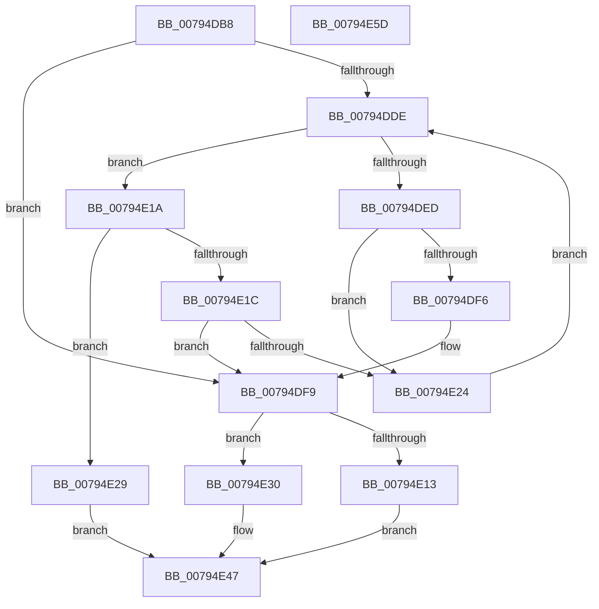

# RtlAddDynamicEHContinuationTarget

- RVA: `0x00794DB8`–`0x00794E5E` (길이 `166` bytes)
- VA: `0x0000000140794DB8`
- 실행 섹션: `PAGE`
- PDB 이름 있음: `예`; PDB Function 태그: `아니요`
- unwind 정보 RVA: `0x0006F978`
- 디코드: `50`개 명령, `166/166` bytes 표시
- 미해석 바이트: `0` (있으면 어셈블리에 `.byte`로 보존)

> 이 문서는 커널 이미지의 기계어와 PDB 기호를 분석해 생성했습니다. 4번과 5번은 함수 원형과 자료형을 바이너리 사용 방식에서 추정한 C 해석이며 원본 소스 복구 결과는 아닙니다.

## 1. Dependencies

- 직접 호출 지점: **3**; 고유 호출 대상: **3**
- 직접 호출자로 확인된 함수: **1**
- RIP 상대 이미지 참조: **0**

### Outgoing calls
- `0x00794DE4` → [RtlpDynamicEHContinuationTargetsTreeCompare](../A3/RtlpDynamicEHContinuationTargetsTreeCompare_function_00A3AC8C.md) (function, `0x00A3AC8C`)
- `0x00794E09` → [ExAllocatePool2](../../poolcode/B8/ExAllocatePool2_function_00B820F0.md) (function, `0x00B820F0`)
- `0x00794E40` → [RtlAvlInsertNodeEx](../../text/26/RtlAvlInsertNodeEx_function_00265790.md) (function, `0x00265790`)

### Direct callers
- [PspProcessDynamicEHContinuationTargets](../78/PspProcessDynamicEHContinuationTargets_function_00782348.md) at `0x0078250A`

### Static image references
- 디코드된 RIP-relative 메모리 참조가 없습니다.

## 2. Other-region calls and transfers

- 다른 실행 섹션으로 향하는 call: **2**
  - `0x00794E09` → [ExAllocatePool2](../../poolcode/B8/ExAllocatePool2_function_00B820F0.md) (`PAGE` → `POOLCODE`)
  - `0x00794E40` → [RtlAvlInsertNodeEx](../../text/26/RtlAvlInsertNodeEx_function_00265790.md) (`PAGE` → `.text`)
- 별도 외부 분기/꼬리 이동을 확인하지 못했습니다.

## 3. Assembly (complete function range)

```asm
00794DB8  48 89 5C 24 08                  mov qword ptr [rsp + 8], rbx
00794DBD  48 89 74 24 10                  mov qword ptr [rsp + 0x10], rsi
00794DC2  48 89 7C 24 18                  mov qword ptr [rsp + 0x18], rdi
00794DC7  41 56                           push r14
00794DC9  48 83 EC 20                     sub rsp, 0x20
00794DCD  48 8B 19                        mov rbx, qword ptr [rcx]
00794DD0  40 32 FF                        xor dil, dil
00794DD3  48 8B F2                        mov rsi, rdx
00794DD6  4C 8B F1                        mov r14, rcx
00794DD9  48 85 DB                        test rbx, rbx
00794DDC  74 1B                           je 0x140794df9
00794DDE  48 8B D3                        mov rdx, rbx
00794DE1  48 8B CE                        mov rcx, rsi
00794DE4  E8 A3 5E 2A 00                  call 0x140a3ac8c
00794DE9  85 C0                           test eax, eax
00794DEB  7E 2D                           jle 0x140794e1a
00794DED  48 8B 43 08                     mov rax, qword ptr [rbx + 8]
00794DF1  48 85 C0                        test rax, rax
00794DF4  75 2E                           jne 0x140794e24
00794DF6  40 B7 01                        mov dil, 1
00794DF9  BA 20 00 00 00                  mov edx, 0x20
00794DFE  B9 01 01 00 00                  mov ecx, 0x101
00794E03  41 B8 44 45 48 4E               mov r8d, 0x4e484544
00794E09  E8 E2 D2 3E 00                  call 0x140b820f0
00794E0E  48 85 C0                        test rax, rax
00794E11  75 1D                           jne 0x140794e30
00794E13  B8 17 00 00 C0                  mov eax, 0xc0000017
00794E18  EB 2D                           jmp 0x140794e47
00794E1A  79 0D                           jns 0x140794e29
00794E1C  48 8B 03                        mov rax, qword ptr [rbx]
00794E1F  48 85 C0                        test rax, rax
00794E22  74 D5                           je 0x140794df9
00794E24  48 8B D8                        mov rbx, rax
00794E27  EB B5                           jmp 0x140794dde
00794E29  B8 18 00 00 C0                  mov eax, 0xc0000018
00794E2E  EB 17                           jmp 0x140794e47
00794E30  4C 8B C8                        mov r9, rax
00794E33  48 89 70 18                     mov qword ptr [rax + 0x18], rsi
00794E37  44 8A C7                        mov r8b, dil
00794E3A  48 8B D3                        mov rdx, rbx
00794E3D  49 8B CE                        mov rcx, r14
00794E40  E8 4B 09 AD FF                  call 0x140265790
00794E45  33 C0                           xor eax, eax
00794E47  48 8B 5C 24 30                  mov rbx, qword ptr [rsp + 0x30]
00794E4C  48 8B 74 24 38                  mov rsi, qword ptr [rsp + 0x38]
00794E51  48 8B 7C 24 40                  mov rdi, qword ptr [rsp + 0x40]
00794E56  48 83 C4 20                     add rsp, 0x20
00794E5A  41 5E                           pop r14
00794E5C  C3                              ret
00794E5D  CC                              int3
```

## 4. C-style interpretation (structured pseudocode)

```c
__int64 __fastcall RtlAddDynamicEHContinuationTarget(__int64 a1, __int64 a2)
{
    __int64 result;
    __int64 v_rdi;
    __int64 v_rsp;
    unsigned __int64 v_stack_p10;
    unsigned __int64 v_stack_p18;
    unsigned __int64 v_stack_p8;

    v_stack_p8 = v_rbx;
    v_stack_p10 = v_rsi;
    v_stack_p18 = v_rdi;
    v_rsp = (v_rsp) - (32);
    v_rdi = 0;
    if (*(unsigned __int64 *)(a1) == 0) goto loc_00794DF9;
loc_00794DDE:
    result = RtlpDynamicEHContinuationTargetsTreeCompare(a2, *(unsigned __int64 *)(a1), a3, a4);
    if (condition_is_less_or_equal) goto loc_00794E1A;
    if (*(unsigned __int64 *)(*(unsigned __int64 *)(a1) + 8) != 0) goto loc_00794E24;
loc_00794DF9:
    result = ExAllocatePool2(257, 32, (unsigned int)(0x4E484544ULL), a4);
    if (result != 0) goto loc_00794E30;
    goto loc_00794E47;
loc_00794E1A:
    if (!sign_flag) goto loc_00794E29;
    if (*(unsigned __int64 *)(*(unsigned __int64 *)(a1)) == 0) goto loc_00794DF9;
loc_00794E24:
    goto loc_00794DDE;
loc_00794E29:
    goto loc_00794E47;
loc_00794E30:
    *(unsigned __int64 *)((unsigned int)(0xC0000018ULL) + 24) = a2;
    result = RtlAvlInsertNodeEx(a1, *(unsigned __int64 *)(*(unsigned __int64 *)(a1)), 1, (unsigned int)(0xC0000018ULL));
    result = 0;
loc_00794E47:
    v_rsp = (v_rsp) + (32);
    return result;
}
```

## 5. (Beta) C Style

```c
int64_t RtlAddDynamicEHContinuationTarget(void *Arg1, int64_t Arg2)
{
    uint8_t *arg1 = (uint8_t *)Arg1;

    int64_t result;
    int64_t local_rdi;
    int64_t local_rsp;
    uint64_t v_stack_p10;
    uint64_t v_stack_p18;
    uint64_t v_stack_p8;

    v_stack_p8 = local_rbx;
    v_stack_p10 = local_rsi;
    v_stack_p18 = local_rdi;
    local_rsp = (local_rsp) - (32);
    local_rdi = 0;
    if (*(uint64_t *)(arg1) == 0) goto loc_00794DF9;
loc_00794DDE:
    result = RtlpDynamicEHContinuationTargetsTreeCompare(Arg2, *(uint64_t *)(arg1), a3, a4);
    if (condition_is_less_or_equal) goto loc_00794E1A;
    if (*(uint64_t *)(*(uint64_t *)(arg1) + 0x8) != 0) goto loc_00794E24;
loc_00794DF9:
    result = ExAllocatePool2(257, 32, (uint32_t)(0x4E484544ULL), a4);
    if (result != 0) goto loc_00794E30;
    goto loc_00794E47;
loc_00794E1A:
    if (!sign_flag) goto loc_00794E29;
    if (*(uint64_t *)(*(uint64_t *)(arg1)) == 0) goto loc_00794DF9;
loc_00794E24:
    goto loc_00794DDE;
loc_00794E29:
    goto loc_00794E47;
loc_00794E30:
    *(uint64_t *)((uint32_t)(0xC0000018ULL) + 0x18) = Arg2;
    result = RtlAvlInsertNodeEx(Arg1, *(uint64_t *)(*(uint64_t *)(arg1)), 1, (uint32_t)(0xC0000018ULL));
    result = 0;
loc_00794E47:
    local_rsp = (local_rsp) + (32);
    return result;
}
```

### 관측된 메모리 오프셋

구조체 형식이 확인되지 않은 접근은 인자 기준의 오프셋으로만 기록했습니다.

| 기준 인자 | 오프셋 표현 | 폭 (bit) | 접근 |
|---|---:|---:|---|
| `Arg1` | `+ 0x0` | `64` | `R` |

## 6. Execution-region graph

[열기: 2D/3D 그래프와 함수 탐색 컨트롤 패널](../../../control-panel.html?section=page&rva=0x00794DB8&view=graph)

- 2D 그래프는 위에서 아래로 흐르고, 3D 그래프는 빈 공간을 드래그해 회전합니다. Shift+드래그는 이동, 휠은 확대·축소, 함수 노드 선택은 대상 보고서 이동입니다.

### Static fallback


