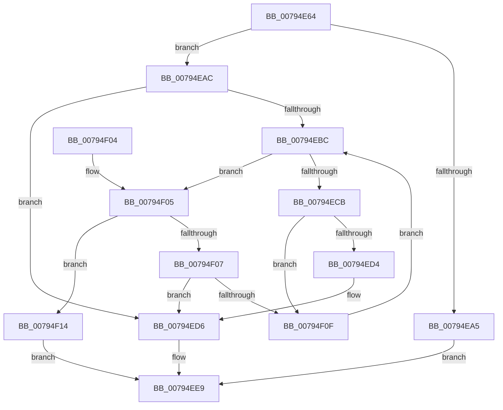

# RtlAddDynamicEnforcedAddressRange

- RVA: `0x00794E64`–`0x00794F25` (길이 `193` bytes)
- VA: `0x0000000140794E64`
- 실행 섹션: `PAGE`
- PDB 이름 있음: `예`; PDB Function 태그: `아니요`
- unwind 정보 RVA: `0x00084A84`
- 디코드: `59`개 명령, `193/193` bytes 표시
- 미해석 바이트: `0` (있으면 어셈블리에 `.byte`로 보존)

> 이 문서는 커널 이미지의 기계어와 PDB 기호를 분석해 생성했습니다. 4번과 5번은 함수 원형과 자료형을 바이너리 사용 방식에서 추정한 C 해석이며 원본 소스 복구 결과는 아닙니다.

## 1. Dependencies

- 직접 호출 지점: **4**; 고유 호출 대상: **4**
- 직접 호출자로 확인된 함수: **1**
- RIP 상대 이미지 참조: **0**

### Outgoing calls
- `0x00794E96` → [ExAllocatePool2](../../poolcode/B8/ExAllocatePool2_function_00B820F0.md) (function, `0x00B820F0`)
- `0x00794EC2` → [RtlpDynamicEnforcedAddressRangesTreeCompare](RtlpDynamicEnforcedAddressRangesTreeCompare_function_00794FD8.md) (function, `0x00794FD8`)
- `0x00794EE2` → [RtlAvlInsertNodeEx](../../text/26/RtlAvlInsertNodeEx_function_00265790.md) (function, `0x00265790`)
- `0x00794F19` → [ExFreePoolWithTag](../../poolcode/B8/ExFreePoolWithTag_function_00B82870.md) (function, `0x00B82870`)

### Direct callers
- [PspProcessDynamicEnforcedAddressRanges](../78/PspProcessDynamicEnforcedAddressRanges_function_00782624.md) at `0x00782817`

### Static image references
- 디코드된 RIP-relative 메모리 참조가 없습니다.

## 2. Other-region calls and transfers

- 다른 실행 섹션으로 향하는 call: **3**
  - `0x00794E96` → [ExAllocatePool2](../../poolcode/B8/ExAllocatePool2_function_00B820F0.md) (`PAGE` → `POOLCODE`)
  - `0x00794EE2` → [RtlAvlInsertNodeEx](../../text/26/RtlAvlInsertNodeEx_function_00265790.md) (`PAGE` → `.text`)
  - `0x00794F19` → [ExFreePoolWithTag](../../poolcode/B8/ExFreePoolWithTag_function_00B82870.md) (`PAGE` → `POOLCODE`)
- 별도 외부 분기/꼬리 이동을 확인하지 못했습니다.

## 3. Assembly (complete function range)

```asm
00794E64  48 8B C4                        mov rax, rsp
00794E67  48 89 58 08                     mov qword ptr [rax + 8], rbx
00794E6B  48 89 68 10                     mov qword ptr [rax + 0x10], rbp
00794E6F  48 89 70 18                     mov qword ptr [rax + 0x18], rsi
00794E73  48 89 78 20                     mov qword ptr [rax + 0x20], rdi
00794E77  41 56                           push r14
00794E79  48 83 EC 20                     sub rsp, 0x20
00794E7D  49 8B F8                        mov rdi, r8
00794E80  48 8B EA                        mov rbp, rdx
00794E83  4C 8B F1                        mov r14, rcx
00794E86  BA 28 00 00 00                  mov edx, 0x28
00794E8B  B9 01 01 00 00                  mov ecx, 0x101
00794E90  41 B8 44 45 41 52               mov r8d, 0x52414544
00794E96  E8 55 D2 3E 00                  call 0x140b820f0
00794E9B  33 DB                           xor ebx, ebx
00794E9D  48 8B F0                        mov rsi, rax
00794EA0  48 85 C0                        test rax, rax
00794EA3  75 07                           jne 0x140794eac
00794EA5  B8 17 00 00 C0                  mov eax, 0xc0000017
00794EAA  EB 3D                           jmp 0x140794ee9
00794EAC  48 89 68 18                     mov qword ptr [rax + 0x18], rbp
00794EB0  48 89 78 20                     mov qword ptr [rax + 0x20], rdi
00794EB4  49 8B 3E                        mov rdi, qword ptr [r14]
00794EB7  48 85 FF                        test rdi, rdi
00794EBA  74 1A                           je 0x140794ed6
00794EBC  48 8B D7                        mov rdx, rdi
00794EBF  48 8B CE                        mov rcx, rsi
00794EC2  E8 11 01 00 00                  call 0x140794fd8
00794EC7  85 C0                           test eax, eax
00794EC9  7E 3A                           jle 0x140794f05
00794ECB  48 8B 47 08                     mov rax, qword ptr [rdi + 8]
00794ECF  48 85 C0                        test rax, rax
00794ED2  75 3B                           jne 0x140794f0f
00794ED4  B3 01                           mov bl, 1
00794ED6  4C 8B CE                        mov r9, rsi
00794ED9  44 8A C3                        mov r8b, bl
00794EDC  48 8B D7                        mov rdx, rdi
00794EDF  49 8B CE                        mov rcx, r14
00794EE2  E8 A9 08 AD FF                  call 0x140265790
00794EE7  33 C0                           xor eax, eax
00794EE9  48 8B 5C 24 30                  mov rbx, qword ptr [rsp + 0x30]
00794EEE  48 8B 6C 24 38                  mov rbp, qword ptr [rsp + 0x38]
00794EF3  48 8B 74 24 40                  mov rsi, qword ptr [rsp + 0x40]
00794EF8  48 8B 7C 24 48                  mov rdi, qword ptr [rsp + 0x48]
00794EFD  48 83 C4 20                     add rsp, 0x20
00794F01  41 5E                           pop r14
00794F03  C3                              ret
00794F04  CC                              int3
00794F05  79 0D                           jns 0x140794f14
00794F07  48 8B 07                        mov rax, qword ptr [rdi]
00794F0A  48 85 C0                        test rax, rax
00794F0D  74 C7                           je 0x140794ed6
00794F0F  48 8B F8                        mov rdi, rax
00794F12  EB A8                           jmp 0x140794ebc
00794F14  33 D2                           xor edx, edx
00794F16  48 8B CE                        mov rcx, rsi
00794F19  E8 52 D9 3E 00                  call 0x140b82870
00794F1E  B8 18 00 00 C0                  mov eax, 0xc0000018
00794F23  EB C4                           jmp 0x140794ee9
```

## 4. C-style interpretation (structured pseudocode)

```c
__int64 __fastcall RtlAddDynamicEnforcedAddressRange(__int64 a1, __int64 a2, __int64 a3)
{
    __int64 result;
    __int64 v_rbx;
    __int64 v_rsp;
    unsigned __int64 v_stack_p10;
    unsigned __int64 v_stack_p18;
    unsigned __int64 v_stack_p20;
    unsigned __int64 v_stack_p8;

    *(unsigned __int64 *)(v_rsp + 8) = v_rbx;
    *(unsigned __int64 *)(v_rsp + 16) = v_rbp;
    *(unsigned __int64 *)(v_rsp + 24) = v_rsi;
    *(unsigned __int64 *)(v_rsp + 32) = v_rdi;
    v_rsp = (v_rsp) - (32);
    result = ExAllocatePool2(257, 40, (unsigned int)(0x52414544ULL), a4);
    v_rbx = 0;
    if (result != 0) goto loc_00794EAC;
    goto loc_00794EE9;
loc_00794EAC:
    *(unsigned __int64 *)((unsigned int)(0xC0000017ULL) + 24) = a2;
    *(unsigned __int64 *)((unsigned int)(0xC0000017ULL) + 32) = a3;
    if (*(unsigned __int64 *)(a1) == 0) goto loc_00794ED6;
loc_00794EBC:
    result = RtlpDynamicEnforcedAddressRangesTreeCompare(result, *(unsigned __int64 *)(a1), (unsigned int)(0x52414544ULL), a4);
    if (condition_is_less_or_equal) goto loc_00794F05;
    if (*(unsigned __int64 *)(*(unsigned __int64 *)(a1) + 8) != 0) goto loc_00794F0F;
loc_00794ED6:
    result = RtlAvlInsertNodeEx(a1, *(unsigned __int64 *)(a1), 1, result);
    result = 0;
loc_00794EE9:
    v_rsp = (v_rsp) + (32);
    return result;
loc_00794F05:
    if (!sign_flag) goto loc_00794F14;
    if (*(unsigned __int64 *)(v_stack_p20) == 0) goto loc_00794ED6;
loc_00794F0F:
    goto loc_00794EBC;
loc_00794F14:
    a2 = 0;
    result = ExFreePoolWithTag(v_stack_p18, a2, 1, result);
    goto loc_00794EE9;
}
```

## 5. (Beta) C Style

```c
int64_t RtlAddDynamicEnforcedAddressRange(void *Arg1, int64_t Arg2, int64_t Arg3)
{
    uint8_t *arg1 = (uint8_t *)Arg1;

    int64_t result;
    int64_t local_rbx;
    int64_t local_rsp;
    uint64_t v_stack_p10;
    uint64_t v_stack_p18;
    uint64_t v_stack_p20;
    uint64_t v_stack_p8;

    *(uint64_t *)(local_rsp + 0x8) = local_rbx;
    *(uint64_t *)(local_rsp + 0x10) = local_rbp;
    *(uint64_t *)(local_rsp + 0x18) = local_rsi;
    *(uint64_t *)(local_rsp + 0x20) = local_rdi;
    local_rsp = (local_rsp) - (32);
    result = ExAllocatePool2(257, 40, (uint32_t)(0x52414544ULL), a4);
    local_rbx = 0;
    if (result != 0) goto loc_00794EAC;
    goto loc_00794EE9;
loc_00794EAC:
    *(uint64_t *)((uint32_t)(0xC0000017ULL) + 0x18) = Arg2;
    *(uint64_t *)((uint32_t)(0xC0000017ULL) + 0x20) = Arg3;
    if (*(uint64_t *)(arg1) == 0) goto loc_00794ED6;
loc_00794EBC:
    result = RtlpDynamicEnforcedAddressRangesTreeCompare(result, *(uint64_t *)(arg1), (uint32_t)(0x52414544ULL), a4);
    if (condition_is_less_or_equal) goto loc_00794F05;
    if (*(uint64_t *)(*(uint64_t *)(arg1) + 0x8) != 0) goto loc_00794F0F;
loc_00794ED6:
    result = RtlAvlInsertNodeEx(Arg1, *(uint64_t *)(arg1), 1, result);
    result = 0;
loc_00794EE9:
    local_rsp = (local_rsp) + (32);
    return result;
loc_00794F05:
    if (!sign_flag) goto loc_00794F14;
    if (*(uint64_t *)(v_stack_p20) == 0) goto loc_00794ED6;
loc_00794F0F:
    goto loc_00794EBC;
loc_00794F14:
    Arg2 = 0;
    result = ExFreePoolWithTag(v_stack_p18, Arg2, 1, result);
    goto loc_00794EE9;
}
```

### 관측된 메모리 오프셋

구조체 형식이 확인되지 않은 접근은 인자 기준의 오프셋으로만 기록했습니다.

| 기준 인자 | 오프셋 표현 | 폭 (bit) | 접근 |
|---|---:|---:|---|
| `Arg1` | `+ 0x0` | `64` | `R` |

## 6. Execution-region graph

[열기: 2D/3D 그래프와 함수 탐색 컨트롤 패널](../../../control-panel.html?section=page&rva=0x00794E64&view=graph)

- 2D 그래프는 위에서 아래로 흐르고, 3D 그래프는 빈 공간을 드래그해 회전합니다. Shift+드래그는 이동, 휠은 확대·축소, 함수 노드 선택은 대상 보고서 이동입니다.

### Static fallback


