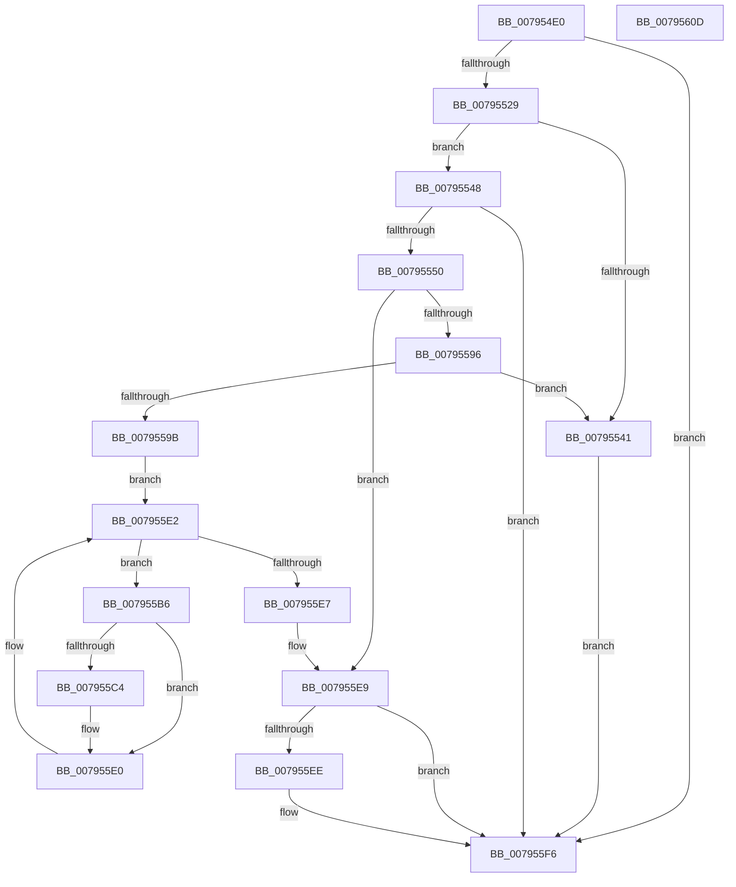

# RtlApplyFunctionOverrideFixupsToImage

- RVA: `0x007954E0`–`0x0079560E` (길이 `302` bytes)
- VA: `0x00000001407954E0`
- 실행 섹션: `PAGE`
- PDB 이름 있음: `예`; PDB Function 태그: `아니요`
- unwind 정보 RVA: `0x000D01E4`
- 디코드: `88`개 명령, `302/302` bytes 표시
- 미해석 바이트: `0` (있으면 어셈블리에 `.byte`로 보존)

> 이 문서는 커널 이미지의 기계어와 PDB 기호를 분석해 생성했습니다. 4번과 5번은 함수 원형과 자료형을 바이너리 사용 방식에서 추정한 C 해석이며 원본 소스 복구 결과는 아닙니다.

## 1. Dependencies

- 직접 호출 지점: **7**; 고유 호출 대상: **7**
- 직접 호출자로 확인된 함수: **1**
- RIP 상대 이미지 참조: **0**

### Outgoing calls
- `0x0079551A` → [RtlImageNtHeaderEx](../../text/41/RtlImageNtHeaderEx_function_0041EAA0.md) (function, `0x0041EAA0`)
- `0x00795533` → [RtlpCaptureDynamicRelocationTableRva](../../text/5E/RtlpCaptureDynamicRelocationTableRva_function_005EC760.md) (function, `0x005EC760`)
- `0x00795586` → [RtlCreateFunctionOverrideFixupInfo](../94/RtlCreateFunctionOverrideFixupInfo_function_00943034.md) (function, `0x00943034`)
- `0x007955AC` → [RtlInitializeSystemOverrideDelta](../AA/RtlInitializeSystemOverrideDelta_function_00AACFB0.md) (function, `0x00AACFB0`)
- `0x007955BB` → [RtlDoesRequireFunctionOverrideFixups](../93/RtlDoesRequireFunctionOverrideFixups_function_0093F97C.md) (function, `0x0093F97C`)
- `0x007955DB` → [RtlApplyFunctionOverrideFixups](../93/RtlApplyFunctionOverrideFixups_function_0093FB44.md) (function, `0x0093FB44`)
- `0x007955F1` → [PdcCloseEvent](../8D/PdcCloseEvent_function_008D2404.md) (function, `0x008D2404`)

### Direct callers
- [MiApplyFunctionOverrideToBootDriver](../../init/C6/MiApplyFunctionOverrideToBootDriver_function_00C6B19C.md) at `0x00C6B27C`

### Static image references
- 디코드된 RIP-relative 메모리 참조가 없습니다.

## 2. Other-region calls and transfers

- 다른 실행 섹션으로 향하는 call: **2**
  - `0x0079551A` → [RtlImageNtHeaderEx](../../text/41/RtlImageNtHeaderEx_function_0041EAA0.md) (`PAGE` → `.text`)
  - `0x00795533` → [RtlpCaptureDynamicRelocationTableRva](../../text/5E/RtlpCaptureDynamicRelocationTableRva_function_005EC760.md) (`PAGE` → `.text`)
- 별도 외부 분기/꼬리 이동을 확인하지 못했습니다.

## 3. Assembly (complete function range)

```asm
007954E0  48 8B C4                        mov rax, rsp
007954E3  48 89 58 08                     mov qword ptr [rax + 8], rbx
007954E7  48 89 68 10                     mov qword ptr [rax + 0x10], rbp
007954EB  48 89 70 18                     mov qword ptr [rax + 0x18], rsi
007954EF  44 88 48 20                     mov byte ptr [rax + 0x20], r9b
007954F3  57                              push rdi
007954F4  48 83 EC 50                     sub rsp, 0x50
007954F8  48 83 60 F0 00                  and qword ptr [rax - 0x10], 0
007954FD  4C 8D 48 E8                     lea r9, [rax - 0x18]
00795501  83 60 20 00                     and dword ptr [rax + 0x20], 0
00795505  49 8B F8                        mov rdi, r8
00795508  48 83 60 E8 00                  and qword ptr [rax - 0x18], 0
0079550D  48 8B F1                        mov rsi, rcx
00795510  44 8B C2                        mov r8d, edx
00795513  8B EA                           mov ebp, edx
00795515  48 8B D1                        mov rdx, rcx
00795518  33 C9                           xor ecx, ecx
0079551A  E8 81 95 C8 FF                  call 0x14041eaa0
0079551F  8B D8                           mov ebx, eax
00795521  85 C0                           test eax, eax
00795523  0F 88 CD 00 00 00               js 0x1407955f6
00795529  4C 8D 44 24 78                  lea r8, [rsp + 0x78]
0079552E  8B D5                           mov edx, ebp
00795530  48 8B CE                        mov rcx, rsi
00795533  E8 28 72 E5 FF                  call 0x1405ec760
00795538  8B D8                           mov ebx, eax
0079553A  3D BB 00 00 C0                  cmp eax, 0xc00000bb
0079553F  75 07                           jne 0x140795548
00795541  33 DB                           xor ebx, ebx
00795543  E9 AE 00 00 00                  jmp 0x1407955f6
00795548  85 C0                           test eax, eax
0079554A  0F 88 A6 00 00 00               js 0x1407955f6
00795550  48 8B 84 24 80 00 00 00         mov rax, qword ptr [rsp + 0x80]
00795558  8B D5                           mov edx, ebp
0079555A  44 8B 44 24 78                  mov r8d, dword ptr [rsp + 0x78]
0079555F  48 89 44 24 38                  mov qword ptr [rsp + 0x38], rax
00795564  48 8D 44 24 48                  lea rax, [rsp + 0x48]
00795569  48 89 44 24 30                  mov qword ptr [rsp + 0x30], rax
0079556E  48 8B 44 24 40                  mov rax, qword ptr [rsp + 0x40]
00795573  48 89 7C 24 28                  mov qword ptr [rsp + 0x28], rdi
00795578  4E 8D 0C 06                     lea r9, [rsi + r8]
0079557C  8B 48 54                        mov ecx, dword ptr [rax + 0x54]
0079557F  89 4C 24 20                     mov dword ptr [rsp + 0x20], ecx
00795583  48 8B CE                        mov rcx, rsi
00795586  E8 A9 DA 1A 00                  call 0x140943034
0079558B  48 8B 7C 24 48                  mov rdi, qword ptr [rsp + 0x48]
00795590  8B D8                           mov ebx, eax
00795592  85 C0                           test eax, eax
00795594  78 53                           js 0x1407955e9
00795596  48 85 FF                        test rdi, rdi
00795599  74 A6                           je 0x140795541
0079559B  83 64 24 20 00                  and dword ptr [rsp + 0x20], 0
007955A0  45 33 C9                        xor r9d, r9d
007955A3  44 8B C5                        mov r8d, ebp
007955A6  48 8B D6                        mov rdx, rsi
007955A9  48 8B CF                        mov rcx, rdi
007955AC  E8 FF 79 31 00                  call 0x140aacfb0
007955B1  8B 5F 20                        mov ebx, dword ptr [rdi + 0x20]
007955B4  EB 2C                           jmp 0x1407955e2
007955B6  8B D3                           mov edx, ebx
007955B8  48 8B CF                        mov rcx, rdi
007955BB  E8 BC A3 1A 00                  call 0x14093f97c
007955C0  84 C0                           test al, al
007955C2  74 1C                           je 0x1407955e0
007955C4  44 8B C3                        mov r8d, ebx
007955C7  C6 44 24 20 01                  mov byte ptr [rsp + 0x20], 1
007955CC  41 C1 E0 0C                     shl r8d, 0xc
007955D0  45 33 C9                        xor r9d, r9d
007955D3  4C 03 C6                        add r8, rsi
007955D6  8B D3                           mov edx, ebx
007955D8  48 8B CF                        mov rcx, rdi
007955DB  E8 64 A5 1A 00                  call 0x14093fb44
007955E0  FF C3                           inc ebx
007955E2  3B 5F 24                        cmp ebx, dword ptr [rdi + 0x24]
007955E5  76 CF                           jbe 0x1407955b6
007955E7  33 DB                           xor ebx, ebx
007955E9  48 85 FF                        test rdi, rdi
007955EC  74 08                           je 0x1407955f6
007955EE  48 8B CF                        mov rcx, rdi
007955F1  E8 0E CE 13 00                  call 0x1408d2404
007955F6  48 8B 6C 24 68                  mov rbp, qword ptr [rsp + 0x68]
007955FB  8B C3                           mov eax, ebx
007955FD  48 8B 5C 24 60                  mov rbx, qword ptr [rsp + 0x60]
00795602  48 8B 74 24 70                  mov rsi, qword ptr [rsp + 0x70]
00795607  48 83 C4 50                     add rsp, 0x50
0079560B  5F                              pop rdi
0079560C  C3                              ret
0079560D  CC                              int3
```

## 4. C-style interpretation (structured pseudocode)

```c
__int64 __fastcall RtlApplyFunctionOverrideFixupsToImage(__int64 a1, int a2, __int64 a3, unsigned __int8 a4, __int64 a5)
{
    __int64 result;
    __int64 v_rbx;
    __int64 v_rsp;
    unsigned __int64 v_stack_m10;
    unsigned __int64 v_stack_m18;
    unsigned __int64 v_stack_m20;
    unsigned __int64 v_stack_m28;
    unsigned __int64 v_stack_m30;
    unsigned int v_stack_m38;
    unsigned __int64 v_stack_p10;
    unsigned __int64 v_stack_p18;
    unsigned __int64 v_stack_p20;
    unsigned __int64 v_stack_p8;

    *(unsigned __int64 *)(v_rsp + 8) = v_rbx;
    *(unsigned __int64 *)(v_rsp + 16) = v_rbp;
    *(unsigned __int64 *)(v_rsp + 24) = v_rsi;
    *(unsigned __int8 *)(v_rsp + 32) = a4;
    v_rsp = (v_rsp) - (80);
    a1 = 0;
    result = RtlImageNtHeaderEx(a1, a1, (unsigned int)(a2), v_rsp - 24);
    if (sign_flag) goto loc_007955F6;
    result = RtlpCaptureDynamicRelocationTableRva(0, (unsigned int)((unsigned int)((unsigned int)(a2))), v_stack_p20, v_rsp - 24);
    if (((unsigned int)(result)) != 0xC00000BBULL) goto loc_00795548;
loc_00795541:
    v_rbx = 0;
    goto loc_007955F6;
loc_00795548:
    if (sign_flag) goto loc_007955F6;
    v_stack_m20 = a5;
    v_stack_m28 = v_stack_m10;
    v_stack_m30 = a3;
    v_stack_m38 = (unsigned int)((unsigned int)(*(unsigned int *)(v_stack_m18 + 84)));
    result = RtlCreateFunctionOverrideFixupInfo(0, (unsigned int)((unsigned int)((unsigned int)(a2))), (unsigned int)(v_stack_p20), a1 + (unsigned int)(v_stack_p20) * 1);
    if (sign_flag) goto loc_007955E9;
    if (v_stack_m10 == 0) goto loc_00795541;
    a4 = 0;
    result = RtlInitializeSystemOverrideDelta(v_stack_m10, 0, (unsigned int)((unsigned int)((unsigned int)(a2))), a4);
    goto loc_007955E2;
loc_007955B6:
    result = RtlDoesRequireFunctionOverrideFixups(v_stack_m10, (unsigned int)((unsigned int)((unsigned int)(*(unsigned int *)(v_stack_m10 + 32)))), (unsigned int)((unsigned int)((unsigned int)(a2))), a4);
    if ((unsigned __int8)(result) != 0) {
        a3 = (unsigned int)((unsigned int)(*(unsigned int *)(v_stack_m10 + 32)));
        v_stack_m38 = 1;
        a3 = (unsigned int)((a3) << (12));
        a4 = 0;
        a3 = (a3) + (0);
        a2 = (unsigned int)((unsigned int)(*(unsigned int *)(v_stack_m10 + 32)));
        a1 = v_stack_m10;
        result = RtlApplyFunctionOverrideFixups(a1, a2, a3, a4);
    }
    v_rbx = (unsigned int)(((unsigned int)(*(unsigned int *)(v_stack_m10 + 32))) + 1);
loc_007955E2:
    if (((unsigned int)(v_rbx)) <= (*(unsigned int *)(v_stack_m10 + 36))) goto loc_007955B6;
    v_rbx = 0;
loc_007955E9:
    if (v_stack_m10 != 0) {
        a1 = v_stack_m10;
        result = PdcCloseEvent(a1, a2, a3, a4);
    }
    v_rsp = (v_rsp) + (80);
    return 0;
}
```

## 5. (Beta) C Style

```c
int64_t RtlApplyFunctionOverrideFixupsToImage(void *Arg1, int32_t Arg2, int64_t Arg3, uint8_t Arg4, int64_t Arg5)
{
    uint8_t *arg1 = (uint8_t *)Arg1;

    int64_t result;
    int64_t local_rbx;
    int64_t local_rsp;
    uint64_t v_stack_m10;
    uint64_t v_stack_m18;
    uint64_t v_stack_m20;
    uint64_t v_stack_m28;
    uint64_t v_stack_m30;
    uint32_t v_stack_m38;
    uint64_t v_stack_p10;
    uint64_t v_stack_p18;
    uint64_t v_stack_p20;
    uint64_t v_stack_p8;

    *(uint64_t *)(local_rsp + 0x8) = local_rbx;
    *(uint64_t *)(local_rsp + 0x10) = local_rbp;
    *(uint64_t *)(local_rsp + 0x18) = local_rsi;
    *(uint8_t *)(local_rsp + 0x20) = Arg4;
    local_rsp = (local_rsp) - (80);
    Arg1 = 0;
    result = RtlImageNtHeaderEx(Arg1, Arg1, (uint32_t)(Arg2), local_rsp - 24);
    if (sign_flag) goto loc_007955F6;
    result = RtlpCaptureDynamicRelocationTableRva(0, (uint32_t)((uint32_t)((uint32_t)(Arg2))), v_stack_p20, local_rsp - 24);
    if (((uint32_t)(result)) != 0xC00000BBULL) goto loc_00795548;
loc_00795541:
    local_rbx = 0;
    goto loc_007955F6;
loc_00795548:
    if (sign_flag) goto loc_007955F6;
    v_stack_m20 = Arg5;
    v_stack_m28 = v_stack_m10;
    v_stack_m30 = Arg3;
    v_stack_m38 = (uint32_t)((uint32_t)(*(uint32_t *)(v_stack_m18 + 0x54)));
    result = RtlCreateFunctionOverrideFixupInfo(0, (uint32_t)((uint32_t)((uint32_t)(Arg2))), (uint32_t)(v_stack_p20), Arg1 + (uint32_t)(v_stack_p20) * 1);
    if (sign_flag) goto loc_007955E9;
    if (v_stack_m10 == 0) goto loc_00795541;
    Arg4 = 0;
    result = RtlInitializeSystemOverrideDelta(v_stack_m10, 0, (uint32_t)((uint32_t)((uint32_t)(Arg2))), Arg4);
    goto loc_007955E2;
loc_007955B6:
    result = RtlDoesRequireFunctionOverrideFixups(v_stack_m10, (uint32_t)((uint32_t)((uint32_t)(*(uint32_t *)(v_stack_m10 + 0x20)))), (uint32_t)((uint32_t)((uint32_t)(Arg2))), Arg4);
    if ((uint8_t)(result) != 0) {
        Arg3 = (uint32_t)((uint32_t)(*(uint32_t *)(v_stack_m10 + 0x20)));
        v_stack_m38 = 1;
        Arg3 = (uint32_t)((Arg3) << (12));
        Arg4 = 0;
        Arg3 = (Arg3) + (0);
        Arg2 = (uint32_t)((uint32_t)(*(uint32_t *)(v_stack_m10 + 0x20)));
        Arg1 = v_stack_m10;
        result = RtlApplyFunctionOverrideFixups(Arg1, Arg2, Arg3, Arg4);
    }
    local_rbx = (uint32_t)(((uint32_t)(*(uint32_t *)(v_stack_m10 + 0x20))) + 1);
loc_007955E2:
    if (((uint32_t)(local_rbx)) <= (*(uint32_t *)(v_stack_m10 + 0x24))) goto loc_007955B6;
    local_rbx = 0;
loc_007955E9:
    if (v_stack_m10 != 0) {
        Arg1 = v_stack_m10;
        result = PdcCloseEvent(Arg1, Arg2, Arg3, Arg4);
    }
    local_rsp = (local_rsp) + (80);
    return 0;
}
```

### 관측된 메모리 오프셋

구조체 형식이 확인되지 않은 접근은 인자 기준의 오프셋으로만 기록했습니다.

| 기준 인자 | 오프셋 표현 | 폭 (bit) | 접근 |
|---|---:|---:|---|
| `Arg1` | `+ 0x0 + r8*1` | `64` | `R` |

## 6. Execution-region graph

[열기: 2D/3D 그래프와 함수 탐색 컨트롤 패널](../../../control-panel.html?section=page&rva=0x007954E0&view=graph)

- 2D 그래프는 위에서 아래로 흐르고, 3D 그래프는 빈 공간을 드래그해 회전합니다. Shift+드래그는 이동, 휠은 확대·축소, 함수 노드 선택은 대상 보고서 이동입니다.

### Static fallback


