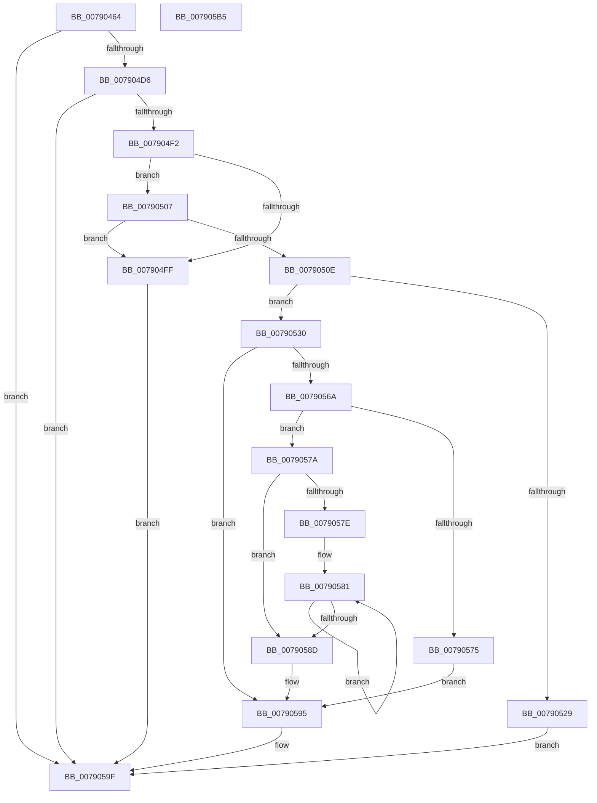

# RtlCheckBootStatusIntegrity

- RVA: `0x00790464`–`0x007905B6` (길이 `338` bytes)
- VA: `0x0000000140790464`
- 실행 섹션: `PAGE`
- PDB 이름 있음: `예`; PDB Function 태그: `아니요`
- unwind 정보 RVA: `0x000CFAD8`
- 디코드: `103`개 명령, `338/338` bytes 표시
- 미해석 바이트: `0` (있으면 어셈블리에 `.byte`로 보존)

> 이 문서는 커널 이미지의 기계어와 PDB 기호를 분석해 생성했습니다. 4번과 5번은 함수 원형과 자료형을 바이너리 사용 방식에서 추정한 C 해석이며 원본 소스 복구 결과는 아닙니다.

## 1. Dependencies

- 직접 호출 지점: **5**; 고유 호출 대상: **4**
- 직접 호출자로 확인된 함수: **1**
- RIP 상대 이미지 참조: **0**

### Outgoing calls
- `0x007904C7` → [ZwReadFile](../../text/6A/ZwReadFile_function_006AD190.md) (function, `0x006AD190`)
- `0x007904E3` → [RtlBootStatusItemInfo](../A7/RtlBootStatusItemInfo_function_00A7F444.md) (function, `0x00A7F444`)
- `0x0079051C` → [ExAllocatePool2](../../poolcode/B8/ExAllocatePool2_function_00B820F0.md) (function, `0x00B820F0`)
- `0x0079055F` → [ZwReadFile](../../text/6A/ZwReadFile_function_006AD190.md) (function, `0x006AD190`)
- `0x0079059A` → [ExFreePoolWithTag](../../poolcode/B8/ExFreePoolWithTag_function_00B82870.md) (function, `0x00B82870`)

### Direct callers
- [PopBootStatCheckIntegrity](../AC/PopBootStatCheckIntegrity_function_00ACDF4C.md) at `0x00ACE115`

### Static image references
- 디코드된 RIP-relative 메모리 참조가 없습니다.

## 2. Other-region calls and transfers

- 다른 실행 섹션으로 향하는 call: **4**
  - `0x007904C7` → [ZwReadFile](../../text/6A/ZwReadFile_function_006AD190.md) (`PAGE` → `.text`)
  - `0x0079051C` → [ExAllocatePool2](../../poolcode/B8/ExAllocatePool2_function_00B820F0.md) (`PAGE` → `POOLCODE`)
  - `0x0079055F` → [ZwReadFile](../../text/6A/ZwReadFile_function_006AD190.md) (`PAGE` → `.text`)
  - `0x0079059A` → [ExFreePoolWithTag](../../poolcode/B8/ExFreePoolWithTag_function_00B82870.md) (`PAGE` → `POOLCODE`)
- 별도 외부 분기/꼬리 이동을 확인하지 못했습니다.

## 3. Assembly (complete function range)

```asm
00790464  4C 8B DC                        mov r11, rsp
00790467  49 89 5B 08                     mov qword ptr [r11 + 8], rbx
0079046B  55                              push rbp
0079046C  56                              push rsi
0079046D  57                              push rdi
0079046E  41 56                           push r14
00790470  41 57                           push r15
00790472  48 8B EC                        mov rbp, rsp
00790475  48 83 EC 70                     sub rsp, 0x70
00790479  49 83 63 A8 00                  and qword ptr [r11 - 0x58], 0
0079047E  48 8D 45 E8                     lea rax, [rbp - 0x18]
00790482  83 65 48 00                     and dword ptr [rbp + 0x48], 0
00790486  48 8B FA                        mov rdi, rdx
00790489  83 65 E0 00                     and dword ptr [rbp - 0x20], 0
0079048D  0F 57 C0                        xorps xmm0, xmm0
00790490  83 65 40 00                     and dword ptr [rbp + 0x40], 0
00790494  45 33 C9                        xor r9d, r9d
00790497  48 83 65 E8 00                  and qword ptr [rbp - 0x18], 0
0079049C  45 33 C0                        xor r8d, r8d
0079049F  49 89 43 A0                     mov qword ptr [r11 - 0x60], rax
007904A3  33 D2                           xor edx, edx
007904A5  48 8D 45 40                     lea rax, [rbp + 0x40]
007904A9  C7 44 24 30 04 00 00 00         mov dword ptr [rsp + 0x30], 4
007904B1  49 89 43 90                     mov qword ptr [r11 - 0x70], rax
007904B5  4C 8B F9                        mov r15, rcx
007904B8  48 8D 45 F0                     lea rax, [rbp - 0x10]
007904BC  45 32 F6                        xor r14b, r14b
007904BF  49 89 43 88                     mov qword ptr [r11 - 0x78], rax
007904C3  0F 11 45 F0                     movups xmmword ptr [rbp - 0x10], xmm0
007904C7  E8 C4 CC F1 FF                  call 0x1406ad190
007904CC  8B D8                           mov ebx, eax
007904CE  85 C0                           test eax, eax
007904D0  0F 88 C9 00 00 00               js 0x14079059f
007904D6  4C 8D 45 E0                     lea r8, [rbp - 0x20]
007904DA  B9 0F 00 00 00                  mov ecx, 0xf
007904DF  48 8D 55 48                     lea rdx, [rbp + 0x48]
007904E3  E8 5C EF 2E 00                  call 0x140a7f444
007904E8  8B D8                           mov ebx, eax
007904EA  85 C0                           test eax, eax
007904EC  0F 88 AD 00 00 00               js 0x14079059f
007904F2  8B 55 E0                        mov edx, dword ptr [rbp - 0x20]
007904F5  03 55 48                        add edx, dword ptr [rbp + 0x48]
007904F8  8B 45 40                        mov eax, dword ptr [rbp + 0x40]
007904FB  3B C2                           cmp eax, edx
007904FD  73 08                           jae 0x140790507
007904FF  44 88 37                        mov byte ptr [rdi], r14b
00790502  E9 98 00 00 00                  jmp 0x14079059f
00790507  3D 00 08 00 00                  cmp eax, 0x800
0079050C  77 F1                           ja 0x1407904ff
0079050E  48 8B D0                        mov rdx, rax
00790511  B9 00 01 00 00                  mov ecx, 0x100
00790516  41 B8 62 73 64 66               mov r8d, 0x66647362
0079051C  E8 CF 1B 3F 00                  call 0x140b820f0
00790521  48 8B F0                        mov rsi, rax
00790524  48 85 C0                        test rax, rax
00790527  75 07                           jne 0x140790530
00790529  BB 17 00 00 C0                  mov ebx, 0xc0000017
0079052E  EB 6F                           jmp 0x14079059f
00790530  48 83 64 24 40 00               and qword ptr [rsp + 0x40], 0
00790536  48 8D 45 E8                     lea rax, [rbp - 0x18]
0079053A  48 89 44 24 38                  mov qword ptr [rsp + 0x38], rax
0079053F  45 33 C9                        xor r9d, r9d
00790542  8B 45 40                        mov eax, dword ptr [rbp + 0x40]
00790545  45 33 C0                        xor r8d, r8d
00790548  89 44 24 30                     mov dword ptr [rsp + 0x30], eax
0079054C  33 D2                           xor edx, edx
0079054E  48 8D 45 F0                     lea rax, [rbp - 0x10]
00790552  48 89 74 24 28                  mov qword ptr [rsp + 0x28], rsi
00790557  49 8B CF                        mov rcx, r15
0079055A  48 89 44 24 20                  mov qword ptr [rsp + 0x20], rax
0079055F  E8 2C CC F1 FF                  call 0x1406ad190
00790564  8B D8                           mov ebx, eax
00790566  85 C0                           test eax, eax
00790568  78 2B                           js 0x140790595
0079056A  8B 45 40                        mov eax, dword ptr [rbp + 0x40]
0079056D  8B C8                           mov ecx, eax
0079056F  48 39 45 F8                     cmp qword ptr [rbp - 8], rax
00790573  74 05                           je 0x14079057a
00790575  44 88 37                        mov byte ptr [rdi], r14b
00790578  EB 1B                           jmp 0x140790595
0079057A  85 C0                           test eax, eax
0079057C  74 0F                           je 0x14079058d
0079057E  48 8B C6                        mov rax, rsi
00790581  44 02 30                        add r14b, byte ptr [rax]
00790584  48 FF C0                        inc rax
00790587  48 83 E9 01                     sub rcx, 1
0079058B  75 F4                           jne 0x140790581
0079058D  45 84 F6                        test r14b, r14b
00790590  0F 94 C0                        sete al
00790593  88 07                           mov byte ptr [rdi], al
00790595  33 D2                           xor edx, edx
00790597  48 8B CE                        mov rcx, rsi
0079059A  E8 D1 22 3F 00                  call 0x140b82870
0079059F  8B C3                           mov eax, ebx
007905A1  48 8B 9C 24 A0 00 00 00         mov rbx, qword ptr [rsp + 0xa0]
007905A9  48 83 C4 70                     add rsp, 0x70
007905AD  41 5F                           pop r15
007905AF  41 5E                           pop r14
007905B1  5F                              pop rdi
007905B2  5E                              pop rsi
007905B3  5D                              pop rbp
007905B4  C3                              ret
007905B5  CC                              int3
```

## 4. C-style interpretation (structured pseudocode)

```c
__int64 __fastcall RtlCheckBootStatusIntegrity(__int64 a1, __int64 a2, int a3, int a4)
{
    __int64 result;
    __int64 v_r14;
    __int64 v_rsp;
    unsigned __int64 v_stack_m30;
    unsigned __int64 v_stack_m38;
    unsigned __int64 v_stack_m40;
    unsigned int v_stack_m48;
    unsigned __int64 v_stack_m58;
    unsigned __int64 v_stack_m60;
    unsigned int v_stack_m68;
    unsigned __int64 v_stack_m70;
    unsigned __int64 v_stack_m78;
    unsigned int v_stack_p18;
    unsigned int v_stack_p20;
    unsigned __int64 v_stack_p8;

    *(unsigned __int64 *)(v_rsp + 8) = v_rbx;
    v_rsp = (v_rsp) - (112);
    a4 = 0;
    a3 = 0;
    *(unsigned __int64 *)(v_rsp - 96) = v_stack_m40;
    a2 = 0;
    v_stack_m68 = 4;
    *(unsigned __int64 *)(v_rsp - 112) = v_stack_p18;
    v_r14 = 0;
    *(unsigned __int64 *)(v_rsp - 120) = v_stack_m38;
    v_stack_m38 = v_xmm0;
    result = ZwReadFile(a1, a2, a3, a4);
    if (sign_flag) goto loc_0079059F;
    result = RtlBootStatusItemInfo(15, v_stack_p20, v_stack_m48, a4);
    if (sign_flag) goto loc_0079059F;
    a2 = (unsigned int)(((unsigned int)(v_stack_m48)) + (v_stack_p20));
    if (((unsigned int)((unsigned int)(v_stack_p18))) >= ((unsigned int)(a2))) goto loc_00790507;
loc_007904FF:
    *(unsigned __int8 *)(a2) = 0;
    goto loc_0079059F;
loc_00790507:
    if (((unsigned int)((unsigned int)(v_stack_p18))) > 0x800ULL) goto loc_007904FF;
    result = ExAllocatePool2(256, (unsigned int)(v_stack_p18), (unsigned int)(0x66647362ULL), a4);
    if (result != 0) goto loc_00790530;
    goto loc_0079059F;
loc_00790530:
    v_stack_m60 = v_stack_m40;
    a4 = 0;
    a3 = 0;
    v_stack_m68 = (unsigned int)((unsigned int)(v_stack_p18));
    a2 = 0;
    v_stack_m70 = result;
    v_stack_m78 = v_stack_m38;
    result = ZwReadFile(a1, a2, a3, a4);
    if (sign_flag) goto loc_00790595;
    if (v_stack_m30 == ((unsigned int)(v_stack_p18))) goto loc_0079057A;
    *(unsigned __int8 *)(a2) = 0;
    goto loc_00790595;
loc_0079057A:
    if ((unsigned int)((unsigned int)(v_stack_p18)) == 0) goto loc_0079058D;
loc_00790581:
    v_r14 = (unsigned __int8)((v_r14) + (*(unsigned __int8 *)(result)));
    result = (result) + 1;
    a1 = ((unsigned int)((unsigned int)((unsigned int)(v_stack_p18)))) - (1);
    if (condition_is_not_equal) goto loc_00790581;
loc_0079058D:
    result = ((unsigned __int8)(v_r14) == 0) ? 1 : 0;
    *(unsigned __int8 *)(a2) = (unsigned __int8)(result);
loc_00790595:
    a2 = 0;
    result = ExFreePoolWithTag(result, a2, a3, a4);
loc_0079059F:
    v_rsp = (v_rsp) + (112);
    return (unsigned int)((unsigned int)((unsigned int)((unsigned int)(result))));
}
```

## 5. (Beta) C Style

```c
int64_t RtlCheckBootStatusIntegrity(int64_t Arg1, void *Arg2, int32_t Arg3, int32_t Arg4)
{
    uint8_t *arg2 = (uint8_t *)Arg2;

    int64_t result;
    int64_t local_r14;
    int64_t local_rsp;
    uint64_t v_stack_m30;
    uint64_t v_stack_m38;
    uint64_t v_stack_m40;
    uint32_t v_stack_m48;
    uint64_t v_stack_m58;
    uint64_t v_stack_m60;
    uint32_t v_stack_m68;
    uint64_t v_stack_m70;
    uint64_t v_stack_m78;
    uint32_t v_stack_p18;
    uint32_t v_stack_p20;
    uint64_t v_stack_p8;

    *(uint64_t *)(local_rsp + 0x8) = local_rbx;
    local_rsp = (local_rsp) - (112);
    Arg4 = 0;
    Arg3 = 0;
    *(uint64_t *)(local_rsp - 0x60) = v_stack_m40;
    Arg2 = 0;
    v_stack_m68 = 4;
    *(uint64_t *)(local_rsp - 0x70) = v_stack_p18;
    local_r14 = 0;
    *(uint64_t *)(local_rsp - 0x78) = v_stack_m38;
    v_stack_m38 = v_xmm0;
    result = ZwReadFile(Arg1, Arg2, Arg3, Arg4);
    if (sign_flag) goto loc_0079059F;
    result = RtlBootStatusItemInfo(15, v_stack_p20, v_stack_m48, Arg4);
    if (sign_flag) goto loc_0079059F;
    Arg2 = (uint32_t)(((uint32_t)(v_stack_m48)) + (v_stack_p20));
    if (((uint32_t)((uint32_t)(v_stack_p18))) >= ((uint32_t)(Arg2))) goto loc_00790507;
loc_007904FF:
    *(uint8_t *)(arg2) = 0;
    goto loc_0079059F;
loc_00790507:
    if (((uint32_t)((uint32_t)(v_stack_p18))) > 0x800ULL) goto loc_007904FF;
    result = ExAllocatePool2(256, (uint32_t)(v_stack_p18), (uint32_t)(0x66647362ULL), Arg4);
    if (result != 0) goto loc_00790530;
    goto loc_0079059F;
loc_00790530:
    v_stack_m60 = v_stack_m40;
    Arg4 = 0;
    Arg3 = 0;
    v_stack_m68 = (uint32_t)((uint32_t)(v_stack_p18));
    Arg2 = 0;
    v_stack_m70 = result;
    v_stack_m78 = v_stack_m38;
    result = ZwReadFile(Arg1, Arg2, Arg3, Arg4);
    if (sign_flag) goto loc_00790595;
    if (v_stack_m30 == ((uint32_t)(v_stack_p18))) goto loc_0079057A;
    *(uint8_t *)(arg2) = 0;
    goto loc_00790595;
loc_0079057A:
    if ((uint32_t)((uint32_t)(v_stack_p18)) == 0) goto loc_0079058D;
loc_00790581:
    local_r14 = (uint8_t)((local_r14) + (*(uint8_t *)(result)));
    result = (result) + 1;
    Arg1 = ((uint32_t)((uint32_t)((uint32_t)(v_stack_p18)))) - (1);
    if (condition_is_not_equal) goto loc_00790581;
loc_0079058D:
    result = ((uint8_t)(local_r14) == 0) ? 1 : 0;
    *(uint8_t *)(arg2) = (uint8_t)(result);
loc_00790595:
    Arg2 = 0;
    result = ExFreePoolWithTag(result, Arg2, Arg3, Arg4);
loc_0079059F:
    local_rsp = (local_rsp) + (112);
    return (uint32_t)((uint32_t)((uint32_t)((uint32_t)(result))));
}
```

### 관측된 메모리 오프셋

구조체 형식이 확인되지 않은 접근은 인자 기준의 오프셋으로만 기록했습니다.

| 기준 인자 | 오프셋 표현 | 폭 (bit) | 접근 |
|---|---:|---:|---|
| `Arg2` | `+ 0x0` | `8` | `W` |

## 6. Execution-region graph

[열기: 2D/3D 그래프와 함수 탐색 컨트롤 패널](../../../control-panel.html?section=page&rva=0x00790464&view=graph)

- 2D 그래프는 위에서 아래로 흐르고, 3D 그래프는 빈 공간을 드래그해 회전합니다. Shift+드래그는 이동, 휠은 확대·축소, 함수 노드 선택은 대상 보고서 이동입니다.

### Static fallback


