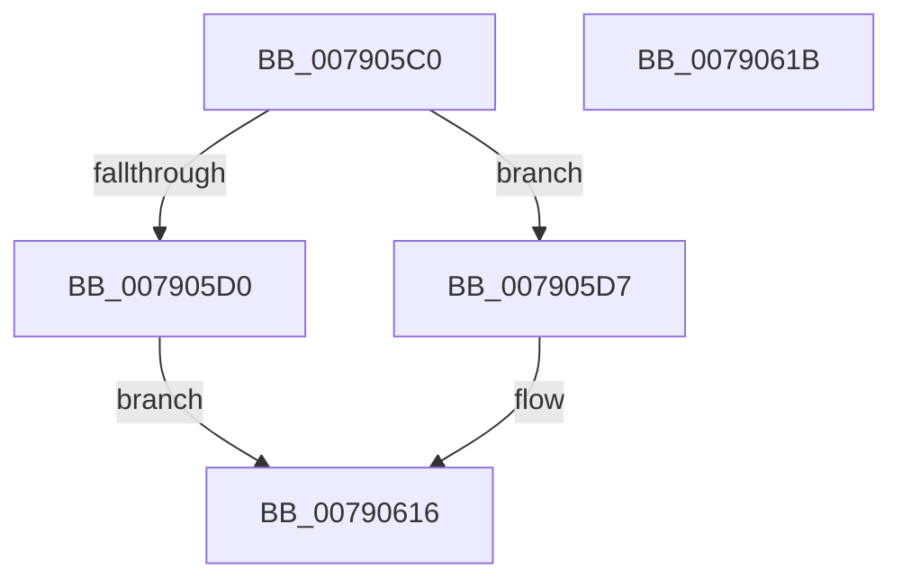

# RtlCheckSystemBootStatusIntegrity

- RVA: `0x007905C0`–`0x0079061C` (길이 `92` bytes)
- VA: `0x00000001407905C0`
- 실행 섹션: `PAGE`
- PDB 이름 있음: `예`; PDB Function 태그: `아니요`
- unwind 정보 RVA: `0x0006E590`
- 디코드: `23`개 명령, `92/92` bytes 표시
- 미해석 바이트: `0` (있으면 어셈블리에 `.byte`로 보존)

> 이 문서는 커널 이미지의 기계어와 PDB 기호를 분석해 생성했습니다. 4번과 5번은 함수 원형과 자료형을 바이너리 사용 방식에서 추정한 C 해석이며 원본 소스 복구 결과는 아닙니다.

## 1. Dependencies

- 직접 호출 지점: **1**; 고유 호출 대상: **1**
- 직접 호출자로 확인된 함수: **1**
- RIP 상대 이미지 참조: **0**

### Outgoing calls
- `0x00790611` → [ZwPowerInformation](../../text/6A/ZwPowerInformation_function_006ADCB0.md) (function, `0x006ADCB0`)

### Direct callers
- [PopCheckShutdownMarker](../../init/C3/PopCheckShutdownMarker_function_00C3DAD4.md) at `0x00C3DBAF`

### Static image references
- 디코드된 RIP-relative 메모리 참조가 없습니다.

## 2. Other-region calls and transfers

- 다른 실행 섹션으로 향하는 call: **1**
  - `0x00790611` → [ZwPowerInformation](../../text/6A/ZwPowerInformation_function_006ADCB0.md) (`PAGE` → `.text`)
- 별도 외부 분기/꼬리 이동을 확인하지 못했습니다.

## 3. Assembly (complete function range)

```asm
007905C0  48 83 EC 68                     sub rsp, 0x68
007905C4  33 D2                           xor edx, edx
007905C6  48 89 54 24 48                  mov qword ptr [rsp + 0x48], rdx
007905CB  48 85 C9                        test rcx, rcx
007905CE  75 07                           jne 0x1407905d7
007905D0  B8 0D 00 00 C0                  mov eax, 0xc000000d
007905D5  EB 3F                           jmp 0x140790616
007905D7  45 33 C9                        xor r9d, r9d
007905DA  48 89 4C 24 50                  mov qword ptr [rsp + 0x50], rcx
007905DF  B8 01 00 00 00                  mov eax, 1
007905E4  89 54 24 20                     mov dword ptr [rsp + 0x20], edx
007905E8  89 44 24 58                     mov dword ptr [rsp + 0x58], eax
007905EC  48 8D 54 24 30                  lea rdx, [rsp + 0x30]
007905F1  48 89 44 24 38                  mov qword ptr [rsp + 0x38], rax
007905F6  48 8D 44 24 48                  lea rax, [rsp + 0x48]
007905FB  45 8D 41 18                     lea r8d, [r9 + 0x18]
007905FF  48 C7 44 24 30 22 00 00 00      mov qword ptr [rsp + 0x30], 0x22
00790608  41 8D 49 57                     lea ecx, [r9 + 0x57]
0079060C  48 89 44 24 40                  mov qword ptr [rsp + 0x40], rax
00790611  E8 9A D6 F1 FF                  call 0x1406adcb0
00790616  48 83 C4 68                     add rsp, 0x68
0079061A  C3                              ret
0079061B  CC                              int3
```

## 4. C-style interpretation (structured pseudocode)

```c
__int64 __fastcall RtlCheckSystemBootStatusIntegrity(__int64 a1, int a2, __int64 a3, int a4)
{
    __int64 result;
    __int64 v_rsp;
    unsigned int v_stack_m10;
    unsigned __int64 v_stack_m18;
    unsigned __int64 v_stack_m20;
    unsigned __int64 v_stack_m28;
    unsigned __int64 v_stack_m30;
    unsigned __int64 v_stack_m38;
    unsigned int v_stack_m48;

    v_rsp = (v_rsp) - (104);
    a2 = 0;
    v_stack_m20 = 0;
    if (a1 != 0) goto loc_007905D7;
    goto loc_00790616;
loc_007905D7:
    a4 = 0;
    v_stack_m18 = a1;
    v_stack_m48 = 0;
    v_stack_m10 = 1;
    v_stack_m30 = 1;
    v_stack_m38 = 34;
    v_stack_m28 = v_stack_m20;
    result = ZwPowerInformation(a4 + 87, v_stack_m38, a4 + 24, a4);
loc_00790616:
    v_rsp = (v_rsp) + (104);
    return result;
}
```

## 5. (Beta) C Style

```c
int64_t RtlCheckSystemBootStatusIntegrity(int64_t Arg1, int32_t Arg2, int64_t Arg3, int32_t Arg4)
{
    int64_t result;
    int64_t local_rsp;
    uint32_t v_stack_m10;
    uint64_t v_stack_m18;
    uint64_t v_stack_m20;
    uint64_t v_stack_m28;
    uint64_t v_stack_m30;
    uint64_t v_stack_m38;
    uint32_t v_stack_m48;

    local_rsp = (local_rsp) - (104);
    Arg2 = 0;
    v_stack_m20 = 0;
    if (Arg1 != 0) goto loc_007905D7;
    goto loc_00790616;
loc_007905D7:
    Arg4 = 0;
    v_stack_m18 = Arg1;
    v_stack_m48 = 0;
    v_stack_m10 = 1;
    v_stack_m30 = 1;
    v_stack_m38 = 34;
    v_stack_m28 = v_stack_m20;
    result = ZwPowerInformation(Arg4 + 87, v_stack_m38, Arg4 + 24, Arg4);
loc_00790616:
    local_rsp = (local_rsp) + (104);
    return result;
}
```

## 6. Execution-region graph

[열기: 2D/3D 그래프와 함수 탐색 컨트롤 패널](../../../control-panel.html?section=page&rva=0x007905C0&view=graph)

- 2D 그래프는 위에서 아래로 흐르고, 3D 그래프는 빈 공간을 드래그해 회전합니다. Shift+드래그는 이동, 휠은 확대·축소, 함수 노드 선택은 대상 보고서 이동입니다.

### Static fallback


