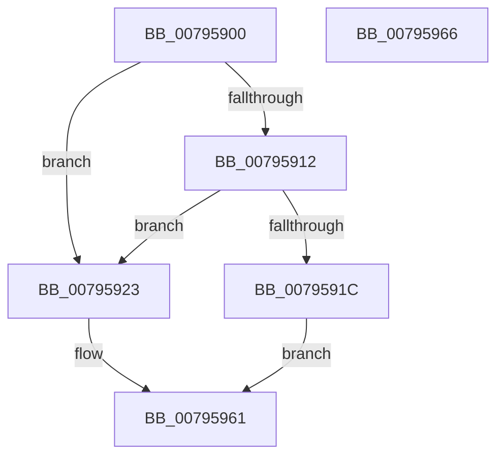

# RtlCompressBufferXp10

- RVA: `0x00795900`–`0x00795967` (길이 `103` bytes)
- VA: `0x0000000140795900`
- 실행 섹션: `PAGE`
- PDB 이름 있음: `예`; PDB Function 태그: `아니요`
- unwind 정보 RVA: `0x0006C2A4`
- 디코드: `24`개 명령, `103/103` bytes 표시
- 미해석 바이트: `0` (있으면 어셈블리에 `.byte`로 보존)

> 이 문서는 커널 이미지의 기계어와 PDB 기호를 분석해 생성했습니다. 4번과 5번은 함수 원형과 자료형을 바이너리 사용 방식에서 추정한 C 해석이며 원본 소스 복구 결과는 아닙니다.

## 1. Dependencies

- 직접 호출 지점: **1**; 고유 호출 대상: **1**
- 직접 호출자로 확인된 함수: **0**
- RIP 상대 이미지 참조: **0**

### Outgoing calls
- `0x0079595C` → [Xp10CompressBuffer](Xp10CompressBuffer_function_007972F4.md) (function, `0x007972F4`)

### Direct callers
- 이 함수 시작 RVA로 연결되는 직접 call은 확인되지 않았습니다. 간접 호출은 완전히 역산할 수 없습니다.

### Static image references
- 디코드된 RIP-relative 메모리 참조가 없습니다.

## 2. Other-region calls and transfers

- 다른 실행 섹션으로 향하는 call: **0**
- 별도 외부 분기/꼬리 이동을 확인하지 못했습니다.

## 3. Assembly (complete function range)

```asm
00795900  48 83 EC 58                     sub rsp, 0x58
00795904  45 33 D2                        xor r10d, r10d
00795907  66 44 89 54 24 42               mov word ptr [rsp + 0x42], r10w
0079590D  66 85 C9                        test cx, cx
00795910  74 11                           je 0x140795923
00795912  B8 00 01 00 00                  mov eax, 0x100
00795917  66 3B C8                        cmp cx, ax
0079591A  74 07                           je 0x140795923
0079591C  B8 BB 00 00 C0                  mov eax, 0xc00000bb
00795921  EB 3E                           jmp 0x140795961
00795923  B8 78 40 00 00                  mov eax, 0x4078
00795928  44 89 54 24 44                  mov dword ptr [rsp + 0x44], r10d
0079592D  66 89 44 24 40                  mov word ptr [rsp + 0x40], ax
00795932  48 8D 4C 24 40                  lea rcx, [rsp + 0x40]
00795937  48 8B 84 24 98 00 00 00         mov rax, qword ptr [rsp + 0x98]
0079593F  48 89 44 24 30                  mov qword ptr [rsp + 0x30], rax
00795944  48 8B 84 24 90 00 00 00         mov rax, qword ptr [rsp + 0x90]
0079594C  48 89 44 24 28                  mov qword ptr [rsp + 0x28], rax
00795951  8B 84 24 80 00 00 00            mov eax, dword ptr [rsp + 0x80]
00795958  89 44 24 20                     mov dword ptr [rsp + 0x20], eax
0079595C  E8 93 19 00 00                  call 0x1407972f4
00795961  48 83 C4 58                     add rsp, 0x58
00795965  C3                              ret
00795966  CC                              int3
```

## 4. C-style interpretation (structured pseudocode)

```c
__int64 __fastcall RtlCompressBufferXp10(unsigned __int16 a1, __int64 a2, __int64 a3, __int64 a4, unsigned int a5, __int64 a6, __int64 a7, __int64 a8)
{
    __int64 result;
    __int64 v_r10;
    __int64 v_rsp;
    unsigned int v_stack_m14;
    unsigned __int16 v_stack_m16;
    unsigned __int16 v_stack_m18;
    unsigned __int64 v_stack_m28;
    unsigned __int64 v_stack_m30;
    unsigned int v_stack_m38;

    v_rsp = (v_rsp) - (88);
    v_r10 = 0;
    v_stack_m16 = 0;
    if (a1 == 0) goto loc_00795923;
    if (a1 == 256) goto loc_00795923;
    goto loc_00795961;
loc_00795923:
    v_stack_m14 = 0;
    v_stack_m18 = (unsigned __int16)((unsigned int)(0x4078ULL));
    v_stack_m28 = a8;
    v_stack_m30 = a7;
    v_stack_m38 = (unsigned int)((unsigned int)(a5));
    result = Xp10CompressBuffer(v_stack_m18, a2, a3, a4);
loc_00795961:
    v_rsp = (v_rsp) + (88);
    return result;
}
```

## 5. (Beta) C Style

```c
int64_t RtlCompressBufferXp10(uint16_t Arg1, int64_t Arg2, int64_t Arg3, int64_t Arg4, uint32_t Arg5, uint64_t Arg6, int64_t Arg7, int64_t Arg8)
{
    int64_t result;
    int64_t local_r10;
    int64_t local_rsp;
    uint32_t v_stack_m14;
    uint16_t v_stack_m16;
    uint16_t v_stack_m18;
    uint64_t v_stack_m28;
    uint64_t v_stack_m30;
    uint32_t v_stack_m38;

    local_rsp = (local_rsp) - (88);
    local_r10 = 0;
    v_stack_m16 = 0;
    if (Arg1 == 0) goto loc_00795923;
    if (Arg1 == 256) goto loc_00795923;
    goto loc_00795961;
loc_00795923:
    v_stack_m14 = 0;
    v_stack_m18 = (uint16_t)((uint32_t)(0x4078ULL));
    v_stack_m28 = Arg8;
    v_stack_m30 = Arg7;
    v_stack_m38 = (uint32_t)((uint32_t)(Arg5));
    result = Xp10CompressBuffer(v_stack_m18, Arg2, Arg3, Arg4);
loc_00795961:
    local_rsp = (local_rsp) + (88);
    return result;
}
```

## 6. Execution-region graph

[열기: 2D/3D 그래프와 함수 탐색 컨트롤 패널](../../../control-panel.html?section=page&rva=0x00795900&view=graph)

- 2D 그래프는 위에서 아래로 흐르고, 3D 그래프는 빈 공간을 드래그해 회전합니다. Shift+드래그는 이동, 휠은 확대·축소, 함수 노드 선택은 대상 보고서 이동입니다.

### Static fallback


