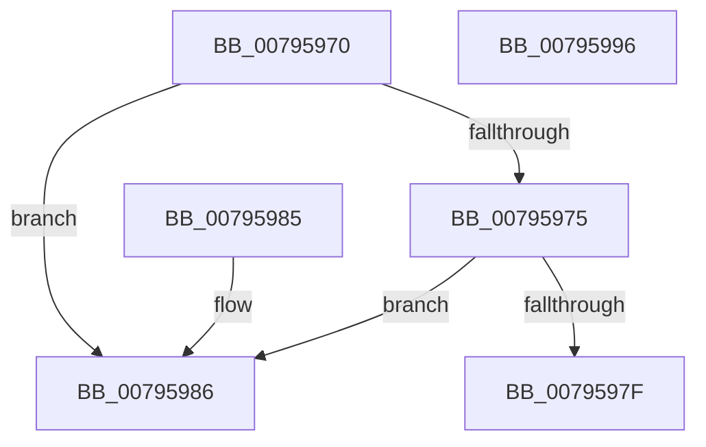

# RtlCompressWorkSpaceSizeXp10

- RVA: `0x00795970`–`0x00795997` (길이 `39` bytes)
- VA: `0x0000000140795970`
- 실행 섹션: `PAGE`
- PDB 이름 있음: `예`; PDB Function 태그: `아니요`
- unwind 정보 RVA: `0x000DB714`
- 디코드: `13`개 명령, `39/39` bytes 표시
- 미해석 바이트: `0` (있으면 어셈블리에 `.byte`로 보존)

> 이 문서는 커널 이미지의 기계어와 PDB 기호를 분석해 생성했습니다. 4번과 5번은 함수 원형과 자료형을 바이너리 사용 방식에서 추정한 C 해석이며 원본 소스 복구 결과는 아닙니다.

## 1. Dependencies

- 직접 호출 지점: **0**; 고유 호출 대상: **0**
- 직접 호출자로 확인된 함수: **0**
- RIP 상대 이미지 참조: **0**

### Outgoing calls
- 직접 디코드된 call 명령이 없습니다.

### Direct callers
- 이 함수 시작 RVA로 연결되는 직접 call은 확인되지 않았습니다. 간접 호출은 완전히 역산할 수 없습니다.

### Static image references
- 디코드된 RIP-relative 메모리 참조가 없습니다.

## 2. Other-region calls and transfers

- 다른 실행 섹션으로 향하는 call: **0**
- 별도 외부 분기/꼬리 이동을 확인하지 못했습니다.

## 3. Assembly (complete function range)

```asm
00795970  66 85 C9                        test cx, cx
00795973  74 11                           je 0x140795986
00795975  B8 00 01 00 00                  mov eax, 0x100
0079597A  66 3B C8                        cmp cx, ax
0079597D  74 07                           je 0x140795986
0079597F  B8 BB 00 00 C0                  mov eax, 0xc00000bb
00795984  C3                              ret
00795985  CC                              int3
00795986  C7 02 20 25 01 02               mov dword ptr [rdx], 0x2012520
0079598C  33 C0                           xor eax, eax
0079598E  41 C7 00 58 96 00 00            mov dword ptr [r8], 0x9658
00795995  C3                              ret
00795996  CC                              int3
```

## 4. C-style interpretation (structured pseudocode)

```c
__int64 __fastcall RtlCompressWorkSpaceSizeXp10(unsigned __int16 a1, __int64 a2, __int64 a3)
{
    __int64 result;

    if (a1 == 0) goto loc_00795986;
    if (a1 == 256) goto loc_00795986;
    return (unsigned int)(0xC00000BBULL);
loc_00795986:
    *(unsigned int *)(a2) = 0x2012520ULL;
    result = 0;
    *(unsigned int *)(a3) = 0x9658ULL;
    return result;
}
```

## 5. (Beta) C Style

```c
int64_t RtlCompressWorkSpaceSizeXp10(uint16_t Arg1, void *Arg2, void *Arg3)
{
    uint8_t *arg2 = (uint8_t *)Arg2;
    uint8_t *arg3 = (uint8_t *)Arg3;

    int64_t result;

    if (Arg1 == 0) goto loc_00795986;
    if (Arg1 == 256) goto loc_00795986;
    return (uint32_t)(0xC00000BBULL);
loc_00795986:
    *(uint32_t *)(arg2) = 0x2012520ULL;
    result = 0;
    *(uint32_t *)(arg3) = 0x9658ULL;
    return result;
}
```

### 관측된 메모리 오프셋

구조체 형식이 확인되지 않은 접근은 인자 기준의 오프셋으로만 기록했습니다.

| 기준 인자 | 오프셋 표현 | 폭 (bit) | 접근 |
|---|---:|---:|---|
| `Arg2` | `+ 0x0` | `32` | `W` |
| `Arg3` | `+ 0x0` | `32` | `W` |

## 6. Execution-region graph

[열기: 2D/3D 그래프와 함수 탐색 컨트롤 패널](../../../control-panel.html?section=page&rva=0x00795970&view=graph)

- 2D 그래프는 위에서 아래로 흐르고, 3D 그래프는 빈 공간을 드래그해 회전합니다. Shift+드래그는 이동, 휠은 확대·축소, 함수 노드 선택은 대상 보고서 이동입니다.

### Static fallback


