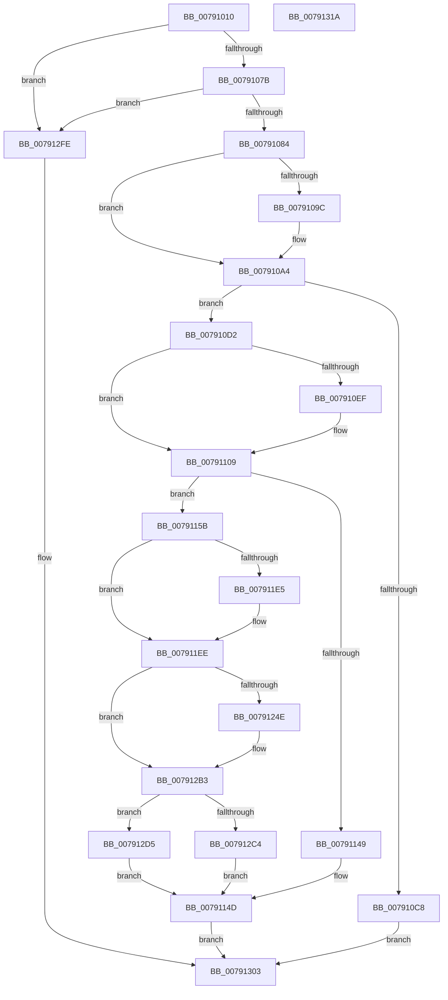

# RtlCreateSystemVolumeInformationFolder

- RVA: `0x00791010`–`0x0079131B` (길이 `779` bytes)
- VA: `0x0000000140791010`
- 실행 섹션: `PAGE`
- PDB 이름 있음: `예`; PDB Function 태그: `아니요`
- unwind 정보 RVA: `0x000CFC98`
- 디코드: `190`개 명령, `779/779` bytes 표시
- 미해석 바이트: `0` (있으면 어셈블리에 `.byte`로 보존)

> 이 문서는 커널 이미지의 기계어와 PDB 기호를 분석해 생성했습니다. 4번과 5번은 함수 원형과 자료형을 바이너리 사용 방식에서 추정한 C 해석이며 원본 소스 복구 결과는 아닙니다.

## 1. Dependencies

- 직접 호출 지점: **16**; 고유 호출 대상: **9**
- 직접 호출자로 확인된 함수: **1**
- RIP 상대 이미지 참조: **1**

### Outgoing calls
- `0x0079105F` → [RtlInitUnicodeString](../../text/42/RtlInitUnicodeString_function_0042A780.md) (function, `0x0042A780`)
- `0x007910BA` → [ExAllocatePool2](../../poolcode/B8/ExAllocatePool2_function_00B820F0.md) (function, `0x00B820F0`)
- `0x007910DD` → [memcpy](../../text/6C/memcpy_function_006C6840.md) (function, `0x006C6840`)
- `0x00791117` → [memcpy](../../text/6C/memcpy_function_006C6840.md) (function, `0x006C6840`)
- `0x0079113E` → [RtlpSysVolCreateSecurityDescriptor](RtlpSysVolCreateSecurityDescriptor_function_00791654.md) (function, `0x00791654`)
- `0x0079114F` → [ExFreePoolWithTag](../../poolcode/B8/ExFreePoolWithTag_function_00B82870.md) (function, `0x00B82870`)
- `0x007911DC` → [IopCreateFile](../8A/IopCreateFile_function_008AB298.md) (function, `0x008AB298`)
- `0x007911E9` → [NtClose](../86/NtClose_function_00868870.md) (function, `0x00868870`)
- `0x00791243` → [IopCreateFile](../8A/IopCreateFile_function_008AB298.md) (function, `0x008AB298`)
- `0x00791252` → [RtlpSysVolTakeOwnership](RtlpSysVolTakeOwnership_function_007917C8.md) (function, `0x007917C8`)
- `0x007912AC` → [IopCreateFile](../8A/IopCreateFile_function_008AB298.md) (function, `0x008AB298`)
- `0x007912B9` → [ExFreePoolWithTag](../../poolcode/B8/ExFreePoolWithTag_function_00B82870.md) (function, `0x00B82870`)
- `0x007912C8` → [ExFreePoolWithTag](../../poolcode/B8/ExFreePoolWithTag_function_00B82870.md) (function, `0x00B82870`)
- `0x007912D8` → [ExFreePoolWithTag](../../poolcode/B8/ExFreePoolWithTag_function_00B82870.md) (function, `0x00B82870`)
- `0x007912E5` → [RtlpSysVolCheckOwnerAndSecurity](RtlpSysVolCheckOwnerAndSecurity_function_00791324.md) (function, `0x00791324`)
- `0x007912F0` → [NtClose](../86/NtClose_function_00868870.md) (function, `0x00868870`)

### Direct callers
- [DifRtlCreateSystemVolumeInformationFolderWrapper](../../text/63/DifRtlCreateSystemVolumeInformationFolderWrapper_function_0063B660.md) at `0x0063B72D`

### Static image references
- `0x0079102B` → RVA `0x00B05A10` (` ?? ::NNGAKEGL::`string'`; read)

## 2. Other-region calls and transfers

- 다른 실행 섹션으로 향하는 call: **8**
  - `0x0079105F` → [RtlInitUnicodeString](../../text/42/RtlInitUnicodeString_function_0042A780.md) (`PAGE` → `.text`)
  - `0x007910BA` → [ExAllocatePool2](../../poolcode/B8/ExAllocatePool2_function_00B820F0.md) (`PAGE` → `POOLCODE`)
  - `0x007910DD` → [memcpy](../../text/6C/memcpy_function_006C6840.md) (`PAGE` → `.text`)
  - `0x00791117` → [memcpy](../../text/6C/memcpy_function_006C6840.md) (`PAGE` → `.text`)
  - `0x0079114F` → [ExFreePoolWithTag](../../poolcode/B8/ExFreePoolWithTag_function_00B82870.md) (`PAGE` → `POOLCODE`)
  - `0x007912B9` → [ExFreePoolWithTag](../../poolcode/B8/ExFreePoolWithTag_function_00B82870.md) (`PAGE` → `POOLCODE`)
  - `0x007912C8` → [ExFreePoolWithTag](../../poolcode/B8/ExFreePoolWithTag_function_00B82870.md) (`PAGE` → `POOLCODE`)
  - `0x007912D8` → [ExFreePoolWithTag](../../poolcode/B8/ExFreePoolWithTag_function_00B82870.md) (`PAGE` → `POOLCODE`)
- 별도 외부 분기/꼬리 이동을 확인하지 못했습니다.

## 3. Assembly (complete function range)

```asm
00791010  48 89 5C 24 20                  mov qword ptr [rsp + 0x20], rbx
00791015  55                              push rbp
00791016  56                              push rsi
00791017  57                              push rdi
00791018  41 56                           push r14
0079101A  41 57                           push r15
0079101C  48 8D 6C 24 C9                  lea rbp, [rsp - 0x37]
00791021  48 81 EC E0 00 00 00            sub rsp, 0xe0
00791028  45 33 F6                        xor r14d, r14d
0079102B  48 8D 15 DE 49 37 00            lea rdx, [rip + 0x3749de]
00791032  0F 57 C0                        xorps xmm0, xmm0
00791035  4C 89 75 77                     mov qword ptr [rbp + 0x77], r14
00791039  48 8B D9                        mov rbx, rcx
0079103C  4C 89 75 6F                     mov qword ptr [rbp + 0x6f], r14
00791040  0F 57 C9                        xorps xmm1, xmm1
00791043  44 89 75 0B                     mov dword ptr [rbp + 0xb], r14d
00791047  48 8D 4D E7                     lea rcx, [rbp - 0x19]
0079104B  44 89 75 23                     mov dword ptr [rbp + 0x23], r14d
0079104F  0F 11 45 E7                     movups xmmword ptr [rbp - 0x19], xmm0
00791053  4C 89 75 67                     mov qword ptr [rbp + 0x67], r14
00791057  0F 11 4D D7                     movups xmmword ptr [rbp - 0x29], xmm1
0079105B  0F 11 45 F7                     movups xmmword ptr [rbp - 9], xmm0
0079105F  E8 1C 97 C9 FF                  call 0x14042a780
00791064  0F B7 03                        movzx eax, word ptr [rbx]
00791067  0F B7 7D E7                     movzx edi, word ptr [rbp - 0x19]
0079106B  8D 14 07                        lea edx, [rdi + rax]
0079106E  66 89 55 D7                     mov word ptr [rbp - 0x29], dx
00791072  66 3B D0                        cmp dx, ax
00791075  0F 82 83 02 00 00               jb 0x1407912fe
0079107B  66 3B D7                        cmp dx, di
0079107E  0F 82 7A 02 00 00               jb 0x1407912fe
00791084  8B C8                           mov ecx, eax
00791086  45 8D 7E 5C                     lea r15d, [r14 + 0x5c]
0079108A  48 8B 43 08                     mov rax, qword ptr [rbx + 8]
0079108E  48 D1 E9                        shr rcx, 1
00791091  0F B7 74 48 FE                  movzx esi, word ptr [rax + rcx*2 - 2]
00791096  66 41 3B F7                     cmp si, r15w
0079109A  74 08                           je 0x1407910a4
0079109C  66 83 C2 02                     add dx, 2
007910A0  66 89 55 D7                     mov word ptr [rbp - 0x29], dx
007910A4  66 83 C2 02                     add dx, 2
007910A8  B9 00 01 00 00                  mov ecx, 0x100
007910AD  0F B7 D2                        movzx edx, dx
007910B0  41 B8 56 6F 6C 53               mov r8d, 0x536c6f56
007910B6  66 89 55 D9                     mov word ptr [rbp - 0x27], dx
007910BA  E8 31 10 3F 00                  call 0x140b820f0
007910BF  48 89 45 DF                     mov qword ptr [rbp - 0x21], rax
007910C3  48 85 C0                        test rax, rax
007910C6  75 0A                           jne 0x1407910d2
007910C8  B8 9A 00 00 C0                  mov eax, 0xc000009a
007910CD  E9 31 02 00 00                  jmp 0x140791303
007910D2  44 0F B7 03                     movzx r8d, word ptr [rbx]
007910D6  48 8B C8                        mov rcx, rax
007910D9  48 8B 53 08                     mov rdx, qword ptr [rbx + 8]
007910DD  E8 5E 57 F3 FF                  call 0x1406c6840
007910E2  0F B7 03                        movzx eax, word ptr [rbx]
007910E5  66 89 45 D7                     mov word ptr [rbp - 0x29], ax
007910E9  66 41 3B F7                     cmp si, r15w
007910ED  74 1A                           je 0x140791109
007910EF  8B C8                           mov ecx, eax
007910F1  48 8B 45 DF                     mov rax, qword ptr [rbp - 0x21]
007910F5  48 D1 E9                        shr rcx, 1
007910F8  66 44 89 3C 48                  mov word ptr [rax + rcx*2], r15w
007910FD  0F B7 45 D7                     movzx eax, word ptr [rbp - 0x29]
00791101  66 83 C0 02                     add ax, 2
00791105  66 89 45 D7                     mov word ptr [rbp - 0x29], ax
00791109  48 8B 55 EF                     mov rdx, qword ptr [rbp - 0x11]
0079110D  4C 8B C7                        mov r8, rdi
00791110  0F B7 C8                        movzx ecx, ax
00791113  48 03 4D DF                     add rcx, qword ptr [rbp - 0x21]
00791117  E8 24 57 F3 FF                  call 0x1406c6840
0079111C  0F B7 45 D7                     movzx eax, word ptr [rbp - 0x29]
00791120  48 8D 55 6F                     lea rdx, [rbp + 0x6f]
00791124  66 03 C7                        add ax, di
00791127  0F B7 C8                        movzx ecx, ax
0079112A  66 89 45 D7                     mov word ptr [rbp - 0x29], ax
0079112E  48 8B 45 DF                     mov rax, qword ptr [rbp - 0x21]
00791132  48 D1 E9                        shr rcx, 1
00791135  66 44 89 34 48                  mov word ptr [rax + rcx*2], r14w
0079113A  48 8D 4D 77                     lea rcx, [rbp + 0x77]
0079113E  E8 11 05 00 00                  call 0x140791654
00791143  8B D8                           mov ebx, eax
00791145  85 C0                           test eax, eax
00791147  79 12                           jns 0x14079115b
00791149  48 8B 4D DF                     mov rcx, qword ptr [rbp - 0x21]
0079114D  33 D2                           xor edx, edx
0079114F  E8 1C 17 3F 00                  call 0x140b82870
00791154  8B C3                           mov eax, ebx
00791156  E9 A8 01 00 00                  jmp 0x140791303
0079115B  48 8B 7D 77                     mov rdi, qword ptr [rbp + 0x77]
0079115F  48 8D 45 D7                     lea rax, [rbp - 0x29]
00791163  4C 89 74 24 78                  mov qword ptr [rsp + 0x78], r14
00791168  4C 8D 4D F7                     lea r9, [rbp - 9]
0079116C  BE 20 00 00 00                  mov esi, 0x20
00791171  C7 45 07 30 00 00 00            mov dword ptr [rbp + 7], 0x30
00791178  89 74 24 70                     mov dword ptr [rsp + 0x70], esi
0079117C  4C 8D 45 07                     lea r8, [rbp + 7]
00791180  44 89 74 24 68                  mov dword ptr [rsp + 0x68], r14d
00791185  48 8D 4D 67                     lea rcx, [rbp + 0x67]
00791189  4C 89 74 24 60                  mov qword ptr [rsp + 0x60], r14
0079118E  BA 00 00 01 00                  mov edx, 0x10000
00791193  44 89 74 24 58                  mov dword ptr [rsp + 0x58], r14d
00791198  44 8D 7E E7                     lea r15d, [rsi - 0x19]
0079119C  44 89 74 24 50                  mov dword ptr [rsp + 0x50], r14d
007911A1  4C 89 74 24 48                  mov qword ptr [rsp + 0x48], r14
007911A6  C7 44 24 40 60 10 20 00         mov dword ptr [rsp + 0x40], 0x201060
007911AE  C7 44 24 38 01 00 00 00         mov dword ptr [rsp + 0x38], 1
007911B6  44 89 7C 24 30                  mov dword ptr [rsp + 0x30], r15d
007911BB  44 89 74 24 28                  mov dword ptr [rsp + 0x28], r14d
007911C0  4C 89 74 24 20                  mov qword ptr [rsp + 0x20], r14
007911C5  4C 89 75 0F                     mov qword ptr [rbp + 0xf], r14
007911C9  C7 45 1F 40 02 00 00            mov dword ptr [rbp + 0x1f], 0x240
007911D0  48 89 45 17                     mov qword ptr [rbp + 0x17], rax
007911D4  48 89 7D 27                     mov qword ptr [rbp + 0x27], rdi
007911D8  4C 89 75 2F                     mov qword ptr [rbp + 0x2f], r14
007911DC  E8 B7 A0 11 00                  call 0x1408ab298
007911E1  85 C0                           test eax, eax
007911E3  78 09                           js 0x1407911ee
007911E5  48 8B 4D 67                     mov rcx, qword ptr [rbp + 0x67]
007911E9  E8 82 76 0D 00                  call 0x140868870
007911EE  4C 89 74 24 78                  mov qword ptr [rsp + 0x78], r14
007911F3  4C 8D 4D F7                     lea r9, [rbp - 9]
007911F7  89 74 24 70                     mov dword ptr [rsp + 0x70], esi
007911FB  4C 8D 45 07                     lea r8, [rbp + 7]
007911FF  44 89 74 24 68                  mov dword ptr [rsp + 0x68], r14d
00791204  48 8D 4D 67                     lea rcx, [rbp + 0x67]
00791208  4C 89 74 24 60                  mov qword ptr [rsp + 0x60], r14
0079120D  BA 00 00 1E 00                  mov edx, 0x1e0000
00791212  44 89 74 24 58                  mov dword ptr [rsp + 0x58], r14d
00791217  44 89 74 24 50                  mov dword ptr [rsp + 0x50], r14d
0079121C  4C 89 74 24 48                  mov qword ptr [rsp + 0x48], r14
00791221  C7 44 24 40 21 00 00 00         mov dword ptr [rsp + 0x40], 0x21
00791229  C7 44 24 38 03 00 00 00         mov dword ptr [rsp + 0x38], 3
00791231  44 89 7C 24 30                  mov dword ptr [rsp + 0x30], r15d
00791236  C7 44 24 28 06 00 00 00         mov dword ptr [rsp + 0x28], 6
0079123E  4C 89 74 24 20                  mov qword ptr [rsp + 0x20], r14
00791243  E8 50 A0 11 00                  call 0x1408ab298
00791248  8B D8                           mov ebx, eax
0079124A  85 C0                           test eax, eax
0079124C  79 65                           jns 0x1407912b3
0079124E  48 8D 4D D7                     lea rcx, [rbp - 0x29]
00791252  E8 71 05 00 00                  call 0x1407917c8
00791257  4C 89 74 24 78                  mov qword ptr [rsp + 0x78], r14
0079125C  4C 8D 4D F7                     lea r9, [rbp - 9]
00791260  89 74 24 70                     mov dword ptr [rsp + 0x70], esi
00791264  4C 8D 45 07                     lea r8, [rbp + 7]
00791268  44 89 74 24 68                  mov dword ptr [rsp + 0x68], r14d
0079126D  48 8D 4D 67                     lea rcx, [rbp + 0x67]
00791271  4C 89 74 24 60                  mov qword ptr [rsp + 0x60], r14
00791276  BA 00 00 1E 00                  mov edx, 0x1e0000
0079127B  44 89 74 24 58                  mov dword ptr [rsp + 0x58], r14d
00791280  44 89 74 24 50                  mov dword ptr [rsp + 0x50], r14d
00791285  4C 89 74 24 48                  mov qword ptr [rsp + 0x48], r14
0079128A  C7 44 24 40 21 00 00 00         mov dword ptr [rsp + 0x40], 0x21
00791292  C7 44 24 38 03 00 00 00         mov dword ptr [rsp + 0x38], 3
0079129A  44 89 7C 24 30                  mov dword ptr [rsp + 0x30], r15d
0079129F  C7 44 24 28 06 00 00 00         mov dword ptr [rsp + 0x28], 6
007912A7  4C 89 74 24 20                  mov qword ptr [rsp + 0x20], r14
007912AC  E8 E7 9F 11 00                  call 0x1408ab298
007912B1  8B D8                           mov ebx, eax
007912B3  48 8B 4D DF                     mov rcx, qword ptr [rbp - 0x21]
007912B7  33 D2                           xor edx, edx
007912B9  E8 B2 15 3F 00                  call 0x140b82870
007912BE  33 D2                           xor edx, edx
007912C0  85 DB                           test ebx, ebx
007912C2  79 11                           jns 0x1407912d5
007912C4  48 8B 4D 6F                     mov rcx, qword ptr [rbp + 0x6f]
007912C8  E8 A3 15 3F 00                  call 0x140b82870
007912CD  48 8B CF                        mov rcx, rdi
007912D0  E9 78 FE FF FF                  jmp 0x14079114d
007912D5  48 8B CF                        mov rcx, rdi
007912D8  E8 93 15 3F 00                  call 0x140b82870
007912DD  48 8B 55 6F                     mov rdx, qword ptr [rbp + 0x6f]
007912E1  48 8B 4D 67                     mov rcx, qword ptr [rbp + 0x67]
007912E5  E8 3A 00 00 00                  call 0x140791324
007912EA  48 8B 4D 67                     mov rcx, qword ptr [rbp + 0x67]
007912EE  8B D8                           mov ebx, eax
007912F0  E8 7B 75 0D 00                  call 0x140868870
007912F5  48 8B 4D 6F                     mov rcx, qword ptr [rbp + 0x6f]
007912F9  E9 4F FE FF FF                  jmp 0x14079114d
007912FE  B8 0D 00 00 C0                  mov eax, 0xc000000d
00791303  48 8B 9C 24 28 01 00 00         mov rbx, qword ptr [rsp + 0x128]
0079130B  48 81 C4 E0 00 00 00            add rsp, 0xe0
00791312  41 5F                           pop r15
00791314  41 5E                           pop r14
00791316  5F                              pop rdi
00791317  5E                              pop rsi
00791318  5D                              pop rbp
00791319  C3                              ret
0079131A  CC                              int3
```

## 4. C-style interpretation (structured pseudocode)

```c
__int64 __fastcall RtlCreateSystemVolumeInformationFolder(__int64 a1)
{
    __int64 result;
    __int64 v_r14;
    __int64 v_rbx;
    __int64 v_rsp;
    unsigned __int64 v_stack_m30;
    unsigned __int64 v_stack_m38;
    unsigned int v_stack_m3C;
    unsigned int v_stack_m40;
    unsigned __int64 v_stack_m48;
    unsigned __int64 v_stack_m50;
    unsigned int v_stack_m54;
    unsigned int v_stack_m58;
    unsigned __int64 v_stack_m5F;
    unsigned __int64 v_stack_m68;
    unsigned __int64 v_stack_m70;
    unsigned __int64 v_stack_m78;
    unsigned __int64 v_stack_m80;
    unsigned __int16 v_stack_m86;
    unsigned __int64 v_stack_m88;
    unsigned __int64 v_stack_m90;
    unsigned int v_stack_m98;
    unsigned int v_stack_mA0;
    unsigned __int64 v_stack_mA8;
    unsigned int v_stack_mB0;
    unsigned int v_stack_mB8;
    unsigned __int64 v_stack_mC0;
    unsigned int v_stack_mC8;
    unsigned int v_stack_mD0;
    unsigned int v_stack_mD8;
    unsigned int v_stack_mE0;
    unsigned __int64 v_stack_mE8;
    unsigned __int64 v_stack_p10;
    unsigned __int64 v_stack_p18;
    unsigned __int64 v_stack_p20;
    unsigned __int64 v_stack_p8;

    v_stack_p20 = v_rbx;
    v_rsp = (v_rsp) - (224);
    v_r14 = 0;
    v_stack_p18 = 0;
    v_stack_p10 = 0;
    v_stack_m54 = 0;
    v_stack_m3C = 0;
    v_stack_m78 = v_xmm0;
    v_stack_p8 = 0;
    v_stack_m88 = v_xmm1;
    v_stack_m68 = v_xmm0;
    result = RtlInitUnicodeString(v_stack_m78, v_rip + 3623390, a3, a4);
    v_stack_m88 = (unsigned __int16)(v_stack_m78 + *(unsigned __int16 *)(a1) * 1);
    if (((unsigned __int16)(v_stack_m78 + *(unsigned __int16 *)(a1) * 1)) < ((unsigned __int16)(*(unsigned __int16 *)(a1)))) goto loc_007912FE;
    if (((unsigned __int16)(v_stack_m78 + *(unsigned __int16 *)(a1) * 1)) < ((unsigned __int16)(v_stack_m78))) goto loc_007912FE;
    a1 = ((unsigned int)((unsigned int)(*(unsigned __int16 *)(a1)))) >> (1);
    if (((unsigned __int16)(*(unsigned __int16 *)(*(unsigned __int64 *)(a1 + 8) + a1 * 2 - 2))) != ((unsigned __int16)(v_r14 + 92))) {
        a2 = (unsigned __int16)((v_stack_m78 + *(unsigned __int16 *)(a1) * 1) + (2));
        v_stack_m88 = (unsigned __int16)(a2);
    }
    a2 = (unsigned __int16)((a2) + (2));
    v_stack_m86 = (unsigned __int16)((unsigned __int16)(a2));
    result = ExAllocatePool2(256, (unsigned __int16)(a2), (unsigned int)(0x536C6F56ULL), a4);
    v_stack_m80 = result;
    if (result != 0) goto loc_007910D2;
    goto loc_00791303;
loc_007910D2:
    result = memcpy((unsigned int)(0xC000009AULL), *(unsigned __int64 *)(a1 + 8), *(unsigned __int16 *)(a1), a4);
    v_stack_m88 = (unsigned __int16)(*(unsigned __int16 *)(a1));
    result = *(unsigned __int16 *)(a1);
    if (((unsigned __int16)(*(unsigned __int16 *)(*(unsigned __int64 *)(a1 + 8) + a1 * 2 - 2))) != ((unsigned __int16)(v_r14 + 92))) {
        a1 = (unsigned int)(*(unsigned __int16 *)(a1));
        result = v_stack_m80;
        a1 = (a1) >> (1);
        *(unsigned __int16 *)(result + a1 * 2) = (unsigned __int16)(v_r14 + 92);
        result = v_stack_m88;
        result = (unsigned __int16)((result) + (2));
        v_stack_m88 = (unsigned __int16)(result);
    }
    a1 = ((unsigned __int16)(result)) + (v_stack_m80);
    result = memcpy(a1, v_stack_m70, v_stack_m78, a4);
    result = (unsigned __int16)((v_stack_m88) + ((unsigned __int16)(v_stack_m78)));
    v_stack_m88 = (unsigned __int16)(result);
    a1 = ((unsigned __int16)(result)) >> (1);
    *(unsigned __int16 *)(v_stack_m80 + a1 * 2) = 0;
    result = RtlpSysVolCreateSecurityDescriptor(v_stack_p18, v_stack_p10, v_stack_m78, a4);
    if (!sign_flag) goto loc_0079115B;
loc_0079114D:
    a2 = 0;
    result = ExFreePoolWithTag(v_stack_m80, a2, v_stack_m78, a4);
    goto loc_00791303;
loc_0079115B:
    v_stack_m90 = 0;
    v_stack_m58 = 48;
    v_stack_m98 = 32;
    v_stack_mA0 = 0;
    v_stack_mA8 = 0;
    v_stack_mB0 = 0;
    v_stack_mB8 = 0;
    v_stack_mC0 = 0;
    v_stack_mC8 = 0x201060ULL;
    v_stack_mD0 = 1;
    v_stack_mD8 = (unsigned int)(32 - 25);
    v_stack_mE0 = 0;
    v_stack_mE8 = 0;
    v_stack_m50 = 0;
    v_stack_m40 = 576;
    v_stack_m48 = v_stack_m88;
    v_stack_m38 = v_stack_p18;
    v_stack_m30 = 0;
    result = IopCreateFile(v_stack_p8, (unsigned int)(0x10000ULL), v_stack_m58, v_stack_m68);
    if (!(sign_flag)) {
        a1 = v_stack_p8;
        result = NtClose(a1, (unsigned int)(0x10000ULL), v_stack_m58, v_stack_m68);
    }
    v_stack_m90 = 0;
    v_stack_m98 = 32;
    v_stack_mA0 = 0;
    v_stack_mA8 = 0;
    v_stack_mB0 = 0;
    v_stack_mB8 = 0;
    v_stack_mC0 = 0;
    v_stack_mC8 = 33;
    v_stack_mD0 = 3;
    v_stack_mD8 = (unsigned int)(32 - 25);
    v_stack_mE0 = 6;
    v_stack_mE8 = 0;
    result = IopCreateFile(v_stack_p8, (unsigned int)(0x1E0000ULL), v_stack_m58, v_stack_m68);
    v_rbx = (unsigned int)((unsigned int)(result));
    if (sign_flag) {
        a1 = v_stack_m88;
        result = RtlpSysVolTakeOwnership(a1, (unsigned int)(0x1E0000ULL), v_stack_m58, v_stack_m68);
        v_stack_m90 = 0;
        a4 = v_stack_m68;
        v_stack_m98 = 32;
        a3 = v_stack_m58;
        v_stack_mA0 = 0;
        a1 = v_stack_p8;
        v_stack_mA8 = 0;
        a2 = 0x1E0000ULL;
        v_stack_mB0 = 0;
        v_stack_mB8 = 0;
        v_stack_mC0 = 0;
        v_stack_mC8 = 33;
        v_stack_mD0 = 3;
        v_stack_mD8 = (unsigned int)(32 - 25);
        v_stack_mE0 = 6;
        v_stack_mE8 = 0;
        result = IopCreateFile(a1, a2, a3, a4);
        v_rbx = (unsigned int)(result);
    }
    a2 = 0;
    result = ExFreePoolWithTag(v_stack_m80, a2, a3, a4);
    a2 = 0;
    if (!sign_flag) goto loc_007912D5;
    result = ExFreePoolWithTag(v_stack_p10, a2, a3, a4);
    goto loc_0079114D;
loc_007912D5:
    result = ExFreePoolWithTag(v_stack_p18, a2, a3, a4);
    result = RtlpSysVolCheckOwnerAndSecurity(v_stack_p8, v_stack_p10, a3, a4);
    result = NtClose(v_stack_p8, v_stack_p10, a3, a4);
    goto loc_0079114D;
loc_007912FE:
loc_00791303:
    v_rsp = (v_rsp) + (224);
    return (unsigned int)(0xC000000DULL);
}
```

## 5. (Beta) C Style

```c
int64_t RtlCreateSystemVolumeInformationFolder(void *Arg1)
{
    uint8_t *arg1 = (uint8_t *)Arg1;

    int64_t result;
    int64_t local_r14;
    int64_t local_rbx;
    int64_t local_rsp;
    uint64_t v_stack_m30;
    uint64_t v_stack_m38;
    uint32_t v_stack_m3C;
    uint32_t v_stack_m40;
    uint64_t v_stack_m48;
    uint64_t v_stack_m50;
    uint32_t v_stack_m54;
    uint32_t v_stack_m58;
    uint64_t v_stack_m5F;
    uint64_t v_stack_m68;
    uint64_t v_stack_m70;
    uint64_t v_stack_m78;
    uint64_t v_stack_m80;
    uint16_t v_stack_m86;
    uint64_t v_stack_m88;
    uint64_t v_stack_m90;
    uint32_t v_stack_m98;
    uint32_t v_stack_mA0;
    uint64_t v_stack_mA8;
    uint32_t v_stack_mB0;
    uint32_t v_stack_mB8;
    uint64_t v_stack_mC0;
    uint32_t v_stack_mC8;
    uint32_t v_stack_mD0;
    uint32_t v_stack_mD8;
    uint32_t v_stack_mE0;
    uint64_t v_stack_mE8;
    uint64_t v_stack_p10;
    uint64_t v_stack_p18;
    uint64_t v_stack_p20;
    uint64_t v_stack_p8;

    v_stack_p20 = local_rbx;
    local_rsp = (local_rsp) - (224);
    local_r14 = 0;
    v_stack_p18 = 0;
    v_stack_p10 = 0;
    v_stack_m54 = 0;
    v_stack_m3C = 0;
    v_stack_m78 = v_xmm0;
    v_stack_p8 = 0;
    v_stack_m88 = v_xmm1;
    v_stack_m68 = v_xmm0;
    result = RtlInitUnicodeString(v_stack_m78, v_rip + 3623390, a3, a4);
    v_stack_m88 = (uint16_t)(v_stack_m78 + *(uint16_t *)(arg1) * 1);
    if (((uint16_t)(v_stack_m78 + *(uint16_t *)(arg1) * 1)) < ((uint16_t)(*(uint16_t *)(arg1)))) goto loc_007912FE;
    if (((uint16_t)(v_stack_m78 + *(uint16_t *)(arg1) * 1)) < ((uint16_t)(v_stack_m78))) goto loc_007912FE;
    Arg1 = ((uint32_t)((uint32_t)(*(uint16_t *)(arg1)))) >> (1);
    if (((uint16_t)(*(uint16_t *)(*(uint64_t *)(arg1 + 0x8) + arg1 * 2 - 0x2))) != ((uint16_t)(local_r14 + 92))) {
        a2 = (uint16_t)((v_stack_m78 + *(uint16_t *)(arg1) * 1) + (2));
        v_stack_m88 = (uint16_t)(a2);
    }
    a2 = (uint16_t)((a2) + (2));
    v_stack_m86 = (uint16_t)((uint16_t)(a2));
    result = ExAllocatePool2(256, (uint16_t)(a2), (uint32_t)(0x536C6F56ULL), a4);
    v_stack_m80 = result;
    if (result != 0) goto loc_007910D2;
    goto loc_00791303;
loc_007910D2:
    result = memcpy((uint32_t)(0xC000009AULL), *(uint64_t *)(arg1 + 0x8), *(uint16_t *)(arg1), a4);
    v_stack_m88 = (uint16_t)(*(uint16_t *)(arg1));
    result = *(uint16_t *)(arg1);
    if (((uint16_t)(*(uint16_t *)(*(uint64_t *)(arg1 + 0x8) + arg1 * 2 - 0x2))) != ((uint16_t)(local_r14 + 92))) {
        Arg1 = (uint32_t)(*(uint16_t *)(arg1));
        result = v_stack_m80;
        Arg1 = (Arg1) >> (1);
        *(uint16_t *)(result + arg1 * 2) = (uint16_t)(local_r14 + 92);
        result = v_stack_m88;
        result = (uint16_t)((result) + (2));
        v_stack_m88 = (uint16_t)(result);
    }
    Arg1 = ((uint16_t)(result)) + (v_stack_m80);
    result = memcpy(Arg1, v_stack_m70, v_stack_m78, a4);
    result = (uint16_t)((v_stack_m88) + ((uint16_t)(v_stack_m78)));
    v_stack_m88 = (uint16_t)(result);
    Arg1 = ((uint16_t)(result)) >> (1);
    *(uint16_t *)(v_stack_m80 + arg1 * 2) = 0;
    result = RtlpSysVolCreateSecurityDescriptor(v_stack_p18, v_stack_p10, v_stack_m78, a4);
    if (!sign_flag) goto loc_0079115B;
loc_0079114D:
    a2 = 0;
    result = ExFreePoolWithTag(v_stack_m80, a2, v_stack_m78, a4);
    goto loc_00791303;
loc_0079115B:
    v_stack_m90 = 0;
    v_stack_m58 = 48;
    v_stack_m98 = 32;
    v_stack_mA0 = 0;
    v_stack_mA8 = 0;
    v_stack_mB0 = 0;
    v_stack_mB8 = 0;
    v_stack_mC0 = 0;
    v_stack_mC8 = 0x201060ULL;
    v_stack_mD0 = 1;
    v_stack_mD8 = (uint32_t)(32 - 25);
    v_stack_mE0 = 0;
    v_stack_mE8 = 0;
    v_stack_m50 = 0;
    v_stack_m40 = 576;
    v_stack_m48 = v_stack_m88;
    v_stack_m38 = v_stack_p18;
    v_stack_m30 = 0;
    result = IopCreateFile(v_stack_p8, (uint32_t)(0x10000ULL), v_stack_m58, v_stack_m68);
    if (!(sign_flag)) {
        Arg1 = v_stack_p8;
        result = NtClose(Arg1, (uint32_t)(0x10000ULL), v_stack_m58, v_stack_m68);
    }
    v_stack_m90 = 0;
    v_stack_m98 = 32;
    v_stack_mA0 = 0;
    v_stack_mA8 = 0;
    v_stack_mB0 = 0;
    v_stack_mB8 = 0;
    v_stack_mC0 = 0;
    v_stack_mC8 = 33;
    v_stack_mD0 = 3;
    v_stack_mD8 = (uint32_t)(32 - 25);
    v_stack_mE0 = 6;
    v_stack_mE8 = 0;
    result = IopCreateFile(v_stack_p8, (uint32_t)(0x1E0000ULL), v_stack_m58, v_stack_m68);
    local_rbx = (uint32_t)((uint32_t)(result));
    if (sign_flag) {
        Arg1 = v_stack_m88;
        result = RtlpSysVolTakeOwnership(Arg1, (uint32_t)(0x1E0000ULL), v_stack_m58, v_stack_m68);
        v_stack_m90 = 0;
        a4 = v_stack_m68;
        v_stack_m98 = 32;
        a3 = v_stack_m58;
        v_stack_mA0 = 0;
        Arg1 = v_stack_p8;
        v_stack_mA8 = 0;
        a2 = 0x1E0000ULL;
        v_stack_mB0 = 0;
        v_stack_mB8 = 0;
        v_stack_mC0 = 0;
        v_stack_mC8 = 33;
        v_stack_mD0 = 3;
        v_stack_mD8 = (uint32_t)(32 - 25);
        v_stack_mE0 = 6;
        v_stack_mE8 = 0;
        result = IopCreateFile(Arg1, a2, a3, a4);
        local_rbx = (uint32_t)(result);
    }
    a2 = 0;
    result = ExFreePoolWithTag(v_stack_m80, a2, a3, a4);
    a2 = 0;
    if (!sign_flag) goto loc_007912D5;
    result = ExFreePoolWithTag(v_stack_p10, a2, a3, a4);
    goto loc_0079114D;
loc_007912D5:
    result = ExFreePoolWithTag(v_stack_p18, a2, a3, a4);
    result = RtlpSysVolCheckOwnerAndSecurity(v_stack_p8, v_stack_p10, a3, a4);
    result = NtClose(v_stack_p8, v_stack_p10, a3, a4);
    goto loc_0079114D;
loc_007912FE:
loc_00791303:
    local_rsp = (local_rsp) + (224);
    return (uint32_t)(0xC000000DULL);
}
```

### 관측된 메모리 오프셋

구조체 형식이 확인되지 않은 접근은 인자 기준의 오프셋으로만 기록했습니다.

| 기준 인자 | 오프셋 표현 | 폭 (bit) | 접근 |
|---|---:|---:|---|
| `Arg1` | `+ 0x0` | `16` | `R` |
| `Arg1` | `+ 0x8` | `64` | `R` |

## 6. Execution-region graph

[열기: 2D/3D 그래프와 함수 탐색 컨트롤 패널](../../../control-panel.html?section=page&rva=0x00791010&view=graph)

- 2D 그래프는 위에서 아래로 흐르고, 3D 그래프는 빈 공간을 드래그해 회전합니다. Shift+드래그는 이동, 휠은 확대·축소, 함수 노드 선택은 대상 보고서 이동입니다.

### Static fallback


