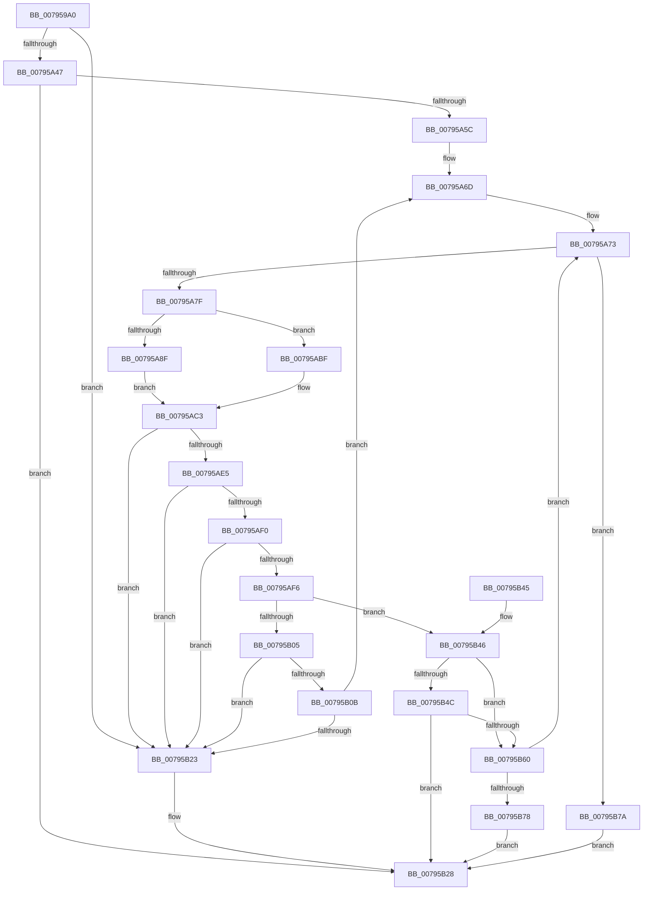

# RtlDecompressBuffer2Xp10

- RVA: `0x007959A0`–`0x00795BAE` (길이 `526` bytes)
- VA: `0x00000001407959A0`
- 실행 섹션: `PAGE`
- PDB 이름 있음: `예`; PDB Function 태그: `아니요`
- unwind 정보 RVA: `0x000D0328`
- 디코드: `148`개 명령, `526/526` bytes 표시
- 미해석 바이트: `0` (있으면 어셈블리에 `.byte`로 보존)

> 이 문서는 커널 이미지의 기계어와 PDB 기호를 분석해 생성했습니다. 4번과 5번은 함수 원형과 자료형을 바이너리 사용 방식에서 추정한 C 해석이며 원본 소스 복구 결과는 아닙니다.

## 1. Dependencies

- 직접 호출 지점: **7**; 고유 호출 대상: **6**
- 직접 호출자로 확인된 함수: **1**
- RIP 상대 이미지 참조: **0**

### Outgoing calls
- `0x00795A39` → [Xp10ScatteredReadBytes](Xp10ScatteredReadBytes_function_0079A220.md) (function, `0x0079A220`)
- `0x00795A4F` → [Xp10ValidateFrameHeaderAndFillParameters](Xp10ValidateFrameHeaderAndFillParameters_function_0079A324.md) (function, `0x0079A324`)
- `0x00795A9B` → [Xp10ScatteredReadBytes](Xp10ScatteredReadBytes_function_0079A220.md) (function, `0x0079A220`)
- `0x00795B16` → [Xp10ScatteredCopyBits](Xp10ScatteredCopyBits_function_00799F68.md) (function, `0x00799F68`)
- `0x00795B57` → [Xp10ReadMtfHeader](Xp10ReadMtfHeader_function_00799C40.md) (function, `0x00799C40`)
- `0x00795B6B` → [Xp10ExecuteHuffmanDecode](Xp10ExecuteHuffmanDecode_function_007979C8.md) (function, `0x007979C8`)
- `0x00795B86` → [Xp10ReadAndValidateCrc](Xp10ReadAndValidateCrc_function_00799B68.md) (function, `0x00799B68`)

### Direct callers
- [RtlDecompressBufferXp10](RtlDecompressBufferXp10_function_00795BC0.md) at `0x00795BFD`

### Static image references
- 디코드된 RIP-relative 메모리 참조가 없습니다.

## 2. Other-region calls and transfers

- 다른 실행 섹션으로 향하는 call: **0**
- 별도 외부 분기/꼬리 이동을 확인하지 못했습니다.

## 3. Assembly (complete function range)

```asm
007959A0  48 8B C4                        mov rax, rsp
007959A3  48 89 58 08                     mov qword ptr [rax + 8], rbx
007959A7  48 89 70 10                     mov qword ptr [rax + 0x10], rsi
007959AB  48 89 78 18                     mov qword ptr [rax + 0x18], rdi
007959AF  44 89 48 20                     mov dword ptr [rax + 0x20], r9d
007959B3  55                              push rbp
007959B4  41 55                           push r13
007959B6  41 56                           push r14
007959B8  48 8D 68 C1                     lea rbp, [rax - 0x3f]
007959BC  48 81 EC B0 00 00 00            sub rsp, 0xb0
007959C3  33 C0                           xor eax, eax
007959C5  4C 89 45 DF                     mov qword ptr [rbp - 0x21], r8
007959C9  21 45 BB                        and dword ptr [rbp - 0x45], eax
007959CC  48 8B D1                        mov rdx, rcx
007959CF  48 21 45 D7                     and qword ptr [rbp - 0x29], rax
007959D3  49 83 CD FF                     or r13, 0xffffffffffffffff
007959D7  48 21 45 CF                     and qword ptr [rbp - 0x31], rax
007959DB  48 21 45 AF                     and qword ptr [rbp - 0x51], rax
007959DF  21 45 B7                        and dword ptr [rbp - 0x49], eax
007959E2  48 21 45 0F                     and qword ptr [rbp + 0xf], rax
007959E6  48 21 45 07                     and qword ptr [rbp + 7], rax
007959EA  89 45 99                        mov dword ptr [rbp - 0x67], eax
007959ED  89 45 97                        mov dword ptr [rbp - 0x69], eax
007959F0  49 8B 08                        mov rcx, qword ptr [r8]
007959F3  48 89 4D BF                     mov qword ptr [rbp - 0x41], rcx
007959F7  49 03 48 08                     add rcx, qword ptr [r8 + 8]
007959FB  44 8D 40 06                     lea r8d, [rax + 6]
007959FF  48 89 4D C7                     mov qword ptr [rbp - 0x39], rcx
00795A03  48 8B 0A                        mov rcx, qword ptr [rdx]
00795A06  48 89 4D F7                     mov qword ptr [rbp - 9], rcx
00795A0A  48 03 4A 08                     add rcx, qword ptr [rdx + 8]
00795A0E  48 89 4D FF                     mov qword ptr [rbp - 1], rcx
00795A12  48 8D 4D BF                     lea rcx, [rbp - 0x41]
00795A16  48 89 55 17                     mov qword ptr [rbp + 0x17], rdx
00795A1A  48 8D 55 9F                     lea rdx, [rbp - 0x61]
00795A1E  89 45 9F                        mov dword ptr [rbp - 0x61], eax
00795A21  66 89 45 A3                     mov word ptr [rbp - 0x5d], ax
00795A25  48 C7 45 E7 01 00 00 00         mov qword ptr [rbp - 0x19], 1
00795A2D  4C 89 6D A7                     mov qword ptr [rbp - 0x59], r13
00795A31  48 C7 45 1F 01 00 00 00         mov qword ptr [rbp + 0x1f], 1
00795A39  E8 E2 47 00 00                  call 0x14079a220
00795A3E  83 F8 06                        cmp eax, 6
00795A41  0F 85 DC 00 00 00               jne 0x140795b23
00795A47  48 8D 55 97                     lea rdx, [rbp - 0x69]
00795A4B  48 8D 4D 9F                     lea rcx, [rbp - 0x61]
00795A4F  E8 D0 48 00 00                  call 0x14079a324
00795A54  85 C0                           test eax, eax
00795A56  0F 88 CC 00 00 00               js 0x140795b28
00795A5C  4C 8B 75 77                     mov r14, qword ptr [rbp + 0x77]
00795A60  48 8D 45 97                     lea rax, [rbp - 0x69]
00795A64  33 DB                           xor ebx, ebx
00795A66  49 89 06                        mov qword ptr [r14], rax
00795A69  49 8D 76 08                     lea rsi, [r14 + 8]
00795A6D  0F 57 C0                        xorps xmm0, xmm0
00795A70  0F 11 06                        movups xmmword ptr [rsi], xmm0
00795A73  4C 89 6D A7                     mov qword ptr [rbp - 0x59], r13
00795A77  85 DB                           test ebx, ebx
00795A79  0F 88 FB 00 00 00               js 0x140795b7a
00795A7F  83 65 5F 00                     and dword ptr [rbp + 0x5f], 0
00795A83  BA 20 00 00 00                  mov edx, 0x20
00795A88  8B 45 B7                        mov eax, dword ptr [rbp - 0x49]
00795A8B  3B C2                           cmp eax, edx
00795A8D  73 30                           jae 0x140795abf
00795A8F  44 8D 42 E4                     lea r8d, [rdx - 0x1c]
00795A93  48 8D 55 5F                     lea rdx, [rbp + 0x5f]
00795A97  48 8D 4D BF                     lea rcx, [rbp - 0x41]
00795A9B  E8 80 47 00 00                  call 0x14079a220
00795AA0  8B 4D B7                        mov ecx, dword ptr [rbp - 0x49]
00795AA3  8B 55 5F                        mov edx, dword ptr [rbp + 0x5f]
00795AA6  4C 8B 45 AF                     mov r8, qword ptr [rbp - 0x51]
00795AAA  48 D3 E2                        shl rdx, cl
00795AAD  4C 0B C2                        or r8, rdx
00795AB0  8D 04 C1                        lea eax, [rcx + rax*8]
00795AB3  BA 20 00 00 00                  mov edx, 0x20
00795AB8  3B C2                           cmp eax, edx
00795ABA  0F 42 D0                        cmovb edx, eax
00795ABD  EB 04                           jmp 0x140795ac3
00795ABF  4C 8B 45 AF                     mov r8, qword ptr [rbp - 0x51]
00795AC3  8B CA                           mov ecx, edx
00795AC5  2B C2                           sub eax, edx
00795AC7  BB 01 00 00 00                  mov ebx, 1
00795ACC  89 45 B7                        mov dword ptr [rbp - 0x49], eax
00795ACF  48 D3 E3                        shl rbx, cl
00795AD2  FF CB                           dec ebx
00795AD4  8B CA                           mov ecx, edx
00795AD6  41 23 D8                        and ebx, r8d
00795AD9  49 D3 E8                        shr r8, cl
00795ADC  4C 89 45 AF                     mov qword ptr [rbp - 0x51], r8
00795AE0  83 FA 20                        cmp edx, 0x20
00795AE3  75 3E                           jne 0x140795b23
00795AE5  8B C3                           mov eax, ebx
00795AE7  25 FF FF FF 0F                  and eax, 0xfffffff
00795AEC  3B C2                           cmp eax, edx
00795AEE  72 33                           jb 0x140795b23
00795AF0  0F BA E3 1C                     bt ebx, 0x1c
00795AF4  72 2D                           jb 0x140795b23
00795AF6  8D 78 E0                        lea edi, [rax - 0x20]
00795AF9  8B C7                           mov eax, edi
00795AFB  48 89 45 A7                     mov qword ptr [rbp - 0x59], rax
00795AFF  0F BA E3 1D                     bt ebx, 0x1d
00795B03  72 41                           jb 0x140795b46
00795B05  40 F6 C7 07                     test dil, 7
00795B09  75 18                           jne 0x140795b23
00795B0B  44 8B C7                        mov r8d, edi
00795B0E  48 8D 55 A7                     lea rdx, [rbp - 0x59]
00795B12  48 8D 4D F7                     lea rcx, [rbp - 9]
00795B16  E8 4D 44 00 00                  call 0x140799f68
00795B1B  3B C7                           cmp eax, edi
00795B1D  0F 84 4A FF FF FF               je 0x140795a6d
00795B23  B8 42 02 00 C0                  mov eax, 0xc0000242
00795B28  4C 8D 9C 24 B0 00 00 00         lea r11, [rsp + 0xb0]
00795B30  49 8B 5B 20                     mov rbx, qword ptr [r11 + 0x20]
00795B34  49 8B 73 28                     mov rsi, qword ptr [r11 + 0x28]
00795B38  49 8B 7B 30                     mov rdi, qword ptr [r11 + 0x30]
00795B3C  49 8B E3                        mov rsp, r11
00795B3F  41 5E                           pop r14
00795B41  41 5D                           pop r13
00795B43  5D                              pop rbp
00795B44  C3                              ret
00795B45  CC                              int3
00795B46  0F BA E3 1E                     bt ebx, 0x1e
00795B4A  73 14                           jae 0x140795b60
00795B4C  4C 8D 45 A7                     lea r8, [rbp - 0x59]
00795B50  48 8B D6                        mov rdx, rsi
00795B53  48 8D 4D 97                     lea rcx, [rbp - 0x69]
00795B57  E8 E4 40 00 00                  call 0x140799c40
00795B5C  85 C0                           test eax, eax
00795B5E  78 C8                           js 0x140795b28
00795B60  4C 8D 45 F7                     lea r8, [rbp - 9]
00795B64  49 8B CE                        mov rcx, r14
00795B67  48 8D 55 A7                     lea rdx, [rbp - 0x59]
00795B6B  E8 58 1E 00 00                  call 0x1407979c8
00795B70  85 C0                           test eax, eax
00795B72  0F 89 FB FE FF FF               jns 0x140795a73
00795B78  EB AE                           jmp 0x140795b28
00795B7A  4C 8D 45 A7                     lea r8, [rbp - 0x59]
00795B7E  48 8D 55 F7                     lea rdx, [rbp - 9]
00795B82  48 8D 4D 97                     lea rcx, [rbp - 0x69]
00795B86  E8 DD 3F 00 00                  call 0x140799b68
00795B8B  48 8B 4D 17                     mov rcx, qword ptr [rbp + 0x17]
00795B8F  48 8B 55 0F                     mov rdx, qword ptr [rbp + 0xf]
00795B93  4C 8B 45 07                     mov r8, qword ptr [rbp + 7]
00795B97  48 03 D2                        add rdx, rdx
00795B9A  4C 2B 04 D1                     sub r8, qword ptr [rcx + rdx*8]
00795B9E  48 8B 4D 6F                     mov rcx, qword ptr [rbp + 0x6f]
00795BA2  4C 03 45 F7                     add r8, qword ptr [rbp - 9]
00795BA6  4C 89 01                        mov qword ptr [rcx], r8
00795BA9  E9 7A FF FF FF                  jmp 0x140795b28
```

## 4. C-style interpretation (structured pseudocode)

```c
__int64 __fastcall RtlDecompressBuffer2Xp10(__int64 a1, __int64 a2, __int64 a3, int a4)
{
    __int64 result;
    __int64 v_r13;
    __int64 v_rbx;
    __int64 v_rsp;
    unsigned __int64 v_stack_m18;

    *(unsigned __int64 *)(v_rsp + 8) = v_rbx;
    *(unsigned __int64 *)(v_rsp + 16) = v_rsi;
    *(unsigned __int64 *)(v_rsp + 24) = v_rdi;
    *(unsigned int *)(v_rsp + 32) = a4;
    v_rsp = (v_rsp) - (176);
    result = 0;
    *(unsigned __int64 *)(v_rsp - 63 - 33) = a3;
    v_r13 = (v_r13) | (-1);
    *(unsigned int *)(v_rsp - 63 - 103) = 0;
    *(unsigned int *)(v_rsp - 63 - 105) = 0;
    *(unsigned __int64 *)(v_rsp - 63 - 65) = *(unsigned __int64 *)(a3);
    a1 = (*(unsigned __int64 *)(a3)) + (*(unsigned __int64 *)(a3 + 8));
    *(unsigned __int64 *)(v_rsp - 63 - 57) = a1;
    *(unsigned __int64 *)(v_rsp - 63 - 9) = *(unsigned __int64 *)(a1);
    a1 = (*(unsigned __int64 *)(a1)) + (*(unsigned __int64 *)(a1 + 8));
    *(unsigned __int64 *)(v_rsp - 63 - 1) = a1;
    *(unsigned __int64 *)(v_rsp - 63 + 23) = a1;
    *(unsigned int *)(v_rsp - 63 - 97) = 0;
    *(unsigned __int16 *)(v_rsp - 63 - 93) = 0;
    *(unsigned __int64 *)(v_rsp - 63 - 25) = 1;
    *(unsigned __int64 *)(v_rsp - 63 - 89) = v_r13;
    *(unsigned __int64 *)(v_rsp - 63 + 31) = 1;
    result = Xp10ScatteredReadBytes(v_rsp - 63 - 65, v_rsp - 63 - 97, result + 6, a4);
    if (((unsigned int)(result)) != 6) goto loc_00795B23;
    result = Xp10ValidateFrameHeaderAndFillParameters(v_rsp - 63 - 97, v_rsp - 63 - 105, result + 6, a4);
    if (sign_flag) goto loc_00795B28;
    v_rbx = 0;
    *(unsigned __int64 *)(*(unsigned __int64 *)(v_rsp - 63 + 119)) = v_rsp - 63 - 105;
loc_00795A6D:
    *(unsigned __int64 *)(*(unsigned __int64 *)(v_rsp - 63 + 119) + 8) = v_xmm0;
loc_00795A73:
    *(unsigned __int64 *)(v_rsp - 63 - 89) = v_r13;
    if (sign_flag) goto loc_00795B7A;
    if (((unsigned int)((unsigned int)(*(unsigned int *)(v_rsp - 63 - 73)))) >= 32) goto loc_00795ABF;
    result = Xp10ScatteredReadBytes(v_rsp - 63 - 65, v_rsp - 63 + 95, 32 - 28, a4);
    a2 = ((unsigned int)(*(unsigned int *)(v_rsp - 63 + 95))) << ((unsigned __int8)((unsigned int)(*(unsigned int *)(v_rsp - 63 - 73))));
    a3 = (*(unsigned __int64 *)(v_rsp - 63 - 81)) | (a2);
    a2 = 32;
    if (((unsigned int)((unsigned int)(*(unsigned int *)(v_rsp - 63 - 73)) + result * 8)) < 32) { a2 = (unsigned int)((unsigned int)(*(unsigned int *)(v_rsp - 63 - 73)) + result * 8); }
    goto loc_00795AC3;
loc_00795ABF:
loc_00795AC3:
    result = (unsigned int)(((unsigned int)(*(unsigned int *)(v_rsp - 63 - 73)) + result * 8) - ((unsigned int)(a2)));
    *(unsigned int *)(v_rsp - 63 - 73) = (unsigned int)(result);
    v_rbx = (1) << ((unsigned __int8)((unsigned int)((unsigned int)(a2))));
    v_rbx = (unsigned int)((v_rbx) - 1);
    v_rbx = (unsigned int)((v_rbx) & ((unsigned int)(*(unsigned __int64 *)(v_rsp - 63 - 81))));
    a3 = (*(unsigned __int64 *)(v_rsp - 63 - 81)) >> ((unsigned __int8)((unsigned int)((unsigned int)(a2))));
    *(unsigned __int64 *)(v_rsp - 63 - 81) = a3;
    if (((unsigned int)(a2)) != 32) goto loc_00795B23;
    result = (unsigned int)(((unsigned int)((unsigned int)(v_rbx))) & (0xFFFFFFFULL));
    if (((unsigned int)(result)) < ((unsigned int)(a2))) goto loc_00795B23;
    if (((unsigned int)(result)) < ((unsigned int)(a2))) goto loc_00795B23;
    *(unsigned __int64 *)(v_rsp - 63 - 89) = (unsigned int)((unsigned int)(result - 32));
    if (((unsigned int)(result)) < ((unsigned int)(a2))) goto loc_00795B46;
    if ((((unsigned __int8)(result - 32)) & (7)) != 0) goto loc_00795B23;
    result = Xp10ScatteredCopyBits(v_rsp - 63 - 9, v_rsp - 63 - 89, (unsigned int)((unsigned int)(result - 32)), a4);
    if (((unsigned int)(result)) == ((unsigned int)(result - 32))) goto loc_00795A6D;
loc_00795B23:
loc_00795B28:
    return (unsigned int)(0xC0000242ULL);
loc_00795B46:
    if (((unsigned int)(result)) >= ((unsigned int)(result - 32))) goto loc_00795B60;
    result = Xp10ReadMtfHeader(v_rsp - 63 - 105, *(unsigned __int64 *)(v_stack_m18 + 40), v_rsp - 63 - 89, a4);
    if (sign_flag) goto loc_00795B28;
loc_00795B60:
    result = Xp10ExecuteHuffmanDecode(*(unsigned __int64 *)(v_rsp - 63 + 119), v_rsp - 63 - 89, v_rsp - 63 - 9, a4);
    if (!sign_flag) goto loc_00795A73;
    goto loc_00795B28;
loc_00795B7A:
    result = Xp10ReadAndValidateCrc(v_rsp - 63 - 105, v_rsp - 63 - 9, v_rsp - 63 - 89, a4);
    a2 = (*(unsigned __int64 *)(v_rsp - 63 + 15)) + (*(unsigned __int64 *)(v_rsp - 63 + 15));
    a3 = (*(unsigned __int64 *)(v_rsp - 63 + 7)) - (*(unsigned __int64 *)(*(unsigned __int64 *)(v_rsp - 63 + 23) + a2 * 8));
    a3 = (a3) + (*(unsigned __int64 *)(v_rsp - 63 - 9));
    *(unsigned __int64 *)(*(unsigned __int64 *)(v_rsp - 63 + 111)) = a3;
    goto loc_00795B28;
}
```

## 5. (Beta) C Style

```c
int64_t RtlDecompressBuffer2Xp10(void *Arg1, int64_t Arg2, void *Arg3, int32_t Arg4)
{
    uint8_t *arg1 = (uint8_t *)Arg1;
    uint8_t *arg3 = (uint8_t *)Arg3;

    int64_t result;
    int64_t local_r13;
    int64_t local_rbx;
    int64_t local_rsp;
    uint64_t v_stack_m18;

    *(uint64_t *)(local_rsp + 0x8) = local_rbx;
    *(uint64_t *)(local_rsp + 0x10) = local_rsi;
    *(uint64_t *)(local_rsp + 0x18) = local_rdi;
    *(uint32_t *)(local_rsp + 0x20) = Arg4;
    local_rsp = (local_rsp) - (176);
    result = 0;
    *(void **)(local_rsp - 0x3F - 0x21) = Arg3;
    local_r13 = (local_r13) | (-1);
    *(uint32_t *)(local_rsp - 0x3F - 0x67) = 0;
    *(uint32_t *)(local_rsp - 0x3F - 0x69) = 0;
    *(uint64_t *)(local_rsp - 0x3F - 0x41) = *(uint64_t *)(arg3);
    Arg1 = (*(uint64_t *)(arg3)) + (*(uint64_t *)(arg3 + 0x8));
    *(void **)(local_rsp - 0x3F - 0x39) = Arg1;
    *(uint64_t *)(local_rsp - 0x3F - 0x9) = *(uint64_t *)(arg1);
    Arg1 = (*(uint64_t *)(arg1)) + (*(uint64_t *)(arg1 + 0x8));
    *(void **)(local_rsp - 0x3F - 0x1) = Arg1;
    *(void **)(local_rsp - 0x3F + 0x17) = Arg1;
    *(uint32_t *)(local_rsp - 0x3F - 0x61) = 0;
    *(uint16_t *)(local_rsp - 0x3F - 0x5D) = 0;
    *(uint64_t *)(local_rsp - 0x3F - 0x19) = 1;
    *(uint64_t *)(local_rsp - 0x3F - 0x59) = local_r13;
    *(uint64_t *)(local_rsp - 0x3F + 0x1F) = 1;
    result = Xp10ScatteredReadBytes(local_rsp - 63 - 65, local_rsp - 63 - 97, result + 6, Arg4);
    if (((uint32_t)(result)) != 6) goto loc_00795B23;
    result = Xp10ValidateFrameHeaderAndFillParameters(local_rsp - 63 - 97, local_rsp - 63 - 105, result + 6, Arg4);
    if (sign_flag) goto loc_00795B28;
    local_rbx = 0;
    *(uint64_t *)(*(uint64_t *)(local_rsp - 0x3F + 0x77)) = local_rsp - 63 - 105;
loc_00795A6D:
    *(uint64_t *)(*(uint64_t *)(local_rsp - 0x3F + 0x77) + 0x8) = v_xmm0;
loc_00795A73:
    *(uint64_t *)(local_rsp - 0x3F - 0x59) = local_r13;
    if (sign_flag) goto loc_00795B7A;
    if (((uint32_t)((uint32_t)(*(uint32_t *)(local_rsp - 0x3F - 0x49)))) >= 32) goto loc_00795ABF;
    result = Xp10ScatteredReadBytes(local_rsp - 63 - 65, local_rsp - 63 + 95, 32 - 28, Arg4);
    Arg2 = ((uint32_t)(*(uint32_t *)(local_rsp - 0x3F + 0x5F))) << ((uint8_t)((uint32_t)(*(uint32_t *)(local_rsp - 0x3F - 0x49))));
    Arg3 = (*(uint64_t *)(local_rsp - 0x3F - 0x51)) | (Arg2);
    Arg2 = 32;
    if (((uint32_t)((uint32_t)(*(uint32_t *)(local_rsp - 0x3F - 0x49)) + result * 8)) < 32) { Arg2 = (uint32_t)((uint32_t)(*(uint32_t *)(local_rsp - 0x3F - 0x49)) + result * 8); }
    goto loc_00795AC3;
loc_00795ABF:
loc_00795AC3:
    result = (uint32_t)(((uint32_t)(*(uint32_t *)(local_rsp - 0x3F - 0x49)) + result * 8) - ((uint32_t)(Arg2)));
    *(uint32_t *)(local_rsp - 0x3F - 0x49) = (uint32_t)(result);
    local_rbx = (1) << ((uint8_t)((uint32_t)((uint32_t)(Arg2))));
    local_rbx = (uint32_t)((local_rbx) - 1);
    local_rbx = (uint32_t)((local_rbx) & ((uint32_t)(*(uint64_t *)(local_rsp - 0x3F - 0x51))));
    Arg3 = (*(uint64_t *)(local_rsp - 0x3F - 0x51)) >> ((uint8_t)((uint32_t)((uint32_t)(Arg2))));
    *(void **)(local_rsp - 0x3F - 0x51) = Arg3;
    if (((uint32_t)(Arg2)) != 32) goto loc_00795B23;
    result = (uint32_t)(((uint32_t)((uint32_t)(local_rbx))) & (0xFFFFFFFULL));
    if (((uint32_t)(result)) < ((uint32_t)(Arg2))) goto loc_00795B23;
    if (((uint32_t)(result)) < ((uint32_t)(Arg2))) goto loc_00795B23;
    *(uint64_t *)(local_rsp - 0x3F - 0x59) = (uint32_t)((uint32_t)(result - 32));
    if (((uint32_t)(result)) < ((uint32_t)(Arg2))) goto loc_00795B46;
    if ((((uint8_t)(result - 32)) & (7)) != 0) goto loc_00795B23;
    result = Xp10ScatteredCopyBits(local_rsp - 63 - 9, local_rsp - 63 - 89, (uint32_t)((uint32_t)(result - 32)), Arg4);
    if (((uint32_t)(result)) == ((uint32_t)(result - 32))) goto loc_00795A6D;
loc_00795B23:
loc_00795B28:
    return (uint32_t)(0xC0000242ULL);
loc_00795B46:
    if (((uint32_t)(result)) >= ((uint32_t)(result - 32))) goto loc_00795B60;
    result = Xp10ReadMtfHeader(local_rsp - 63 - 105, *(uint64_t *)(v_stack_m18 + 0x28), local_rsp - 63 - 89, Arg4);
    if (sign_flag) goto loc_00795B28;
loc_00795B60:
    result = Xp10ExecuteHuffmanDecode(*(uint64_t *)(local_rsp - 0x3F + 0x77), local_rsp - 63 - 89, local_rsp - 63 - 9, Arg4);
    if (!sign_flag) goto loc_00795A73;
    goto loc_00795B28;
loc_00795B7A:
    result = Xp10ReadAndValidateCrc(local_rsp - 63 - 105, local_rsp - 63 - 9, local_rsp - 63 - 89, Arg4);
    Arg2 = (*(uint64_t *)(local_rsp - 0x3F + 0xF)) + (*(uint64_t *)(local_rsp - 0x3F + 0xF));
    Arg3 = (*(uint64_t *)(local_rsp - 0x3F + 0x7)) - (*(uint64_t *)(*(uint64_t *)(local_rsp - 0x3F + 0x17) + Arg2 * 8));
    Arg3 = (Arg3) + (*(uint64_t *)(local_rsp - 0x3F - 0x9));
    *(void **)(*(uint64_t *)(local_rsp - 0x3F + 0x6F)) = Arg3;
    goto loc_00795B28;
}
```

### 관측된 메모리 오프셋

구조체 형식이 확인되지 않은 접근은 인자 기준의 오프셋으로만 기록했습니다.

| 기준 인자 | 오프셋 표현 | 폭 (bit) | 접근 |
|---|---:|---:|---|
| `Arg1` | `+ 0x0` | `64` | `R` |
| `Arg1` | `+ 0x8` | `64` | `R` |
| `Arg3` | `+ 0x0` | `64` | `R` |
| `Arg3` | `+ 0x8` | `64` | `R` |

## 6. Execution-region graph

[열기: 2D/3D 그래프와 함수 탐색 컨트롤 패널](../../../control-panel.html?section=page&rva=0x007959A0&view=graph)

- 2D 그래프는 위에서 아래로 흐르고, 3D 그래프는 빈 공간을 드래그해 회전합니다. Shift+드래그는 이동, 휠은 확대·축소, 함수 노드 선택은 대상 보고서 이동입니다.

### Static fallback


