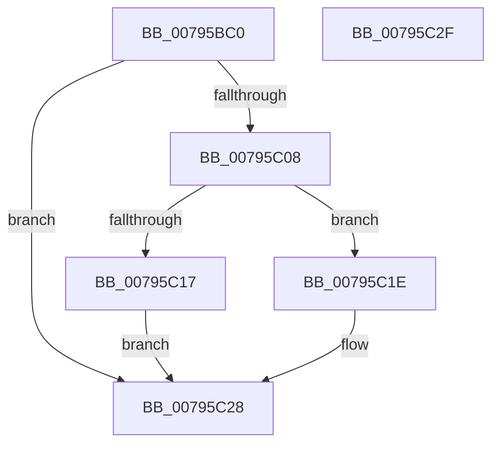

# RtlDecompressBufferXp10

- RVA: `0x00795BC0`–`0x00795C30` (길이 `112` bytes)
- VA: `0x0000000140795BC0`
- 실행 섹션: `PAGE`
- PDB 이름 있음: `예`; PDB Function 태그: `아니요`
- unwind 정보 RVA: `0x0007A034`
- 디코드: `31`개 명령, `112/112` bytes 표시
- 미해석 바이트: `0` (있으면 어셈블리에 `.byte`로 보존)

> 이 문서는 커널 이미지의 기계어와 PDB 기호를 분석해 생성했습니다. 4번과 5번은 함수 원형과 자료형을 바이너리 사용 방식에서 추정한 C 해석이며 원본 소스 복구 결과는 아닙니다.

## 1. Dependencies

- 직접 호출 지점: **1**; 고유 호출 대상: **1**
- 직접 호출자로 확인된 함수: **0**
- RIP 상대 이미지 참조: **0**

### Outgoing calls
- `0x00795BFD` → [RtlDecompressBuffer2Xp10](RtlDecompressBuffer2Xp10_function_007959A0.md) (function, `0x007959A0`)

### Direct callers
- 이 함수 시작 RVA로 연결되는 직접 call은 확인되지 않았습니다. 간접 호출은 완전히 역산할 수 없습니다.

### Static image references
- 디코드된 RIP-relative 메모리 참조가 없습니다.

## 2. Other-region calls and transfers

- 다른 실행 섹션으로 향하는 call: **0**
- 별도 외부 분기/꼬리 이동을 확인하지 못했습니다.

## 3. Assembly (complete function range)

```asm
00795BC0  4C 8B DC                        mov r11, rsp
00795BC3  48 83 EC 68                     sub rsp, 0x68
00795BC7  49 83 63 08 00                  and qword ptr [r11 + 8], 0
00795BCC  41 8B C1                        mov eax, r9d
00795BCF  49 89 43 E0                     mov qword ptr [r11 - 0x20], rax
00795BD3  8B C2                           mov eax, edx
00795BD5  49 89 43 F0                     mov qword ptr [r11 - 0x10], rax
00795BD9  48 8B 84 24 A0 00 00 00         mov rax, qword ptr [rsp + 0xa0]
00795BE1  49 89 43 C8                     mov qword ptr [r11 - 0x38], rax
00795BE5  49 8D 43 08                     lea rax, [r11 + 8]
00795BE9  4D 89 43 D8                     mov qword ptr [r11 - 0x28], r8
00795BED  4D 8D 43 D8                     lea r8, [r11 - 0x28]
00795BF1  49 89 4B E8                     mov qword ptr [r11 - 0x18], rcx
00795BF5  49 8D 4B E8                     lea rcx, [r11 - 0x18]
00795BF9  49 89 43 C0                     mov qword ptr [r11 - 0x40], rax
00795BFD  E8 9E FD FF FF                  call 0x1407959a0
00795C02  8B D0                           mov edx, eax
00795C04  85 C0                           test eax, eax
00795C06  78 20                           js 0x140795c28
00795C08  48 8B 4C 24 70                  mov rcx, qword ptr [rsp + 0x70]
00795C0D  B8 FF FF FF FF                  mov eax, 0xffffffff
00795C12  48 3B C8                        cmp rcx, rax
00795C15  76 07                           jbe 0x140795c1e
00795C17  BA 42 02 00 C0                  mov edx, 0xc0000242
00795C1C  EB 0A                           jmp 0x140795c28
00795C1E  48 8B 84 24 98 00 00 00         mov rax, qword ptr [rsp + 0x98]
00795C26  89 08                           mov dword ptr [rax], ecx
00795C28  8B C2                           mov eax, edx
00795C2A  48 83 C4 68                     add rsp, 0x68
00795C2E  C3                              ret
00795C2F  CC                              int3
```

## 4. C-style interpretation (structured pseudocode)

```c
__int64 __fastcall RtlDecompressBufferXp10(__int64 a1, int a2, __int64 a3, int a4, __int64 a5, __int64 a6, __int64 a7)
{
    __int64 result;
    __int64 v_rsp;
    unsigned __int64 v_stack_p8;

    v_rsp = (v_rsp) - (104);
    *(unsigned __int64 *)(v_rsp - 32) = (unsigned int)(a4);
    *(unsigned __int64 *)(v_rsp - 16) = (unsigned int)(a2);
    *(unsigned __int64 *)(v_rsp - 56) = a7;
    *(unsigned __int64 *)(v_rsp - 40) = a3;
    *(unsigned __int64 *)(v_rsp - 24) = a1;
    *(unsigned __int64 *)(v_rsp - 64) = v_rsp + 8;
    result = RtlDecompressBuffer2Xp10(v_rsp - 24, a2, v_rsp - 40, a4);
    if (sign_flag) goto loc_00795C28;
    if (v_stack_p8 <= ((unsigned int)(0xFFFFFFFFULL))) goto loc_00795C1E;
    goto loc_00795C28;
loc_00795C1E:
    *(unsigned int *)(a6) = (unsigned int)(v_stack_p8);
loc_00795C28:
    v_rsp = (v_rsp) + (104);
    return (unsigned int)((unsigned int)((unsigned int)(0xC0000242ULL)));
}
```

## 5. (Beta) C Style

```c
int64_t RtlDecompressBufferXp10(int64_t Arg1, int32_t Arg2, int64_t Arg3, int32_t Arg4, uint64_t Arg5, void *Arg6, int64_t Arg7)
{
    uint8_t *arg6 = (uint8_t *)Arg6;

    int64_t result;
    int64_t local_rsp;
    uint64_t v_stack_p8;

    local_rsp = (local_rsp) - (104);
    *(uint64_t *)(local_rsp - 0x20) = (uint32_t)(Arg4);
    *(uint64_t *)(local_rsp - 0x10) = (uint32_t)(Arg2);
    *(uint64_t *)(local_rsp - 0x38) = Arg7;
    *(uint64_t *)(local_rsp - 0x28) = Arg3;
    *(uint64_t *)(local_rsp - 0x18) = Arg1;
    *(uint64_t *)(local_rsp - 0x40) = local_rsp + 8;
    result = RtlDecompressBuffer2Xp10(local_rsp - 24, Arg2, local_rsp - 40, Arg4);
    if (sign_flag) goto loc_00795C28;
    if (v_stack_p8 <= ((uint32_t)(0xFFFFFFFFULL))) goto loc_00795C1E;
    goto loc_00795C28;
loc_00795C1E:
    *(uint32_t *)(arg6) = (uint32_t)(v_stack_p8);
loc_00795C28:
    local_rsp = (local_rsp) + (104);
    return (uint32_t)((uint32_t)((uint32_t)(0xC0000242ULL)));
}
```

### 관측된 메모리 오프셋

구조체 형식이 확인되지 않은 접근은 인자 기준의 오프셋으로만 기록했습니다.

| 기준 인자 | 오프셋 표현 | 폭 (bit) | 접근 |
|---|---:|---:|---|
| `Arg6` | `+ 0x0` | `32` | `W` |

## 6. Execution-region graph

[열기: 2D/3D 그래프와 함수 탐색 컨트롤 패널](../../../control-panel.html?section=page&rva=0x00795BC0&view=graph)

- 2D 그래프는 위에서 아래로 흐르고, 3D 그래프는 빈 공간을 드래그해 회전합니다. Shift+드래그는 이동, 휠은 확대·축소, 함수 노드 선택은 대상 보고서 이동입니다.

### Static fallback


