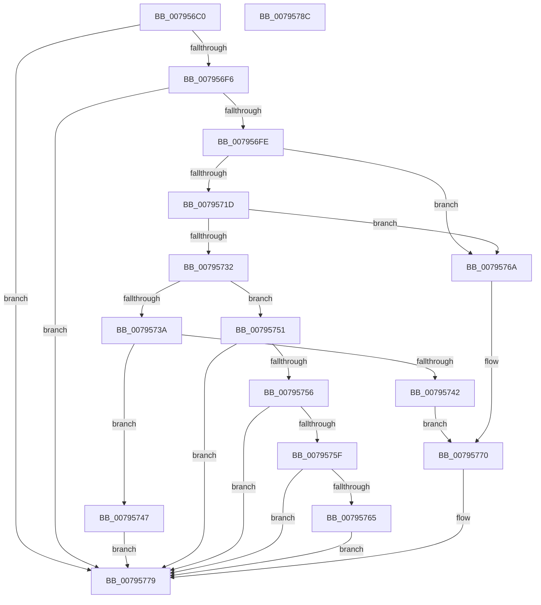

# RtlDescribeChunkLZNT1

- RVA: `0x007956C0`–`0x0079578D` (길이 `205` bytes)
- VA: `0x00000001407956C0`
- 실행 섹션: `PAGE`
- PDB 이름 있음: `예`; PDB Function 태그: `아니요`
- unwind 정보 RVA: `0x00069588`
- 디코드: `62`개 명령, `205/205` bytes 표시
- 미해석 바이트: `0` (있으면 어셈블리에 `.byte`로 보존)

> 이 문서는 커널 이미지의 기계어와 PDB 기호를 분석해 생성했습니다. 4번과 5번은 함수 원형과 자료형을 바이너리 사용 방식에서 추정한 C 해석이며 원본 소스 복구 결과는 아닙니다.

## 1. Dependencies

- 직접 호출 지점: **0**; 고유 호출 대상: **0**
- 직접 호출자로 확인된 함수: **1**
- RIP 상대 이미지 참조: **0**

### Outgoing calls
- 직접 디코드된 call 명령이 없습니다.

### Direct callers
- [RtlReserveChunkLZNT1](RtlReserveChunkLZNT1_function_007957A0.md) at `0x007957DF`
- [RtlReserveChunkLZNT1](RtlReserveChunkLZNT1_function_007957A0.md) at `0x00795804`

### Static image references
- 디코드된 RIP-relative 메모리 참조가 없습니다.

## 2. Other-region calls and transfers

- 다른 실행 섹션으로 향하는 call: **0**
- 별도 외부 분기/꼬리 이동을 확인하지 못했습니다.

## 3. Assembly (complete function range)

```asm
007956C0  48 89 5C 24 08                  mov qword ptr [rsp + 8], rbx
007956C5  48 89 74 24 10                  mov qword ptr [rsp + 0x10], rsi
007956CA  48 89 7C 24 18                  mov qword ptr [rsp + 0x18], rdi
007956CF  48 8B 01                        mov rax, qword ptr [rcx]
007956D2  33 F6                           xor esi, esi
007956D4  49 89 00                        mov qword ptr [r8], rax
007956D7  48 8B D9                        mov rbx, rcx
007956DA  41 89 31                        mov dword ptr [r9], esi
007956DD  48 8D 42 FC                     lea rax, [rdx - 4]
007956E1  48 8B 09                        mov rcx, qword ptr [rcx]
007956E4  4D 8B D8                        mov r11, r8
007956E7  41 BA 1A 00 00 80               mov r10d, 0x8000001a
007956ED  48 3B C8                        cmp rcx, rax
007956F0  0F 87 83 00 00 00               ja 0x140795779
007956F6  0F B7 01                        movzx eax, word ptr [rcx]
007956F9  66 85 C0                        test ax, ax
007956FC  74 7B                           je 0x140795779
007956FE  8B C8                           mov ecx, eax
00795700  44 8B D6                        mov r10d, esi
00795703  81 E1 FF 0F 00 00               and ecx, 0xfff
00795709  83 C1 03                        add ecx, 3
0079570C  41 89 09                        mov dword ptr [r9], ecx
0079570F  44 8B C1                        mov r8d, ecx
00795712  4C 03 03                        add r8, qword ptr [rbx]
00795715  4C 89 03                        mov qword ptr [rbx], r8
00795718  4C 3B C2                        cmp r8, rdx
0079571B  77 4D                           ja 0x14079576a
0079571D  BA 00 70 00 00                  mov edx, 0x7000
00795722  0F B7 C8                        movzx ecx, ax
00795725  66 23 CA                        and cx, dx
00795728  BA 00 30 00 00                  mov edx, 0x3000
0079572D  66 3B CA                        cmp cx, dx
00795730  75 38                           jne 0x14079576a
00795732  41 8B 09                        mov ecx, dword ptr [r9]
00795735  66 85 C0                        test ax, ax
00795738  78 17                           js 0x140795751
0079573A  81 F9 02 10 00 00               cmp ecx, 0x1002
00795740  74 05                           je 0x140795747
00795742  4C 2B C1                        sub r8, rcx
00795745  EB 29                           jmp 0x140795770
00795747  49 83 03 02                     add qword ptr [r11], 2
0079574B  41 83 01 FE                     add dword ptr [r9], -2
0079574F  EB 28                           jmp 0x140795779
00795751  83 F9 06                        cmp ecx, 6
00795754  75 23                           jne 0x140795779
00795756  49 8B 03                        mov rax, qword ptr [r11]
00795759  80 78 02 02                     cmp byte ptr [rax + 2], 2
0079575D  75 1A                           jne 0x140795779
0079575F  40 38 70 03                     cmp byte ptr [rax + 3], sil
00795763  75 14                           jne 0x140795779
00795765  41 89 31                        mov dword ptr [r9], esi
00795768  EB 0F                           jmp 0x140795779
0079576A  41 8B 01                        mov eax, dword ptr [r9]
0079576D  4C 2B C0                        sub r8, rax
00795770  41 BA 42 02 00 C0               mov r10d, 0xc0000242
00795776  4C 89 03                        mov qword ptr [rbx], r8
00795779  48 8B 5C 24 08                  mov rbx, qword ptr [rsp + 8]
0079577E  41 8B C2                        mov eax, r10d
00795781  48 8B 74 24 10                  mov rsi, qword ptr [rsp + 0x10]
00795786  48 8B 7C 24 18                  mov rdi, qword ptr [rsp + 0x18]
0079578B  C3                              ret
0079578C  CC                              int3
```

## 4. C-style interpretation (structured pseudocode)

```c
__int64 __fastcall RtlDescribeChunkLZNT1(__int64 a1, __int64 a2, __int64 a3, __int64 a4)
{
    __int64 v_rsi;
    unsigned __int64 v_stack_p10;
    unsigned __int64 v_stack_p18;
    unsigned __int64 v_stack_p8;

    v_stack_p8 = v_rbx;
    v_stack_p10 = v_rsi;
    v_stack_p18 = v_rdi;
    v_rsi = 0;
    *(unsigned __int64 *)(a3) = *(unsigned __int64 *)(a1);
    *(unsigned int *)(a4) = 0;
    if ((*(unsigned __int64 *)(a1)) > (a2 - 4)) goto loc_00795779;
    if ((unsigned __int16)(*(unsigned __int16 *)(*(unsigned __int64 *)(a1))) == 0) goto loc_00795779;
    a1 = (unsigned int)(((unsigned int)((unsigned int)(*(unsigned __int16 *)(*(unsigned __int64 *)(a1))))) & (0xFFFULL));
    a1 = (unsigned int)((a1) + (3));
    *(unsigned int *)(a4) = (unsigned int)(a1);
    a3 = ((unsigned int)((unsigned int)(a1))) + (*(unsigned __int64 *)(a1));
    *(unsigned __int64 *)(a1) = a3;
    if (a3 > a2) goto loc_0079576A;
    a1 = (unsigned __int16)(((unsigned __int16)(*(unsigned __int16 *)(*(unsigned __int64 *)(a1)))) & ((unsigned __int16)((unsigned int)(0x7000ULL))));
    if (((unsigned __int16)(a1)) != ((unsigned __int16)((unsigned int)(0x3000ULL)))) goto loc_0079576A;
    if (sign_flag) goto loc_00795751;
    if (((unsigned int)((unsigned int)(*(unsigned int *)(a4)))) == 0x1002ULL) goto loc_00795747;
    a3 = (a3) - ((unsigned int)(*(unsigned int *)(a4)));
    goto loc_00795770;
loc_00795747:
    goto loc_00795779;
loc_00795751:
    if (((unsigned int)((unsigned int)(*(unsigned int *)(a4)))) != 6) goto loc_00795779;
    if ((*(unsigned __int8 *)(*(unsigned __int64 *)(a3) + 2)) != 2) goto loc_00795779;
    if ((*(unsigned __int8 *)(*(unsigned __int64 *)(a3) + 3)) != 0) goto loc_00795779;
    *(unsigned int *)(a4) = 0;
    goto loc_00795779;
loc_0079576A:
    a3 = (a3) - ((unsigned int)(*(unsigned int *)(a4)));
loc_00795770:
    *(unsigned __int64 *)(a1) = a3;
loc_00795779:
    return (unsigned int)((unsigned int)((unsigned int)(0xC0000242ULL)));
}
```

## 5. (Beta) C Style

```c
int64_t RtlDescribeChunkLZNT1(void *Arg1, void *Arg2, void *Arg3, void *Arg4)
{
    uint8_t *arg1 = (uint8_t *)Arg1;
    uint8_t *arg2 = (uint8_t *)Arg2;
    uint8_t *arg3 = (uint8_t *)Arg3;
    uint8_t *arg4 = (uint8_t *)Arg4;

    int64_t local_rsi;
    uint64_t v_stack_p10;
    uint64_t v_stack_p18;
    uint64_t v_stack_p8;

    v_stack_p8 = local_rbx;
    v_stack_p10 = local_rsi;
    v_stack_p18 = local_rdi;
    local_rsi = 0;
    *(uint64_t *)(arg3) = *(uint64_t *)(arg1);
    *(uint32_t *)(arg4) = 0;
    if ((*(uint64_t *)(arg1)) > (Arg2 - 4)) goto loc_00795779;
    if ((uint16_t)(*(uint16_t *)(*(uint64_t *)(arg1))) == 0) goto loc_00795779;
    Arg1 = (uint32_t)(((uint32_t)((uint32_t)(*(uint16_t *)(*(uint64_t *)(arg1))))) & (0xFFFULL));
    Arg1 = (uint32_t)((Arg1) + (3));
    *(uint32_t *)(arg4) = (uint32_t)(Arg1);
    Arg3 = ((uint32_t)((uint32_t)(Arg1))) + (*(uint64_t *)(arg1));
    *(void **)(arg1) = Arg3;
    if (Arg3 > Arg2) goto loc_0079576A;
    Arg1 = (uint16_t)(((uint16_t)(*(uint16_t *)(*(uint64_t *)(arg1)))) & ((uint16_t)((uint32_t)(0x7000ULL))));
    if (((uint16_t)(Arg1)) != ((uint16_t)((uint32_t)(0x3000ULL)))) goto loc_0079576A;
    if (sign_flag) goto loc_00795751;
    if (((uint32_t)((uint32_t)(*(uint32_t *)(arg4)))) == 0x1002ULL) goto loc_00795747;
    Arg3 = (Arg3) - ((uint32_t)(*(uint32_t *)(arg4)));
    goto loc_00795770;
loc_00795747:
    goto loc_00795779;
loc_00795751:
    if (((uint32_t)((uint32_t)(*(uint32_t *)(arg4)))) != 6) goto loc_00795779;
    if ((*(uint8_t *)(*(uint64_t *)(arg3) + 0x2)) != 2) goto loc_00795779;
    if ((*(uint8_t *)(*(uint64_t *)(arg3) + 0x3)) != 0) goto loc_00795779;
    *(uint32_t *)(arg4) = 0;
    goto loc_00795779;
loc_0079576A:
    Arg3 = (Arg3) - ((uint32_t)(*(uint32_t *)(arg4)));
loc_00795770:
    *(void **)(arg1) = Arg3;
loc_00795779:
    return (uint32_t)((uint32_t)((uint32_t)(0xC0000242ULL)));
}
```

### 관측된 메모리 오프셋

구조체 형식이 확인되지 않은 접근은 인자 기준의 오프셋으로만 기록했습니다.

| 기준 인자 | 오프셋 표현 | 폭 (bit) | 접근 |
|---|---:|---:|---|
| `Arg1` | `+ 0x0` | `64` | `R` |
| `Arg1` | `+ 0x0` | `64` | `W` |
| `Arg2` | `- 0x4` | `64` | `R` |
| `Arg3` | `+ 0x0` | `64` | `R` |
| `Arg3` | `+ 0x0` | `64` | `R/W` |
| `Arg3` | `+ 0x0` | `64` | `W` |
| `Arg4` | `+ 0x0` | `32` | `R` |
| `Arg4` | `+ 0x0` | `32` | `R/W` |
| `Arg4` | `+ 0x0` | `32` | `W` |

## 6. Execution-region graph

[열기: 2D/3D 그래프와 함수 탐색 컨트롤 패널](../../../control-panel.html?section=page&rva=0x007956C0&view=graph)

- 2D 그래프는 위에서 아래로 흐르고, 3D 그래프는 빈 공간을 드래그해 회전합니다. Shift+드래그는 이동, 휠은 확대·축소, 함수 노드 선택은 대상 보고서 이동입니다.

### Static fallback


