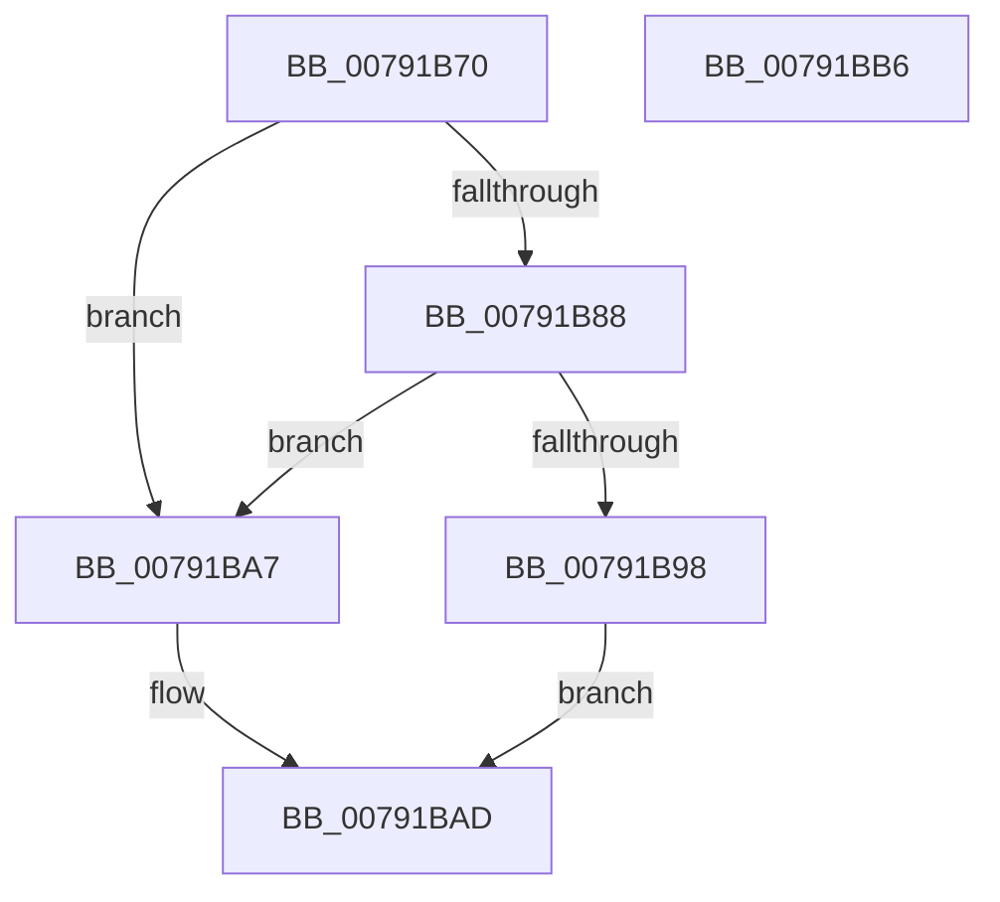

# RtlExtendCorrelationVector

- RVA: `0x00791B70`–`0x00791BB7` (길이 `71` bytes)
- VA: `0x0000000140791B70`
- 실행 섹션: `PAGE`
- PDB 이름 있음: `예`; PDB Function 태그: `아니요`
- unwind 정보 RVA: `0x0005CF00`
- 디코드: `22`개 명령, `71/71` bytes 표시
- 미해석 바이트: `0` (있으면 어셈블리에 `.byte`로 보존)

> 이 문서는 커널 이미지의 기계어와 PDB 기호를 분석해 생성했습니다. 4번과 5번은 함수 원형과 자료형을 바이너리 사용 방식에서 추정한 C 해석이며 원본 소스 복구 결과는 아닙니다.

## 1. Dependencies

- 직접 호출 지점: **2**; 고유 호출 대상: **2**
- 직접 호출자로 확인된 함수: **0**
- RIP 상대 이미지 참조: **0**

### Outgoing calls
- `0x00791B7C` → [RtlpGetCorrelationVectorEndPosition](../../text/5E/RtlpGetCorrelationVectorEndPosition_function_005EC52C.md) (function, `0x005EC52C`)
- `0x00791B8B` → [RtlpGetCorrelationVectorBufferLength](../AB/RtlpGetCorrelationVectorBufferLength_function_00AB9518.md) (function, `0x00AB9518`)

### Direct callers
- 이 함수 시작 RVA로 연결되는 직접 call은 확인되지 않았습니다. 간접 호출은 완전히 역산할 수 없습니다.

### Static image references
- 디코드된 RIP-relative 메모리 참조가 없습니다.

## 2. Other-region calls and transfers

- 다른 실행 섹션으로 향하는 call: **1**
  - `0x00791B7C` → [RtlpGetCorrelationVectorEndPosition](../../text/5E/RtlpGetCorrelationVectorEndPosition_function_005EC52C.md) (`PAGE` → `.text`)
- 별도 외부 분기/꼬리 이동을 확인하지 못했습니다.

## 3. Assembly (complete function range)

```asm
00791B70  40 53                           push rbx
00791B72  48 83 EC 20                     sub rsp, 0x20
00791B76  48 8B D9                        mov rbx, rcx
00791B79  45 33 DB                        xor r11d, r11d
00791B7C  E8 AB A9 E5 FF                  call 0x1405ec52c
00791B81  4C 63 C0                        movsxd r8, eax
00791B84  85 C0                           test eax, eax
00791B86  78 1F                           js 0x140791ba7
00791B88  48 8B CB                        mov rcx, rbx
00791B8B  E8 88 79 32 00                  call 0x140ab9518
00791B90  83 E8 03                        sub eax, 3
00791B93  44 3B C0                        cmp r8d, eax
00791B96  7D 0F                           jge 0x140791ba7
00791B98  66 41 C7 44 18 01 2E 30         mov word ptr [r8 + rbx + 1], 0x302e
00791BA0  45 88 5C 18 03                  mov byte ptr [r8 + rbx + 3], r11b
00791BA5  EB 06                           jmp 0x140791bad
00791BA7  41 BB 05 00 00 80               mov r11d, 0x80000005
00791BAD  41 8B C3                        mov eax, r11d
00791BB0  48 83 C4 20                     add rsp, 0x20
00791BB4  5B                              pop rbx
00791BB5  C3                              ret
00791BB6  CC                              int3
```

## 4. C-style interpretation (structured pseudocode)

```c
__int64 __fastcall RtlExtendCorrelationVector(__int64 a1)
{
    __int64 result;
    __int64 v_r11;
    __int64 v_rsp;

    v_rsp = (v_rsp) - (32);
    v_r11 = 0;
    result = RtlpGetCorrelationVectorEndPosition(a1, a2, a3, a4);
    if (sign_flag) goto loc_00791BA7;
    result = RtlpGetCorrelationVectorBufferLength(a1, a2, (int)((unsigned int)(result)), a4);
    result = (unsigned int)((result) - (3));
    if (((unsigned int)((int)((unsigned int)(result)))) >= ((unsigned int)(result))) goto loc_00791BA7;
    *(unsigned __int16 *)((int)((unsigned int)(result)) + a1 * 1 + 1) = 0x302EULL;
    *(unsigned __int8 *)((int)((unsigned int)(result)) + a1 * 1 + 3) = 0;
    goto loc_00791BAD;
loc_00791BA7:
loc_00791BAD:
    v_rsp = (v_rsp) + (32);
    return (unsigned int)((unsigned int)((unsigned int)(0x80000005ULL)));
}
```

## 5. (Beta) C Style

```c
int64_t RtlExtendCorrelationVector(int64_t Arg1)
{
    int64_t result;
    int64_t local_r11;
    int64_t local_rsp;

    local_rsp = (local_rsp) - (32);
    local_r11 = 0;
    result = RtlpGetCorrelationVectorEndPosition(Arg1, a2, a3, a4);
    if (sign_flag) goto loc_00791BA7;
    result = RtlpGetCorrelationVectorBufferLength(Arg1, a2, (int32_t)((uint32_t)(result)), a4);
    result = (uint32_t)((result) - (3));
    if (((uint32_t)((int32_t)((uint32_t)(result)))) >= ((uint32_t)(result))) goto loc_00791BA7;
    *(uint16_t *)((int32_t)((uint32_t)(result)) + Arg1 * 1 + 0x1) = 0x302EULL;
    *(uint8_t *)((int32_t)((uint32_t)(result)) + Arg1 * 1 + 0x3) = 0;
    goto loc_00791BAD;
loc_00791BA7:
loc_00791BAD:
    local_rsp = (local_rsp) + (32);
    return (uint32_t)((uint32_t)((uint32_t)(0x80000005ULL)));
}
```

## 6. Execution-region graph

[열기: 2D/3D 그래프와 함수 탐색 컨트롤 패널](../../../control-panel.html?section=page&rva=0x00791B70&view=graph)

- 2D 그래프는 위에서 아래로 흐르고, 3D 그래프는 빈 공간을 드래그해 회전합니다. Shift+드래그는 이동, 휠은 확대·축소, 함수 노드 선택은 대상 보고서 이동입니다.

### Static fallback


