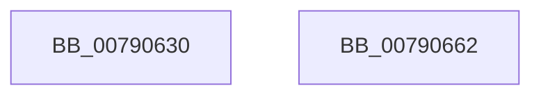

# RtlGetSystemBootStatus

- RVA: `0x00790630`–`0x00790663` (길이 `51` bytes)
- VA: `0x0000000140790630`
- 실행 섹션: `PAGE`
- PDB 이름 있음: `예`; PDB Function 태그: `아니요`
- unwind 정보 RVA: `0x00063458`
- 디코드: `14`개 명령, `51/51` bytes 표시
- 미해석 바이트: `0` (있으면 어셈블리에 `.byte`로 보존)

> 이 문서는 커널 이미지의 기계어와 PDB 기호를 분석해 생성했습니다. 4번과 5번은 함수 원형과 자료형을 바이너리 사용 방식에서 추정한 C 해석이며 원본 소스 복구 결과는 아닙니다.

## 1. Dependencies

- 직접 호출 지점: **1**; 고유 호출 대상: **1**
- 직접 호출자로 확인된 함수: **1**
- RIP 상대 이미지 참조: **0**

### Outgoing calls
- `0x00790658` → [RtlpSystemBootStatusRequest](../A8/RtlpSystemBootStatusRequest_function_00A8B384.md) (function, `0x00A8B384`)

### Direct callers
- [PopCheckAndClearBootError](../../init/C3/PopCheckAndClearBootError_function_00C3DA4C.md) at `0x00C3DA7C`

### Static image references
- 디코드된 RIP-relative 메모리 참조가 없습니다.

## 2. Other-region calls and transfers

- 다른 실행 섹션으로 향하는 call: **0**
- 별도 외부 분기/꼬리 이동을 확인하지 못했습니다.

## 3. Assembly (complete function range)

```asm
00790630  48 83 EC 48                     sub rsp, 0x48
00790634  33 C0                           xor eax, eax
00790636  89 4C 24 20                     mov dword ptr [rsp + 0x20], ecx
0079063A  89 44 24 24                     mov dword ptr [rsp + 0x24], eax
0079063E  21 44 24 24                     and dword ptr [rsp + 0x24], eax
00790642  48 89 54 24 28                  mov qword ptr [rsp + 0x28], rdx
00790647  48 8D 54 24 20                  lea rdx, [rsp + 0x20]
0079064C  44 89 44 24 30                  mov dword ptr [rsp + 0x30], r8d
00790651  8D 48 1F                        lea ecx, [rax + 0x1f]
00790654  44 8D 40 01                     lea r8d, [rax + 1]
00790658  E8 27 AD 2F 00                  call 0x140a8b384
0079065D  48 83 C4 48                     add rsp, 0x48
00790661  C3                              ret
00790662  CC                              int3
```

## 4. C-style interpretation (structured pseudocode)

```c
__int64 __fastcall RtlGetSystemBootStatus(int a1, __int64 a2, int a3)
{
    __int64 result;
    __int64 v_rsp;
    unsigned int v_stack_m18;
    unsigned __int64 v_stack_m20;
    unsigned int v_stack_m24;
    unsigned int v_stack_m28;

    v_rsp = (v_rsp) - (72);
    result = 0;
    v_stack_m28 = a1;
    v_stack_m24 = 0;
    v_stack_m20 = a2;
    v_stack_m18 = a3;
    result = RtlpSystemBootStatusRequest(result + 31, v_stack_m28, result + 1, a4);
    v_rsp = (v_rsp) + (72);
    return result;
}
```

## 5. (Beta) C Style

```c
int64_t RtlGetSystemBootStatus(int32_t Arg1, int64_t Arg2, int32_t Arg3)
{
    int64_t result;
    int64_t local_rsp;
    uint32_t v_stack_m18;
    uint64_t v_stack_m20;
    uint32_t v_stack_m24;
    uint32_t v_stack_m28;

    local_rsp = (local_rsp) - (72);
    result = 0;
    v_stack_m28 = Arg1;
    v_stack_m24 = 0;
    v_stack_m20 = Arg2;
    v_stack_m18 = Arg3;
    result = RtlpSystemBootStatusRequest(result + 31, v_stack_m28, result + 1, a4);
    local_rsp = (local_rsp) + (72);
    return result;
}
```

## 6. Execution-region graph

[열기: 2D/3D 그래프와 함수 탐색 컨트롤 패널](../../../control-panel.html?section=page&rva=0x00790630&view=graph)

- 2D 그래프는 위에서 아래로 흐르고, 3D 그래프는 빈 공간을 드래그해 회전합니다. Shift+드래그는 이동, 휠은 확대·축소, 함수 노드 선택은 대상 보고서 이동입니다.

### Static fallback


