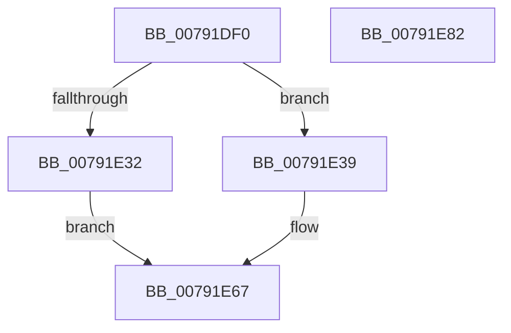

# RtlIdnToUnicode

- RVA: `0x00791DF0`–`0x00791E83` (길이 `147` bytes)
- VA: `0x0000000140791DF0`
- 실행 섹션: `PAGE`
- PDB 이름 있음: `예`; PDB Function 태그: `아니요`
- unwind 정보 RVA: `0x00060130`
- 디코드: `41`개 명령, `147/147` bytes 표시
- 미해석 바이트: `0` (있으면 어셈블리에 `.byte`로 보존)

> 이 문서는 커널 이미지의 기계어와 PDB 기호를 분석해 생성했습니다. 4번과 5번은 함수 원형과 자료형을 바이너리 사용 방식에서 추정한 C 해석이며 원본 소스 복구 결과는 아닙니다.

## 1. Dependencies

- 직접 호출 지점: **3**; 고유 호출 대상: **3**
- 직접 호출자로 확인된 함수: **0**
- RIP 상대 이미지 참조: **0**

### Outgoing calls
- `0x00791E25` → [ExAllocatePool2](../../poolcode/B8/ExAllocatePool2_function_00B820F0.md) (function, `0x00B820F0`)
- `0x00791E54` → [RtlpIdnToUnicodeWorker](../../text/5E/RtlpIdnToUnicodeWorker_function_005ECB3C.md) (function, `0x005ECB3C`)
- `0x00791E60` → [ExFreePoolWithTag](../../poolcode/B8/ExFreePoolWithTag_function_00B82870.md) (function, `0x00B82870`)

### Direct callers
- 이 함수 시작 RVA로 연결되는 직접 call은 확인되지 않았습니다. 간접 호출은 완전히 역산할 수 없습니다.

### Static image references
- 디코드된 RIP-relative 메모리 참조가 없습니다.

## 2. Other-region calls and transfers

- 다른 실행 섹션으로 향하는 call: **3**
  - `0x00791E25` → [ExAllocatePool2](../../poolcode/B8/ExAllocatePool2_function_00B820F0.md) (`PAGE` → `POOLCODE`)
  - `0x00791E54` → [RtlpIdnToUnicodeWorker](../../text/5E/RtlpIdnToUnicodeWorker_function_005ECB3C.md) (`PAGE` → `.text`)
  - `0x00791E60` → [ExFreePoolWithTag](../../poolcode/B8/ExFreePoolWithTag_function_00B82870.md) (`PAGE` → `POOLCODE`)
- 별도 외부 분기/꼬리 이동을 확인하지 못했습니다.

## 3. Assembly (complete function range)

```asm
00791DF0  48 8B C4                        mov rax, rsp
00791DF3  48 89 58 08                     mov qword ptr [rax + 8], rbx
00791DF7  48 89 68 10                     mov qword ptr [rax + 0x10], rbp
00791DFB  48 89 70 18                     mov qword ptr [rax + 0x18], rsi
00791DFF  48 89 78 20                     mov qword ptr [rax + 0x20], rdi
00791E03  41 56                           push r14
00791E05  48 83 EC 40                     sub rsp, 0x40
00791E09  41 8B F0                        mov esi, r8d
00791E0C  48 8B EA                        mov rbp, rdx
00791E0F  44 8B F1                        mov r14d, ecx
00791E12  BA FE 03 00 00                  mov edx, 0x3fe
00791E17  B9 00 01 00 00                  mov ecx, 0x100
00791E1C  41 B8 49 64 6E 45               mov r8d, 0x456e6449
00791E22  49 8B D9                        mov rbx, r9
00791E25  E8 C6 02 3F 00                  call 0x140b820f0
00791E2A  48 8B F8                        mov rdi, rax
00791E2D  48 85 C0                        test rax, rax
00791E30  75 07                           jne 0x140791e39
00791E32  B8 17 00 00 C0                  mov eax, 0xc0000017
00791E37  EB 2E                           jmp 0x140791e67
00791E39  48 8B 44 24 70                  mov rax, qword ptr [rsp + 0x70]
00791E3E  4C 8B CB                        mov r9, rbx
00791E41  48 89 7C 24 28                  mov qword ptr [rsp + 0x28], rdi
00791E46  44 8B C6                        mov r8d, esi
00791E49  48 8B D5                        mov rdx, rbp
00791E4C  48 89 44 24 20                  mov qword ptr [rsp + 0x20], rax
00791E51  41 8B CE                        mov ecx, r14d
00791E54  E8 E3 AC E5 FF                  call 0x1405ecb3c
00791E59  33 D2                           xor edx, edx
00791E5B  48 8B CF                        mov rcx, rdi
00791E5E  8B D8                           mov ebx, eax
00791E60  E8 0B 0A 3F 00                  call 0x140b82870
00791E65  8B C3                           mov eax, ebx
00791E67  48 8B 5C 24 50                  mov rbx, qword ptr [rsp + 0x50]
00791E6C  48 8B 6C 24 58                  mov rbp, qword ptr [rsp + 0x58]
00791E71  48 8B 74 24 60                  mov rsi, qword ptr [rsp + 0x60]
00791E76  48 8B 7C 24 68                  mov rdi, qword ptr [rsp + 0x68]
00791E7B  48 83 C4 40                     add rsp, 0x40
00791E7F  41 5E                           pop r14
00791E81  C3                              ret
00791E82  CC                              int3
```

## 4. C-style interpretation (structured pseudocode)

```c
__int64 __fastcall RtlIdnToUnicode(int a1, __int64 a2, int a3, __int64 a4, __int64 a5)
{
    __int64 result;
    __int64 v_rsp;
    unsigned __int64 v_stack_m20;
    unsigned __int64 v_stack_m28;
    unsigned __int64 v_stack_p10;
    unsigned __int64 v_stack_p18;
    unsigned __int64 v_stack_p20;
    unsigned __int64 v_stack_p8;

    *(unsigned __int64 *)(v_rsp + 8) = v_rbx;
    *(unsigned __int64 *)(v_rsp + 16) = v_rbp;
    *(unsigned __int64 *)(v_rsp + 24) = v_rsi;
    *(unsigned __int64 *)(v_rsp + 32) = v_rdi;
    v_rsp = (v_rsp) - (64);
    result = ExAllocatePool2(256, (unsigned int)(0x3FEULL), (unsigned int)(0x456E6449ULL), a4);
    if (result != 0) goto loc_00791E39;
    goto loc_00791E67;
loc_00791E39:
    v_stack_m20 = result;
    v_stack_m28 = a5;
    result = RtlpIdnToUnicodeWorker((unsigned int)((unsigned int)((unsigned int)(a1))), a2, (unsigned int)((unsigned int)((unsigned int)(a3))), a4);
    a2 = 0;
    result = ExFreePoolWithTag(result, a2, (unsigned int)((unsigned int)((unsigned int)(a3))), a4);
loc_00791E67:
    v_rsp = (v_rsp) + (64);
    return (unsigned int)((unsigned int)((unsigned int)((unsigned int)(result))));
}
```

## 5. (Beta) C Style

```c
int64_t RtlIdnToUnicode(int32_t Arg1, int64_t Arg2, int32_t Arg3, int64_t Arg4, int64_t Arg5)
{
    int64_t result;
    int64_t local_rsp;
    uint64_t v_stack_m20;
    uint64_t v_stack_m28;
    uint64_t v_stack_p10;
    uint64_t v_stack_p18;
    uint64_t v_stack_p20;
    uint64_t v_stack_p8;

    *(uint64_t *)(local_rsp + 0x8) = local_rbx;
    *(uint64_t *)(local_rsp + 0x10) = local_rbp;
    *(uint64_t *)(local_rsp + 0x18) = local_rsi;
    *(uint64_t *)(local_rsp + 0x20) = local_rdi;
    local_rsp = (local_rsp) - (64);
    result = ExAllocatePool2(256, (uint32_t)(0x3FEULL), (uint32_t)(0x456E6449ULL), Arg4);
    if (result != 0) goto loc_00791E39;
    goto loc_00791E67;
loc_00791E39:
    v_stack_m20 = result;
    v_stack_m28 = Arg5;
    result = RtlpIdnToUnicodeWorker((uint32_t)((uint32_t)((uint32_t)(Arg1))), Arg2, (uint32_t)((uint32_t)((uint32_t)(Arg3))), Arg4);
    Arg2 = 0;
    result = ExFreePoolWithTag(result, Arg2, (uint32_t)((uint32_t)((uint32_t)(Arg3))), Arg4);
loc_00791E67:
    local_rsp = (local_rsp) + (64);
    return (uint32_t)((uint32_t)((uint32_t)((uint32_t)(result))));
}
```

## 6. Execution-region graph

[열기: 2D/3D 그래프와 함수 탐색 컨트롤 패널](../../../control-panel.html?section=page&rva=0x00791DF0&view=graph)

- 2D 그래프는 위에서 아래로 흐르고, 3D 그래프는 빈 공간을 드래그해 회전합니다. Shift+드래그는 이동, 휠은 확대·축소, 함수 노드 선택은 대상 보고서 이동입니다.

### Static fallback


