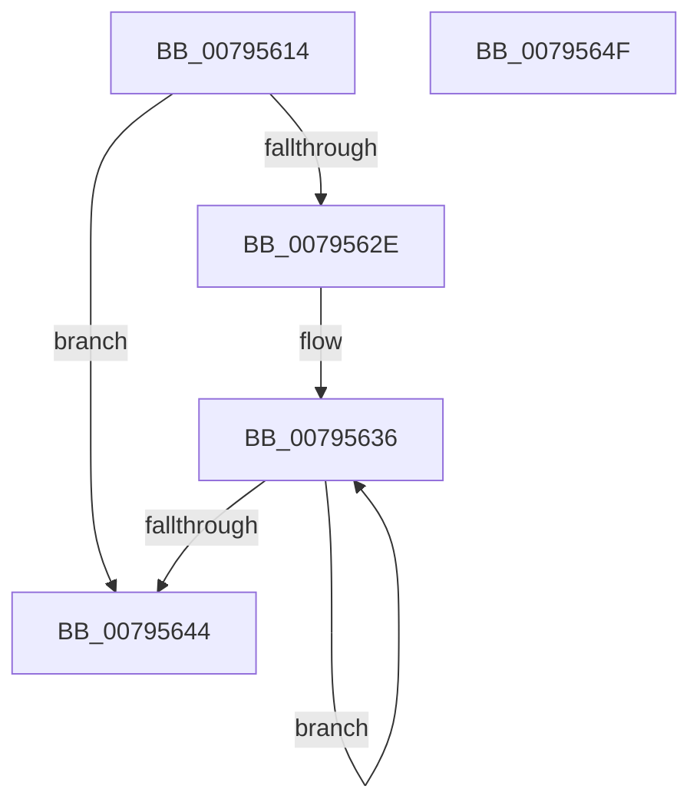

# RtlInitFunctionOverrideCapabilities

- RVA: `0x00795614`–`0x00795650` (길이 `60` bytes)
- VA: `0x0000000140795614`
- 실행 섹션: `PAGE`
- PDB 이름 있음: `예`; PDB Function 태그: `아니요`
- unwind 정보 RVA: `0x0005CAAC`
- 디코드: `20`개 명령, `60/60` bytes 표시
- 미해석 바이트: `0` (있으면 어셈블리에 `.byte`로 보존)

> 이 문서는 커널 이미지의 기계어와 PDB 기호를 분석해 생성했습니다. 4번과 5번은 함수 원형과 자료형을 바이너리 사용 방식에서 추정한 C 해석이며 원본 소스 복구 결과는 아닙니다.

## 1. Dependencies

- 직접 호출 지점: **1**; 고유 호출 대상: **1**
- 직접 호출자로 확인된 함수: **1**
- RIP 상대 이미지 참조: **0**

### Outgoing calls
- `0x00795624` → [RtlpInitFunctionOverrideCapabilities](RtlpInitFunctionOverrideCapabilities_function_0079AC60.md) (function, `0x0079AC60`)

### Direct callers
- [MiInitializeFunctionOverrides](../../init/C6/MiInitializeFunctionOverrides_function_00C60788.md) at `0x00C607D7`

### Static image references
- 디코드된 RIP-relative 메모리 참조가 없습니다.

## 2. Other-region calls and transfers

- 다른 실행 섹션으로 향하는 call: **0**
- 별도 외부 분기/꼬리 이동을 확인하지 못했습니다.

## 3. Assembly (complete function range)

```asm
00795614  48 89 5C 24 08                  mov qword ptr [rsp + 8], rbx
00795619  57                              push rdi
0079561A  48 83 EC 20                     sub rsp, 0x20
0079561E  48 8B FA                        mov rdi, rdx
00795621  48 8B D9                        mov rbx, rcx
00795624  E8 37 56 00 00                  call 0x14079ac60
00795629  48 85 FF                        test rdi, rdi
0079562C  74 16                           je 0x140795644
0079562E  48 2B FB                        sub rdi, rbx
00795631  B9 5A 00 00 00                  mov ecx, 0x5a
00795636  8A 04 1F                        mov al, byte ptr [rdi + rbx]
00795639  20 03                           and byte ptr [rbx], al
0079563B  48 FF C3                        inc rbx
0079563E  48 83 E9 01                     sub rcx, 1
00795642  75 F2                           jne 0x140795636
00795644  48 8B 5C 24 30                  mov rbx, qword ptr [rsp + 0x30]
00795649  48 83 C4 20                     add rsp, 0x20
0079564D  5F                              pop rdi
0079564E  C3                              ret
0079564F  CC                              int3
```

## 4. C-style interpretation (structured pseudocode)

```c
__int64 __fastcall RtlInitFunctionOverrideCapabilities(__int64 a1, __int64 a2)
{
    __int64 result;
    __int64 v_rbx;
    __int64 v_rdi;
    __int64 v_rsp;
    unsigned __int64 v_stack_p8;

    v_stack_p8 = v_rbx;
    v_rsp = (v_rsp) - (32);
    result = RtlpInitFunctionOverrideCapabilities(a1, a2, a3, a4);
    if (a2 == 0) goto loc_00795644;
    v_rdi = (a2) - (a1);
loc_00795636:
    v_rbx = (a1) + 1;
    a1 = (90) - (1);
    if (condition_is_not_equal) goto loc_00795636;
loc_00795644:
    v_rsp = (v_rsp) + (32);
    return *(unsigned __int8 *)(v_rdi + a1 * 1);
}
```

## 5. (Beta) C Style

```c
int64_t RtlInitFunctionOverrideCapabilities(int64_t Arg1, int64_t Arg2)
{
    int64_t result;
    int64_t local_rbx;
    int64_t local_rdi;
    int64_t local_rsp;
    uint64_t v_stack_p8;

    v_stack_p8 = local_rbx;
    local_rsp = (local_rsp) - (32);
    result = RtlpInitFunctionOverrideCapabilities(Arg1, Arg2, a3, a4);
    if (Arg2 == 0) goto loc_00795644;
    local_rdi = (Arg2) - (Arg1);
loc_00795636:
    local_rbx = (Arg1) + 1;
    Arg1 = (90) - (1);
    if (condition_is_not_equal) goto loc_00795636;
loc_00795644:
    local_rsp = (local_rsp) + (32);
    return *(uint8_t *)(local_rdi + Arg1 * 1);
}
```

## 6. Execution-region graph

[열기: 2D/3D 그래프와 함수 탐색 컨트롤 패널](../../../control-panel.html?section=page&rva=0x00795614&view=graph)

- 2D 그래프는 위에서 아래로 흐르고, 3D 그래프는 빈 공간을 드래그해 회전합니다. Shift+드래그는 이동, 휠은 확대·축소, 함수 노드 선택은 대상 보고서 이동입니다.

### Static fallback


