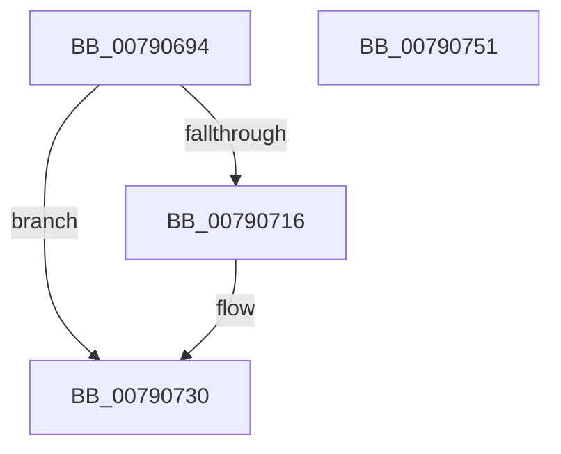

# RtlInitializeBootStatusDataBlackBox

- RVA: `0x00790694`–`0x00790752` (길이 `190` bytes)
- VA: `0x0000000140790694`
- 실행 섹션: `PAGE`
- PDB 이름 있음: `예`; PDB Function 태그: `아니요`
- unwind 정보 RVA: `0x000CFB10`
- 디코드: `45`개 명령, `190/190` bytes 표시
- 미해석 바이트: `0` (있으면 어셈블리에 `.byte`로 보존)

> 이 문서는 커널 이미지의 기계어와 PDB 기호를 분석해 생성했습니다. 4번과 5번은 함수 원형과 자료형을 바이너리 사용 방식에서 추정한 C 해석이며 원본 소스 복구 결과는 아닙니다.

## 1. Dependencies

- 직접 호출 지점: **4**; 고유 호출 대상: **4**
- 직접 호출자로 확인된 함수: **1**
- RIP 상대 이미지 참조: **1**

### Outgoing calls
- `0x007906CB` → [memset](../../text/6C/memset_function_006C6C40.md) (function, `0x006C6C40`)
- `0x0079070D` → [ZwReadFile](../../text/6A/ZwReadFile_function_006AD190.md) (function, `0x006AD190`)
- `0x00790726` → [RtlpRecordBootStatusData](../A8/RtlpRecordBootStatusData_function_00A8F57C.md) (function, `0x00A8F57C`)
- `0x0079073B` → [_security_check_cookie](../../text/6A/_security_check_cookie_function_006AC640.md) (function, `0x006AC640`)

### Direct callers
- [PoClearTransitionMarker](../75/PoClearTransitionMarker_function_00753C88.md) at `0x00753CC7`

### Static image references
- `0x007906A1` → RVA `0x00E0A740` (`.data`; read)

## 2. Other-region calls and transfers

- 다른 실행 섹션으로 향하는 call: **3**
  - `0x007906CB` → [memset](../../text/6C/memset_function_006C6C40.md) (`PAGE` → `.text`)
  - `0x0079070D` → [ZwReadFile](../../text/6A/ZwReadFile_function_006AD190.md) (`PAGE` → `.text`)
  - `0x0079073B` → [_security_check_cookie](../../text/6A/_security_check_cookie_function_006AC640.md) (`PAGE` → `.text`)
- 별도 외부 분기/꼬리 이동을 확인하지 못했습니다.

## 3. Assembly (complete function range)

```asm
00790694  48 89 5C 24 10                  mov qword ptr [rsp + 0x10], rbx
00790699  57                              push rdi
0079069A  48 81 EC 50 01 00 00            sub rsp, 0x150
007906A1  48 8B 05 98 A0 67 00            mov rax, qword ptr [rip + 0x67a098]
007906A8  48 33 C4                        xor rax, rsp
007906AB  48 89 84 24 40 01 00 00         mov qword ptr [rsp + 0x140], rax
007906B3  48 8B D9                        mov rbx, rcx
007906B6  0F 57 C0                        xorps xmm0, xmm0
007906B9  48 8D 4C 24 70                  lea rcx, [rsp + 0x70]
007906BE  33 D2                           xor edx, edx
007906C0  41 B8 C8 00 00 00               mov r8d, 0xc8
007906C6  0F 11 44 24 58                  movups xmmword ptr [rsp + 0x58], xmm0
007906CB  E8 70 65 F3 FF                  call 0x1406c6c40
007906D0  33 FF                           xor edi, edi
007906D2  48 8D 44 24 50                  lea rax, [rsp + 0x50]
007906D7  48 89 7C 24 40                  mov qword ptr [rsp + 0x40], rdi
007906DC  45 33 C9                        xor r9d, r9d
007906DF  48 89 44 24 38                  mov qword ptr [rsp + 0x38], rax
007906E4  45 33 C0                        xor r8d, r8d
007906E7  48 8D 44 24 70                  lea rax, [rsp + 0x70]
007906EC  C7 44 24 30 C8 00 00 00         mov dword ptr [rsp + 0x30], 0xc8
007906F4  48 89 44 24 28                  mov qword ptr [rsp + 0x28], rax
007906F9  33 D2                           xor edx, edx
007906FB  48 8D 44 24 58                  lea rax, [rsp + 0x58]
00790700  48 89 7C 24 50                  mov qword ptr [rsp + 0x50], rdi
00790705  48 8B CB                        mov rcx, rbx
00790708  48 89 44 24 20                  mov qword ptr [rsp + 0x20], rax
0079070D  E8 7E CA F1 FF                  call 0x1406ad190
00790712  85 C0                           test eax, eax
00790714  78 1A                           js 0x140790730
00790716  41 B9 C8 00 00 00               mov r9d, 0xc8
0079071C  48 8D 54 24 70                  lea rdx, [rsp + 0x70]
00790721  45 33 C0                        xor r8d, r8d
00790724  33 C9                           xor ecx, ecx
00790726  E8 51 EE 2F 00                  call 0x140a8f57c
0079072B  85 C0                           test eax, eax
0079072D  0F 49 C7                        cmovns eax, edi
00790730  48 8B 8C 24 40 01 00 00         mov rcx, qword ptr [rsp + 0x140]
00790738  48 33 CC                        xor rcx, rsp
0079073B  E8 00 BF F1 FF                  call 0x1406ac640
00790740  48 8B 9C 24 68 01 00 00         mov rbx, qword ptr [rsp + 0x168]
00790748  48 81 C4 50 01 00 00            add rsp, 0x150
0079074F  5F                              pop rdi
00790750  C3                              ret
00790751  CC                              int3
```

## 4. C-style interpretation (structured pseudocode)

```c
__int64 __fastcall RtlInitializeBootStatusDataBlackBox(__int64 a1, int a2, __int64 a3, int a4)
{
    __int64 result;
    __int64 v_rdi;
    __int64 v_rsp;
    unsigned __int64 v_stack_m100;
    unsigned __int64 v_stack_m108;
    unsigned __int64 v_stack_m118;
    unsigned __int64 v_stack_m120;
    unsigned int v_stack_m128;
    unsigned __int64 v_stack_m130;
    unsigned __int64 v_stack_m138;
    unsigned __int64 v_stack_m18;
    unsigned __int64 v_stack_mE8;
    unsigned __int64 v_stack_p10;

    v_stack_p10 = v_rbx;
    v_rsp = (v_rsp) - (336);
    result = (*(unsigned __int64 *)(v_rip + 6791320)) ^ (v_rsp);
    v_stack_m18 = result;
    a2 = 0;
    v_stack_m100 = v_xmm0;
    result = memset(v_stack_mE8, a2, 200, a4);
    v_rdi = 0;
    v_stack_m118 = 0;
    a4 = 0;
    v_stack_m120 = v_stack_m108;
    a3 = 0;
    v_stack_m128 = 200;
    v_stack_m130 = v_stack_mE8;
    a2 = 0;
    v_stack_m108 = 0;
    v_stack_m138 = v_stack_m100;
    result = ZwReadFile(a1, a2, a3, a4);
    if (!(sign_flag)) {
        a4 = 200;
        a2 = v_stack_mE8;
        a3 = 0;
        a1 = 0;
        result = RtlpRecordBootStatusData(a1, a2, a3, a4);
        if (!sign_flag) { result = 0; }
    }
    a1 = (v_stack_m18) ^ (v_rsp);
    result = _security_check_cookie(a1, a2, a3, a4);
    v_rsp = (v_rsp) + (336);
    return result;
}
```

## 5. (Beta) C Style

```c
int64_t RtlInitializeBootStatusDataBlackBox(int64_t Arg1, int32_t Arg2, int64_t Arg3, int32_t Arg4)
{
    int64_t result;
    int64_t local_rdi;
    int64_t local_rsp;
    uint64_t v_stack_m100;
    uint64_t v_stack_m108;
    uint64_t v_stack_m118;
    uint64_t v_stack_m120;
    uint32_t v_stack_m128;
    uint64_t v_stack_m130;
    uint64_t v_stack_m138;
    uint64_t v_stack_m18;
    uint64_t v_stack_mE8;
    uint64_t v_stack_p10;

    v_stack_p10 = local_rbx;
    local_rsp = (local_rsp) - (336);
    result = (*(uint64_t *)(v_rip + 0x67A098)) ^ (local_rsp);
    v_stack_m18 = result;
    Arg2 = 0;
    v_stack_m100 = v_xmm0;
    result = memset(v_stack_mE8, Arg2, 200, Arg4);
    local_rdi = 0;
    v_stack_m118 = 0;
    Arg4 = 0;
    v_stack_m120 = v_stack_m108;
    Arg3 = 0;
    v_stack_m128 = 200;
    v_stack_m130 = v_stack_mE8;
    Arg2 = 0;
    v_stack_m108 = 0;
    v_stack_m138 = v_stack_m100;
    result = ZwReadFile(Arg1, Arg2, Arg3, Arg4);
    if (!(sign_flag)) {
        Arg4 = 200;
        Arg2 = v_stack_mE8;
        Arg3 = 0;
        Arg1 = 0;
        result = RtlpRecordBootStatusData(Arg1, Arg2, Arg3, Arg4);
        if (!sign_flag) { result = 0; }
    }
    Arg1 = (v_stack_m18) ^ (local_rsp);
    result = _security_check_cookie(Arg1, Arg2, Arg3, Arg4);
    local_rsp = (local_rsp) + (336);
    return result;
}
```

## 6. Execution-region graph

[열기: 2D/3D 그래프와 함수 탐색 컨트롤 패널](../../../control-panel.html?section=page&rva=0x00790694&view=graph)

- 2D 그래프는 위에서 아래로 흐르고, 3D 그래프는 빈 공간을 드래그해 회전합니다. Shift+드래그는 이동, 휠은 확대·축소, 함수 노드 선택은 대상 보고서 이동입니다.

### Static fallback


