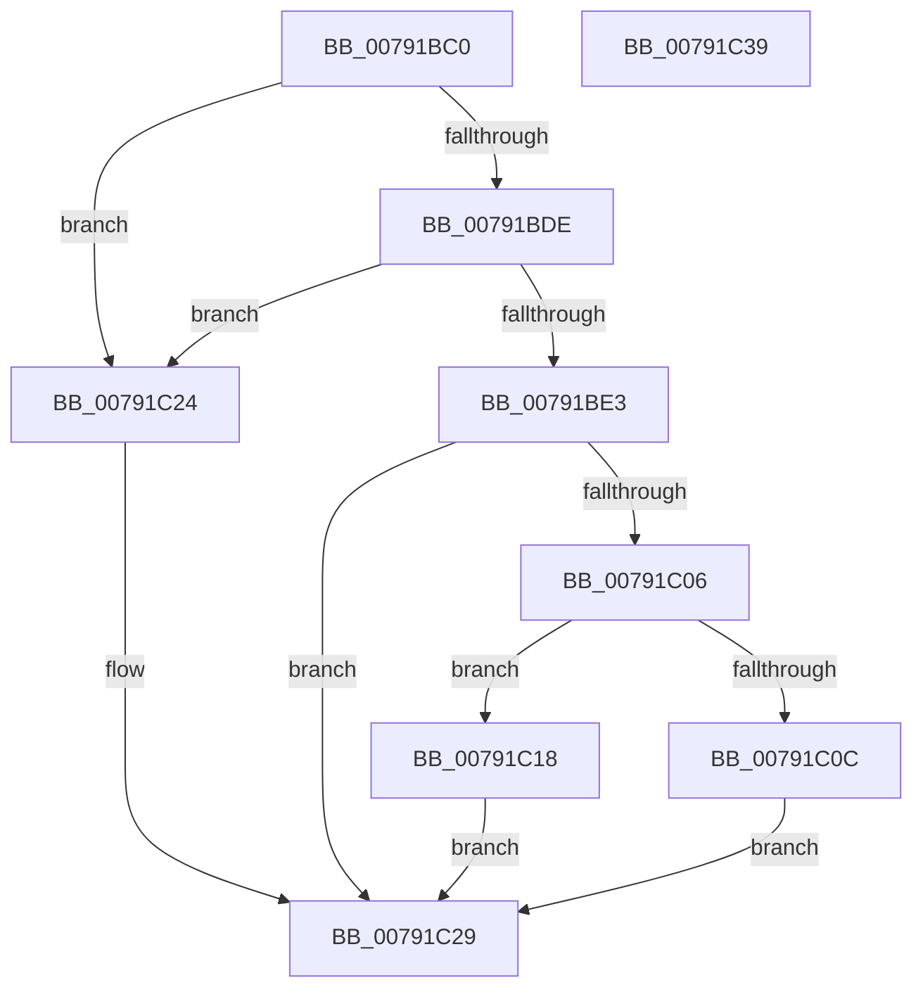

# RtlInitializeCorrelationVector

- RVA: `0x00791BC0`–`0x00791C3A` (길이 `122` bytes)
- VA: `0x0000000140791BC0`
- 실행 섹션: `PAGE`
- PDB 이름 있음: `예`; PDB Function 태그: `아니요`
- unwind 정보 RVA: `0x00060BC4`
- 디코드: `37`개 명령, `122/122` bytes 표시
- 미해석 바이트: `0` (있으면 어셈블리에 `.byte`로 보존)

> 이 문서는 커널 이미지의 기계어와 PDB 기호를 분석해 생성했습니다. 4번과 5번은 함수 원형과 자료형을 바이너리 사용 방식에서 추정한 C 해석이며 원본 소스 복구 결과는 아닙니다.

## 1. Dependencies

- 직접 호출 지점: **2**; 고유 호출 대상: **2**
- 직접 호출자로 확인된 함수: **0**
- RIP 상대 이미지 참조: **0**

### Outgoing calls
- `0x00791BEE` → [memset](../../text/6C/memset_function_006C6C40.md) (function, `0x006C6C40`)
- `0x00791BFD` → [RtlpBase64Encode](RtlpBase64Encode_function_00791C40.md) (function, `0x00791C40`)

### Direct callers
- 이 함수 시작 RVA로 연결되는 직접 call은 확인되지 않았습니다. 간접 호출은 완전히 역산할 수 없습니다.

### Static image references
- 디코드된 RIP-relative 메모리 참조가 없습니다.

## 2. Other-region calls and transfers

- 다른 실행 섹션으로 향하는 call: **1**
  - `0x00791BEE` → [memset](../../text/6C/memset_function_006C6C40.md) (`PAGE` → `.text`)
- 별도 외부 분기/꼬리 이동을 확인하지 못했습니다.

## 3. Assembly (complete function range)

```asm
00791BC0  48 89 5C 24 08                  mov qword ptr [rsp + 8], rbx
00791BC5  48 89 74 24 10                  mov qword ptr [rsp + 0x10], rsi
00791BCA  57                              push rdi
00791BCB  48 83 EC 20                     sub rsp, 0x20
00791BCF  8D 42 FF                        lea eax, [rdx - 1]
00791BD2  49 8B F0                        mov rsi, r8
00791BD5  8B FA                           mov edi, edx
00791BD7  48 8B D9                        mov rbx, rcx
00791BDA  3C 01                           cmp al, 1
00791BDC  77 46                           ja 0x140791c24
00791BDE  4D 85 C0                        test r8, r8
00791BE1  74 41                           je 0x140791c24
00791BE3  48 FF C1                        inc rcx
00791BE6  33 D2                           xor edx, edx
00791BE8  41 B8 81 00 00 00               mov r8d, 0x81
00791BEE  E8 4D 50 F3 FF                  call 0x1406c6c40
00791BF3  4C 8D 43 01                     lea r8, [rbx + 1]
00791BF7  40 88 3B                        mov byte ptr [rbx], dil
00791BFA  48 8B CE                        mov rcx, rsi
00791BFD  E8 3E 00 00 00                  call 0x140791c40
00791C02  85 C0                           test eax, eax
00791C04  78 23                           js 0x140791c29
00791C06  40 80 FF 01                     cmp dil, 1
00791C0A  75 0C                           jne 0x140791c18
00791C0C  66 C7 43 11 2E 30               mov word ptr [rbx + 0x11], 0x302e
00791C12  C6 43 13 00                     mov byte ptr [rbx + 0x13], 0
00791C16  EB 11                           jmp 0x140791c29
00791C18  66 C7 43 17 2E 30               mov word ptr [rbx + 0x17], 0x302e
00791C1E  C6 43 19 00                     mov byte ptr [rbx + 0x19], 0
00791C22  EB 05                           jmp 0x140791c29
00791C24  B8 0D 00 00 C0                  mov eax, 0xc000000d
00791C29  48 8B 5C 24 30                  mov rbx, qword ptr [rsp + 0x30]
00791C2E  48 8B 74 24 38                  mov rsi, qword ptr [rsp + 0x38]
00791C33  48 83 C4 20                     add rsp, 0x20
00791C37  5F                              pop rdi
00791C38  C3                              ret
00791C39  CC                              int3
```

## 4. C-style interpretation (structured pseudocode)

```c
__int64 __fastcall RtlInitializeCorrelationVector(__int64 a1, __int64 a2, __int64 a3)
{
    __int64 result;
    __int64 v_rsp;
    unsigned __int64 v_stack_p10;
    unsigned __int64 v_stack_p8;

    v_stack_p8 = v_rbx;
    v_stack_p10 = v_rsi;
    v_rsp = (v_rsp) - (32);
    if (((unsigned __int8)(a2 - 1)) > 1) goto loc_00791C24;
    if (a3 == 0) goto loc_00791C24;
    a1 = (a1) + 1;
    a2 = 0;
    result = memset(a1, a2, 129, a4);
    *(unsigned __int8 *)(a1) = (unsigned __int8)((unsigned int)((unsigned int)(a2)));
    result = RtlpBase64Encode(a3, a2, a1 + 1, a4);
    if (sign_flag) goto loc_00791C29;
    if (((unsigned __int8)((unsigned int)((unsigned int)(a2)))) != 1) goto loc_00791C18;
    *(unsigned __int16 *)(a1 + 17) = 0x302EULL;
    *(unsigned __int8 *)(a1 + 19) = 0;
    goto loc_00791C29;
loc_00791C18:
    *(unsigned __int16 *)(a1 + 23) = 0x302EULL;
    *(unsigned __int8 *)(a1 + 25) = 0;
    goto loc_00791C29;
loc_00791C24:
loc_00791C29:
    v_rsp = (v_rsp) + (32);
    return (unsigned int)(0xC000000DULL);
}
```

## 5. (Beta) C Style

```c
int64_t RtlInitializeCorrelationVector(void *CorrelationVector, void *Arg2, int64_t Arg3)
{
    uint8_t *correlationVector = (uint8_t *)CorrelationVector;
    uint8_t *arg2 = (uint8_t *)Arg2;

    int64_t result;
    int64_t local_rsp;
    uint64_t v_stack_p10;
    uint64_t v_stack_p8;

    v_stack_p8 = local_rbx;
    v_stack_p10 = local_rsi;
    local_rsp = (local_rsp) - (32);
    if (((uint8_t)(Arg2 - 1)) > 1) goto loc_00791C24;
    if (Arg3 == 0) goto loc_00791C24;
    CorrelationVector = (CorrelationVector) + 1;
    Arg2 = 0;
    result = memset(CorrelationVector, Arg2, 129, a4);
    *(uint8_t *)(correlationVector) = (uint8_t)((uint32_t)((uint32_t)(Arg2)));
    result = RtlpBase64Encode(Arg3, Arg2, CorrelationVector + 1, a4);
    if (sign_flag) goto loc_00791C29;
    if (((uint8_t)((uint32_t)((uint32_t)(Arg2)))) != 1) goto loc_00791C18;
    *(uint16_t *)(correlationVector + 0x11) = 0x302EULL;
    *(uint8_t *)(correlationVector + 0x13) = 0;
    goto loc_00791C29;
loc_00791C18:
    *(uint16_t *)(correlationVector + 0x17) = 0x302EULL;
    *(uint8_t *)(correlationVector + 0x19) = 0;
    goto loc_00791C29;
loc_00791C24:
loc_00791C29:
    local_rsp = (local_rsp) + (32);
    return (uint32_t)(0xC000000DULL);
}
```

### 관측된 메모리 오프셋

구조체 형식이 확인되지 않은 접근은 인자 기준의 오프셋으로만 기록했습니다.

| 기준 인자 | 오프셋 표현 | 폭 (bit) | 접근 |
|---|---:|---:|---|
| `CorrelationVector` | `+ 0x0` | `8` | `W` |
| `CorrelationVector` | `+ 0x1` | `64` | `R` |
| `CorrelationVector` | `+ 0x11` | `16` | `W` |
| `CorrelationVector` | `+ 0x13` | `8` | `W` |
| `CorrelationVector` | `+ 0x17` | `16` | `W` |
| `CorrelationVector` | `+ 0x19` | `8` | `W` |
| `Arg2` | `- 0x1` | `32` | `R` |

## 6. Execution-region graph

[열기: 2D/3D 그래프와 함수 탐색 컨트롤 패널](../../../control-panel.html?section=page&rva=0x00791BC0&view=graph)

- 2D 그래프는 위에서 아래로 흐르고, 3D 그래프는 빈 공간을 드래그해 회전합니다. Shift+드래그는 이동, 휠은 확대·축소, 함수 노드 선택은 대상 보고서 이동입니다.

### Static fallback


