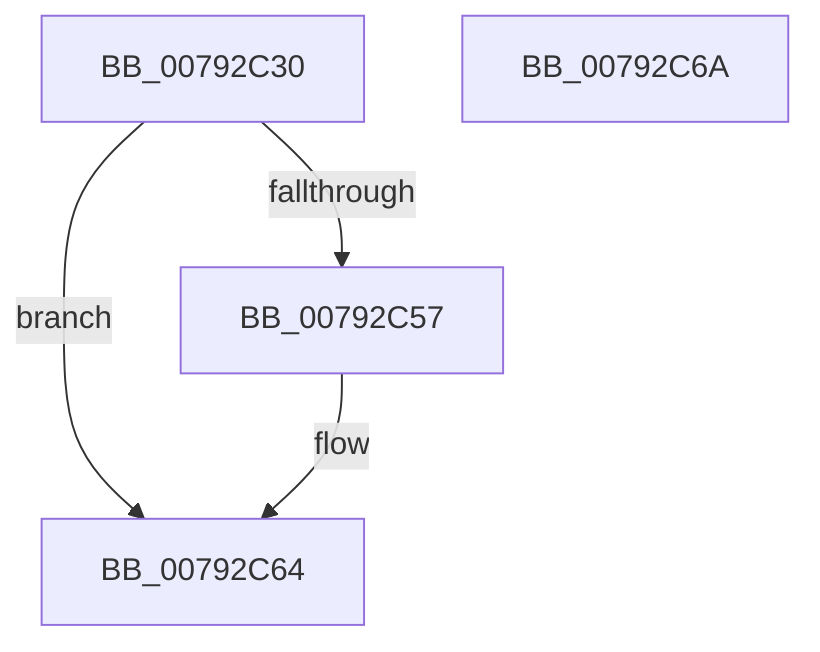

# RtlIsApiSetImplemented

- RVA: `0x00792C30`–`0x00792C6B` (길이 `59` bytes)
- VA: `0x0000000140792C30`
- 실행 섹션: `PAGE`
- PDB 이름 있음: `예`; PDB Function 태그: `아니요`
- unwind 정보 RVA: `0x0005CF00`
- 디코드: `19`개 명령, `59/59` bytes 표시
- 미해석 바이트: `0` (있으면 어셈블리에 `.byte`로 보존)

> 이 문서는 커널 이미지의 기계어와 PDB 기호를 분석해 생성했습니다. 4번과 5번은 함수 원형과 자료형을 바이너리 사용 방식에서 추정한 C 해석이며 원본 소스 복구 결과는 아닙니다.

## 1. Dependencies

- 직접 호출 지점: **2**; 고유 호출 대상: **2**
- 직접 호출자로 확인된 함수: **0**
- RIP 상대 이미지 참조: **0**

### Outgoing calls
- `0x00792C3E` → [PsQueryCurrentApiSetSchema](../A2/PsQueryCurrentApiSetSchema_function_00A24300.md) (function, `0x00A24300`)
- `0x00792C4E` → [ApiSetQuerySchemaInfo2](../../text/66/ApiSetQuerySchemaInfo2_function_00661FAC.md) (function, `0x00661FAC`)

### Direct callers
- 이 함수 시작 RVA로 연결되는 직접 call은 확인되지 않았습니다. 간접 호출은 완전히 역산할 수 없습니다.

### Static image references
- 디코드된 RIP-relative 메모리 참조가 없습니다.

## 2. Other-region calls and transfers

- 다른 실행 섹션으로 향하는 call: **1**
  - `0x00792C4E` → [ApiSetQuerySchemaInfo2](../../text/66/ApiSetQuerySchemaInfo2_function_00661FAC.md) (`PAGE` → `.text`)
- 별도 외부 분기/꼬리 이동을 확인하지 못했습니다.

## 3. Assembly (complete function range)

```asm
00792C30  40 53                           push rbx
00792C32  48 83 EC 20                     sub rsp, 0x20
00792C36  83 64 24 38 00                  and dword ptr [rsp + 0x38], 0
00792C3B  48 8B D9                        mov rbx, rcx
00792C3E  E8 BD 16 29 00                  call 0x140a24300
00792C43  48 8B C8                        mov rcx, rax
00792C46  4C 8D 44 24 38                  lea r8, [rsp + 0x38]
00792C4B  48 8B D3                        mov rdx, rbx
00792C4E  E8 59 F3 EC FF                  call 0x140661fac
00792C53  85 C0                           test eax, eax
00792C55  78 0D                           js 0x140792c64
00792C57  8B 44 24 38                     mov eax, dword ptr [rsp + 0x38]
00792C5B  F7 D8                           neg eax
00792C5D  1B C0                           sbb eax, eax
00792C5F  25 25 02 00 C0                  and eax, 0xc0000225
00792C64  48 83 C4 20                     add rsp, 0x20
00792C68  5B                              pop rbx
00792C69  C3                              ret
00792C6A  CC                              int3
```

## 4. C-style interpretation (structured pseudocode)

```c
__int64 __fastcall RtlIsApiSetImplemented(__int64 a1)
{
    __int64 result;
    __int64 v_rsp;
    unsigned int v_stack_p10;

    v_rsp = (v_rsp) - (32);
    result = PsQueryCurrentApiSetSchema(a1, a2, a3, a4);
    result = ApiSetQuerySchemaInfo2(result, a1, v_stack_p10, a4);
    if (!(sign_flag)) {
        result = v_stack_p10;
        result = (unsigned int)(-(result));
        result = (unsigned int)((result) & (0xC0000225ULL));
    }
    v_rsp = (v_rsp) + (32);
    return result;
}
```

## 5. (Beta) C Style

```c
int64_t RtlIsApiSetImplemented(int64_t Arg1)
{
    int64_t result;
    int64_t local_rsp;
    uint32_t v_stack_p10;

    local_rsp = (local_rsp) - (32);
    result = PsQueryCurrentApiSetSchema(Arg1, a2, a3, a4);
    result = ApiSetQuerySchemaInfo2(result, Arg1, v_stack_p10, a4);
    if (!(sign_flag)) {
        result = v_stack_p10;
        result = (uint32_t)(-(result));
        result = (uint32_t)((result) & (0xC0000225ULL));
    }
    local_rsp = (local_rsp) + (32);
    return result;
}
```

## 6. Execution-region graph

[열기: 2D/3D 그래프와 함수 탐색 컨트롤 패널](../../../control-panel.html?section=page&rva=0x00792C30&view=graph)

- 2D 그래프는 위에서 아래로 흐르고, 3D 그래프는 빈 공간을 드래그해 회전합니다. Shift+드래그는 이동, 휠은 확대·축소, 함수 노드 선택은 대상 보고서 이동입니다.

### Static fallback


