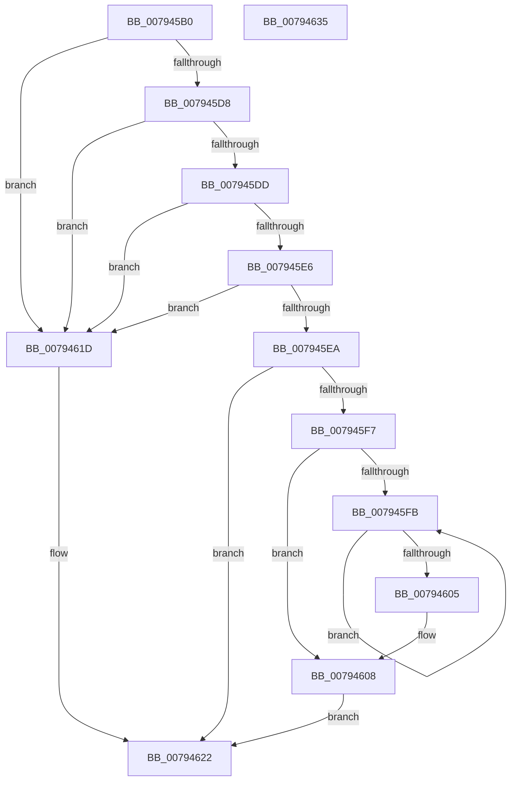

# RtlIsNormalizedString

- RVA: `0x007945B0`–`0x00794636` (길이 `134` bytes)
- VA: `0x00000001407945B0`
- 실행 섹션: `PAGE`
- PDB 이름 있음: `예`; PDB Function 태그: `아니요`
- unwind 정보 RVA: `0x000BD000`
- 디코드: `46`개 명령, `134/134` bytes 표시
- 미해석 바이트: `0` (있으면 어셈블리에 `.byte`로 보존)

> 이 문서는 커널 이미지의 기계어와 PDB 기호를 분석해 생성했습니다. 4번과 5번은 함수 원형과 자료형을 바이너리 사용 방식에서 추정한 C 해석이며 원본 소스 복구 결과는 아닙니다.

## 1. Dependencies

- 직접 호출 지점: **2**; 고유 호출 대상: **2**
- 직접 호출자로 확인된 함수: **1**
- RIP 상대 이미지 참조: **0**

### Outgoing calls
- `0x007945EE` → [RtlpGetNormalization](RtlpGetNormalization_function_0079AB58.md) (function, `0x0079AB58`)
- `0x00794616` → [Normalization__IsNormalized](Normalization__IsNormalized_function_007934D0.md) (function, `0x007934D0`)

### Direct callers
- [RtlpIdnToUnicodeWorker](../../text/5E/RtlpIdnToUnicodeWorker_function_005ECB3C.md) at `0x005ECC96`
- [RtlpIdnToUnicodeWorker](../../text/5E/RtlpIdnToUnicodeWorker_function_005ECB3C.md) at `0x005ECD56`

### Static image references
- 디코드된 RIP-relative 메모리 참조가 없습니다.

## 2. Other-region calls and transfers

- 다른 실행 섹션으로 향하는 call: **0**
- 별도 외부 분기/꼬리 이동을 확인하지 못했습니다.

## 3. Assembly (complete function range)

```asm
007945B0  48 8B C4                        mov rax, rsp
007945B3  48 89 58 08                     mov qword ptr [rax + 8], rbx
007945B7  48 89 68 18                     mov qword ptr [rax + 0x18], rbp
007945BB  56                              push rsi
007945BC  57                              push rdi
007945BD  41 56                           push r14
007945BF  48 83 EC 20                     sub rsp, 0x20
007945C3  45 33 F6                        xor r14d, r14d
007945C6  49 8B E9                        mov rbp, r9
007945C9  4C 89 70 10                     mov qword ptr [rax + 0x10], r14
007945CD  41 8B F8                        mov edi, r8d
007945D0  48 8B F2                        mov rsi, rdx
007945D3  48 85 D2                        test rdx, rdx
007945D6  74 45                           je 0x14079461d
007945D8  4D 85 C9                        test r9, r9
007945DB  74 40                           je 0x14079461d
007945DD  48 83 CB FF                     or rbx, 0xffffffffffffffff
007945E1  44 3B C3                        cmp r8d, ebx
007945E4  7C 37                           jl 0x14079461d
007945E6  85 C9                           test ecx, ecx
007945E8  74 33                           je 0x14079461d
007945EA  48 8D 50 10                     lea rdx, [rax + 0x10]
007945EE  E8 65 65 00 00                  call 0x14079ab58
007945F3  85 C0                           test eax, eax
007945F5  78 2B                           js 0x140794622
007945F7  3B FB                           cmp edi, ebx
007945F9  75 0D                           jne 0x140794608
007945FB  48 FF C3                        inc rbx
007945FE  66 44 39 34 5E                  cmp word ptr [rsi + rbx*2], r14w
00794603  75 F6                           jne 0x1407945fb
00794605  8D 7B 01                        lea edi, [rbx + 1]
00794608  48 8B 4C 24 48                  mov rcx, qword ptr [rsp + 0x48]
0079460D  4C 8B CD                        mov r9, rbp
00794610  44 8B C7                        mov r8d, edi
00794613  48 8B D6                        mov rdx, rsi
00794616  E8 B5 EE FF FF                  call 0x1407934d0
0079461B  EB 05                           jmp 0x140794622
0079461D  B8 0D 00 00 C0                  mov eax, 0xc000000d
00794622  48 8B 5C 24 40                  mov rbx, qword ptr [rsp + 0x40]
00794627  48 8B 6C 24 50                  mov rbp, qword ptr [rsp + 0x50]
0079462C  48 83 C4 20                     add rsp, 0x20
00794630  41 5E                           pop r14
00794632  5F                              pop rdi
00794633  5E                              pop rsi
00794634  C3                              ret
00794635  CC                              int3
```

## 4. C-style interpretation (structured pseudocode)

```c
__int64 __fastcall RtlIsNormalizedString(int a1, __int64 a2, int a3, __int64 a4)
{
    __int64 result;
    __int64 v_r14;
    __int64 v_rbx;
    __int64 v_rsp;
    unsigned __int64 v_stack_p10;
    unsigned __int64 v_stack_p18;
    unsigned __int64 v_stack_p8;

    *(unsigned __int64 *)(v_rsp + 8) = v_rbx;
    *(unsigned __int64 *)(v_rsp + 24) = v_rbp;
    v_rsp = (v_rsp) - (32);
    v_r14 = 0;
    *(unsigned __int64 *)(v_rsp + 16) = 0;
    if (a2 == 0) goto loc_0079461D;
    if (a4 == 0) goto loc_0079461D;
    v_rbx = (v_rbx) | (-1);
    if (a3 < ((unsigned int)(v_rbx))) goto loc_0079461D;
    if (a1 == 0) goto loc_0079461D;
    result = RtlpGetNormalization(a1, v_rsp + 16, a3, a4);
    if (sign_flag) goto loc_00794622;
    if (((unsigned int)((unsigned int)(a3))) != ((unsigned int)(v_rbx))) goto loc_00794608;
loc_007945FB:
    v_rbx = (v_rbx) + 1;
    if ((*(unsigned __int16 *)(a2 + v_rbx * 2)) != 0) goto loc_007945FB;
loc_00794608:
    result = Normalization__IsNormalized(v_stack_p10, a2, (unsigned int)((unsigned int)(v_rbx + 1)), a4);
    goto loc_00794622;
loc_0079461D:
loc_00794622:
    v_rsp = (v_rsp) + (32);
    return (unsigned int)(0xC000000DULL);
}
```

## 5. (Beta) C Style

```c
int64_t RtlIsNormalizedString(int32_t Arg1, void *Arg2, int32_t Arg3, int64_t Arg4)
{
    uint8_t *arg2 = (uint8_t *)Arg2;

    int64_t result;
    int64_t local_r14;
    int64_t local_rbx;
    int64_t local_rsp;
    uint64_t v_stack_p10;
    uint64_t v_stack_p18;
    uint64_t v_stack_p8;

    *(uint64_t *)(local_rsp + 0x8) = local_rbx;
    *(uint64_t *)(local_rsp + 0x18) = local_rbp;
    local_rsp = (local_rsp) - (32);
    local_r14 = 0;
    *(uint64_t *)(local_rsp + 0x10) = 0;
    if (Arg2 == NULL) goto loc_0079461D;
    if (Arg4 == 0) goto loc_0079461D;
    local_rbx = (local_rbx) | (-1);
    if (Arg3 < ((uint32_t)(local_rbx))) goto loc_0079461D;
    if (Arg1 == 0) goto loc_0079461D;
    result = RtlpGetNormalization(Arg1, local_rsp + 16, Arg3, Arg4);
    if (sign_flag) goto loc_00794622;
    if (((uint32_t)((uint32_t)(Arg3))) != ((uint32_t)(local_rbx))) goto loc_00794608;
loc_007945FB:
    local_rbx = (local_rbx) + 1;
    if ((*(uint16_t *)(arg2 + local_rbx * 2)) != 0) goto loc_007945FB;
loc_00794608:
    result = Normalization__IsNormalized(v_stack_p10, Arg2, (uint32_t)((uint32_t)(local_rbx + 1)), Arg4);
    goto loc_00794622;
loc_0079461D:
loc_00794622:
    local_rsp = (local_rsp) + (32);
    return (uint32_t)(0xC000000DULL);
}
```

### 관측된 메모리 오프셋

구조체 형식이 확인되지 않은 접근은 인자 기준의 오프셋으로만 기록했습니다.

| 기준 인자 | 오프셋 표현 | 폭 (bit) | 접근 |
|---|---:|---:|---|
| `Arg2` | `+ 0x0 + rbx*2` | `16` | `R` |

## 6. Execution-region graph

[열기: 2D/3D 그래프와 함수 탐색 컨트롤 패널](../../../control-panel.html?section=page&rva=0x007945B0&view=graph)

- 2D 그래프는 위에서 아래로 흐르고, 3D 그래프는 빈 공간을 드래그해 회전합니다. Shift+드래그는 이동, 휠은 확대·축소, 함수 노드 선택은 대상 보고서 이동입니다.

### Static fallback


