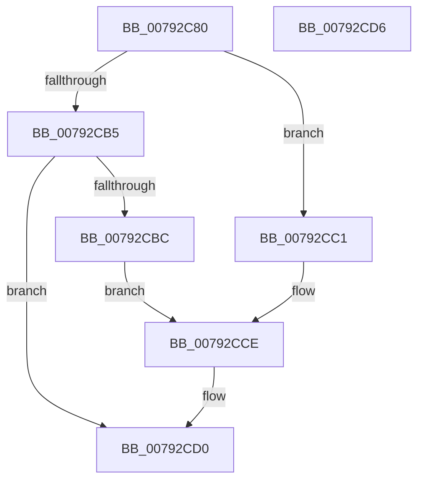

# RtlIsPartialPlaceholderFileHandle

- RVA: `0x00792C80`–`0x00792CD7` (길이 `87` bytes)
- VA: `0x0000000140792C80`
- 실행 섹션: `PAGE`
- PDB 이름 있음: `예`; PDB Function 태그: `아니요`
- unwind 정보 RVA: `0x0007F554`
- 디코드: `26`개 명령, `87/87` bytes 표시
- 미해석 바이트: `0` (있으면 어셈블리에 `.byte`로 보존)

> 이 문서는 커널 이미지의 기계어와 PDB 기호를 분석해 생성했습니다. 4번과 5번은 함수 원형과 자료형을 바이너리 사용 방식에서 추정한 C 해석이며 원본 소스 복구 결과는 아닙니다.

## 1. Dependencies

- 직접 호출 지점: **1**; 고유 호출 대상: **1**
- 직접 호출자로 확인된 함수: **0**
- RIP 상대 이미지 참조: **0**

### Outgoing calls
- `0x00792CAC` → [NtQueryInformationFile](../8A/NtQueryInformationFile_function_008AD630.md) (function, `0x008AD630`)

### Direct callers
- 이 함수 시작 RVA로 연결되는 직접 call은 확인되지 않았습니다. 간접 호출은 완전히 역산할 수 없습니다.

### Static image references
- 디코드된 RIP-relative 메모리 참조가 없습니다.

## 2. Other-region calls and transfers

- 다른 실행 섹션으로 향하는 call: **0**
- 별도 외부 분기/꼬리 이동을 확인하지 못했습니다.

## 3. Assembly (complete function range)

```asm
00792C80  48 8B C4                        mov rax, rsp
00792C83  53                              push rbx
00792C84  48 83 EC 40                     sub rsp, 0x40
00792C88  48 83 60 18 00                  and qword ptr [rax + 0x18], 0
00792C8D  4C 8D 40 18                     lea r8, [rax + 0x18]
00792C91  48 8B DA                        mov rbx, rdx
00792C94  C7 40 D8 23 00 00 00            mov dword ptr [rax - 0x28], 0x23
00792C9B  0F 57 C0                        xorps xmm0, xmm0
00792C9E  48 8D 50 E8                     lea rdx, [rax - 0x18]
00792CA2  41 B9 08 00 00 00               mov r9d, 8
00792CA8  0F 11 40 E8                     movups xmmword ptr [rax - 0x18], xmm0
00792CAC  E8 7F A9 11 00                  call 0x1408ad630
00792CB1  85 C0                           test eax, eax
00792CB3  79 0C                           jns 0x140792cc1
00792CB5  3D 0D 00 00 C0                  cmp eax, 0xc000000d
00792CBA  75 14                           jne 0x140792cd0
00792CBC  C6 03 00                        mov byte ptr [rbx], 0
00792CBF  EB 0D                           jmp 0x140792cce
00792CC1  F7 44 24 60 00 00 44 00         test dword ptr [rsp + 0x60], 0x440000
00792CC9  0F 95 C0                        setne al
00792CCC  88 03                           mov byte ptr [rbx], al
00792CCE  33 C0                           xor eax, eax
00792CD0  48 83 C4 40                     add rsp, 0x40
00792CD4  5B                              pop rbx
00792CD5  C3                              ret
00792CD6  CC                              int3
```

## 4. C-style interpretation (structured pseudocode)

```c
__int64 __fastcall RtlIsPartialPlaceholderFileHandle(__int64 a1, __int64 a2)
{
    __int64 result;
    __int64 v_rsp;
    unsigned int v_stack_p18;

    v_rsp = (v_rsp) - (64);
    *(unsigned int *)(v_rsp - 40) = 35;
    *(unsigned __int64 *)(v_rsp - 24) = v_xmm0;
    result = NtQueryInformationFile(a1, v_rsp - 24, v_rsp + 24, 8);
    if (!sign_flag) goto loc_00792CC1;
    if (((unsigned int)(result)) != 0xC000000DULL) goto loc_00792CD0;
    *(unsigned __int8 *)(a2) = 0;
    goto loc_00792CCE;
loc_00792CC1:
    result = (((v_stack_p18) & (0x440000ULL)) != 0) ? 1 : 0;
    *(unsigned __int8 *)(a2) = (unsigned __int8)(result);
loc_00792CCE:
    result = 0;
loc_00792CD0:
    v_rsp = (v_rsp) + (64);
    return result;
}
```

## 5. (Beta) C Style

```c
int64_t RtlIsPartialPlaceholderFileHandle(int64_t Arg1, void *Arg2)
{
    uint8_t *arg2 = (uint8_t *)Arg2;

    int64_t result;
    int64_t local_rsp;
    uint32_t v_stack_p18;

    local_rsp = (local_rsp) - (64);
    *(uint32_t *)(local_rsp - 0x28) = 35;
    *(uint64_t *)(local_rsp - 0x18) = v_xmm0;
    result = NtQueryInformationFile(Arg1, local_rsp - 24, local_rsp + 24, 8);
    if (!sign_flag) goto loc_00792CC1;
    if (((uint32_t)(result)) != 0xC000000DULL) goto loc_00792CD0;
    *(uint8_t *)(arg2) = 0;
    goto loc_00792CCE;
loc_00792CC1:
    result = (((v_stack_p18) & (0x440000ULL)) != 0) ? 1 : 0;
    *(uint8_t *)(arg2) = (uint8_t)(result);
loc_00792CCE:
    result = 0;
loc_00792CD0:
    local_rsp = (local_rsp) + (64);
    return result;
}
```

### 관측된 메모리 오프셋

구조체 형식이 확인되지 않은 접근은 인자 기준의 오프셋으로만 기록했습니다.

| 기준 인자 | 오프셋 표현 | 폭 (bit) | 접근 |
|---|---:|---:|---|
| `Arg2` | `+ 0x0` | `8` | `W` |

## 6. Execution-region graph

[열기: 2D/3D 그래프와 함수 탐색 컨트롤 패널](../../../control-panel.html?section=page&rva=0x00792C80&view=graph)

- 2D 그래프는 위에서 아래로 흐르고, 3D 그래프는 빈 공간을 드래그해 회전합니다. Shift+드래그는 이동, 휠은 확대·축소, 함수 노드 선택은 대상 보고서 이동입니다.

### Static fallback


