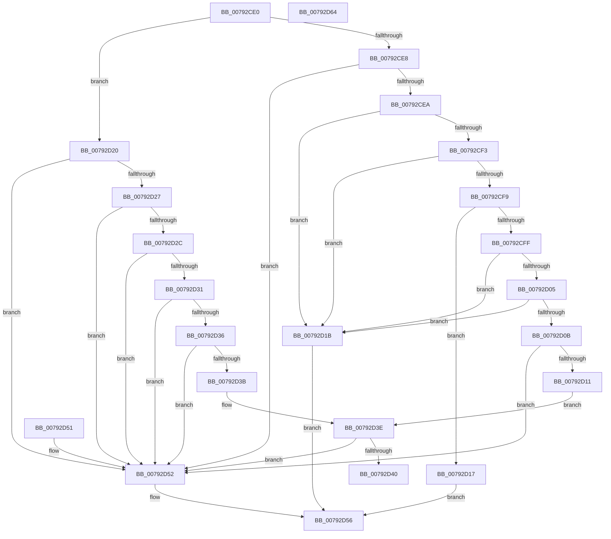

# RtlIsPartialPlaceholderFileInfo

- RVA: `0x00792CE0`–`0x00792D65` (길이 `133` bytes)
- VA: `0x0000000140792CE0`
- 실행 섹션: `PAGE`
- PDB 이름 있음: `예`; PDB Function 태그: `아니요`
- unwind 정보 RVA: `0x000DB714`
- 디코드: `49`개 명령, `133/133` bytes 표시
- 미해석 바이트: `0` (있으면 어셈블리에 `.byte`로 보존)

> 이 문서는 커널 이미지의 기계어와 PDB 기호를 분석해 생성했습니다. 4번과 5번은 함수 원형과 자료형을 바이너리 사용 방식에서 추정한 C 해석이며 원본 소스 복구 결과는 아닙니다.

## 1. Dependencies

- 직접 호출 지점: **0**; 고유 호출 대상: **0**
- 직접 호출자로 확인된 함수: **0**
- RIP 상대 이미지 참조: **0**

### Outgoing calls
- 직접 디코드된 call 명령이 없습니다.

### Direct callers
- 이 함수 시작 RVA로 연결되는 직접 call은 확인되지 않았습니다. 간접 호출은 완전히 역산할 수 없습니다.

### Static image references
- 디코드된 RIP-relative 메모리 참조가 없습니다.

## 2. Other-region calls and transfers

- 다른 실행 섹션으로 향하는 call: **0**
- 별도 외부 분기/꼬리 이동을 확인하지 못했습니다.

## 3. Assembly (complete function range)

```asm
00792CE0  4C 8B D1                        mov r10, rcx
00792CE3  83 FA 44                        cmp edx, 0x44
00792CE6  7F 38                           jg 0x140792d20
00792CE8  74 68                           je 0x140792d52
00792CEA  44 8B CA                        mov r9d, edx
00792CED  41 83 E9 02                     sub r9d, 2
00792CF1  74 28                           je 0x140792d1b
00792CF3  41 83 E9 01                     sub r9d, 1
00792CF7  74 22                           je 0x140792d1b
00792CF9  41 83 E9 20                     sub r9d, 0x20
00792CFD  74 18                           je 0x140792d17
00792CFF  41 83 E9 02                     sub r9d, 2
00792D03  74 16                           je 0x140792d1b
00792D05  41 83 E9 01                     sub r9d, 1
00792D09  74 10                           je 0x140792d1b
00792D0B  41 83 E9 16                     sub r9d, 0x16
00792D0F  74 41                           je 0x140792d52
00792D11  41 83 F9 03                     cmp r9d, 3
00792D15  EB 27                           jmp 0x140792d3e
00792D17  8B 01                           mov eax, dword ptr [rcx]
00792D19  EB 3B                           jmp 0x140792d56
00792D1B  8B 41 38                        mov eax, dword ptr [rcx + 0x38]
00792D1E  EB 36                           jmp 0x140792d56
00792D20  8B CA                           mov ecx, edx
00792D22  83 E9 46                        sub ecx, 0x46
00792D25  74 2B                           je 0x140792d52
00792D27  83 E9 07                        sub ecx, 7
00792D2A  74 26                           je 0x140792d52
00792D2C  83 E9 01                        sub ecx, 1
00792D2F  74 21                           je 0x140792d52
00792D31  83 E9 01                        sub ecx, 1
00792D34  74 1C                           je 0x140792d52
00792D36  83 E9 01                        sub ecx, 1
00792D39  74 17                           je 0x140792d52
00792D3B  83 F9 01                        cmp ecx, 1
00792D3E  74 12                           je 0x140792d52
00792D40  83 FA 54                        cmp edx, 0x54
00792D43  B8 BB 00 00 C0                  mov eax, 0xc00000bb
00792D48  B9 03 00 00 C0                  mov ecx, 0xc0000003
00792D4D  0F 4D C1                        cmovge eax, ecx
00792D50  C3                              ret
00792D51  CC                              int3
00792D52  41 8B 42 38                     mov eax, dword ptr [r10 + 0x38]
00792D56  A9 00 00 44 00                  test eax, 0x440000
00792D5B  0F 95 C0                        setne al
00792D5E  41 88 00                        mov byte ptr [r8], al
00792D61  33 C0                           xor eax, eax
00792D63  C3                              ret
00792D64  CC                              int3
```

## 4. C-style interpretation (structured pseudocode)

```c
__int64 __fastcall RtlIsPartialPlaceholderFileInfo(__int64 a1, int a2, __int64 a3)
{
    __int64 result;

    if (a2 > 68) goto loc_00792D20;
    if (a2 == 68) goto loc_00792D52;
    a4 = (unsigned int)(((unsigned int)(a2)) - (2));
    if (condition_is_equal) goto loc_00792D1B;
    a4 = (unsigned int)((a4) - (1));
    if (condition_is_equal) goto loc_00792D1B;
    a4 = (unsigned int)((a4) - (32));
    if (condition_is_equal) goto loc_00792D17;
    a4 = (unsigned int)((a4) - (2));
    if (condition_is_equal) goto loc_00792D1B;
    a4 = (unsigned int)((a4) - (1));
    if (condition_is_equal) goto loc_00792D1B;
    a4 = (unsigned int)((a4) - (22));
    if (condition_is_equal) goto loc_00792D52;
    goto loc_00792D3E;
loc_00792D17:
    goto loc_00792D56;
loc_00792D1B:
    goto loc_00792D56;
loc_00792D20:
    a1 = (unsigned int)(((unsigned int)(a2)) - (70));
    if (condition_is_equal) goto loc_00792D52;
    a1 = (unsigned int)((a1) - (7));
    if (condition_is_equal) goto loc_00792D52;
    a1 = (unsigned int)((a1) - (1));
    if (condition_is_equal) goto loc_00792D52;
    a1 = (unsigned int)((a1) - (1));
    if (condition_is_equal) goto loc_00792D52;
    a1 = (unsigned int)((a1) - (1));
    if (condition_is_equal) goto loc_00792D52;
loc_00792D3E:
    if (((unsigned int)(a1)) == 1) goto loc_00792D52;
    result = (unsigned int)(0xC00000BBULL);
    if (a2 >= 84) { result = (unsigned int)((unsigned int)(0xC0000003ULL)); }
    return result;
loc_00792D52:
loc_00792D56:
    result = ((((unsigned int)((unsigned int)(*(unsigned int *)(a1 + 56)))) & (0x440000ULL)) != 0) ? 1 : 0;
    *(unsigned __int8 *)(a3) = (unsigned __int8)(result);
    result = 0;
    return result;
}
```

## 5. (Beta) C Style

```c
int64_t RtlIsPartialPlaceholderFileInfo(void *Arg1, int32_t Arg2, void *Arg3)
{
    uint8_t *arg1 = (uint8_t *)Arg1;
    uint8_t *arg3 = (uint8_t *)Arg3;

    int64_t result;

    if (Arg2 > 68) goto loc_00792D20;
    if (Arg2 == 68) goto loc_00792D52;
    a4 = (uint32_t)(((uint32_t)(Arg2)) - (2));
    if (condition_is_equal) goto loc_00792D1B;
    a4 = (uint32_t)((a4) - (1));
    if (condition_is_equal) goto loc_00792D1B;
    a4 = (uint32_t)((a4) - (32));
    if (condition_is_equal) goto loc_00792D17;
    a4 = (uint32_t)((a4) - (2));
    if (condition_is_equal) goto loc_00792D1B;
    a4 = (uint32_t)((a4) - (1));
    if (condition_is_equal) goto loc_00792D1B;
    a4 = (uint32_t)((a4) - (22));
    if (condition_is_equal) goto loc_00792D52;
    goto loc_00792D3E;
loc_00792D17:
    goto loc_00792D56;
loc_00792D1B:
    goto loc_00792D56;
loc_00792D20:
    Arg1 = (uint32_t)(((uint32_t)(Arg2)) - (70));
    if (condition_is_equal) goto loc_00792D52;
    Arg1 = (uint32_t)((Arg1) - (7));
    if (condition_is_equal) goto loc_00792D52;
    Arg1 = (uint32_t)((Arg1) - (1));
    if (condition_is_equal) goto loc_00792D52;
    Arg1 = (uint32_t)((Arg1) - (1));
    if (condition_is_equal) goto loc_00792D52;
    Arg1 = (uint32_t)((Arg1) - (1));
    if (condition_is_equal) goto loc_00792D52;
loc_00792D3E:
    if (((uint32_t)(Arg1)) == 1) goto loc_00792D52;
    result = (uint32_t)(0xC00000BBULL);
    if (Arg2 >= 84) { result = (uint32_t)((uint32_t)(0xC0000003ULL)); }
    return result;
loc_00792D52:
loc_00792D56:
    result = ((((uint32_t)((uint32_t)(*(uint32_t *)(arg1 + 0x38)))) & (0x440000ULL)) != 0) ? 1 : 0;
    *(uint8_t *)(arg3) = (uint8_t)(result);
    result = 0;
    return result;
}
```

### 관측된 메모리 오프셋

구조체 형식이 확인되지 않은 접근은 인자 기준의 오프셋으로만 기록했습니다.

| 기준 인자 | 오프셋 표현 | 폭 (bit) | 접근 |
|---|---:|---:|---|
| `Arg1` | `+ 0x0` | `32` | `R` |
| `Arg1` | `+ 0x38` | `32` | `R` |
| `Arg3` | `+ 0x0` | `8` | `W` |

## 6. Execution-region graph

[열기: 2D/3D 그래프와 함수 탐색 컨트롤 패널](../../../control-panel.html?section=page&rva=0x00792CE0&view=graph)

- 2D 그래프는 위에서 아래로 흐르고, 3D 그래프는 빈 공간을 드래그해 회전합니다. Shift+드래그는 이동, 휠은 확대·축소, 함수 노드 선택은 대상 보고서 이동입니다.

### Static fallback


