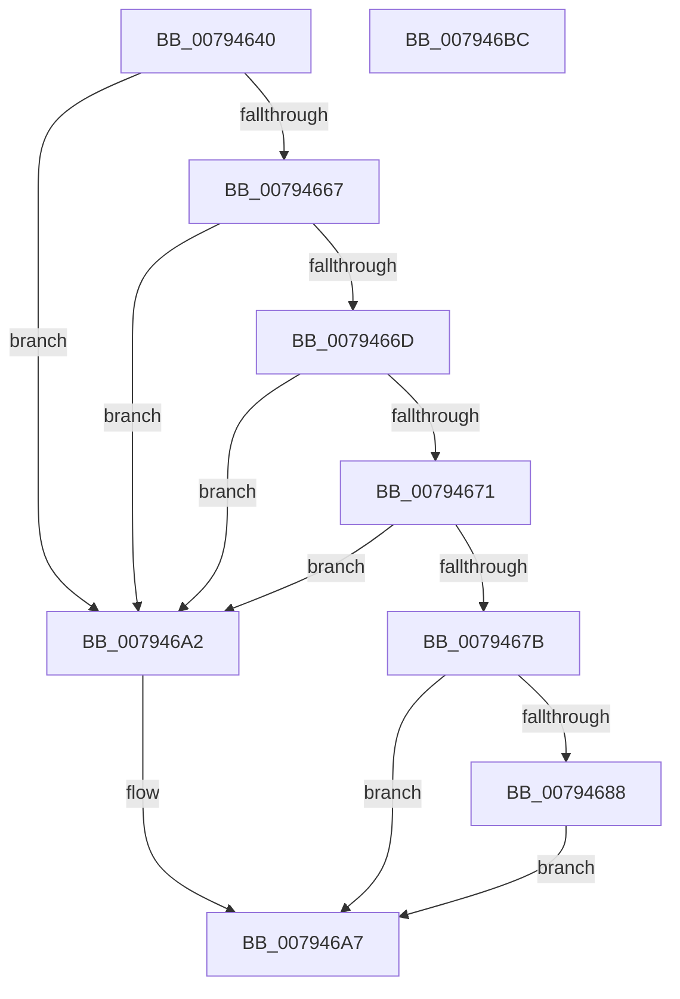

# RtlNormalizeString

- RVA: `0x00794640`–`0x007946BD` (길이 `125` bytes)
- VA: `0x0000000140794640`
- 실행 섹션: `PAGE`
- PDB 이름 있음: `예`; PDB Function 태그: `아니요`
- unwind 정보 RVA: `0x000A7960`
- 디코드: `38`개 명령, `125/125` bytes 표시
- 미해석 바이트: `0` (있으면 어셈블리에 `.byte`로 보존)

> 이 문서는 커널 이미지의 기계어와 PDB 기호를 분석해 생성했습니다. 4번과 5번은 함수 원형과 자료형을 바이너리 사용 방식에서 추정한 C 해석이며 원본 소스 복구 결과는 아닙니다.

## 1. Dependencies

- 직접 호출 지점: **2**; 고유 호출 대상: **2**
- 직접 호출자로 확인된 함수: **1**
- RIP 상대 이미지 참조: **0**

### Outgoing calls
- `0x0079467F` → [RtlpGetNormalization](RtlpGetNormalization_function_0079AB58.md) (function, `0x0079AB58`)
- `0x0079469B` → [RtlpNormalizeStringWorker](RtlpNormalizeStringWorker_function_007946C4.md) (function, `0x007946C4`)

### Direct callers
- [RtlpNameprepAsciiRealWorker](../../text/5E/RtlpNameprepAsciiRealWorker_function_005ECDF8.md) at `0x005ECF75`
- [RtlpNameprepAsciiRealWorker](../../text/5E/RtlpNameprepAsciiRealWorker_function_005ECDF8.md) at `0x005ECFCB`

### Static image references
- 디코드된 RIP-relative 메모리 참조가 없습니다.

## 2. Other-region calls and transfers

- 다른 실행 섹션으로 향하는 call: **0**
- 별도 외부 분기/꼬리 이동을 확인하지 못했습니다.

## 3. Assembly (complete function range)

```asm
00794640  48 8B C4                        mov rax, rsp
00794643  48 89 58 08                     mov qword ptr [rax + 8], rbx
00794647  48 89 68 18                     mov qword ptr [rax + 0x18], rbp
0079464B  48 89 70 20                     mov qword ptr [rax + 0x20], rsi
0079464F  57                              push rdi
00794650  48 83 EC 30                     sub rsp, 0x30
00794654  48 83 60 10 00                  and qword ptr [rax + 0x10], 0
00794659  49 8B E9                        mov rbp, r9
0079465C  41 8B F8                        mov edi, r8d
0079465F  48 8B F2                        mov rsi, rdx
00794662  48 85 D2                        test rdx, rdx
00794665  74 3B                           je 0x1407946a2
00794667  41 83 F8 FF                     cmp r8d, -1
0079466B  7C 35                           jl 0x1407946a2
0079466D  85 C9                           test ecx, ecx
0079466F  74 31                           je 0x1407946a2
00794671  48 8B 5C 24 60                  mov rbx, qword ptr [rsp + 0x60]
00794676  83 3B 00                        cmp dword ptr [rbx], 0
00794679  7C 27                           jl 0x1407946a2
0079467B  48 8D 50 10                     lea rdx, [rax + 0x10]
0079467F  E8 D4 64 00 00                  call 0x14079ab58
00794684  85 C0                           test eax, eax
00794686  78 1F                           js 0x1407946a7
00794688  48 8B 4C 24 48                  mov rcx, qword ptr [rsp + 0x48]
0079468D  4C 8B CD                        mov r9, rbp
00794690  44 8B C7                        mov r8d, edi
00794693  48 89 5C 24 20                  mov qword ptr [rsp + 0x20], rbx
00794698  48 8B D6                        mov rdx, rsi
0079469B  E8 24 00 00 00                  call 0x1407946c4
007946A0  EB 05                           jmp 0x1407946a7
007946A2  B8 0D 00 00 C0                  mov eax, 0xc000000d
007946A7  48 8B 5C 24 40                  mov rbx, qword ptr [rsp + 0x40]
007946AC  48 8B 6C 24 50                  mov rbp, qword ptr [rsp + 0x50]
007946B1  48 8B 74 24 58                  mov rsi, qword ptr [rsp + 0x58]
007946B6  48 83 C4 30                     add rsp, 0x30
007946BA  5F                              pop rdi
007946BB  C3                              ret
007946BC  CC                              int3
```

## 4. C-style interpretation (structured pseudocode)

```c
__int64 __fastcall RtlNormalizeString(int a1, __int64 a2, int a3, __int64 a4, __int64 a5)
{
    __int64 result;
    __int64 v_rsp;
    unsigned __int64 v_stack_m18;
    unsigned __int64 v_stack_p10;
    unsigned __int64 v_stack_p18;
    unsigned __int64 v_stack_p20;
    unsigned __int64 v_stack_p8;

    *(unsigned __int64 *)(v_rsp + 8) = v_rbx;
    *(unsigned __int64 *)(v_rsp + 24) = v_rbp;
    *(unsigned __int64 *)(v_rsp + 32) = v_rsi;
    v_rsp = (v_rsp) - (48);
    if (a2 == 0) goto loc_007946A2;
    if (a3 < -1) goto loc_007946A2;
    if (a1 == 0) goto loc_007946A2;
    if ((*(unsigned int *)(a5)) < 0) goto loc_007946A2;
    result = RtlpGetNormalization(a1, v_rsp + 16, a3, a4);
    if (sign_flag) goto loc_007946A7;
    v_stack_m18 = a5;
    result = RtlpNormalizeStringWorker(v_stack_p10, a2, (unsigned int)((unsigned int)((unsigned int)(a3))), a4);
    goto loc_007946A7;
loc_007946A2:
loc_007946A7:
    v_rsp = (v_rsp) + (48);
    return (unsigned int)(0xC000000DULL);
}
```

## 5. (Beta) C Style

```c
int64_t RtlNormalizeString(int32_t Arg1, int64_t Arg2, int32_t Arg3, int64_t Arg4, void *Arg5)
{
    uint8_t *arg5 = (uint8_t *)Arg5;

    int64_t result;
    int64_t local_rsp;
    uint64_t v_stack_m18;
    uint64_t v_stack_p10;
    uint64_t v_stack_p18;
    uint64_t v_stack_p20;
    uint64_t v_stack_p8;

    *(uint64_t *)(local_rsp + 0x8) = local_rbx;
    *(uint64_t *)(local_rsp + 0x18) = local_rbp;
    *(uint64_t *)(local_rsp + 0x20) = local_rsi;
    local_rsp = (local_rsp) - (48);
    if (Arg2 == 0) goto loc_007946A2;
    if (Arg3 < -1) goto loc_007946A2;
    if (Arg1 == 0) goto loc_007946A2;
    if ((*(uint32_t *)(arg5)) < 0) goto loc_007946A2;
    result = RtlpGetNormalization(Arg1, local_rsp + 16, Arg3, Arg4);
    if (sign_flag) goto loc_007946A7;
    v_stack_m18 = Arg5;
    result = RtlpNormalizeStringWorker(v_stack_p10, Arg2, (uint32_t)((uint32_t)((uint32_t)(Arg3))), Arg4);
    goto loc_007946A7;
loc_007946A2:
loc_007946A7:
    local_rsp = (local_rsp) + (48);
    return (uint32_t)(0xC000000DULL);
}
```

### 관측된 메모리 오프셋

구조체 형식이 확인되지 않은 접근은 인자 기준의 오프셋으로만 기록했습니다.

| 기준 인자 | 오프셋 표현 | 폭 (bit) | 접근 |
|---|---:|---:|---|
| `Arg5` | `+ 0x0` | `32` | `R` |

## 6. Execution-region graph

[열기: 2D/3D 그래프와 함수 탐색 컨트롤 패널](../../../control-panel.html?section=page&rva=0x00794640&view=graph)

- 2D 그래프는 위에서 아래로 흐르고, 3D 그래프는 빈 공간을 드래그해 회전합니다. Shift+드래그는 이동, 휠은 확대·축소, 함수 노드 선택은 대상 보고서 이동입니다.

### Static fallback


